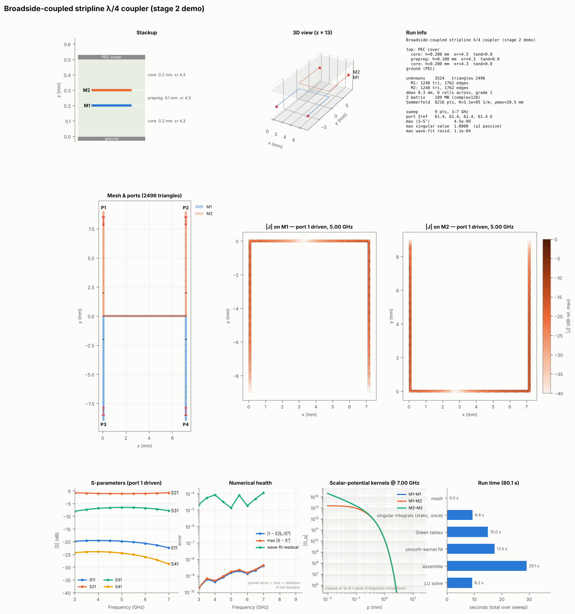

# mom25d — an open-source 2.5D Method-of-Moments solver for PCB structures

A planar (2.5D) full-wave MoM electromagnetic solver in Python (NumPy/SciPy, shapely, triangle),
aimed at signal-integrity and RF structures on multilayer boards: traces, couplers, via
transitions, planes, CPWG. Feed it a KiCad board (or Gerbers) with port footprints, get
Touchstone S-parameters and a diagnostic dashboard out.



## Quick start

```bash
pip install -r requirements.txt
python -m pytest tests -q                                   # ~2 min

# KiCad board -> S-parameters (example board generated by a script; no KiCad needed)
python examples/make_demo_board.py examples/demo_transition
python mom25d_cli.py examples/demo_transition.kicad_pcb --config examples/demo_transition.mom25d.toml
```

## KiCad workflow

1. **Ports.** Place a port footprint (e.g. `mom25d:RF_Port`, no copper) at the end of each
   feed, with a user text **`P1`, `P2`, …** on the Fab layer. The footprint position is the port
   location and its rotation is the direction *into* the circuit (0° = +x). Optional footprint
   fields:
   * `mom.port` = `wave` (default when a straight feed exists: de-embedded travelling-wave port,
     reference plane at the footprint), `via` (lumped port to the ground layer), `gap`
   * `mom.layer` = copper layer of the port (inner-layer striplines), `mom.z0`, `mom.ref` (mm shift)
2. **Pick-and-place** (`.pos` / `.csv`) lists the port components (Value or Reference `P<n>`, or a
   package containing "PORT"); it is required for the Gerber path.
3. **Stackup** is read from *Board Setup → Physical Stackup* (copper, dielectric thickness, εr,
   loss tangent, solder mask, dielectric sub-layers). Pick the copper layer that acts as the
   infinite ground (`--ground B.Cu`); other copper (planes, pours) is meshed metal. `--cover`
   turns a copper layer into a PEC cover for stripline-only models.
4. **Run** `mom25d_cli.py board.kicad_pcb --pos board-top.pos --nets RF,GND --ground B.Cu
   --fmin 0.5 --fmax 10`, or put the options in a TOML file (`--config`). Outputs: `.sNp`,
   `_dashboard.png`, `_summary.json`.
5. **Gerber fallback:** `mom25d_cli.py fab/board-job.gbrjob --pos board-top.pos ...` — the stackup
   comes from the KiCad job file; copper from RS-274X/X2; vias from Excellon (blind/buried spans
   from the X2 attribute). Gerbers have no nets: crop with `--region`.

Each wave port's reference impedance is computed automatically from its cross-section (trace plus
the metal covering it) and the result is renormalised to `--z0`.

## What's inside

| Module | Contents |
|---|---|
| `mom25d.py` | Stage 1: microstrip MPIE/RWG, analytic singular integrals, port extraction |
| `mom25d_ml.py` | Layer stacks (open / PEC cover), TL-network layered Green's functions, singular and nearest-image extraction, tensor mesher |
| `mom25d_geo.py` | Polygon mesher (constrained Delaunay, edge-graded rings, port lines, vias, regional refinement), `LinePort` |
| `mom25d_via.py` | Vertical-current kernels in layered media (via–strip, via–via) |
| `mom25d_sing.py` | Analytic off-plane 1/R integrals (thin layers, two-sheet conductors) |
| `mom25d_sim.py` | `Simulation`: polygons, vias, wave/gap/via ports, lumped R-L-C, metal loss, thick conductors, solvers |
| `mom25d_fast.py` | H-matrix (ACA) + GMRES, and the memory-lean `direct` solver |
| `mom25d_afs.py` | Adaptive frequency sweep (set-valued AAA rational fitting) |
| `mom25d_kicad.py`, `mom25d_gerber.py` | Board import → `BoardModel` → `Simulation` |
| `mom25d_viz.py` | Dashboard: stackup, 3D view, mesh/ports/vias, currents, S-params, numerical health, kernels, timing |
| `mom25d_cli.py` | Command-line runner |

**Formulation.** Mixed-potential integral equation with RWG basis functions; layered-media
kernels from a spectral transmission-line network (TE/TM), Sommerfeld integrals on a deformed
contour. Singular (1/ρ), near-singular cross-layer (1/√(ρ²+d²)) and nearest-image terms are
extracted and integrated analytically. Vias are thin wires with constant current per layer span
("chains"); their end charges are spread over the pad's vertex fan so they cancel the pad's own
charge exactly. Lumped elements are rank-one updates across a cut line or a via.

**Solvers.** `dense` (reference), `direct` (dense LU of the fast operator: centroid far field +
exact sparse near field; memory ≈ Z only), `aca` (H-matrix + GMRES, near-field LU
preconditioner; memory ~ N log N). `auto` picks by size.

## Validation (all in `tests/`)

| Check | Result |
|---|---|
| Layered Green's functions vs exact images (on/between interfaces) | ~1e-5 |
| Via kernels vs exact image solution (air, homogeneous dielectric) | ~1e-6 |
| Stripline Z0 vs Cohn / ε_eff | 0.6 % / 0.01 % |
| Broadside coupler vs coupled-line theory; power balance (lossless) | ~0.1 dB; 1 − 1e-9 |
| Series R / C in a line vs circuit theory | < 0.5 % |
| Via to ground vs Goldfarb–Pucel | +10 % (current crowding from the wide line, expected) |
| Two-sheet thick conductor vs 2D finite-thickness solver | 85–95 % of the thickness effect |
| Power plane cavity resonances vs cavity model (ACA + AFS, 17 solves) | within 0.7 % |
| Gerber round trip vs native KiCad import | copper identical to < 0.02 mm² |

## Limits and next steps

* Port de-embedding needs a straight feed of ≳ λ/8 at the lowest frequency; cuts must stay
  clear of discontinuities (the solver warns when the wave fit degrades).
* Thick conductors are an optional two-sheet model (≥ ~18 µm validated); default is zero thickness.
* Iterative (ACA) convergence slows near plane-pair resonances; `direct` is the robust choice up
  to ~15k unknowns on a 16–32 GB machine.
* Not yet: dielectric/copper roughness models, differential ports, KiCad custom-pad primitives
  beyond polygons/circles/lines, Calderón-type preconditioning.
