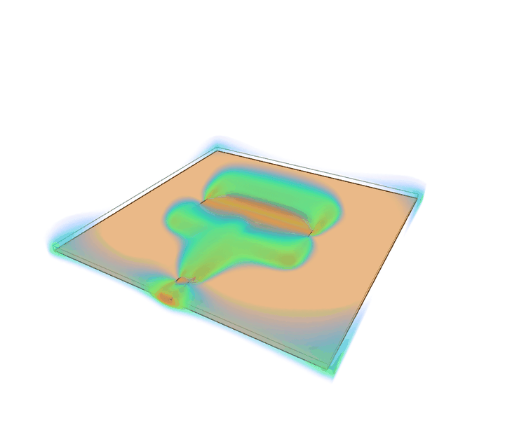
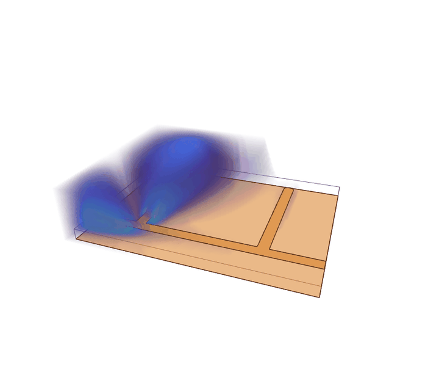
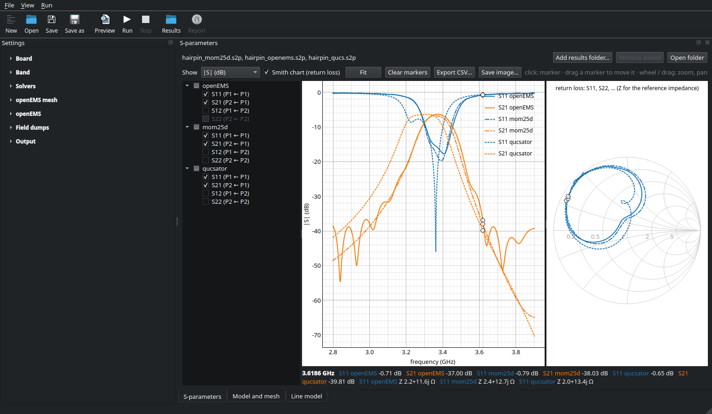
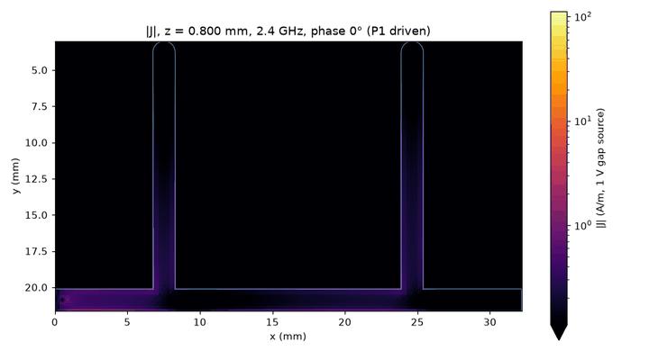
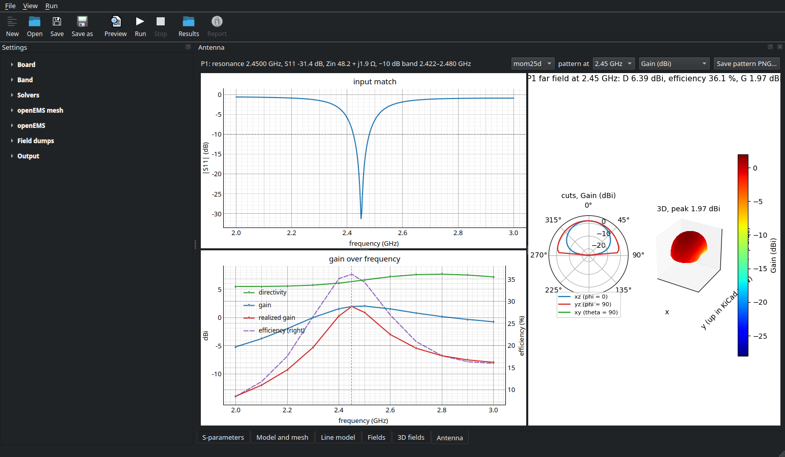
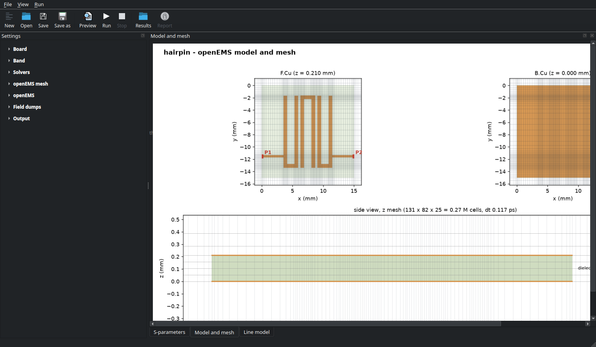
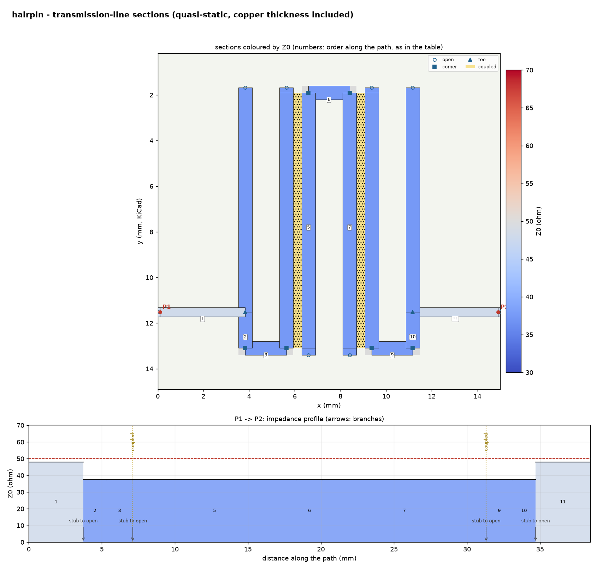

# kicad2ems

kicad2ems simulates KiCad boards. It reads the stackup, copper, vias and outline from a `.kicad_pcb`,
takes ports from marker footprints and R/L/C parts from the components, and solves the board with one or
more electromagnetic solvers. Each run writes Touchstone S-parameters, plots, a JSON summary and an HTML
report that compares the solvers.

| Solver | Name | Best for | Needs |
|---|---|---|---|
| [openEMS](https://openems.de) (3D FDTD) | `openems` | anything: planes, board edges, connectors, enclosures, antennas | openEMS |
| [mom25d](docs/mom.md) (2.5D method of moments) | `mom` | planar circuits over a ground plane: filters, couplers, matching networks, patch antennas | cuPy for GPU acceleration |
| [EMerge](docs/emerge.md) (3D FEM, experimental) | `emerge` | small closed or high-Q structures (a filter in a shielding can), a third full-wave check | EMerge (`setup.sh`: from git, patched for Python 3.14) |
| Transmission-line model | `lines` | a quick estimate: impedance steps, delays, layout mistakes | scikit-rf or qucsator |

By default kicad2ems picks the full-wave solver it expects to be fastest for your board and adds the
line model.

## Gallery

<p align="center">
  
  
</p>

*The E field of a 2.45 GHz patch antenna (openEMS, `--dump E@volume+12@2.45`) and of a stub notch filter at its
2.4 GHz notch, over one period: the GUI's 3D field view, translucent over the copper.*

<p align="center">
  
</p>

*A hairpin band-pass filter solved by openEMS (FDTD), mom25d (MoM) and the transmission-line model (qucsator),
overlaid in the GUI with a Smith chart of the return loss.*

<p align="center">
  
  
</p>

*Left: mom25d's surface current on the stub notch at 2.4 GHz (`--mom-dump 2.4 --dump-animate gif`): the
quarter-wave stub holds the standing wave and nothing passes it. Right: the patch in antenna mode: match, gain and
efficiency over frequency, polar cuts and the 3D pattern.*

<p align="center">
  
  
</p>

*The openEMS mesh preview (`--preview`) and the transmission-line sections the line model finds.*
`python tools/readme_media.py --openems-python <python with openEMS>` makes these again from the examples.

## Features

- **KiCad import** (KiCad 5 to 10): stackup, tracks, arcs, zones, graphics, pads, vias and outline.
  Gerber files work too.
- **Ports** from footprints with a Fab text `P1`, `P2`, …, including differential pairs (`P1+` / `P1-`)
  and gap ports for antennas.
- **Lumped parts** from two-pad R/L/C footprints.
- **Antenna mode**: gain, efficiency and radiation patterns.
- **Field dumps** of E, H or current density: images, animations, and a 3D view.
- **GUI** (`kicad2ems-gui`) for setup, preview, progress and results.
- **GPU acceleration** for mom25d (AMD ROCm or NVIDIA CUDA).
- **Solver plugins**: other solvers can be added as packages.

## Install

```bash
git clone https://github.com/lowprocess/kicad2ems.git && cd kicad2ems
./setup.sh
source .venv/bin/activate
```

`setup.sh` creates a virtual environment in `.venv/` and asks which optional parts you want: the GUI,
field dumps, the line model, the gmsh mesher, mom25d's compiled core, the CuPy package for your GPU, and
openEMS (build a local copy, use an existing one, or skip it). `./setup.sh --yes` takes the defaults.
Installing by hand is described in [Getting started](docs/getting-started.md).

openEMS is only needed for the FDTD solver. Everything else works without it. To see what your setup
can run:

```bash
kicad2ems --check
```

## Quick start

```bash
kicad2ems examples/filter.toml --preview            # model, mesh and line model only: seconds
kicad2ems examples/filter.toml --solvers mom,lines  # MoM and the line model: about a minute
kicad2ems examples/filter.toml --solvers all        # openEMS too, all three compared
```

Results go to `examples/out/`: `filter_<solver>.s2p` for each solver, plots, `filter_run.json` and
`filter_report.html`. To simulate your own board, see
[Getting started](docs/getting-started.md#your-own-board).

## Documentation

Start with [Getting started](docs/getting-started.md), then [Usage](docs/usage.md). The
[documentation index](docs/index.md) lists every page.

## License

GPL-3.0-or-later (see [LICENSE](LICENSE)). kicad2ems uses openEMS (GPL-3.0-or-later) and CSXCAD
(LGPL-3.0-or-later) as Python packages and runs qucsator (GPL-2.0-or-later) as a separate program. No
third-party code is copied into the repository.
