# kicad2ems

kicad2ems simulates KiCad boards. It reads the stackup, copper, vias and outline from a `.kicad_pcb`,
takes ports from marker footprints and R/L/C parts from the components, and solves the board with one or
more electromagnetic solvers. Each run writes Touchstone S-parameters, plots, a JSON summary and an HTML
report that compares the solvers.

Everything is in this repository and installs as one package, `kicad2ems` (until 0.4 the parts were packages of
their own, each in its repository; their histories are merged here):

| Part | What it is | Code | Docs |
|---|---|---|---|
| core | the board model, the line model, the settings, the runs and the results | `kicad2ems.core` | [docs](docs/index.md) |
| gui | the window: settings, runs, plots, fields, antennas, the Filter page (the `gui` extra) | `kicad2ems.gui` | [docs/gui](docs/gui/README.md) |
| ipc | the KiCad plugin: the impedance map, and simulations set up from the PCB editor | `kicad2ems.ipc` | [docs/ipc](docs/ipc/README.md) |
| fdtd | the FDTD solvers, openEMS and gfdtd, on one shared FDTD model | `kicad2ems.fdtd` | [docs/fdtd](docs/fdtd/README.md) |
| mom25d | the 2.5D Method-of-Moments solver | `kicad2ems.mom25d` | [docs/mom25d](docs/mom25d/README.md) |
| pcbqs | DC/PDN, quasistatic fields, low-frequency S-parameters, ngspice circuits and temperature | `kicad2ems.pcbqs` | [docs/pcbqs](docs/pcbqs/README.md) |
| gfdtd | a 3D FDTD engine for the GPU or the CPU (fdtd runs it) | `kicad2ems.gfdtd` | [docs/gfdtd](docs/gfdtd/README.md) |
| fem | Palace and Elmer behind kicad2ems: a second opinion (the `fem` extra) | `kicad2ems.fem` | [docs/fem](docs/fem/README.md) |
| dfsynth | distributed filter synthesis (the GUI's Filter page) | `kicad2ems.dfsynth` | [docs/dfsynth](docs/dfsynth/README.md) |
| emsdev | the machine: GPUs, CPU threads, memory, the compilers the cores build with | `kicad2ems.emsdev` | [docs/emsdev](docs/emsdev/README.md) |

| Solver | Name | Best for | Needs |
|---|---|---|---|
| [openEMS](https://openems.de) (3D FDTD) | `openems` | anything: planes, board edges, connectors, enclosures, antennas | openEMS (not on PyPI: your distribution's, or `tools/build_openems.sh`) |
| [mom25d](docs/mom.md) (2.5D method of moments) | `mom` | planar circuits over a ground plane: filters, couplers, matching networks, patch antennas | its compiled core (the mesher); a GPU optional |
| [gfdtd](docs/gfdtd.md) (3D FDTD on the GPU) | `gfdtd` | openEMS's model, 8–20x faster on a GPU, ~2x on the CPU, without conductor loss | a GPU, or its compiled CPU core |
| Transmission-line model | `lines` | a quick estimate: impedance steps, delays, layout mistakes | scikit-rf or qucsator |
| [pcbqs](docs/pcbqs/sparams.md) (quasi-static) | `pcbqs` | the low end, DC to about a tenth of a wavelength: copper resistance, loop inductance, where the return current goes | its compiled core (the mesher); run only when named |

By default kicad2ems picks the full-wave solver it expects to be fastest for your board and adds the
line model ([which solver](docs/usage.md#which)).

## Gallery

<p align="center">
  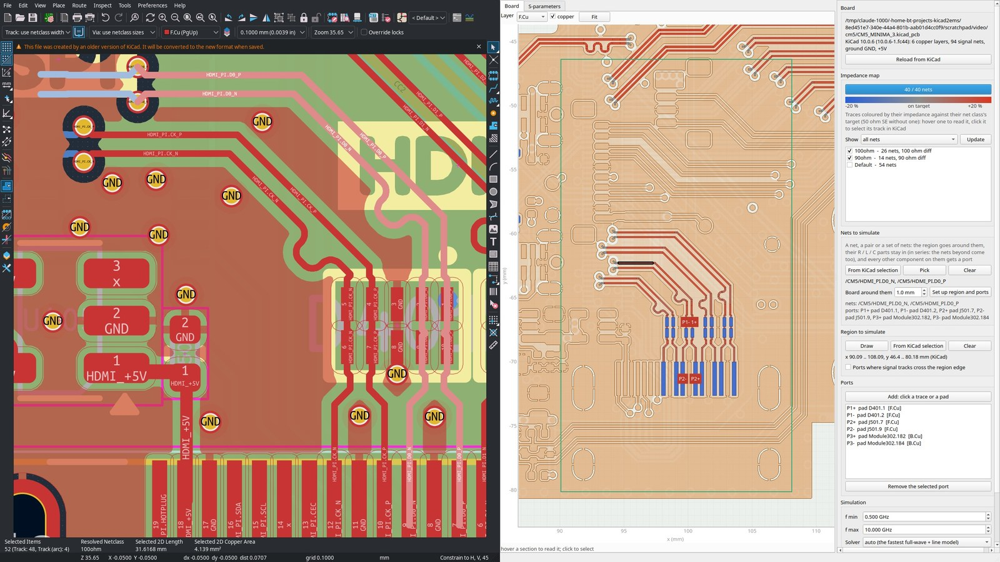
</p>

*The KiCad plugin beside KiCad 10's PCB editor with its CM5 Minima demo board: the HDMI D0 pair selected in KiCad,
and the region and ports the plugin set up around it.*

<p align="center">
  
  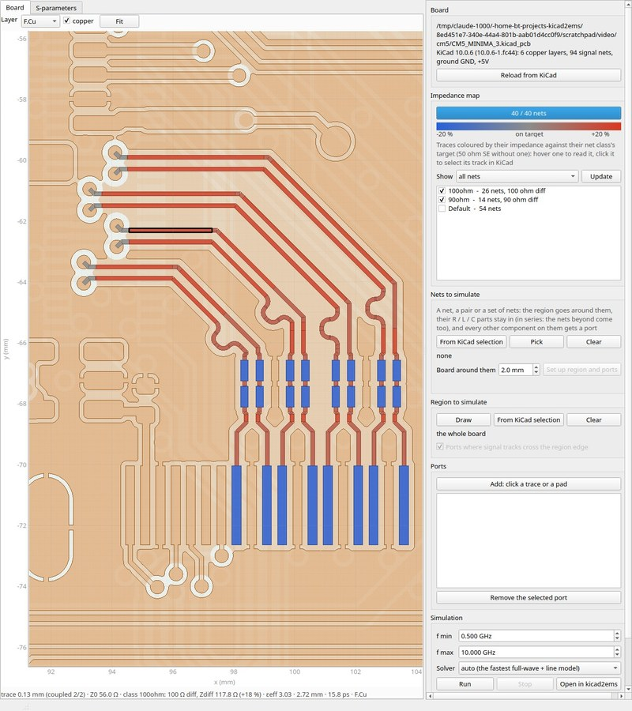
  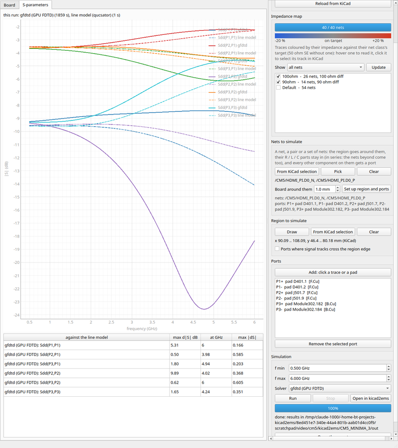
</p>

*The impedance map of the board's 94 signal nets filling in; the HDMI pairs against their 100 ohm class, a section
read out at the bottom; the D0 pair's mixed-mode S-parameters from gfdtd (solid) and the line model (dashed).*

<p align="center">
  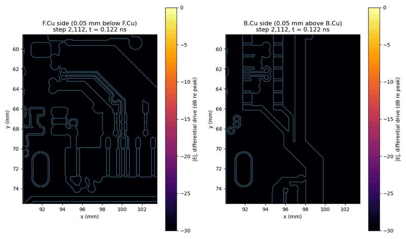
</p>

*The same pair driven differentially from the module: its E field just inside the F.Cu and B.Cu dielectrics,
in dB re the peak (30 dB range), from gfdtd's field dumps of the two legs' runs.*

<p align="center">
  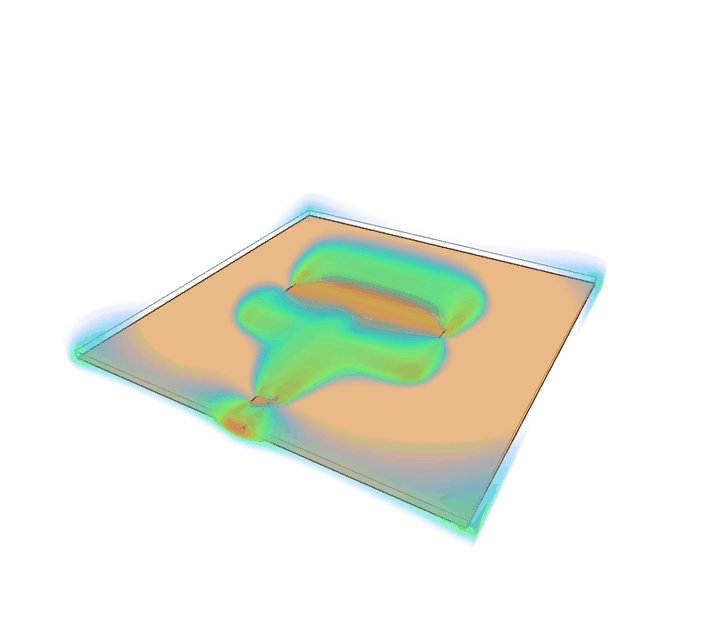
  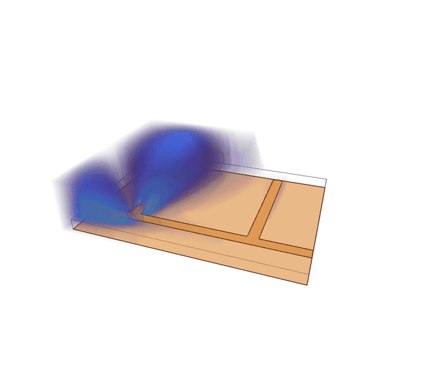
</p>

*The E field of a 2.45 GHz patch antenna (`--dump E@volume+12@2.45`) and of a stub notch filter at its 2.4 GHz
notch, over one period: the GUI's 3D field view, translucent over the copper.*

<p align="center">
  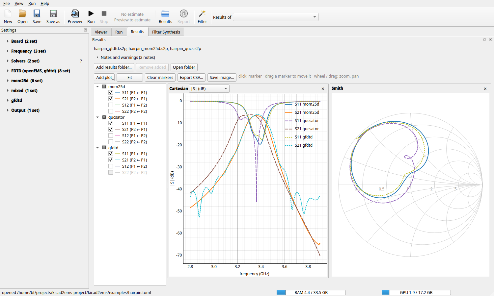
</p>

*A hairpin band-pass filter solved by gfdtd (FDTD), mom25d (MoM) and the line model (qucsator), overlaid in the GUI
with a Smith chart.*

<p align="center">
  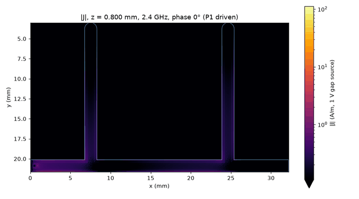
  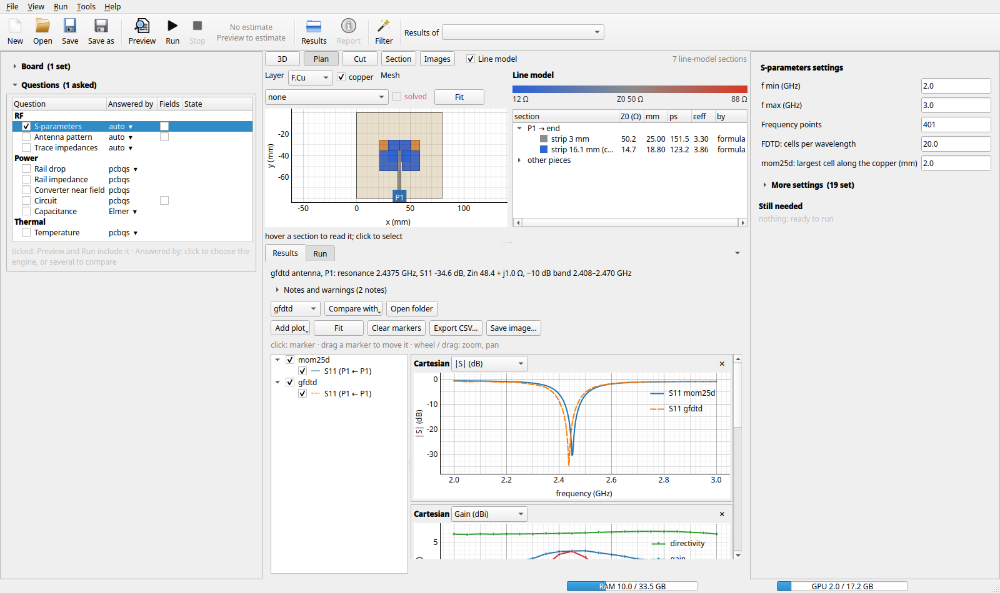
</p>

*Left: mom25d's surface current on the stub notch at 2.4 GHz (`--mom-dump 2.4 --dump-animate gif`): the
quarter-wave stub holds the standing wave and nothing passes it. Right: the patch in antenna mode: match, gain and
efficiency over frequency, polar cuts.*

<p align="center">
  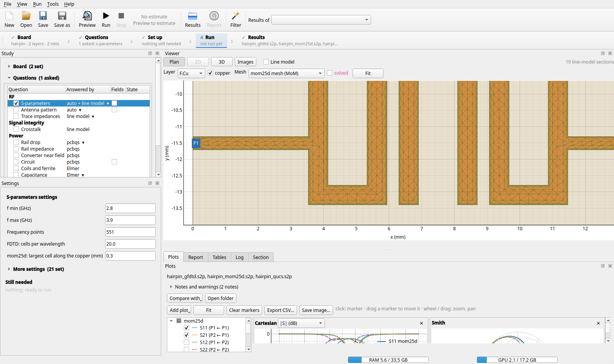
  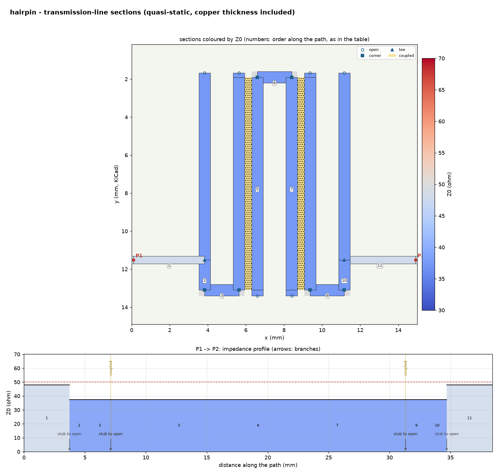
</p>

*The hairpin's mom25d mesh in the Viewer's plan (rings of thin cells along the copper's edges), and the line
sections the line model finds. kicad2ems-gui's `tools/readme_media.py` makes these pictures again from the
examples; the plugin's were recorded from KiCad 10, driven by a script.*

## Features

- **KiCad import** (KiCad 5 to 10): stackup, tracks, arcs, zones, graphics, pads, vias and outline.
  Gerber files work too.
- **Ports** from footprints with a Fab text `P1`, `P2`, …, including differential pairs (`P1+` / `P1-`)
  and gap ports for antennas.
- **Lumped parts** from two-pad R/L/C footprints.
- **Antenna mode**: gain, efficiency and radiation patterns; phased arrays steered after the run.
- **Field dumps** of E, H or current density: images, animations, and a 3D view.
- **GUI** (`kicad2ems-gui`) for setup, preview, progress and results.
- **KiCad plugin** (KiCad 9+, IPC API): the open board's trace impedances in the PCB editor, and a region with
  ports to simulate ([KiCad plugin](docs/kicad-plugin.md)).
- **GPU acceleration** for gfdtd and mom25d: GPUs through Vulkan (run on AMD and NVIDIA cards); mom25d also through CuPy on CUDA or ROCm.
- **One interface for every solver** (`kicad2ems.core.solvers.Solver`): another
  solver is a `Solver` class listed in `kicad2ems.core.solvers.SOLVERS`.

## Install

Linux and macOS:

```bash
git clone https://github.com/lowprocess/kicad2ems.git && cd kicad2ems
./setup.sh
source .venv/bin/activate
```

Windows (Python 3.10 or newer from python.org, and Git):

```bat
git clone https://github.com/lowprocess/kicad2ems.git && cd kicad2ems
py install.py
.venv\Scripts\activate
```

The installer (`install.py`; `./setup.sh` runs it) asks where to install (a venv in this checkout by default, or
for your user, system-wide, or into the Python itself) and which optional parts you want: the GUI, the solvers and
their compiled cores, a GPU package, openEMS, qucsator, the finite-element tools with Elmer and Palace (one you
have, or built: Palace with Spack, never by default) and a launcher entry. `--yes` takes the defaults.
[Getting started](docs/getting-started.md) has the options and installing by hand. Without any full-wave solver,
kicad2ems runs the line model alone; `kicad2ems --check` shows what your setup can run.

## Quick start

```bash
kicad2ems examples/rf_interdig.toml --preview            # model, mesh and line model only: seconds
kicad2ems examples/rf_interdig.toml --solvers mom,lines  # MoM and the line model: about a minute
kicad2ems examples/rf_interdig.toml --solvers all        # every solver, compared
```

Results go to `examples/out/`: `rf_interdig_<solver>.s2p` for each solver, plots, `rf_interdig_run.json` and
`rf_interdig_report.html`. To simulate your own board, see
[Getting started](docs/getting-started.md#your-own-board).

## Documentation

Start with [Getting started](docs/getting-started.md), then [Usage](docs/usage.md). The
[documentation index](docs/index.md) lists every page.

## License

GPL-3.0-or-later (see [LICENSE](LICENSE)). kicad2ems uses openEMS (GPL-3.0-or-later) and CSXCAD
(LGPL-3.0-or-later) as Python packages and runs qucsator (GPL-2.0-or-later), ngspice (BSD-style), Elmer
(GPL-2.0-or-later) and Palace (Apache-2.0) as separate programs.

No third-party code is copied into the repository: the constrained Delaunay triangulation that mom25d's and
pcbqs's compiled cores mesh with is kicad2ems's own (`src/kicad2ems/emsdev/native/mesh2d.hpp`), like the rest
GPL-3.0-or-later.
