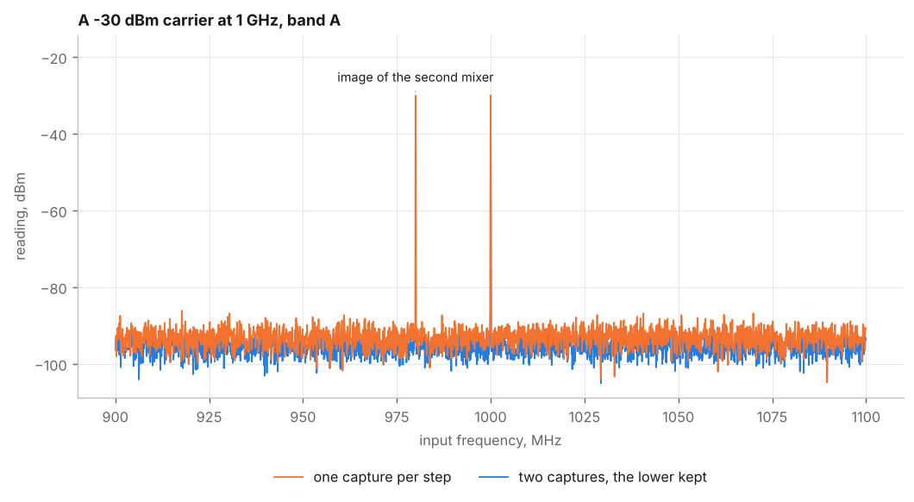
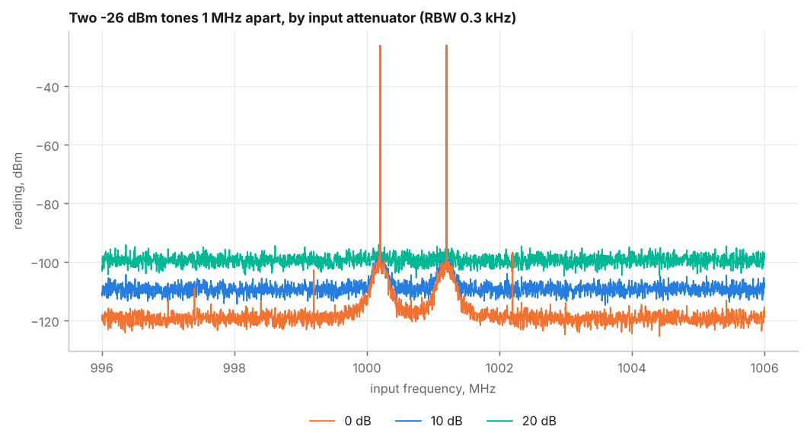
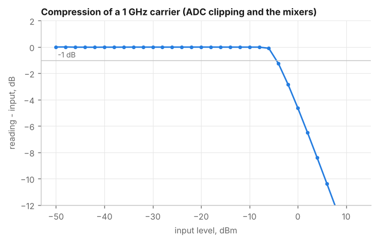
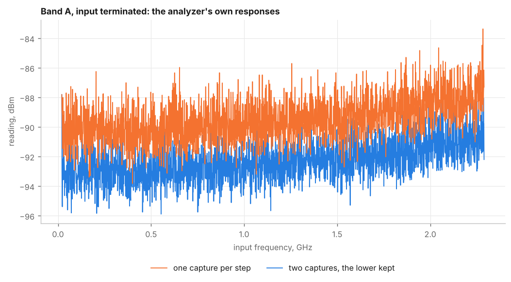
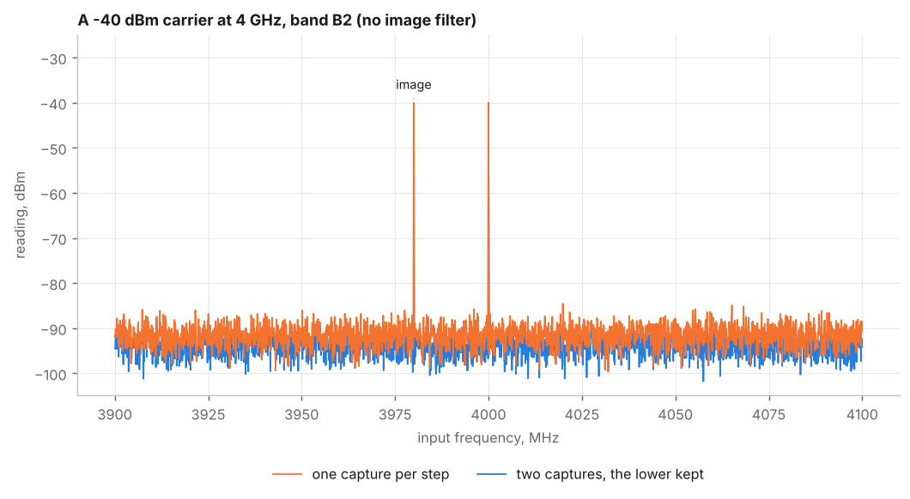

# Spectrum analyzer simulation

LO1 LMX2582, LO2 LMX2582, two SIM-83+, 40 MSPS ADC12040, 4096-point captures.

## Budget

Input attenuator 10 dB, IF attenuator 6 dB, preamp off. The first IF is 3.210 GHz (this filter's centre); band A ends at 2.29 GHz.

| f, GHz | band | gain to ADC, dB | NF (Friis), dB | NF (effective), dB | noise floor, dBm/Hz | IIP3, dBm | P1dB in, dBm | ADC full scale, dBm | SFDR, dB (1 Hz) |
|---|---|---|---|---|---|---|---|---|---|
| 0.10 | A | 22.9 | 30.5 | 33.9 | -140.1 | +18.6 | -3.3 | -6.9 | 106 |
| 0.50 | A | 22.7 | 30.7 | 34.0 | -140.0 | +18.8 | -3.1 | -6.7 | 106 |
| 1.00 | A | 22.3 | 31.1 | 34.4 | -139.6 | +19.1 | -2.7 | -6.3 | 106 |
| 1.50 | A | 22.0 | 31.5 | 34.8 | -139.2 | +19.5 | -2.4 | -6.0 | 106 |
| 2.00 | A | 21.1 | 32.3 | 35.6 | -138.4 | +20.4 | -1.5 | -5.1 | 106 |
| 2.29 | A | 20.2 | 33.3 | 36.6 | -137.4 | +21.3 | -0.6 | -4.2 | 106 |
| 2.50 | B1 | 14.8 | 31.1 | 34.8 | -139.2 | +27.1 | +4.8 | +1.2 | 111 |
| 3.00 | B1 | 14.5 | 31.4 | 35.1 | -138.9 | +27.4 | +5.1 | +1.5 | 111 |
| 3.40 | B1 | 14.1 | 31.8 | 35.5 | -138.5 | +27.9 | +5.5 | +1.9 | 111 |
| 4.00 | B2 | 14.0 | 31.8 | 35.5 | -138.5 | +27.9 | +5.6 | +2.0 | 111 |
| 5.00 | B2 | 13.2 | 32.7 | 36.4 | -137.6 | +28.7 | +6.4 | +2.8 | 111 |
| 5.49 | B2 | 11.4 | 34.4 | 38.2 | -135.8 | +30.5 | +8.2 | +4.6 | 111 |

With the input attenuator at 0 dB (the most sensitive setting), without and with the preamps (a TRF37D73 in band A, a PMA3-83LN+ in band B, each after its band's first filter):

| f, GHz | band | preamp | NF (effective), dB | noise floor, dBm/Hz | IIP3, dBm | ADC full scale, dBm | SFDR, dB (1 Hz) |
|---|---|---|---|---|---|---|---|
| 0.1 | A | off | 23.9 | -150.1 | +8.6 | -16.9 | 106 |
| 0.1 | A | on | 10.4 | -163.6 | -13.5 | -38.9 | 100 |
| 1.0 | A | off | 24.4 | -149.6 | +9.1 | -16.3 | 106 |
| 1.0 | A | on | 11.0 | -163.0 | -11.9 | -37.4 | 101 |
| 2.0 | A | on | 12.5 | -161.5 | -9.2 | -34.6 | 102 |
| 2.5 | B1 | off | 24.8 | -149.2 | +17.1 | -8.8 | 111 |
| 2.5 | B1 | on | 10.4 | -163.6 | -4.0 | -29.9 | 106 |
| 4.0 | B2 | off | 25.5 | -148.5 | +17.9 | -8.0 | 111 |
| 4.0 | B2 | on | 11.2 | -162.8 | -2.9 | -28.8 | 107 |
| 5.4 | B2 | on | 13.1 | -160.9 | -0.9 | -26.7 | 107 |

The effective noise figure is what the noise pass finds: it has the second mixer's image, the LOs' noise and the ADC's, which the Friis column leaves out. SFDR is 2/3 (IIP3 - noise floor) in 1 Hz; take 2/3 of 10 log(RBW) off for a wider one.

### Stage by stage at 1.0 GHz (band A)

| stage | at, MHz | gain, dB | NF, dB | IIP3, dBm | gain so far | NF so far | IIP3 so far |
|---|---|---|---|---|---|---|---|
| DC block + limiter | 1000.0 | -0.3 | 0.3 | - | -0.3 | 0.3 | +300.0 |
| input PE43711 (10 dB) | 1000.0 | -11.4 | 11.4 | +57 | -11.7 | 11.7 | +57.3 |
| SW1 (band select) | 1000.0 | -0.7 | 0.7 | +58 | -12.5 | 12.5 | +57.1 |
| LFCN-2250+ | 1000.0 | -0.4 | 0.4 | - | -12.9 | 12.9 | +57.1 |
| LFCN-2250+ | 1000.0 | -0.4 | 0.4 | - | -13.3 | 13.3 | +57.1 |
| band A preamp switch (in) | 1000.0 | -0.7 | 0.7 | +58 | -14.0 | 14.0 | +56.9 |
| band A preamp switch (out) | 1000.0 | -0.7 | 0.7 | +58 | -14.7 | 14.7 | +56.8 |
| 3 dB pad (mixer 1 IF port) | 1000.0 | -3.0 | 3.0 | - | -17.7 | 17.7 | +56.8 |
| SIM-83+ (LO1, up) | 1000.0 | -6.0 | 6.0 | +12 | -23.7 | 23.7 | +29.7 |
| 3 dB pad (mixer 1 RF port) | 3210.0 | -3.0 | 3.0 | - | -26.7 | 26.7 | +29.7 |
| IF1 band-pass (hairpin N=5) | 3210.0 | -2.1 | 2.1 | - | -28.9 | 28.9 | +29.7 |
| IF1 amp PMA3-83LN+ | 3210.0 | +20.9 | 1.5 | +14 | -7.9 | 30.3 | +29.5 |
| IF1 low-pass (radial stub N=7) | 3210.0 | -0.2 | 0.2 | - | -8.1 | 30.3 | +29.5 |
| SW2 (mixer 2 select) | 3210.0 | -0.8 | 0.8 | +58 | -8.9 | 30.3 | +29.5 |
| SIM-83+ (LO2, down) | 3210.0 | -6.0 | 6.0 | +12 | -14.9 | 30.4 | +20.3 |
| IF2 diplexer (LP arm, 30 MHz) | 10.0 | -0.3 | 0.3 | - | -15.2 | 30.4 | +20.3 |
| LMH6629 #1 | 10.0 | +19.9 | 8.0 | +26 | +4.8 | 31.1 | +20.3 |
| IF PE43711 (6 dB) | 10.0 | -7.3 | 7.3 | +57 | -2.5 | 31.1 | +20.3 |
| anti-alias LPF (elliptic N=7, 16.5 MHz) | 10.0 | -1.1 | 1.1 | - | -3.6 | 31.1 | +20.3 |
| LMH6629 #2 | 10.0 | +19.9 | 8.0 | +26 | +16.3 | 31.1 | +19.8 |
| THS4541 ADC driver | 10.0 | +6.0 | 20.0 | +44 | +22.3 | 31.1 | +19.1 |

### Stage by stage at 4.0 GHz (band B2)

| stage | at, MHz | gain, dB | NF, dB | IIP3, dBm | gain so far | NF so far | IIP3 so far |
|---|---|---|---|---|---|---|---|
| DC block + limiter | 4000.0 | -0.3 | 0.3 | - | -0.3 | 0.3 | +300.0 |
| input PE43711 (10 dB) | 4000.0 | -12.1 | 12.1 | +57 | -12.4 | 12.4 | +57.3 |
| SW1 (band select) | 4000.0 | -0.9 | 0.9 | +58 | -13.3 | 13.3 | +57.1 |
| band B2 preselector (stub N=5) | 4000.0 | -0.3 | 0.3 | - | -13.6 | 13.6 | +57.1 |
| band B2 low-pass (radial stub N=7) | 4000.0 | -0.1 | 0.1 | - | -13.7 | 13.7 | +57.1 |
| SW3 (B1/B2) | 4000.0 | -0.9 | 0.9 | +58 | -14.6 | 14.6 | +56.9 |
| band B preamp switch (in) | 4000.0 | -0.9 | 0.9 | +58 | -15.5 | 15.5 | +56.8 |
| band B preamp switch (out) | 4000.0 | -0.9 | 0.9 | +58 | -16.3 | 16.3 | +56.7 |
| SW2 (mixer 2 select) | 4000.0 | -0.9 | 0.9 | +58 | -17.2 | 17.2 | +56.7 |
| SIM-83+ (LO2, down) | 4000.0 | -6.0 | 6.0 | +12 | -23.2 | 23.2 | +29.2 |
| IF2 diplexer (LP arm, 30 MHz) | 10.0 | -0.3 | 0.3 | - | -23.5 | 23.5 | +29.2 |
| LMH6629 #1 | 10.0 | +19.9 | 8.0 | +26 | -3.6 | 31.5 | +29.1 |
| IF PE43711 (6 dB) | 10.0 | -7.3 | 7.3 | +57 | -10.9 | 31.5 | +29.1 |
| anti-alias LPF (elliptic N=7, 16.5 MHz) | 10.0 | -1.1 | 1.1 | - | -11.9 | 31.5 | +29.1 |
| LMH6629 #2 | 10.0 | +19.9 | 8.0 | +26 | +8.0 | 31.8 | +28.6 |
| THS4541 ADC driver | 10.0 | +6.0 | 20.0 | +44 | +14.0 | 31.8 | +27.9 |

## A carrier at 1 GHz, -30 dBm

| reading, dBm (RBW 19.6 kHz) | one capture per step | two captures, the lower kept |
|---|---|---|
| carrier | -30.0 | -30.0 |
| image, 20 MHz below | -30.0 | -90.2 |
| noise floor (median) | -98.1 | -101.2 |
| skirt at +100 kHz (mean) | -92.0 | -97.1 |
| skirt at +300 kHz (mean) | -98.7 | -99.4 |

At 100 kHz the two LOs' phase noise is -110.7 and -113.1 dBc/Hz (LMX2582 datasheet profile at 4.21 and 3.20 GHz), which in this RBW is -65.8 dBc: the skirt above.

The lower of two readings of noise is 3 dB under either: with two captures the floor, and any noise-like signal, reads 3 dB low.

Close in (a 262144-sample capture, RBW 306 Hz), the reading follows the two LOs' datasheet profiles until the analyzer's noise floor takes over:

## Two tones, 1 MHz apart, -26 dBm each

| input attenuator, dB | tone reads, dBm | IM3 reads, dBm | IM3, dBc | from the budget's IIP3, dBc | each tone at the ADC, dBFS | floor, dBm |
|---|---|---|---|---|---|---|
| 0 | -26.2 | -96.7 | -70.5 | -70.3 | -9.7 | -125.1 |
| 10 | -26.2 | -106.2 | -80.0 | -90.3 | -19.7 | -115.8 |
| 20 | -26.2 | -96.5 | -70.3 | -110.3 | -29.7 | -106.1 |

With no attenuation the product is the chain's (the two mixers, mostly), within 2 dB of the budget, whose cascade adds every stage's product in phase. Each 10 dB of attenuation should take it down 20 dB; what is left when it does not is the ADC's own INL, which stays near -100 dBFS whatever the level.

## Reading against input level (1 GHz, attenuator 10 dB)

The ADC's full scale is -6.3 dBm at the input (budget); the first clipped sample appears at -6 dBm, and the reading is 1 dB low from -4 dBm. The first stage to compress (the budget's cascade) does so at -2.7 dBm at the input.

## A 0 dBm signal on the first IF (3.21 GHz), seen from band A

With one capture per step it reads up to -82.0 dBm (82 dB under the signal), at every tuning: here at 698.70 MHz, made by `1LO2-1[1x[IF1 signal] through SIM-83+]`. With two captures, -89.7 dBm. The rejection is the two LFCN-2250+ (their datasheet limit, 30 dB each at this frequency), the mixer's own isolation, and the leak around the band switches.

## Band A with nothing connected

Noise floor -97.8 dBm (median). Responses 15 dB or more over their step's floor:

none.

## Band B: a carrier at 4 GHz, and a bursting 18 MHz wide signal at 2.442 GHz

| reading, dBm | one capture per step | two captures, the lower kept |
|---|---|---|
| carrier, 4 GHz | -40.0 | -40.0 |
| image, 20 MHz below | -40.0 | -90.0 |
| noise floor | -96.5 | -99.4 |

A noise-like signal 18 MHz wide, -40 dBm in total, is -69.6 dBm in this RBW. Steady, and then on for 35 % of the captures (each capture is 0.1 ms), max hold over eight sweeps:

|  | steady: reads, dBm | bursting: reads (median), dBm | bursting: share of its band shown | 20 MHz below: reads, dBm |
|---|---|---|---|---|
| one capture per step | -69.0 | -68.0 | 100 % | -70.6 |
| two captures, the lower kept | -72.4 | -91.1 | 32 % | -93.8 |

One capture per step shows the signal and its image side by side. Keeping the lower of two captures removes the image, but a step shows a bursting signal only when both of its captures caught it: the signal is shown in pieces, and low.

## 10 MHz to 5.49 GHz

| signal, MHz | level, dBm | reads, dBm |
|---|---|---|
| 100.3 | -35.0 | -35.2 |
| 915.2 | -25.0 | -25.0 |
| 1575.4 | -60.0 | -59.9 |
| 2440.1 | -30.0 | -30.2 |
| 5200.3 | -45.0 | -45.2 |

Readings 15 dB or more over the local floor that are not the five signals: 5 with one capture per step, 0 with two.

| at, MHz | one capture, dBm | two captures, dBm | made by |
|---|---|---|---|
| 904.80 | -25.0 | -90.8 | `1LO2-1[1LO1-1[915.2 MHz]]` |
| 2419.90 | -30.2 | -90.6 | `1LO2-1[2440.1 MHz]` |
| 79.70 | -35.2 | -98.8 | `1LO2-1[1LO1-1[100.3 MHz]]` |
| 5179.70 | -45.2 | -88.9 | `1LO2-1[5200.3 MHz]` |
| 1564.60 | -59.8 | -95.8 | `1LO2-1[1LO1-1[1575.4 MHz]]` |

1647 captures of 4096 samples, 23 s of simulation.

## One strong signal: 0 dBm at 915.2 MHz, attenuator 20 dB

The mixer sees -25 dBm. The signal reads -0.0 dBm. Other readings 15 dB or more over the local floor: 4 with one capture per step, 1 with two.

| at, MHz | one capture, dBm | made by | two captures, dBm | and in the second capture by |
|---|---|---|---|---|
| 904.80 | -0.0 | `1LO2-1[1LO1-1[915.2 MHz]]` | -72.8 | `alias of [1LO2-1[1LO1-1[915.2 MHz]]] at an IF of 25.2 MHz, through the anti-alias filter` |
| 899.60 | -66.8 | harmonic 2 of [1LO2-1[1LO1-1[915.2 MHz]]] in the IF amplifiers and ADC | -86.4 |  |
| 919.60 | -68.0 | harmonic 2 of [1LO2-1[1LO1-1[915.2 MHz]]] in the IF amplifiers and ADC | -84.3 |  |
| 885.07 | -72.1 | the skirt of `1LO2-1[1LO1-1[915.2 MHz]]` | -81.6 |  |

`1LO2-1[1LO1-1[x]]` is the plain conversion of x: where it is not at x it is the second mixer's image. What survives two captures does so because the IF is a quarter of the sampling rate: the image in the first capture and the alias (the signal at an IF of 25 MHz, folded) in the second land on the same frequency, so the image rejection is no better than the anti-alias filter's stop band.

## Where each part's numbers come from

| part | source |
|---|---|
| DC block + limiter | assumed 0.3 dB (no part chosen) |
| input PE43711 (10 dB) | pSemi datasheet DOC-84940 table 3 (typical insertion loss by band; past 6 GHz assumed) |
| SW1 (band select) | pSemi PE42540 datasheet (typical insertion loss; past 8 GHz assumed) |
| LFCN-2250+ | datasheet specification points (LFCN-2250D+ table, read from a search result); past 5 GHz assumed |
| band A preamp switch (in) | pSemi PE42540 datasheet (typical insertion loss; past 8 GHz assumed) |
| band A preamp switch (out) | pSemi PE42540 datasheet (typical insertion loss; past 8 GHz assumed) |
| 3 dB pad (mixer 1 IF port) | resistive pad (exact) |
| SIM-83+ | datasheet typ. (CL, isolations, IP3, via search results); spur table, port roll-off and P1dB assumed |
| 3 dB pad (mixer 1 RF port) | resistive pad (exact) |
| IF1 band-pass (hairpin N=5) | EM simulation (kicad2ems mom25d) of dfsynth's layout: data/if1_bpf_3g2_hairpin.s2p, 3.2 GHz, 180 MHz, RO4003C 0.508 mm |
| IF1 amp PMA3-83LN+ | datasheet figures at 2 GHz (via search results); frequency slopes assumed |
| IF1 low-pass (radial stub N=7) | EM simulation (kicad2ems mom25d) of dfsynth's layout: data/if1_lpf_4g0_radial.s2p, 4.0 GHz, RO4003C 0.508 mm |
| SW2 (mixer 2 select) | pSemi PE42540 datasheet (typical insertion loss; past 8 GHz assumed) |
| SW1 (off path) | pSemi PE42540 datasheet (typical RFC-RFx isolation; past 8 GHz assumed) |
| band B2 preselector (stub N=5) | EM simulation (kicad2ems mom25d) of dfsynth's layout: data/b2_bpf_3g4_5g5_stub.s2p, 3.4-5.5 GHz, RO4003C 0.508 mm |
| band B2 low-pass (radial stub N=7) | EM simulation (kicad2ems mom25d) of dfsynth's layout: data/b2_lpf_6g4_radial.s2p, 6.4 GHz, RO4003C 0.508 mm |
| SW3 (B1/B2) | pSemi PE42540 datasheet (typical insertion loss; past 8 GHz assumed) |
| band B preamp switch (in) | pSemi PE42540 datasheet (typical insertion loss; past 8 GHz assumed) |
| band B preamp (unpowered) | assumed 20 dB through an unpowered LNA |
| band B preamp switch (out) | pSemi PE42540 datasheet (typical insertion loss; past 8 GHz assumed) |
| SW2 (off path) | pSemi PE42540 datasheet (typical RFC-RFx isolation; past 8 GHz assumed) |
| band B1 preselector (stub N=5) | EM simulation (kicad2ems mom25d) of dfsynth's layout: data/b1_bpf_2g3_3g5_stub.s2p, 2.3-3.5 GHz, RO4003C 0.508 mm |
| IF2 diplexer (LP arm, 30 MHz) | ideal 3rd-order Butterworth, 0.3 dB loss assumed |
| LMH6629 #1 | TI datasheet SNOSB18 (NF, HD2 and HD3 at 10 MHz, swing); bandwidth at Av=10 assumed |
| IF PE43711 (6 dB) | pSemi datasheet DOC-84940 table 3 (typical insertion loss by band; past 6 GHz assumed) |
| anti-alias LPF (elliptic N=7, 16.5 MHz) | ideal elliptic prototype, 1 dB loss assumed |
| LMH6629 #2 | TI datasheet SNOSB18 (NF, HD2 and HD3 at 10 MHz, swing); bandwidth at Av=10 assumed |
| THS4541 ADC driver | TI datasheet SLOS375 (HD2, HD3 at 10 MHz); noise figure estimated |
| LMX2582 | TI datasheet SNAS680E table 6.5 (VCO and PLL noise, output power, harmonics, PFD spur); loop bandwidth chosen |
| ADC12040 | TI datasheet SNAS122 (SNR, THD, INL, DNL, jitter); INL shape synthetic |

