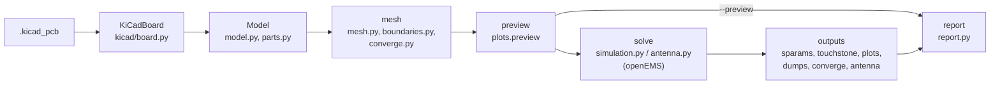

# 3. Architecture

[← Usage](usage.md) · [Index](index.md) · [Next: KiCad import →](kicad-import.md)

## The run pipeline

`kicad2openems` (`cli.main`) parses the command line, applies the TOML config (`config.apply_toml`) and
hands the options to `pipeline.Job`, which runs the stages in order:



| Stage | `Job` method | Produces |
|---|---|---|
| model | `model()` | `self.board` (`KiCadBoard`), `self.m` (`Model`) |
| mesh | `mesh()` | `self.bc` (6 boundary names), `self.grid` (mesh dict), `self.levels` (`--converge`) |
| preview | `preview()` | `<name>_mesh.png`, `self.pulse` (excitation length) |
| solve | `solve()` | `self.result` (`RunResult`), `self.ant` (antenna results), `self.coarse` (coarser levels) |
| outputs | `outputs()` | Touchstone, plots, JSON, `self.Smm` / `self.names` (mixed-mode S), `self.info` |
| report | `report()` | `<name>_report.html` |

All messages go through `Job.log`, which prints them and keeps them (`Job.messages`); lines containing
`WARNING` become the report's warning list. `Job.wrote(label, path)` records output files for the report.
Lower-level functions take a `log` callable (default `print`) so they can be used without a `Job`.

## Module map

```
kicad2openems/
  cli.py          argument parser, main(): config, then Job(args).run()
  config.py       TOML -> args; paths relative to the config file
  pipeline.py     Job: the stages above
  kicad/          .kicad_pcb reading (no geometry decisions here)
    sexpr.py        S-expression parser and accessors
    shapes.py       arcs, rotation, pad outlines (incl. custom pads)
    board.py        KiCadBoard: stackup, copper items, vias, footprints, port footprints
    nets.py         net-name matching, DiffLegs (differential port legs)
    pnp.py          pick-and-place files
    outline.py      board outline from Edge.Cuts
  geometry.py     y flip, polygon lists, hole splitting for CSXCAD
  model.py        Model: stack, copper, vias, Port (vertical / gap), parts
  parts.py        lumped R/L/C parts: value parsing, detection, openEMS pieces
  boundaries.py   per-side boundaries, closed-box resonance check
  mesh.py         auto_mesh and its helpers
  converge.py     mesh levels and their comparison
  simulation.py   CSXCAD / openEMS model (build_fdtd), runs, RunResult, step counting, --check
  progress.py     openEMS output redirection, progress / ETA monitor
  dielectric.py   Djordjevic-Sarkar model and its Debye fit
  antenna.py      antenna runs: NF2FF box, match, gain, patterns
  dumps.py        field-dump specs, CSX dump boxes, HDF5 reader, field maps
  sparams.py      reciprocity fill, mixed-mode conversion
  touchstone.py   .sNp read / write
  plots.py        mesh preview, S-parameter, convergence, antenna and pattern plots
  report.py       the HTML report
```

openEMS and CSXCAD are imported **inside the functions that need them** (`simulation.build_fdtd`,
`check_openems`, `antenna.run_antenna`), so everything else imports and runs without them. Keep it
that way: the tests rely on it.

## Data passed between stages

**`KiCadBoard`** (KiCad coordinates, y down, mm; stackup thicknesses in metres):
`stack_items` (list of dicts: kind copper/diel/mask, name, t, er, tand), `items`
(`(layer, net, shapely geometry)` for every copper item), `vias` (dicts: x, y, drill, size, layers, net),
`footprints` (dicts: ref, value, props, x, y, rot, side, pads, dnp, exclude_from_sim).

**`Model`** (model coordinates, y up, mm): `layers` (dielectrics bottom to top: name, z0, z1, er, tand,
kind), `cu_z` / `cu_t` / `cu_order` (copper heights, thicknesses, bottom to top), `copper`
(`{layer: [Polygon]}`, oriented CCW, simplified), `outline`, `vias` (`(x, y, r, z0, z1)`), `via_signal`,
`ports` (`Port`), `user_ports` (single ports and differential pairs), `parts` (`parts.Part`), `notes`.

**mesh dict** (`auto_mesh`): `x`, `y`, `z` (numpy arrays of line positions, mm), `vias` (vias as placed
— snapped ones moved onto lines), `info` (cells, fine_mm, dt_ps, min_cell_mm, mem_gb, bc, lines across
each port, …; also written to `<name>_openems.json`).

**`RunResult`** (`simulation.py`): `S` (nf × n × n, single-ended, NaN in columns of ports not driven),
`dump_files`, `dump_norm`, `seconds`, `steps` per driven port.

**Antenna results** (`antenna.run_antenna`): dict with `match`, `rows` (gain table), `f_pattern`, `cuts`,
`sphere`, `port`, `seconds`, `steps`.

## Processes and threads

- A normal run is one process. `--jobs N` starts N worker processes (`spawn`) that each build and run one
  excitation (`simulation._run_port`; it is top-level so it pickles). `Model.__getstate__` drops the parsed
  board and the log callable to keep the pickle small.
- openEMS uses its own threads (`--threads`).
- `progress.Monitor` is a thread in the main process that tails the `openems.log` files.

---
[← Usage](usage.md) · [Index](index.md) · [Next: KiCad import →](kicad-import.md)
