# 3. Architecture

[← Usage](usage.md) · [Index](index.md) · [Next: KiCad import →](kicad-import.md)

## The run pipeline

`kicad2ems` (`cli.main`) parses the command line and builds one typed `config.Settings`
(`config.build_settings`: defaults ← TOML ← command line). `Settings.solver_plan()` says which solvers
the run uses ([solvers](usage.md#solvers)). `pipeline.Job(settings)` runs the stages in order; every
solver-specific step goes through the solver's plugin (below):

```mermaid
flowchart LR
    P["preflight<br/>can the solvers run?"] --> A[".kicad_pcb / .gbrjob<br/>/ board.json"]
    A --> B["importers/<br/>kicad, gerber"]
    B --> C["Board<br/>board.py, parts.py, edges.py<br/>&rarr; &lt;name&gt;_board.json"]
    C --> L["lines<br/>tlines.py (the network)"]
    L --> S["assess<br/>can each solver model it?"]
    S --> E["prepare<br/>each plugin (openEMS: mesh)"]
    E --> F["solve<br/>each plugin, cheap first"]
    F --> G["outputs<br/>&lt;name&gt;_&lt;solver&gt;.sNp, plot,<br/>comparisons, plugin extras"]
    G --> R["report<br/>&lt;name&gt;_run.json, report.py"]
```



| Stage | `Job` method | Produces |
|---|---|---|
| preflight | `preflight()` | `self.plan` (the solvers that run, `lines` resolved to `qucs` or `scikit`), `self.named` (those named in `--solvers`), each solver's `check()`: a named one that cannot run stops the run (exit 2), a reference is left out |
| model | `model()` | `self.m` (`board.Board`), `<name>_board.json` |
| lines | `lines()` | `self.lm` (`tlines.LineModel`, the network the line solvers solve), `<name>_tlines.png` |
| assess | `assess()` | each solver's `assess(job)`: why it cannot model this board (mom25d: gap ports, no ground plane, antenna mode); named: the run stops (exit 2), a reference is left out |
| prepare | `prepare()` | `self.prep[solver]`: each solver's own form of the board (openEMS: boundaries, mesh, dumps, `<name>_mesh.png`); `self.previewed` solvers (openEMS with `--preview`) are prepared, not solved; without a mesh, `<name>_model.png` |
| solve | `solve()` | `self.results[solver]`: a `solvers.Result` each (S over the board's ports as reported, names, reference impedances, info); a failure is a warning (exit 1 when the solver was named) |
| outputs | `outputs()` | `<name>_<solver>.sNp`, the first solver's plot `<name>_<solver>.png` with the others overlaid, each compared with it; then each solver's `outputs()` (openEMS: field maps, run table, antenna, convergence) |
| report | `report()` | `<name>_run.json` and `<name>_report.html` |

**The summary.** Every stage adds what it computed to `Job.summary`, a JSON-friendly dict
([keys](postprocessing.md#json-summary)): `solved` holds one entry per solver (its label, Touchstone file,
time, \|S\| table, info, and `compare` against the first solver), `results` the first solver's.
`report()` writes it as `<name>_run.json`, and `report.build(summary, base_dir)` renders the HTML page
from that dict alone, so the report can be rebuilt from the JSON file
([post-processing](postprocessing.md#the-report)).

**Messages.** All messages go through `Job.log`, which prints them, keeps them (`Job.messages`) and sends
them to `--events`; lines containing `WARNING` become the report's warning list. `Job.stage` and
`Job.status` emit the stage and progress events, `Job.wrote(label, path)` records output files, and
`Job.figure(fig, suffix, key, label)` saves a plot and records it. Lower-level functions take a `log`
callable (default `print`) so they can be used without a `Job`.

**Plots** are matplotlib `Figure` objects (no pyplot, no global backend state), so a GUI can embed them;
`plots.save(fig, path)` writes a PNG.

<a id="solver-plugins"></a>
## Solver plugins

A solver is a `solvers.Solver` subclass registered under its name. The built-in ones are listed in
`solvers.BUILTIN`; another package adds one with an entry point in the group `kicad2ems.solvers`:

```toml
# the plugin package's pyproject.toml
[project.entry-points."kicad2ems.solvers"]
mysolver = "mypackage.plugin:MySolver"
```

It then appears in `--solvers`, `--check`, the config (`[solver.mysolver]`) and the GUI's tick boxes, with
no change to kicad2ems. A plugin that fails to load, or reuses a name or a setting, is left out and listed
by `--check`.

| Declares | |
|---|---|
| `name`, `aliases`, `label` | `'mom25d'`, `('mom',)`, `'mom25d (MoM)'`; `name` is also its output suffix and its config table |
| `consumes` | `'board'` (the geometry) or `'network'` (the line model, `tlines.LineModel`) |
| `previewed` | `True`: `--preview` prepares it without solving (openEMS) |
| `rank` | rough cost (0 circuit, 1 planar, 2 3D): the cheap solvers run first |
| `capabilities` | what it models, per feature of `solvers.FEATURES`: `yes`, `no`, `ignored` or `approximated: how` (the table `--check` prints) |
| `options` | its settings, `options.Option` each |

| Implements | |
|---|---|
| `check(s=None)` | `(usable, one line)`: version and origin, or what is missing and how to get it |
| `validate(s)` | a message when its settings cannot be used together (checked with the settings) |
| `assess(job)` | why it cannot model this board in this run (`[]`: it can) |
| `prepare(job)` | its own form of the board, handed to `solve` |
| `solve(job, prep)` | a `Result` |
| `outputs(job, prep, result)` | its own extra outputs (optional) |
| `deviations(job, prep)` | `[solvers.Deviation]`: what it models differently from the board, by its own rules (openEMS: vias moved onto the mesh, parts split, walls moved; mom25d: the ground plane, the outline, via spans, walls as via rows, parts as strips) |
| `readback(job, prep)` | what its native model holds, in board terms (vias, walls, copper area per layer, part elements, ports): openEMS's from the calls `build_fdtd` makes (recorded by `solvers/openems/readback.py`, no openEMS needed), mom25d's from its `BoardModel` |

**Parity.** A solver may approximate the board, but it must say so. `parity.check(board, readback,
deviations)` lists every difference between the board and the solver's model that the solver did not
declare; `tests/test_parity.py` requires none on the example boards and checks that an undeclared change
(a via moved 0.1 mm) is caught. The declarations also make the report's *What each solver saw* table: per
feature of the board, each solver's capability and what it changed, where to look first when two solvers
disagree.

The plugins: `solvers/openems/plugin.py` (`OpenEMS`), `solvers/mom.py` (`MoM25D`, over `mom25d.api.solve_board`),
`solvers/lines/plugin.py` (`Qucs`, `Scikit`: the same network, two circuit solvers).

**Settings as data.** Every setting is declared once as an `options.Option` (key, default, help, type,
choices, converter, its short name in the solver's table, GUI label, group): the run's own in
`config.CORE`, each solver's in its plugin. `config.Settings` is a dataclass made from them (a field per
option), `cli.parser()` makes the command-line options from them, `config.read_toml` reads the top-level
keys and the `[solver.<name>]` tables by them, and `gui.runner.FIELDS` is the form they describe.

## Module map

```
kicad2ems/
  __init__.py     __version__ (single source of the version, read by pyproject.toml)
  cli.py          argument parser (from the option tables), main(): Settings, then Job(settings).run(); --check
  config.py       CORE options, Settings (made from the option tables), TOML reading, checks; paths relative to the config
  options.py      Option and the value converters
  pipeline.py     Job: the stages above, the run summary
  events.py       EventSink: --events JSON lines
  importers/      board readers into one raw form (Imported)
    kicad/          .kicad_pcb: sexpr, shapes, board (KiCadBoard), nets, pnp, outline
    gerber.py       Gerber X2 + Excellon + job file (GerberBoard)
  board.py        Board: the canonical board (stack, copper with nets, vias, Port, parts, walls, primitives),
                  board.json read / write, summary() for the parity checks
  region.py       region cropping, nets = auto, extra ports, cut ports
  parts.py        lumped R/L/C parts: value parsing, detection, openEMS pieces
  edges.py        edge walls where the planes end at the board sides
  geometry.py     y flip, polygon lists, hole splitting for CSXCAD
  solvers/        Solver, Result, the registry (entry points), capabilities
    openems/        plugin.py (OpenEMS); boundaries, mesh, converge, simulation (build_fdtd, runs, --check),
                    progress, dielectric, antenna, dumps, fields
    mom.py          MoM25D: the board solved by mom25d (mom25d.api.solve_board), mixed-mode mapping
    lines/          plugin.py (Qucs, Scikit); tlines (sections, Z0, coupled sections, discontinuities),
                    strips, coupled, fastsolve (the sections as a circuit)
  sparams.py      reciprocity fill, mixed-mode conversion
  touchstone.py   .sNp read / write
  plots.py        figures: model / mesh preview, line sections, S-parameters, convergence, antenna, patterns
  report.py       the HTML report, rendered from the run summary
  gui/            kicad2ems-gui: runner (form fields, configs, runs), app, traces, splot, fieldtab, antennatab
mom25d/           the 2.5D MoM solver; reads <name>_board.json (board.py), api.solve_board
```

openEMS and CSXCAD are imported **inside the functions that need them** (`simulation.build_fdtd`,
`check_openems`, `simulation._debye_material`), scikit-rf inside `fastsolve`, h5py inside
`dumps.read_fd` and `antenna.read_sphere`, mom25d inside `solvers/mom.py`. A plugin module imports
nothing heavy at module level: the registry loads every plugin to build the settings. Everything else
imports and runs without them. Keep it that way: the tests rely on it, and so do the solvers that need
no openEMS.

**One board for every solver.** No solver reads KiCad or Gerber files: each gets the `Board`
(`<name>_board.json`), and mom25d reads that file itself, without kicad2ems. openEMS's changes on the way
(vias snapped to the mesh, parts split, walls moved onto mesh lines) stay inside its plugin.

## Data passed between stages

**`Settings`** (`config.py`): one field per option, typed (GHz, mm, lists, tuples); `Settings.options()`
is the dict stored in the summary.

**`KiCadBoard`** (KiCad coordinates, y down, mm; stackup thicknesses in metres):
`stack_items` (list of dicts: kind copper/diel/mask, name, t, er, tand), `items`
(`(layer, net, shapely geometry)` for every copper item), `tracks` (routed tracks: layer, net, width,
points), `vias` (dicts: x, y, drill, size, layers, net, `pth` for plated holes), `footprints` (dicts:
ref, value, props, fab, x, y, rot, side, pads, dnp, exclude_from_sim), `edges` (Edge.Cuts pieces).

**`Board`** (`board.py`; model coordinates, y up, mm): `layers` (dielectrics bottom to top: name, z0, z1, er, tand,
kind), `cu_z` / `cu_t` / `cu_order` (copper heights, thicknesses, bottom to top), `copper`
(`{layer: [Polygon]}`, oriented CCW, simplified), `outline`, `vias` (`(x, y, r, z0, z1)`), `via_signal`,
`ports` (`Port`), `user_ports` (single ports and differential pairs), `parts` (`parts.Part`), `walls`,
`prims` (the primitives: items, tracks, vias, footprints), `notes`. `to_dict()` / `save()` is board.json.

**mesh dict** (`auto_mesh`): `x`, `y`, `z` (numpy arrays of line positions, mm), `vias` (vias as placed
— snapped ones moved onto lines), `info` (cells, fine_mm, dt_ps, min_cell_mm, mem_gb, bc, lines across
each port, …; stored as `mesh` in the summary).

**`LineModel`** (`tlines.py`): `elements` (`Element`: kind, nodes a / b, length, layer, width,
cross-section, z0, z0_sheet, eeff, notes, group; kinds trace, pad, via, part and the zero-length
coupling hops of a coupled section), `ports` (port name → node), `port_z0`, `paths` (per port pair: the
ordered sections and the branches), `groups` (coupled sections: members with their near and far nodes,
gaps, neighbour-pair even / odd impedances), `junctions` (discontinuities: node, kind, arms, widths),
`notes`. `summary()` gives the `lines` entry of the
summary; `fastsolve.solve` turns it into S-parameters.

**`RunResult`** (`simulation.py`): `S` (nf × n × n, single-ended, NaN in columns of ports not driven),
`dump_files`, `dump_norm`, `seconds` and `steps` per driven port, `extra` (per driven port, what the
run's `analyse` hook returned: in antenna mode the far-field results).

**Antenna results** (`RunResult.extra[port]`): dict with `match`, `rows` (gain table), `f_pattern`,
`cuts`, `sphere`, `port`.

## Processes and threads

- A normal run is one process. `--jobs N` starts N worker processes (`spawn`) that each build and run one
  excitation (`simulation._run_port`; it is top-level so it pickles). `Board.__getstate__` drops the log
  callable.
- S-parameter and antenna runs share one path: `simulation.run_excitations` with optional `setup(FDTD,
  CSX)` and `analyse(...)` hooks. Antenna mode passes the NF2FF box as `setup` and the far-field
  analysis as `analyse` (`antenna.run_antenna`).
- openEMS uses its own threads (`--threads`).
- `progress.Monitor` is a thread in the main process that tails the `openems.log` files and calls
  `Job.status` for `--events`.

---
[← Usage](usage.md) · [Index](index.md) · [Next: KiCad import →](kicad-import.md)
