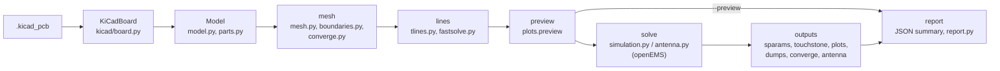

# 3. Architecture

[← Usage](usage.md) · [Index](index.md) · [Next: KiCad import →](kicad-import.md)

## The run pipeline

`kicad2openems` (`cli.main`) parses the command line and builds one typed `config.Settings`
(`config.build_settings`: defaults ← TOML ← command line). `pipeline.Job(settings)` runs the stages in
order:



| Stage | `Job` method | Produces |
|---|---|---|
| model | `model()` | `self.board` (`KiCadBoard`), `self.m` (`Model`) |
| mesh | `mesh()` | `self.bc` (6 boundary names), `self.grid` (mesh dict), `self.levels` (`--converge`), `self.dumps` |
| lines | `lines()` | `self.lm` (`tlines.LineModel`), `<name>_tlines.png`; with `--fast`, `self.fast` and `<name>_fast.sNp` |
| preview | `preview()` | `<name>_mesh.png`, the excitation length; with `--preview --fast`, `<name>_fast.png` |
| solve | `solve()` | `self.result` (`RunResult`), `self.ant` (antenna results), `self.coarse` (coarser levels) |
| outputs | `outputs()` | Touchstone, plots, field maps, `self.Smm` / `self.names` (mixed-mode S), antenna and convergence results, the line-model comparison |
| report | `report()` | `<name>_openems.json` and `<name>_report.html` |

`--preview` stops after `preview()` and writes the report. A failure in `lines()` is a warning: the line
model is an aid and never stops a run.

**The summary.** Every stage adds what it computed to `Job.summary`, a JSON-friendly dict
([keys](postprocessing.md#json-summary)). `report()` writes it as `<name>_openems.json`, and
`report.build(summary, base_dir)` renders the HTML page from that dict alone, so the report can be
rebuilt from the JSON file ([post-processing](postprocessing.md#the-report)).

**Messages.** All messages go through `Job.log`, which prints them, keeps them (`Job.messages`) and sends
them to `--events`; lines containing `WARNING` become the report's warning list. `Job.stage` and
`Job.status` emit the stage and progress events, `Job.wrote(label, path)` records output files, and
`Job.figure(fig, suffix, key, label)` saves a plot and records it. Lower-level functions take a `log`
callable (default `print`) so they can be used without a `Job`.

**Plots** are matplotlib `Figure` objects (no pyplot, no global backend state), so a GUI can embed them;
`plots.save(fig, path)` writes a PNG.

## Module map

```
kicad2openems/
  __init__.py     __version__ (single source of the version, read by pyproject.toml)
  cli.py          argument parser, main(): Settings, then Job(settings).run()
  config.py       Settings (typed), TOML reading, conversion and checks; paths relative to the config
  pipeline.py     Job: the stages above, the run summary
  events.py       EventSink: --events JSON lines
  kicad/          .kicad_pcb reading (no geometry decisions here)
    sexpr.py        S-expression parser and accessors
    shapes.py       arcs, curves, rotation, graphic shapes, pad outlines (incl. custom pads)
    board.py        KiCadBoard: stackup, copper items, tracks, vias, footprints, Edge.Cuts pieces, port footprints
    nets.py         net-name matching, DiffLegs (differential port legs)
    pnp.py          pick-and-place files
    outline.py      board outline from Edge.Cuts
  geometry.py     y flip, polygon lists, hole splitting for CSXCAD
  model.py        Model: stack, copper, vias, Port (vertical / gap), region cropping, parts
  parts.py        lumped R/L/C parts: value parsing, detection, openEMS pieces
  boundaries.py   per-side boundaries, closed-box resonance check
  mesh.py         auto_mesh and its helpers
  converge.py     mesh levels and their comparison
  tlines.py       transmission-line sections, cross-sections, closed-form Z0, coupled sections,
                  discontinuities
  strips.py       rectilinear copper shapes as line strips
  coupled.py      coupled microstrip even / odd mode, multiconductor line blocks
  fastsolve.py    the sections as a circuit: scikit-rf or qucsator
  edges.py        edge walls (PEC where the planes end at the board sides)
  simulation.py   CSXCAD / openEMS model (build_fdtd), runs, RunResult, step counting, --check
  progress.py     openEMS output redirection, progress / ETA monitor
  dielectric.py   Djordjevic-Sarkar model and its Debye fit
  antenna.py      antenna runs: NF2FF box and analysis hooks, match, gain, patterns
  dumps.py        field-dump specs, CSX dump boxes, HDF5 reader, field maps, dump_info / dump_norm files
  mom.py          --mom: the CSX file with <mom25d> hints, mom25d's solve, mixed-mode mapping
  fields.py       field viewing: VTR reader, dumps of a run folder, plane cuts, GIF / MP4 animations
  sparams.py      reciprocity fill, mixed-mode conversion
  touchstone.py   .sNp read / write
  plots.py        figures: mesh preview, line sections, S-parameters, convergence, antenna, patterns
  report.py       the HTML report, rendered from the run summary
```

openEMS and CSXCAD are imported **inside the functions that need them** (`simulation.build_fdtd`,
`check_openems`, `simulation._debye_material`), scikit-rf inside `fastsolve`, h5py inside
`dumps.read_fd` and `antenna.read_sphere`. Everything else imports and runs without them. Keep it that way: the tests rely on it.

## Data passed between stages

**`Settings`** (`config.py`): one field per option, typed (GHz, mm, lists, tuples); `Settings.options()`
is the dict stored in the summary.

**`KiCadBoard`** (KiCad coordinates, y down, mm; stackup thicknesses in metres):
`stack_items` (list of dicts: kind copper/diel/mask, name, t, er, tand), `items`
(`(layer, net, shapely geometry)` for every copper item), `tracks` (routed tracks: layer, net, width,
points), `vias` (dicts: x, y, drill, size, layers, net, `pth` for plated holes), `footprints` (dicts:
ref, value, props, fab, x, y, rot, side, pads, dnp, exclude_from_sim), `edges` (Edge.Cuts pieces).

**`Model`** (model coordinates, y up, mm): `layers` (dielectrics bottom to top: name, z0, z1, er, tand,
kind), `cu_z` / `cu_t` / `cu_order` (copper heights, thicknesses, bottom to top), `copper`
(`{layer: [Polygon]}`, oriented CCW, simplified), `outline`, `vias` (`(x, y, r, z0, z1)`), `via_signal`,
`ports` (`Port`), `user_ports` (single ports and differential pairs), `parts` (`parts.Part`), `notes`.

**mesh dict** (`auto_mesh`): `x`, `y`, `z` (numpy arrays of line positions, mm), `vias` (vias as placed
— snapped ones moved onto lines), `info` (cells, fine_mm, dt_ps, min_cell_mm, mem_gb, bc, lines across
each port, …; stored as `mesh` in the summary).

**`LineModel`** (`tlines.py`): `elements` (`Element`: kind, nodes a / b, length, layer, width,
cross-section, z0, z0_sheet, eeff, notes, group; kinds trace, pad, via, part and the zero-length
coupling hops of a coupled section), `ports` (port name → node), `port_z0`, `paths` (per port pair: the
ordered sections and the branches), `groups` (coupled sections: members with their near and far nodes,
gaps, neighbour-pair even / odd impedances), `junctions` (discontinuities: node, kind, arms, widths),
`notes`. `summary()` gives the `lines` entry of the
summary; `fastsolve.solve` turns it into S-parameters.

**`RunResult`** (`simulation.py`): `S` (nf × n × n, single-ended, NaN in columns of ports not driven),
`dump_files`, `dump_norm`, `seconds` and `steps` per driven port, `extra` (per driven port, what the
run's `analyse` hook returned: in antenna mode the far-field results).

**Antenna results** (`RunResult.extra[port]`): dict with `match`, `rows` (gain table), `f_pattern`,
`cuts`, `sphere`, `port`.

## Processes and threads

- A normal run is one process. `--jobs N` starts N worker processes (`spawn`) that each build and run one
  excitation (`simulation._run_port`; it is top-level so it pickles). `Model.__getstate__` drops the parsed
  board and the log callable to keep the pickle small.
- S-parameter and antenna runs share one path: `simulation.run_excitations` with optional `setup(FDTD,
  CSX)` and `analyse(...)` hooks. Antenna mode passes the NF2FF box as `setup` and the far-field
  analysis as `analyse` (`antenna.run_antenna`).
- openEMS uses its own threads (`--threads`).
- `progress.Monitor` is a thread in the main process that tails the `openems.log` files and calls
  `Job.status` for `--events`.

---
[← Usage](usage.md) · [Index](index.md) · [Next: KiCad import →](kicad-import.md)
