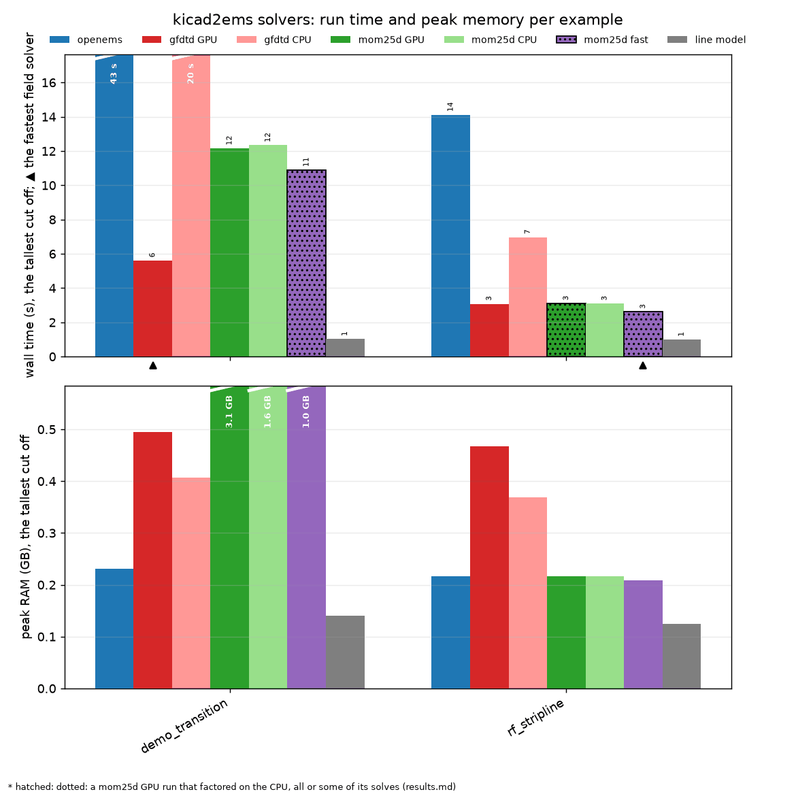

# Benchmarks

[Index](index.md)

Run time and peak memory of each solver on a representative subset of the examples, one board per regime:
single-layer microstrip (hairpin, coupler), grounded coplanar waveguide with a via fence (rf_gcpw), a
stripline between meshed planes (rf_stripline), a via transition through an inner plane (demo_transition) and
an antenna (antenna_patch). Measured with `tools/bench_solvers.py` (`--all` runs every example) on one machine:
an Intel i7-13700K (8 performance and 8 efficiency cores, 24 threads), 31 GB RAM, an AMD Radeon RX 7800 XT
(16 GB) through CuPy and ROCm 7.

Each solver ran alone, in a process of its own, three times. The table gives the median, with the range of the
three runs in brackets where they differ by a second or more. Times are wall time for the whole run: model,
mesh, port characterisation and the solve. RAM is the process's peak. GPU memory is what mom25d planned for
its matrix. The fastest field solver on each board is in bold (the line model is not a field solver).
*mom25d fast* is `--mom-quads on --mom-quad-tol 60 --mom-coarsen 2` ([quad cells](mom.md#quads),
[coarsening](mom.md#coarsen)).

| Example | openems | gfdtd GPU | gfdtd CPU | mom25d GPU | mom25d CPU | mom25d fast | line model | Fastest | FDTD model | mom25d model | mom25d fast model |
|---|---|---|---|---|---|---|---|---|---|---|---|
| antenna_patch | 30 s (30–34), 0.3 GB | 9 s, 0.6 GB | 18 s (17–18), 0.4 GB | 4 s, 0.3 GB · *on the CPU* | 4 s, 0.3 GB | **3 s, 0.2 GB** · *on the CPU* | n/a | mom25d fast | 0.42 M cells, 17920 steps | 1,391 unknowns, 11 solves, double | 466 unknowns, 9 solves, double |
| demo_transition | 43 s (39–55), 0.2 GB | **6 s, 0.5 GB** | 20 s (20–22), 0.4 GB | 12 s (12–13), 3.1 GB (+0.5 GPU) | 12 s (11–13), 1.6 GB | 11 s, 1.0 GB · *on the CPU* | 1 s, 0.1 GB | gfdtd GPU | 0.51 M cells, 86099 steps | 4,043 unknowns, 21 solves, hybrid | 2,959 unknowns, 18 solves, double |
| hairpin | 46 s (42–50), 0.2 GB | 7 s, 0.4 GB | 36 s (35–36), 0.3 GB | 6 s, 2.8 GB (+0.6 GPU) | 7 s, 1.2 GB | **3 s, 0.4 GB** · *on the CPU* | 1 s, 0.1 GB | mom25d fast | 0.31 M cells, 108458 steps | 4,763 unknowns, 13 solves, hybrid | 1,992 unknowns, 11 solves, double |
| rf_coupler | 27 s (27–28), 0.2 GB | 5 s, 0.5 GB | 16 s (15–16), 0.4 GB | 10 s, 3.1 GB (+0.7 GPU) | 14 s (14–15), 1.9 GB | **4 s, 0.5 GB** · *on the CPU* | 1 s, 0.1 GB | mom25d fast | 0.59 M cells, 33184 steps | 5,864 unknowns, 20 solves, hybrid | 2,360 unknowns, 11 solves, double |
| rf_gcpw | 67 s (55–67), 0.2 GB | **6 s, 0.4 GB** | 35 s (34–46), 0.3 GB | 8 s (7–8), 3.1 GB (+0.5 GPU) | 9 s, 1.7 GB | 8 s, 3.1 GB · *on the CPU* | 1 s, 0.1 GB | gfdtd GPU | 0.20 M cells, 161086 steps | 3,526 unknowns, 20 solves, hybrid | 1,941 unknowns, 22 solves, double |
| rf_stripline | 14 s, 0.2 GB | 3 s, 0.5 GB | 7 s, 0.4 GB | 3 s, 0.2 GB · *on the CPU* | 3 s, 0.2 GB | **3 s, 0.2 GB** · *on the CPU* | 1 s, 0.1 GB | mom25d fast | 0.43 M cells, 16405 steps | 1,337 unknowns, 18 solves, double | 806 unknowns, 18 solves, double |

*on the CPU*: a GPU run of mom25d that factored on the CPU (the board below its GPU threshold, sim.GPU_MIN_N, or too large for the GPU); *n of m on the CPU*: solves that fell back to double precision on the CPU after the complex64 LU failed to precondition (the worst of the runs).

## Reading the table

- **gfdtd on the GPU** is the fastest field solver on two of the six boards (the transition and rf_gcpw, 6 s;
  3–9 s on all six), and never more than 0.6 GB. On its CPU it is 2–6× slower, still faster than openEMS everywhere.
- **openEMS** needs the least memory (0.2–0.3 GB). Its time follows cells × timesteps: high-Q circuits
  (hairpin, 108k steps) and the fence of rf_gcpw (161k steps) are its slow cases.
- **mom25d** is fastest on four: the antenna (*mom25d fast*: 3 s), the hairpin (3 s), the coupler (4 s) and
  the stripline (3 s), and within 1.4× of gfdtd's GPU on rf_gcpw. On the transition it takes 11–12 s, 1.8× gfdtd's
  GPU. Its solid planes are PEC and its lone stitching-via pads left out ([planes](mom.md#planes)): the
  stripline 15,563 unknowns to 1,337, the transition 13,670 to 4,043. Where a plane has a signal via through it
  (the transition's inner plane), the plane is still meshed: the [roadmap](https://github.com/lowprocess/kicad2ems/blob/main/ROADMAP.md) has the next step.
- **The fast setting** halves mom25d's time on the microstrip boards (hairpin, coupler) and costs at most 0.02
  in |S| ([quad cells](mom.md#quads)). It gains less on the transition, whose meshed inner plane holds most of the
  unknowns.
- **The runs repeat**: the three runs of each solver differ by under 10 % on most boards. openEMS and gfdtd's CPU
  vary most (up to 37 % and 35 %: the transition, rf_gcpw); mom25d by up to 10 % on the transition, where how
  many solves reuse a kept LU varies with the sweep's samples.
- **mom25d's GPU** helps above about 3,000 unknowns (after the quad cells), up to 1.4× over its CPU (the coupler);
  with its LUs kept across the sweep, the CPU nearly matches it on the transition. Small boards
  stay on the CPU (marked *on the CPU*: below `sim.GPU_MIN_N`, where the GPU's start-up costs more than it
  saves). No solve falls back to double precision any more.
- **mom25d keeps its LUs across the sweep** ([reuse](mom.md#reuse)): most frequencies are solved by GMRES with
  a nearby frequency's LU instead of a new one. With every plane meshed, that took the transition from 179 s
  to 83 s on the CPU and from 107 s to 72 s on the GPU, and the stripline from 234 s to 117 s and from 98 s to
  85 s; the small boards gain 10–30 %. With the planes as PEC as well: 12 s and 3 s.
- **The line model** takes about a second on every board, in under 0.15 GB.

To run it again: `python tools/bench_solvers.py --openems-python <python with openEMS>` (`--repeat N`, default 3;
`--all` for every example). Run nothing else meanwhile, a video playing on the GPU included: the times are wall
time.
