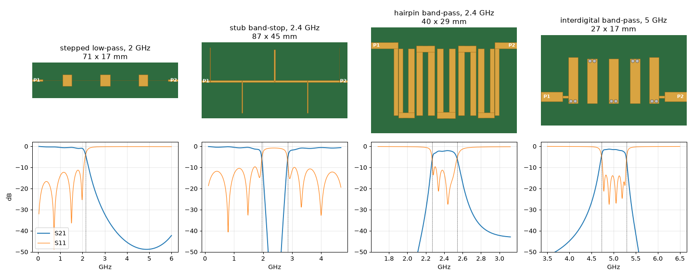

# dfsynth

> Part of kicad2ems since 0.4: the package `kicad2ems.dfsynth`, installed with kicad2ems (`pip install .` in this
> repository; the [README](../../README.md#install) has the installer). Its history up to then is in this
> repository's, and in its own repository. Install lines below that name `.` mean this repository.

dfsynth synthesises distributed-element microstrip filters from a spec (type, response, frequency,
bandwidth, substrate) and writes the layout as a KiCad board. It can then run that board through
[kicad2ems](https://github.com/lowprocess/kicad2ems) to check it with a field solver, and correct the
design from the result.



*Four of its topologies on Rogers substrates, over the response of dfsynth's line model of each layout; dotted: the
spec's band edges (`python tools/dfsynth/readme_figure.py`).*

```bash
pip install .                                     # dfsynth (numpy, scipy, matplotlib)

dfsynth --type bandpass --topology coupled --f0 5G --bw 500M --order 5 \
        --substrate RO4003C-0.813 -o out/bpf --validate mom,lines --em-tune 1
```

That writes:

| file | what |
|---|---|
| `out/bpf.kicad_pcb` | the layout: KiCad 8 format, 2 layers, opens in KiCad 8 and later |
| `out/bpf.toml` | a kicad2ems run configuration for it (`kicad2ems out/bpf.toml --solvers mom,lines`) |
| `out/bpf.kicad_mod` | the filter as a footprint to place in your own board: its copper on F.Cu, pads 1 and 2 at the ports (the feed's width), its ground vias as plated pads 3 (GND), the origin at its centre; it needs a ground plane on the next layer down, at the substrate's height it was designed for (its description says which) |
| `out/bpf_model.s2p`, `_model.png` | dfsynth's own circuit model of the layout |
| `out/bpf_design.json` | spec, substrate, every dimension, the layout, the targets and the validation metrics |
| `out/bpf_em/`, `_validation.png` | with `--validate`: kicad2ems's results, overlaid on the model (and its output, `kicad2ems_output.log`, `kicad2ems_events.jsonl`) |
| `out/bpf_em_tune1/`, `_validation_tune1.png` | with `--em-tune N`: each corrected round |

The **Filter Synthesis** page of `kicad2ems-gui` ([GUI](../gui.md#filter);
its `filter` extra installs dfsynth) does the same from a window, and opens the board in kicad2ems.

## Filters

| type | topology | notes |
|---|---|---|
| lowpass | `stepped` | alternating high / low impedance sections, L first |
| lowpass | `stub` | high-impedance lines with shunt open stubs (alternating sides) |
| lowpass | `radial` | the same with each stub a butterfly of radial stubs (`--stub-angle`, default 60 degrees): each fan's resonance puts a transmission zero in the stop band |
| highpass | `stub` | shunt short-circuited quarter-wave stubs: a wide band-pass from the cut-off to `--bw` above it (default up to 3x the cut-off), as any distributed high-pass is |
| bandpass | `coupled` | edge-coupled (parallel-coupled) half-wave resonators |
| bandpass | `hairpin` | the same, folded into alternating U resonators, coupled-line feeds; `--hairpin-gap` sets the gap between a U's own arms (default: the wider of the strip width and twice the largest coupling gap) |
| bandpass | `interdigital` | quarter-wave rods grounded at alternate ends, tapped feeds; wide gaps for the bandwidth (1.8 mm at 10 % on RO4003C-0.813, against 0.13 mm edge-coupled); tune it with `--validate gfdtd --em-tune 3` |
| bandpass | `endcoupled` | gap-coupled half-wave resonators; narrow bands only (the end gaps get small fast) |
| bandpass | `stub` | Matthaei short-circuited stub band-pass, wide bands (30 to 100 %) |
| bandstop | `stub` | open quarter-wave stubs a quarter wave apart; the connecting lines' impedances are optimised too |
| bandstop | `radial` | the same with radial stubs: these are low-impedance stubs, so only very wide stop bands (about 100 % and up); narrower ones are refused |

Responses: `--response chebyshev` (`--ripple` dB, default 0.1) or `butterworth`. The order comes from
`--order`, or from a stop-band point, `--atten 40@3.5G` (the lowest order with 40 dB at 3.5 GHz).
Ladders with equal terminations (lowpass, bandstop) need an odd Chebyshev order and get bumped to one.
The bandwidth is the ripple bandwidth for Chebyshev, the -3 dB bandwidth for Butterworth. Stub filters
map the prototype through Richards' transformation, so their bands are arithmetically symmetric about f0.

Substrates: `dfsynth --list` shows the presets (FR4, RO4003C, RO4350B, RT5880, RO3010 and alumina in common
thicknesses); `--h`, `--er`, `--tand`, `--copper` override them.

Fabrication limits: `--min-width` and `--min-gap` (default 0.1 mm each, about the best PCB vendors do) are
enforced. A design below them is refused, with the dimensions at fault and the nearest bandwidth that meets the
limits; `--allow-fab-violations` writes it anyway. dfsynth never silently changes a dimension to meet them, except
that band-stop stubs too narrow to make are clamped to the minimum width (the result says the stop band comes out
wider).

## How a design is made

1. **Synthesis**: low-pass prototype g-values, then the topology's classic design equations (stepped
   impedance with the lines' shunt parasitics taken off the capacitors; J-inverters for coupled, hairpin and
   end-coupled resonators; Matthaei's stub band-pass; quarter-wave stub band-stop). The tests check each
   synthesis's ideal TEM network.
2. **Physical dimensions** from closed forms: Hammerstad-Jensen microstrip with strip thickness and
   Kirschning-Jansen dispersion, Kirschning-Jansen coupled lines and open ends, Garg-Bahl gaps, Edwards' width
   steps, Goldfarb-Pucel vias. The interdigital filter uses design curves from the multiconductor model below:
   the coupling of two rods against their gap, and the external Q of a tapped rod.
3. **Calibration**: a circuit model of the actual layout (dispersion, loss, open ends, steps, gaps, vias; radial
   stubs as radial lines; arrays of coupled strips as a multiconductor line whose capacitance matrix comes from a
   quasi-static moment-method solution of the cross-section). Two factors, `kf` (all lengths) and `kb` (the
   design bandwidth), are iterated until the model's -3 dB edges land on the spec's. The low-pass section lengths,
   the band-stop's stub and line impedances, the edge-coupled and hairpin filters' coupling gaps (and each
   hairpin U's bar), and the interdigital's gaps, taps and rod lengths are then refined on the lossless model for
   the pass band's match, the edges held on target, for at most `--refine-time` seconds (default 10). A
   refinement stopped by the limit keeps its best so far (the log says so), so a slower machine can come out a
   little differently; the FR4 hairpin's fit takes about 5 s.
4. **Validation** (`--validate`): kicad2ems solves the written board with the solvers named (`mom` for most of
   these planar filters, `gfdtd` for the interdigital, `lines` for kicad2ems's line model). dfsynth measures each
   result's band edges (3 dB below the pass-band peak, so loss does not move them) and reports centre and
   bandwidth error, pass-band loss and match.
5. **EM tuning** (`--em-tune N`): the full-wave result's centre and bandwidth error is folded back into `kf` and
   `kb`, and the board is written and solved again. The interdigital is tuned by space mapping instead: the
   trims with which the model reproduces the full-wave run's complex S21 and S11 are extracted, and the board's
   trims move by their difference from the model's own, so each rod, gap and tap is corrected on its own.

kicad2ems's solvers treat copper as infinitely thin; dfsynth designs for the copper thickness you give it. On
narrow lines that is a few percent of frequency, so dfsynth also models the layout with zero thickness
(`model (t=0)` in the plots and metrics), and the EM tuning corrects only the difference between the full-wave
result and that model: the board stays designed for real copper.

## Known limits

- Microstrip on one dielectric over a ground plane only (no stripline, no cover, no enclosure).
- Edge-coupled and hairpin filters wider than ~15 % on thin substrates need gaps under 0.1 mm in their first
  and last sections (a tapped feed would avoid that; not implemented).
- End-coupled filters need very small end gaps except for narrow bands on thick, high-er substrates; dfsynth
  refuses an end gap under 2 % of the strip width.
- The shorted stubs' vias are GND vias inside RF copper: KiCad's DRC flags them as shorts, as intended.
- T-junctions are modelled only as the main line's half width; the EM tuning takes care of the rest.
- The kicad2ems configs dfsynth writes use PML boundaries (`bc = "PML_8"`): kicad2ems's default Mur boundary,
  5 mm from the board, absorbs a resonant filter's near field (the interdigital read 17-27 % narrow; with PML,
  -0.6 %).

## Validation status

mom25d on the GPU, one `--em-tune` round (2026-10-21). "Predicted" is mom25d's error over the zero-thickness
model, applied to the model with 35 um copper: the real board's expected error against the spec. RL is mom25d's
worst return loss over the response's own pass band. The lowpass and band-stop rows include conductor loss.

| case | substrate | predicted, round 0 (centre / bw) | after 1 round | RL (round 0 / 1) |
|---|---|---|---|---|
| lowpass stepped, 2 GHz, N5 | RO4003C-0.508 | -2.0 % | +0.0 % | 10.7 / 11.7 dB |
| lowpass stub, 2 GHz, N5 | RO4003C-0.508 | -1.6 % | +0.0 % | 11.7 / 12.0 dB |
| bandstop stub, 2.4 GHz, 1 GHz | RO4003C-0.508 | +1.9 % / +5.2 % | +0.1 % / +0.6 % | 9.2 / 9.5 dB (37 dB rejection) |
| bandpass coupled, 5 GHz, 500 MHz | RO4003C-0.813 | +0.4 % / -6.7 % | -0.0 % / -1.5 % | 12.0 / 12.3 dB |
| bandpass hairpin, 2.4 GHz, 300 MHz | FR4-1.6 | +13.3 % / -18.2 % | -1.2 % / -6.2 % | 16.4 / 16.4 dB |
| bandpass stub, 3 GHz, 1.5 GHz | RO4003C-0.508 | -3.8 % / -5.7 % | -0.2 % / +2.9 % | 12.7 / 15.1 dB |
| highpass stub, 2 GHz | RO4003C-0.508 | +4.5 % / +5.8 % | +1.5 % / -4.1 % | 12.1 / 12.9 dB |

- **Hairpin**: the table's run predates the hairpin's present line model (all its arms coupled, square corners
  fitted to gfdtd), and its 16.4 dB return loss with it: on that model the synthesis alone matched to 5.5 dB
  (FR4-1.6) and 8.1 dB (RO4003C-0.813, 300 MHz). With the gaps and bars refined (2026-11-15) both reach 11.0 dB
  on the lossless model. On gfdtd the refined FR4 design (round 0) has its centre -1.1 % and bandwidth -10.9 % (the
  lossy model's own -10.8 %: FR-4's loss) and a worst return loss of 11.7 dB over its own pass band (the model's
  13.8), 7.0 dB over the spec's; 9 min. With it, round 0 on gfdtd is centre -0.7 %, bandwidth -14 % on FR4-1.6 (the model's own
  -15.6 %: FR-4's loss), and -0.2 % / +1.1 % on RO4003C-0.813 (2.4 GHz / 240 MHz, N5).
- **Cross-checks**: gfdtd and mom25d agree within 1 % on the stepped low-pass's cut-off, and within 0.1 % on the
  tuned hairpin's centre.
- **End-coupled** (10 GHz / 300 MHz on alumina): its 0.03 mm end gaps make the response depend on the copper's
  thickness, which kicad2ems's solvers leave out, so they cannot validate it.
- **Interdigital** (5 GHz / 500 MHz, N5, RO4003C-0.813, gfdtd and openEMS with PML): the band lands where the
  field solvers put it (centre within 0.4 %, bandwidth -0.6 %), but the match does not survive (3 dB return loss
  against the model's 11). `--validate gfdtd --em-tune 3` fixes it: the board it predicts reaches 10.7 dB over the
  spec band (the solvers' own zero-thickness readings: 6-9 dB), and a board tuned on gfdtd this way measures
  11.6 dB on openEMS. mom25d disagrees with both FDTD codes here (+4 % centre: its ports are lumped, the feeds being
  too short for wave ports).
- **Radial stubs**: the stub model puts kicad2ems's `rf_radialstub` notch at 2.10 GHz (openEMS 2.13, mom25d 2.18).
  The radial low-pass and band-stop are not validated on a field solver yet (the 100 % radial band-stop matches
  only 5 dB on the model).
- **kicad2ems's `lines` (qucs)** gives an open circuit on the edge-coupled filter: the middle resonators' width
  steps put a jog in the traces, and only the first and last coupled sections are grouped.

Next: coupled sections across width-step jogs in kicad2ems's line extractor (or steps drawn without them); a
damped or Broyden step for the interdigital's space mapping, whose tap correction oscillates between rounds;
band-stops wider than thin substrates allow (their outer stubs want 200+ ohm); and conductor loss in gfdtd, the
practical solver for these runs (openEMS with PML took 873 s on the interdigital, against ~130 s with Mur).
