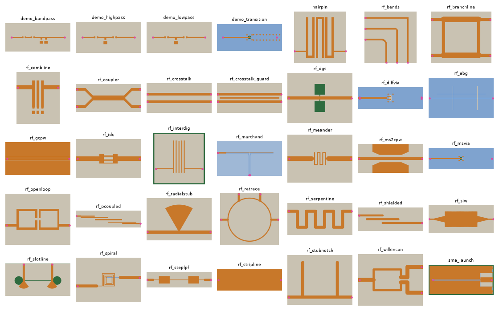
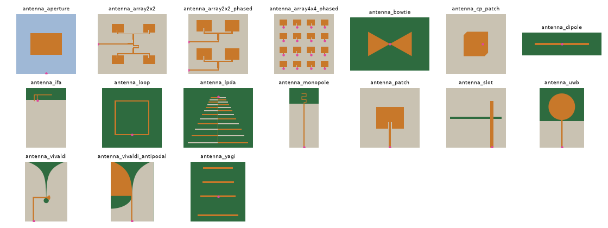

# Examples

[← GUI](gui.md) · [Index](index.md) · [Next: Results →](postprocessing.md)

Each example has a config in `examples/`; run them from the repository root, and the results go to
`examples/out/`. They are installed with kicad2ems (the package `kicad2ems.examples`), so they also open from the
GUI's *File → Examples* in any install (copied, with their boards made, to `~/.local/share/kicad2ems/examples/`), and
a program reaches them through `kicad2ems.api.frontend` (`examples()`, `prepare_example(name, folder)`).

Only three boards are stored (`rf_interdig`, `hairpin`, `sma_launch`); the others are made by scripts, which the
installer runs. After pulling a change to a generator, make them again:

```bash
python examples/make_boards.py                                # every generated board (or: make_boards.py NAME ...)
```



*The boards from above: top copper orange, inner layers blue, the bottom layer beige, the bare substrate green,
ports pink (`python tools/doc_figures.py gallery`).*

## Generated boards

`make_demo_board.py OUT [VARIANT]`:

| Variant | Board | Config |
|---|---|---|
| `transition` (default) | 4 layers: microstrip, a blind via, then stripline between ground planes | `demo_transition.toml` |
| `diff` | a differential microstrip pair with a 45° jog | none: run with `--ground B.Cu` |
| `rlc` | microstrip with a gap bridged by a 1.5 pF capacitor | none |
| `lowpass`, `highpass`, `bandpass` | lumped filters of 0402 parts, plus the ideal circuit for comparison | `demo_lowpass.toml`, … |
| `launch` | a 4-layer edge launch with a grounded-CPW feed | none: `--nets RF,GND --fmin 1 --fmax 6` |

`make_antennas.py KIND OUT [param=mm …]` makes antennas, most for 2.45 GHz, each with a config
`antenna_<kind>.toml`; dimensions can be changed on the command line (`make_antennas.py ifa out arm=19`).



<a id="rf-structures"></a>
## RF structures

`make_rf_examples.py` makes classic microwave structures, most on 0.8 mm FR-4 over a ground plane, some on 4 layers
or RO4003C (`make_rf_examples.py all`, or `NAME` for one). The first eleven have openEMS results in
`examples/reference/` and compare the solvers (`tools/compare_solvers.py`, 2026-10-28; mom25d with lumped ports, as
the FDTD solvers have):

| Board | Result | openEMS | gfdtd | mom25d | line model |
|---|---|---|---|---|---|
| `rf_branchline`: 3 dB hybrid, 2.4 GHz | S21 / S31 | −3.73 / −3.36 dB | −3.77 / −3.36 dB | −3.57 / −3.39 dB | −3.46 / −3.38 dB |
| `rf_wilkinson`: power divider with a 100 Ω resistor | S21, S22, S32 | −3.34, −20.2, −35.3 dB (−3.35, −21.2, −32.2 converged) | −3.35, −20.3, −34.6 dB | −3.31, −20.1, −38.7 dB | −3.30, −18.4, −35.7 dB |
| `rf_steplpf`: stepped-impedance low-pass, 2 GHz | −3 dB frequency | 1.736 GHz (1.729 converged) | 1.737 GHz | 1.756 GHz | 1.800 GHz |
| `rf_stubnotch`: two open λ/4 stubs, 2.4 GHz | notch | 2.383 GHz | 2.398 GHz | 2.410 GHz | 2.493 GHz |
| `rf_gcpw`: grounded CPW with via fences | worst S11, S21 at 5 GHz | −14.8, −0.39 dB | −14.5, −0.39 dB | −22.5, −0.33 dB | −12.1, −0.35 dB |
| `rf_coupler`: 10 dB coupler, 0.14 mm gap | S31, S21 | −10.3, −0.77 dB | −10.3, −0.77 dB | −10.6, −0.70 dB (−10.9, −0.67 before gap rings, [mesh](mom.md#meshers)) | −10.4, −0.72 dB |
| `rf_ratrace`: 180° hybrid ring, 2.4 GHz | S21, S41, S31 | −3.38, −3.54, −28.2 dB | −3.38, −3.52, −28.0 dB | −3.34, −3.45, −35.8 dB | −3.34, −3.43, −46.7 dB |
| `rf_radialstub`: one 60° radial stub | notch | 2.13 GHz | 2.13 GHz | 2.17 GHz | 2.18 GHz (qucsator's radial stub; scikit-rf slices the fan: 1.99 GHz) |
| `rf_stripline`: 4 layers, via-fenced stripline | worst S11, S21 at 10 GHz | −17.5, −0.59 dB | −16.5, −0.58 dB | −19.9, −1.01 dB | −13.5, −0.63 dB |
| `rf_diffvia`: 100 Ω pair through two vias | Sdd21 at 5 / 10 GHz, worst Sdd11 | −0.44 / −0.60, −15.4 dB | −0.43 / −0.59, −15.4 dB | −0.38 / −0.95, −14.7 dB | −0.41 / −1.06, −11.9 dB |
| `rf_shielded`: resonator filter in a metal can; 4.621 GHz from a converged 3D FEM run (EMerge) | peak | 4.625 GHz (4× mesh; 4.555 by default) | 4.625 GHz | 4.648 GHz (no can) | 4.877 GHz |

The figures above sit at single frequencies; a small reflection there mostly says where its ripple falls. Over the whole band, each solver's agreement with openEMS's reference (the rms of the complex difference of the input reflection, dB, and the rms difference of the transmission's |S|):

| Board | gfdtd | mom25d | line model |
|---|---|---|---|
| `rf_branchline` (S11 / S21) | −43.1 dB / 0.08 dB | −30.7 dB / 0.23 dB | −28.8 dB / 0.38 dB |
| `rf_wilkinson` (S11 / S21) | −54.6 dB / 0.02 dB | −30.6 dB / 0.09 dB | −24.4 dB / 0.11 dB |
| `rf_steplpf` (S11 / S21) | −34.7 dB / 0.24 dB | −25.9 dB / 0.71 dB | −19.9 dB / 1.52 dB |
| `rf_stubnotch` (S11 / S21) | −40.1 dB / 0.77 dB | −23.8 dB / 1.91 dB | −15.1 dB / 5.34 dB |
| `rf_gcpw` (S11 / S21) | −46.5 dB / 0.03 dB | −25.4 dB / 0.26 dB | −16.5 dB / 0.24 dB |
| `rf_coupler` (S11 / S21) | −45.5 dB / 0.02 dB | −36.0 dB / 0.11 dB | −28.1 dB / 0.14 dB |
| `rf_ratrace` (S11 / S21) | −45.4 dB / 0.08 dB | −22.6 dB / 1.06 dB | −18.1 dB / 1.26 dB |
| `rf_radialstub` (S11 / S21) | −46.6 dB / 0.16 dB | −26.9 dB / 1.84 dB | −18.6 dB / 2.89 dB |
| `rf_stripline` (S11 / S21) | −42.2 dB / 0.02 dB | −30.0 dB / 0.23 dB | −25.8 dB / 0.05 dB |
| `rf_diffvia` (S1d1d / S2d1d) | −68.4 dB / 0.01 dB | −30.5 dB / 0.21 dB | −26.3 dB / 0.21 dB |
| `rf_shielded` (S11 / S21) | −49.1 dB / 0.13 dB | −16.2 dB / 2.87 dB | −9.9 dB / 11.21 dB |

More structures (`make_rf_examples.py <name>`, boards and configs in the repository), on gfdtd:

| Board | What it shows | gfdtd |
|---|---|---|
| `rf_siw`: substrate-integrated waveguide, 0.508 mm RO4003C, 6 mm tapers | TE10 cut-off (6.0 GHz by design), pass band | cut-off 6.34 GHz; 7.5-11 GHz S21 −0.7 to −1.1 dB, S11 below −7.9 dB (the two tapers' standing wave) |
| `rf_msvia`: F.Cu microstrip through one via to B.Cu microstrip, 4 layers | worst S11 to 10 GHz, S21 at 5 / 10 GHz | −12.9 dB, −0.38 / −1.02 dB |
| `rf_ms2cpw`: microstrip to grounded CPW and back | worst S11 to 10 GHz, S21 at 5 / 10 GHz | −19.0 dB, −0.66 / −1.34 dB |
| `rf_slotline`: microstrip-slotline transitions back to back | −3 dB pass band | 1.1-8 GHz, 0.75 dB at best |
| `rf_marchand`: broadside Marchand balun, 2.4 GHz, 4 layers | S11, differential / common-mode transmission at 2.4 GHz | −43.6 dB, −0.47 / −22.1 dB (S11 below −22 dB, Sc1 below −21 dB from 1.8 to 3 GHz) |
| `rf_bends`: square, mitred, curved 90° bends | S11 at 10 GHz | −12.3, −26.2, −20.9 dB |
| `rf_serpentine`: 80.5 mm of 50 Ω meander | group delay below 3 GHz | 437 ps, 53 ps short of its centre line's (coupled turns cut corners) |
| `rf_crosstalk` / `rf_crosstalk_guard`: lines 3 mm apart, 40 mm | worst NEXT, FEXT at 5 GHz | −26.1 / −29.4 dB, −18.3 / −22.2 dB: the grounded guard trace takes 3-4 dB off |
| `rf_pcoupled`: 3-pole parallel-coupled band-pass, 2.4 GHz, 5 % | −3 dB band, loss, mid-band match | 2.288-2.452 GHz, 5.5 dB (FR-4 at 5 %), −15 dB |
| `rf_combline`: 3-pole combline, 0603 loading capacitors | −3 dB band, loss, mid-band match | 2.237-2.560 GHz, 0.95 dB, −10.8 dB (0.4 pF on the middle rod, 0.6 pF on the outer ones) |
| `rf_openloop`: two open-loop resonators | −3 dB band, loss, mid-band match | 2.290-2.510 GHz, 3.3 dB, −10.3 dB; qucsator's line model follows it closely |
| `rf_dgs`: dumbbell defected ground under a 50 Ω line | stop band | below −10 dB 3.8-7.6 GHz, −19 dB at 5.7 GHz |
| `rf_ebg`: microstrip over a mushroom EBG, 4 layers | stop band | below −10 dB 3.8-5.1 GHz, −42 dB at 4.1 GHz |
| `rf_idc` / `rf_meander` / `rf_spiral`: series C / L in a 50 Ω line | C or L at 1 GHz, self-resonance (mom25d alongside) | 0.61 pF (mom25d 0.54, Alley's formula 0.52) / 10.7 nH (11.5), 5.1 GHz / 28.3 nH (29.2), 1.83 GHz |

The wide-band ones take `diel = "wideband"`: with the default fixed conductivity, FR-4's loss grows as 1/f below
the band centre (at 1 GHz on a 0.5-10 GHz run, 20 % of the power).

Where the solvers disagree:

- **Coupler and grounded CPW**: openEMS needs z cells graded towards the strips ([meshing](meshing.md#z-lines)).
  The references are on a mesh graded from a quarter of the fine cell (`--z-sheet 0.25`), within about 0.2 dB and
  0.5 dB of converged; mom25d's coupling is 0.3–0.4 dB stronger.
- **Curved and fan-shaped copper**: the default mesh refines over arcs and fans (`--curve-res`), which puts the
  radial stub's notch where meshes 3–4× finer do. The rat-race's isolation null needs a finer curve mesh still:
  on gfdtd it converges at 2.30 GHz (2.18 at the default `--curve-res`, 2.25 at 12, 22 M cells at 64), against
  mom25d's 2.33, EMerge's 2.31 and the line model's 2.40 (the design).
- **Differential via**: the line model's via transition is its weak part above 5 GHz (worst Sdd11 −11.9 dB,
  [limits](transmission-lines.md#limits)).
- **Ports**: with its default wave ports, de-embedded onto the line, mom25d measures the line itself (the
  stripline's worst S11 −34.3 dB: a 51 Ω line in a 50 Ω system) where lumped ports, like the FDTD solvers', include
  the port's own reflection (−19.9 dB). Over the band, lumped agrees with openEMS as well or better.
- **GCPW resonance**: the worst S11 is a resonance near 7.7 GHz, −14.8 and −14.5 dB in openEMS and gfdtd and
  −22.5 dB in mom25d, whose laterally infinite dielectric and via rows damp it.
- **gfdtd** matches openEMS within 0.05 dB and 10 MHz on most figures (all eleven boards in 78 s on the GPU). The
  largest differences: the stub notch 15 MHz higher, the stripline's worst S11 1 dB higher, the Wilkinson's deep
  isolation 0.7 dB. It has no conductor loss.
- **Filter loss**: openEMS's default dielectric model overstates the microstrip filter's loss by about 1.3 dB;
  with `--diel wideband` its pass band matches mom25d's to 0.05 dB.

## Board files

- **Hairpin filter** (`hairpin.kicad_pcb`): a 3.3 GHz band-pass filter of three hairpin resonators on
  0.21 mm FR-4.
- **SMA launch** (`sma_launch.kicad_pcb`): an edge-launch SMA connector onto a 50 Ω line on a 4-layer
  board. The ground planes end at the board edge without stitching vias, so the config adds
  [edge walls](meshing.md#edge-walls); without them, the planes resonate near 4.7 GHz.
- **Microstrip filter** (`rf_interdig.kicad_pcb`): an interdigital filter on 0.2 mm FR-4, 1 to 8 GHz. Its
  five fingers form a five-line [coupled section](transmission-lines.md#coupled-sections) in the line model.

## Verified results

openEMS 0.37.

**Lumped filters** (`demo_*.toml`) are compared with their ideal circuits, which shows what the layout
adds:

| Filter | Ideal | Simulated | Why |
|---|---|---|---|
| low-pass, 1 GHz | −3 dB at 0.87 GHz | 0.77 GHz | about 0.4 nH more in the shunt branch: the stub, the ground pad and its vias |
| high-pass, 1 GHz | | cutoff about 15 % lower | the via path in series with the shunt inductor |
| band-pass, 1 GHz | peak at 0.88 GHz | 0.74 GHz | pad and via inductance next to a small 2.2 nH shunt inductor |

**Antennas** (`antenna_*.toml`), all for 2.45 GHz on FR-4:

| Antenna | Resonance | S11 | −10 dB band | Directivity | Efficiency | Gain |
|---|---|---|---|---|---|---|
| patch | 2.438 GHz | −19.4 dB | 2.2 % | 7.0 dBi | 39 % | 2.9 dBi |
| inverted-F | 2.451 GHz | −33.5 dB | 12.0 % | 2.9 dBi | 91 % | 2.5 dBi |
| dipole | 2.430 GHz | −20.3 dB | 15.6 % | 2.1 dBi | 96 % | 1.9 dBi |
| slot | 2.434 GHz | −26.9 dB | 20.6 % | 4.4 dBi | 87 % | 3.7 dBi |

The dipole's 2.1 dBi matches an ideal half-wave dipole (2.15 dBi). The patch's low efficiency is FR-4 loss.

The **Vivaldi** (`antenna_vivaldi.toml`) is wideband, 3–10 GHz on 0.8 mm FR-4, and runs on gfdtd: it radiates off
the board's top edge, so the outline matters (mom25d ignores it). Its config animates the E field in the substrate
at 4, 6 and 8 GHz: the wave leaves the taper further out at low frequencies and nearer the throat at high ones. The
run's headline −10 dB band is only the contiguous band around the deepest dip; for a wideband antenna, read the S11
plot.

The **antipodal Vivaldi** (`antenna_vivaldi_antipodal.toml`, the same board and band) splits the flare between the
layers: the F.Cu half grows out of the 50 Ω microstrip, the B.Cu half out of the ground, overlapping by 0.5 mm at
the throat, so there's no slotline balun to tune. It matches better and gains more:

| | \|S11\| < −10 dB | Worst \|S11\| | Gain at 4 / 6 / 8 GHz | Front-to-back at 4 / 6 / 8 GHz | Efficiency |
|---|---|---|---|---|---|
| Vivaldi | 83 % of 3–10 GHz | −8.3 dB (6.7 GHz) | 3.0 / 6.0 / 6.4 dBi | 5.2 / 9.0 / 9.3 dB | 67–73 % |
| Antipodal | all of 3–10 GHz | −11.2 dB (6.3 GHz) | 4.3 / 6.3 / 7.6 dBi | 6.6 / 9.4 / 9.4 dB | 73–79 % |

Front-to-back is the gain off the aperture against the strongest in the rear half of the board's plane. Options of
`make_antennas.py vivaldi_antipodal` that raise its directivity (gfdtd, 4 / 6 / 8 GHz):

| Options | Board | Gain | Front-to-back | \|S11\| < −10 dB |
|---|---|---|---|---|
| none | 50 × 70 mm | 4.3 / 6.3 / 7.6 dBi | 6.6 / 9.4 / 9.4 dB | all of 3–10 GHz |
| `cd=5`: slots 1 mm wide, 5 mm deep, every 3 mm in the outer edges | 50 × 70 mm | 5.7 / 8.1 / 8.1 dBi | 8.5 / 15.7 / 12.4 dB | all |
| `dext=15 dl=24`: bare substrate past the aperture, a floating elliptical director in it | 50 × 85 mm | 4.6 / 7.0 / 8.2 dBi | 7.4 / 11.2 / 9.7 dB | 96 % (−9.8 dB worst) |
| `cd=5 dext=15 dl=24` | 50 × 85 mm | 6.0 / 8.6 / 8.8 dBi | 9.2 / 15.2 / 12.3 dB | all |

The slots stop the current running down the board's edges toward the feed, which made the back lobe (12 mm deep
ones suppress it better at 4 GHz but cost gain higher up). A finer mesh (6.5 M cells) moved these results by at most
0.1 dB. Variants after published designs did no better: symmetric curved halves (`sym=1`) lose 1.9 dB at 4 GHz,
striped directors 14 mm long resonate in the band, corner via walls change little.

`vivaldi_antipodal_array` feeds N elements from one port through a corporate microstrip network (T-junctions into
100 Ω lines, quarter-wave transformers back to 50 Ω). Four filled elements 30 mm apart (`sym=0 fr=0`) reach 10.8 dBi
at 8 GHz on FR-4, whose loss costs the feed about 1.4 dB. Both take the substrate as `er`, `tand` and `h`; on RO4003C
(`er=3.55 tand=0.0027 h=0.813`) efficiency is the difference:

| Design | Substrate | G, dBi (4 / 6 / 8 GHz) | Efficiency | Front-to-back, dB | \|S11\| < −10 dB |
|---|---|---|---|---|---|
| single, plain | FR-4 | 4.3 / 6.3 / 7.6 | 73–79 % | 6.6 / 9.4 / 9.4 | all |
| single, plain | RO4003C | 5.2 / 7.4 / 8.9 | 95–98 % | 6.8 / 9.0 / 9.7 | 83 % (−8.7 dB, 8.5 GHz) |
| 4 elements, filled | FR-4 | 6.0 / 8.9 / 10.8 | 45–55 % | 10.1 / 15.7 / 17.0 | 86 % (−8.6 dB, 3.4 GHz) |
| 4 elements, filled | RO4003C | 8.0 / 11.3 / 13.4 | 90–93 % | 12.3 / 16.9 / 17.5 | 71 % (−5.1 dB, 3.5 GHz) |

The low-loss board stops hiding the reflections FR-4's loss damped. `ns=2` or `ns=3` (2- or 3-section Chebyshev
transformers over 3–10 GHz in place of each quarter wave) take the array's matched band on RO4003C from 71 % to 78 %
and 83 %; what is left is the elements' coupling to each other.

```bash
python examples/make_antennas.py vivaldi_antipodal_array out sym=0 fr=0 er=3.55 tand=0.0027 h=0.813 ns=3
```

More antennas, on gfdtd (the ground plane finite or absent: mom25d's infinite ground does not suit them):

| Antenna | S11 | −10 dB band | Gain | Efficiency | Notes |
|---|---|---|---|---|---|
| `cp_patch`: corners cut, probe-fed (`port.width` 1.3 mm) | −25.9 dB | 2.400-2.526 GHz | 3.2 dBi | 44 % | axial ratio 0.5 dB at 2.45 GHz, RHCP |
| `aperture`: aperture-coupled patch, 4 layers | −14.3 dB | 2.410-2.485 GHz | 3.3 dBi | 44 % | fed through a slot in the In2.Cu ground |
| `monopole`: meander monopole, 60 mm ground | −12.1 dB | 2.344-2.544 GHz | 3.6 dBi | 81 % | 4 mm between the turns: at 2.6 mm they cancel and the match fails |
| `yagi`: printed Yagi-Uda | −13.6 dB | 2.357-2.533 GHz | 7.8 dBi | 90 % | endfire, D 8.2 dBi |
| `lpda`: printed log-periodic, 12 dipoles | −37.6 dB | 1.605-3.638 GHz | 4.8 / 5.6 / 5.9 dBi at 2 / 3 / 4 GHz | 69-81 % | 79 % of 1.5-4.5 GHz below −10 dB |
| `bowtie`: printed bowtie | −16.0 dB | 2.288-2.688 GHz | 1.9 dBi | 97 % | |
| `uwb`: disc monopole, partial ground | −32.2 dB | 91 % of 2-11 GHz | 2.3 / 3.5 / 5.1 dBi at 3 / 6 / 9 GHz | 83-85 % | |
| `loop`: full-wave square loop | −23.0 dB | 2.336-2.648 GHz | 2.7 dBi | 95 % | 100 Ω reference |

The antenna results give the polarisation at the gain maximum: the axial ratio and the hand (RHCP / LHCP,
or linear above 20 dB), and the gain in each hand ([Results](postprocessing.md#antenna-mode)).

The **2×2 patch array** is four patches fed from one line. mom25d: 2.438 GHz, S11 −25.6 dB,
directivity 13.0 dBi, gain 7.0 dBi, 53 s. openEMS: 2.430 GHz, −22.0 dB, 13.3 dBi, gain 7.5 dBi, 271 s.

The **phased 2×2 array** (`antenna_array2x2_phased.toml`) has a feed per row, P1 and P2, driven with a
phase difference: P2 60° behind P1 tilts the beam to θ 15°, with 7.7 dBi gain (mom25d, 45 s). See
[Phased arrays](mom.md#phased-drive); the GUI steers it afterwards.

## Reference results

`examples/reference/` holds openEMS results for the demo transition, the three stored boards and the first
eleven RF structures. To check a change:

```bash
kicad2ems examples/rf_interdig.toml --compare examples/reference/rf_interdig_openems.s2p
```

---
[← GUI](gui.md) · [Index](index.md) · [Next: Results →](postprocessing.md)
