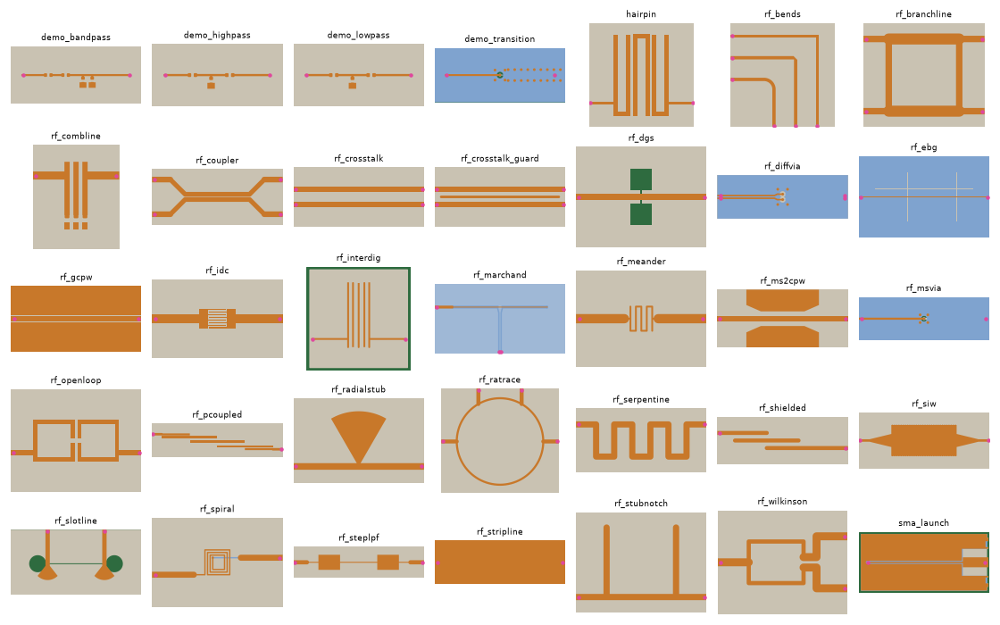
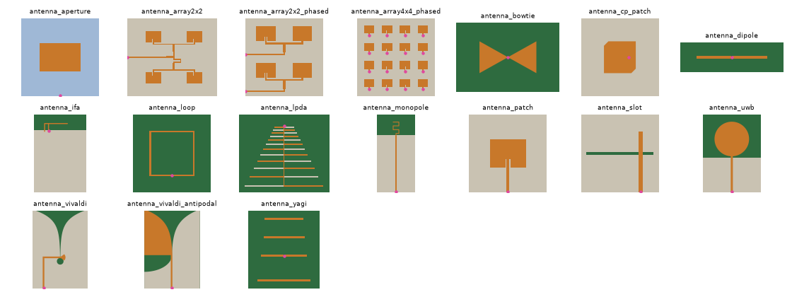
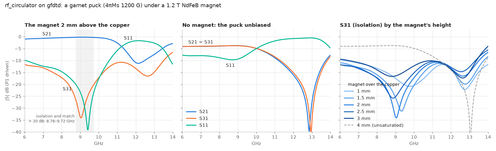
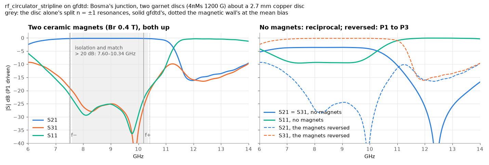
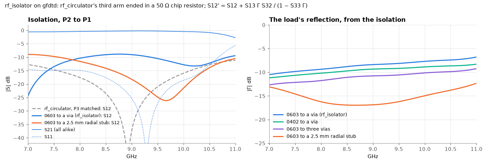
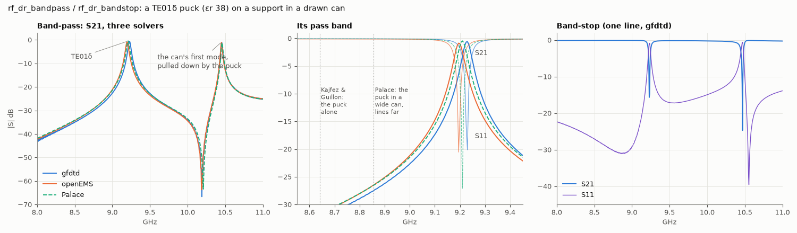
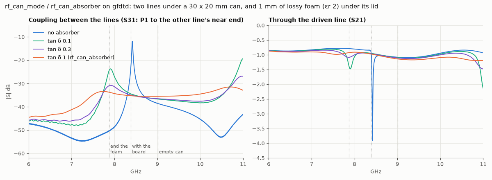
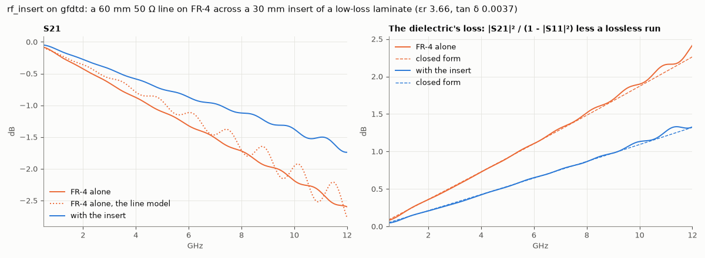

# Examples

[← GUI](gui.md) · [Index](index.md) · [Next: Results →](postprocessing.md)

Each example has a config in `examples/`; run them from the repository root, and the results go to
`examples/out/`. They are installed with kicad2ems (the package `kicad2ems.examples`), so they also open from the
GUI's *File → Examples* in any install (copied, with their boards made, to `~/.local/share/kicad2ems/examples/`), and
a program reaches them through `kicad2ems.examples` (`examples()`, `prepare_example(name, folder)`, and
`index()`: each with its group and what it is). The menu's groups are `GROUPS` in `examples/__init__.py`
(Antennas, RF structures, Lumped-element demos, with subgroups), and what an example is comes from its config's
first comment line. An installed analysis adds its own after them: pcbqs's circuits (`circuit_buck`, ...), each a
config beside its model and its board.

Only three boards are stored (`rf_interdig`, `hairpin`, `sma_launch`); the others are made by scripts, which the
installer runs. After pulling a change to a generator, make them again:

```bash
python examples/make_boards.py                                # every generated board (or: make_boards.py NAME ...)
```



*The boards from above: top copper orange, inner layers blue, the bottom layer beige, the bare substrate green,
ports pink (`python tools/doc_figures.py gallery`).*

## Generated boards

`make_demo_board.py OUT [VARIANT]`:

| Variant | Board | Config |
|---|---|---|
| `transition` (default) | 4 layers: microstrip, a blind via, then stripline between ground planes | `demo_transition.toml` |
| `diff` | a differential microstrip pair with a 45° jog | none: run with `--ground B.Cu` |
| `rlc` | microstrip with a gap bridged by a 1.5 pF capacitor | none |
| `lowpass`, `highpass`, `bandpass` | lumped filters of 0402 parts, plus the ideal circuit for comparison | `demo_lowpass.toml`, … |
| `launch` | a 4-layer edge launch with a grounded-CPW feed | none: `--nets RF,GND --fmin 1 --fmax 6` |

`make_antennas.py KIND OUT [param=mm …]` makes antennas, most for 2.45 GHz, each with a config
`antenna_<kind>.toml`; dimensions can be changed on the command line (`make_antennas.py ifa out arm=19`). Two
need drawn solids, written beside the board as the Draw page's shapes (`antenna_<kind>_shapes.json`): `dra` (a
dielectric resonator and its feed slot) and `patch_radome` (the patch and a plate over it).



<a id="rf-structures"></a>
## RF structures

`make_rf_examples.py` makes classic microwave structures, most on 0.8 mm FR-4 over a ground plane, some on 4 layers
or RO4003C (`make_rf_examples.py all`, or `NAME` for one). The first eleven have openEMS results in
`examples/reference/` and compare the solvers (`tools/compare_solvers.py`, 2026-10-28, mom25d's again on
2026-11-12; mom25d with lumped ports, as the FDTD solvers have):

| Board | Result | openEMS | gfdtd | mom25d | line model |
|---|---|---|---|---|---|
| `rf_branchline`: 3 dB hybrid, 2.4 GHz | S21 / S31 | −3.73 / −3.36 dB | −3.77 / −3.36 dB | −3.57 / −3.39 dB | −3.46 / −3.38 dB |
| `rf_wilkinson`: power divider with a 100 Ω resistor | S21, S22, S32 | −3.34, −20.2, −35.3 dB (−3.35, −21.2, −32.2 converged) | −3.35, −20.3, −34.6 dB | −3.31, −20.1, −38.7 dB | −3.30, −18.4, −35.7 dB |
| `rf_steplpf`: stepped-impedance low-pass, 2 GHz | −3 dB frequency | 1.736 GHz (1.729 converged) | 1.737 GHz | 1.756 GHz | 1.800 GHz |
| `rf_stubnotch`: two open λ/4 stubs, 2.4 GHz | notch | 2.383 GHz | 2.398 GHz | 2.411 GHz | 2.493 GHz |
| `rf_gcpw`: grounded CPW with via fences | worst S11, S21 at 5 GHz | −14.8, −0.39 dB | −14.5, −0.39 dB | −22.5, −0.33 dB | −12.1, −0.35 dB |
| `rf_coupler`: 10 dB coupler, 0.14 mm gap | S31, S21 | −10.3, −0.77 dB | −10.3, −0.77 dB | −10.6, −0.69 dB (−10.9, −0.67 before gap rings, [mesh](mom.md#meshers)) | −10.4, −0.72 dB |
| `rf_ratrace`: 180° hybrid ring, 2.4 GHz | S21, S41, S31 | −3.38, −3.54, −28.2 dB | −3.38, −3.52, −28.0 dB | −3.34, −3.45, −35.8 dB | −3.34, −3.43, −46.7 dB |
| `rf_radialstub`: one 60° radial stub | notch | 2.13 GHz | 2.13 GHz | 2.17 GHz | 2.18 GHz (qucsator's radial stub; scikit-rf slices the fan: 1.99 GHz) |
| `rf_stripline`: 4 layers, via-fenced stripline | worst S11, S21 at 10 GHz | −17.5, −0.59 dB | −16.5, −0.58 dB | −17.3, −1.04 dB | −13.5, −0.63 dB |
| `rf_diffvia`: 100 Ω pair through two vias | Sdd21 at 5 / 10 GHz, worst Sdd11 | −0.44 / −0.60, −15.4 dB | −0.43 / −0.59, −15.4 dB | −0.40 / −0.94, −15.4 dB | −0.41 / −1.06, −11.9 dB |
| `rf_shielded`: resonator filter in a metal can; 4.621 GHz from a converged 3D FEM run (EMerge) | peak | 4.625 GHz (4× mesh; 4.555 by default) | 4.625 GHz | 4.648 GHz (no can) | 4.877 GHz |

`rf_shielded_can` is the same board in a can drawn as solids (a metal box 0.5 mm thick with an air box drawn inside
it, `rf_shielded_can_shapes.json`), in open boundaries: S21's peak 4.6255 GHz on gfdtd and openEMS, as with the PEC
boundary, for 6 % more run time ([drawn solids](meshing.md#drawn-solids)). mom25d refuses it.

`rf_circulator` is a microstrip Y-junction circulator built on the Draw page (`rf_circulator_shapes.json`; `python
examples/make_rf_examples.py circulator` writes it and the board): a bare 0.508 mm RO4003C board with its ground,
and drawn on it a garnet puck (4πMs 1200 G, ΔH 30 Oe, εr 15, 6.4 mm across) set into the laminate, a copper
junction disc (r 2.45 mm), three 50 Ω arms 120° apart with 30 Ω quarter-wave transformers, three ports, and a
NdFeB magnet (Br 1.2 T, 8 mm across, 3 mm tall) 2 mm over the copper. The magnet saturates the puck
(`core.magnets.magnetisation`, self-consistent: its internal field 490–1370 Oe over its cells, its magnetisation
36° off z on the mean and up to 49°, where the magnet's field spreads) and gfdtd runs the magnetised ferrite, each
cell about its own direction ([gfdtd](gfdtd/README.md#how-it-works)); openEMS and Palace refuse it. 0.94 M cells,
2 s a port on an RX 7800 XT.



| | P1 → P2 (S21) | P1 → P3 (S31) | S11 | isolation and match > 20 dB |
|---|---|---|---|---|
| the magnet 2 mm over the copper, at 9.22 GHz | −0.23 dB | −29.5 dB | −31.5 dB | 8.68–9.66 GHz |
| no magnet (the puck unbiased: reciprocal), at 9.22 GHz | −3.8 dB | −3.9 dB | −8.7 dB | — |
| the magnet reversed (Br −1.2 T), at 9.22 GHz | −26.4 dB | −0.23 dB | −31.5 dB | (P1 → P3) |
| the magnet 1.0 / 1.5 / 2.5 / 3.0 / 4.0 / 5.0 mm over | | best −28.3 (6.4 GHz) / −25.7 / −24.3 / −19.9 / −15.0 / −10.4 dB | | — / 8.76–9.92 / 8.82–9.34 / — / — / — GHz |

All three ports driven, the matrix turns with the ports (S21 = S32 = S13, S31 = S12 = S23, S11 = S22 = S33 within
0.02, 0.03, 0.04); reversing the magnet swaps P2 and P3 within 0.05 (the board is its own mirror image); −60 dB
instead of −40 dB to stop moves S by 0.2 dB at most from 6.5 to 14 GHz, and a 0.07 mm mesh instead of 0.1 mm moves
the band to 8.80–9.72 GHz (its lower edge 1.4 %, its upper 0.6 %). The magnet is the circuit's tuning: too far and
the puck is no longer saturated (4 mm: 6 % of its cells, at its rim, partly magnetised, M/Ms 0.58–1; 5 mm: 95 %,
0.38–1); too close (1 mm) and the bias rises until the ferrite's resonance nears the band (the ripple at 6–7 GHz)
while its metal loads the junction. The partly magnetised ferrite (Green and Sandy's μ, Rado's κ) still circulates:
with the magnet 4 mm over, S31 −15.0 dB at 8.64 GHz (S21 −0.48 dB), where those cells left at μ 1 (the model
before) gave −12.0 dB (S21 −0.74 dB); 5 mm over, −10.4 dB at 8.54 GHz (S21 −0.95 dB) against nothing (S21 = S31,
−6.5 dB, the unbiased puck's).

The bias model moved the circuit little. With the ferrite taken saturated along z (the face model alone: 300–840
Oe, along z) the band was 8.76–9.74 GHz (S21 −0.21, S31 −29.6, S11 −28.9 dB at 9.22 GHz); along its own direction
it is 8.68–9.66 (−0.23, −29.5, −31.5 dB): above resonance (f ≈ 2.5 (f0 + fm) here) κ ≈ fm/f hardly depends on H0,
and the tilt's cos θ is partly made up by the higher internal field (S moved by 0.14 at most from 8 to 10.5 GHz).
gfdtd's faces' scheme (the grid's own magnetostatic modes gone) moved it by 0.006 at most there.

`rf_circulator_stripline` is Bosma's stripline Y-junction circulator, built on the Draw page
(`rf_circulator_stripline_shapes.json`; `python examples/make_rf_examples.py circulator_stripline`): a copper
junction disc (r 2.7 mm) on In1.Cu between two garnet discs (4πMs 1200 G, ΔH 30 Oe, εr 15, each 0.508 mm and the
disc's radius) that replace the RO4003C above and below it, between ground planes on F.Cu and B.Cu (In2.Cu empty:
the stack 0.508, 0.254, 0.254 mm), three 50 Ω stripline arms (0.57 mm) with 22 Ω transformers (1.85 mm, 3.6 mm
long), stitching vias on a 1.5 mm lattice wherever they clear the copper by 0.8 mm (a fence along each arm, no
parallel-plate cavity between them: the ports, from In1.Cu to B.Cu, launch that wave too), and two ceramic magnets
(Br 0.4 T, 8 mm across, 1.5 mm tall) on the planes, both magnetised up. Their in-plane fields cancel at the
mid-plane: the discs are magnetised within 23° of z (7° on the mean), their internal field 300–1180 Oe (mean 600).
3.0 M cells, about 18 s a port.



| | P1 → P2 (S21) | P1 → P3 (S31) | S11 | isolation and match > 20 dB |
|---|---|---|---|---|
| the magnets, at 9.88 GHz (the best isolation) | −0.18 dB | −46.9 dB | −33.9 dB | 7.60–10.34 GHz (31 %) |
| no magnets (reciprocal), at 9 GHz | −3.6 dB | −3.7 dB | −9.4 dB | — |
| the magnets reversed (Br −0.4 T), at 9 GHz | −24.5 dB | −0.2 dB | −25.2 dB | (P1 → P3) |

All three ports driven, the three transmissions agree within 0.02 dB and 5.4° over 7.6–10.3 GHz, and every port's
isolation and match is better than 20.3 dB there; unbiased, S11 is the reciprocal junction's least, 1/3 (−9.5 dB);
a 0.07 mm mesh moves the band to 7.62–10.36 GHz (0.2 %).

Against Bosma and Fay and Comstock: in the magnetic-wall model the disc's n = ±1 modes split to x = kR with
J1′(x) ∓ (κ/μ) J1(x)/x = 0, k = ω √(εr μ_eff) / c, μ_eff = (μ² − κ²)/μ (Polder's), and the circulator works between
them, centred where kR = 1.841. gfdtd on the junction alone (the discs between PEC plates, no arms, a source at its
rim):

| | gfdtd | magnetic wall at R | |
|---|---|---|---|
| unbiased (μ 1) | 8.337 GHz | 8.401 GHz | −0.8 % |
| uniform H0 300 Oe: f−, f+ | 7.386, 10.082 GHz | 7.366, 10.206 GHz | +0.3 %, −1.2 % |
| uniform H0 550 Oe | 7.499, 10.240 GHz | 7.484, 10.375 GHz | +0.2 %, −1.3 % |
| uniform H0 800 Oe | 7.590, 10.422 GHz | 7.599, 10.567 GHz | −0.1 %, −1.4 % |
| the magnets' bias (300–1180 Oe) | 7.522, 10.195 GHz | 7.506, 10.410 GHz (the mean, 598 Oe) | +0.2 %, −2.1 % |

The disc's field reaches past its rim into the laminate (εr 3.55, a quarter of the garnet's), so the magnetic wall
is not quite at R: with a uniform bias f− is within 0.3 %, the unbiased mode 0.8 % low and f+ 1.2–1.4 % low. The
magnets' bias is not uniform (about 300 Oe at the axis, up to 1180 near the rim): f+ moves a further 0.8 % against
the mean. Fay and Comstock's centre at the mean bias is 9.45 GHz (κ/μ −0.39); the circulator's 20 dB band runs from
f− to f+ (7.60–10.34 GHz), its best isolation at 9.88, its band's middle 8.97: its 22 Ω transformers couple it far
more strongly (ψ 20°) than the weak coupling their model assumes, and they set where across the split band it is
matched.

`rf_isolator` is `rf_circulator` with its third arm ended in a 50 Ω 0603 resistor (R1, a footprint on the board,
along y) whose far end goes to a 2.5 mm radial stub, an RF ground with no via: a two-port (`python
examples/make_rf_examples.py isolator`). At 9.24 GHz S21 −0.25 dB, S12 −21.1 dB, S11 −35.8, S22 −33.0 dB;
isolation and both matches better than 20 dB from 9.16 to 9.74 GHz (best 24.6 dB at 9.48). 1.28 M cells, 3 s a port.
The load is what limits it. Against `rf_circulator`'s three-port with P3 matched (its 2 × 2 corner: S12 −21 to −37
dB), what P2 sends to P3 comes back from the load and goes on to P1, S12′ = S12 + S13 Γ S32 / (1 − S33 Γ). The 0603
to a via to the ground in its far pad (`stub=None`) reflects Γ −8.3 dB at 9.2 GHz (its current's path, pad, gap and
via, an inductance in series): the forward path and the matches are the same (S21 −0.2 dB, S11 −40 dB), but the
isolation only 9–10 dB across the band. A 0402 to a via reflects −9.3 dB, an 0603 to three vias in a ground pad
−10.7; to the radial stub −15 to −17 dB from 8 to 10 GHz.



<a id="dielectric-resonator"></a>
`rf_dr_bandpass` is a dielectric resonator filter built on the Draw page (`rf_dr_bandpass_shapes.json`; `python
examples/make_rf_examples.py dr_bandpass` writes it and the board): a plain board of two 50 Ω lines on 0.508 mm
RO4003C, and drawn on it a ceramic puck (εr 38, tan δ 2·10⁻⁴, 6 mm across, 2.4 mm tall) on a support (εr 4.5, 3 mm
across, 1.2 mm tall) between the lines, 0.5 mm from its rim, and a can round the board (a metal box with air inside,
18 × 14 mm, 3 mm over the puck). Each line runs 5 mm past the puck's centre to an open end, its current's maximum
at the puck, and couples to the TE01δ mode's magnetic field. `rf_dr_bandstop` (`dr_bandstop`) is the same puck
beside one line through the can, 1 mm under its rim. The first drawn-solid example all three volume solvers run
(2026-11-27; gfdtd on an RX 7800 XT, openEMS on 24 threads of an i7-13700K, Palace on 8 processes):

| `rf_dr_bandpass`, P1 driven | gfdtd | openEMS | Palace |
|---|---|---|---|
| TE01δ: S21's peak | 9.228 GHz | 9.196 GHz | 9.210 GHz (its eigenmode 9.2096) |
| S21, S11 there | −0.56, −20.1 dB | −0.85, −20.5 dB | −0.47, −27.1 dB |
| −3 dB band (loaded Q) | 9.209–9.248 GHz (235) | 9.176–9.217 GHz (224) | 9.190–9.230 GHz (228; eigenmode 227) |
| unloaded Q, from S21 and the loaded Q | 3,740 | 2,410 | 4,370 (eigenmode 4,420) |
| the can's first mode, pulled down by the puck | 10.45 GHz | 10.45 GHz | 10.458 GHz |
| model, time | 0.20 M cells, 274k timesteps, 8 s | the same mesh, 254k timesteps, 100 s | 23,750 tetrahedra (`feature = 1`), 58 s; eigenmodes 139 s; 2.4 GB |
| a finer mesh (`--res 40 --fine 0.1 --nz 8`, 0.64 M cells) | 9.2014 GHz, −0.61 dB, 56 s | 9.1987 GHz, −0.70 dB, 448 s | |

The two FDTD engines are 0.35 % apart on the default mesh (the puck's staircase at εr 38) and 0.03 % on the finer
one, which moves both towards Palace's. Their dielectric loss is a conductivity set at the band centre (`--diel
fixed`), 3 % too high at 9.2 GHz; Palace's is tan δ itself. The unloaded Q is the loss: openEMS's is 0.55 of
Palace's on the default mesh and 0.67 on the finer one, gfdtd's 0.85 and 0.76.

Against the closed forms for a puck alone (a = 3 mm, H = 2.4 mm): Kajfez & Guillon's f = 34 / (a √εr) (a/H + 3.45)
GHz, mm (±2 % for 0.5 < a/H < 2 and 30 < εr < 50) gives 8.641 GHz; Cohn's magnetic-wall waveguide 8.240 GHz and
Itoh & Rudokas's dielectric waveguide 9.501 GHz. Palace's eigenmode of the same puck nearly alone (a 24 × 24 mm can
6 mm over it, an air support 4 mm over the board, the line 4 mm from its rim) is 8.856 GHz, 2.5 % above Kajfez &
Guillon's. From there, Palace's eigenmodes step to the filter:

| | TE01δ | |
|---|---|---|
| the puck nearly alone (support εr 1 / 4.5) | 8.856 / 8.868 GHz | |
| on the 1.2 mm support, the board's ground 1.7 mm under it | 9.101 GHz | +2.6 % |
| the lid 3 mm over it | 9.181 GHz | +0.9 % |
| the walls of an 18 × 16 mm can, 5–6 mm from its rim | 9.188 GHz | +0.07 % |
| the filter: 18 × 14 mm, its lines 0.5 mm from the rim | 9.210 GHz | +0.24 % |

The two models with the support, the board and the lid as TE01 sections ending in metal over and under the puck
put the ground's and the lid's share at +0.6 % (dielectric waveguide) and +1.1 % (Cohn), where Palace has +3.5 %:
both keep the fields above and below inside the puck's radius, and the ground's pull spreads past it.



`rf_dr_bandstop` on gfdtd: the notch at 9.232 GHz, −16.4 dB, 31 MHz wide at −3 dB (0.13 M cells, 270k timesteps,
8 s); the can's first mode makes a second at 10.47 GHz. The line further under the rim deepens it (0 / 0.5 / 1 mm
under it: −12.3 / −14.7 / −17.3 dB). Without the support, the puck on the laminate (in a 20 × 16 mm can, the lines
1 mm from it), the ground pulls TE01δ up to 9.86 GHz, between the can's first mode (9.38 GHz) and the puck's hybrid
modes (10.06 and 10.14 GHz): the support is what keeps the pass band clean. The gfdtd times are the GPU's alone;
shared with other runs they were up to three times longer.

<a id="shield-can-resonance"></a>
`rf_can_mode` is two 50 Ω lines 10 mm apart across 0.8 mm FR-4 under a can drawn round the board (30 × 20 mm, 4 mm
over it; `make_rf_examples.py can_mode`). Apart from the can's modes the lines barely couple; its first, TE101 with
the height as the short side (E vertical, half a wave along each side), couples them. `rf_can_absorber`
(`can_absorber`) draws 1 mm of a lossy foam (εr 2, tan δ 1: a carbon-loaded foam's) under the lid. The closed form:
the empty can c/2 √(1/a² + 1/b²) = 9.008 GHz; with the board's FR-4 on its floor (transverse resonance through the
FR-4 and the air, TM to z) 8.383 GHz; and the foam under the lid (its εr) 7.873 GHz.

| | closed form | gfdtd | Palace |
|---|---|---|---|
| the can's first mode | 8.383 GHz | 8.418 GHz, loaded Q 395 (from S31's −3 dB) | 8.419 GHz, Q 431 (Q_ext 3,370 each port) |
| there: S31, S41; the driven line's S21 | | −11.7, −11.1 dB (−45 to −55 dB below it); −3.9 dB | |
| with the foam | 7.873 GHz (its εr alone) | no peak: S31 at most −33 dB | 7.643 GHz, Q 12.4 |
| tan δ 0.1 / 0.3 | | S31 −23.6 / −30.8 dB at 7.92 GHz | |
| model, time | | 0.07 M cells, 345k timesteps, 6 s; the foam: 0.08 M cells, 14k timesteps, 1 s | 17,000 / 22,700 tetrahedra, 112 / 179 s |



<a id="laminate-insert"></a>
`rf_insert` is a 50 Ω line 60 mm long on 0.8 mm FR-4 (εr 4.4, tan δ 0.02) across an insert of a low-loss
hydrocarbon-ceramic laminate (εr 3.66, tan δ 0.0037), 30 × 10 mm, drawn through the board's whole thickness
(`make_rf_examples.py insert`): a dielectric solid in the board takes the FR-4's place. The line over it is 1.752
mm wide, 50 Ω on it (1.531 mm on FR-4). Both laminates are wideband (`diel = "wideband"`, εr and tan δ as given at
10 GHz). The copper is perfect, so the loss is the dielectric's, the line's radiation and its ports'; a lossless run
(tan δ 0) has the last two (0.06, 0.19, 0.27 dB at 2, 5, 10 GHz on FR-4 alone), taken off |S21|² / (1 − |S11|²)
for the dielectric's share. Its closed form is Pozar's microstrip dielectric attenuation with Kirschning & Jansen's
dispersive εeff and each laminate's Djordjevic–Sarkar εr and tan δ at the frequency. On gfdtd (0.09 M cells, 4,200
timesteps, 1 s):

| | 2 GHz | 5 GHz | 10 GHz |
|---|---|---|---|
| S21: FR-4 alone / with the insert | −0.42 / −0.28 dB | −1.10 / −0.75 dB | −2.19 / −1.38 dB |
| the dielectric's loss, FR-4 alone: gfdtd / closed form / the line model (qucsator) | 0.358 / 0.361 / 0.357 dB | 0.912 / 0.915 / 0.906 dB | 1.898 / 1.870 / 1.871 dB |
| the dielectric's loss with the insert: gfdtd / closed form | 0.207 / 0.211 dB | 0.530 / 0.535 dB | 1.133 / 1.093 dB |

The line model does not see the insert (it builds its sections from the board's tracks); its FR-4 line is the
closed form's. Above 10 GHz the lossless run's ripple, not the dielectric, sets the agreement (12 GHz: 2.42 against
2.26 dB).



The figures above sit at single frequencies; a small reflection there mostly says where its ripple falls. Over the whole band, each solver's agreement with openEMS's reference (the rms of the complex difference of the input reflection, dB, and the rms difference of the transmission's |S|):

| Board | gfdtd | mom25d | line model |
|---|---|---|---|
| `rf_branchline` (S11 / S21) | −43.1 dB / 0.08 dB | −30.7 dB / 0.23 dB | −28.8 dB / 0.38 dB |
| `rf_wilkinson` (S11 / S21) | −54.6 dB / 0.02 dB | −30.6 dB / 0.09 dB | −24.4 dB / 0.11 dB |
| `rf_steplpf` (S11 / S21) | −34.7 dB / 0.24 dB | −25.9 dB / 0.72 dB | −19.9 dB / 1.52 dB |
| `rf_stubnotch` (S11 / S21) | −40.1 dB / 0.77 dB | −23.8 dB / 1.90 dB | −15.1 dB / 5.34 dB |
| `rf_gcpw` (S11 / S21) | −46.5 dB / 0.03 dB | −26.1 dB / 0.26 dB | −16.5 dB / 0.24 dB |
| `rf_coupler` (S11 / S21) | −45.5 dB / 0.02 dB | −38.3 dB / 0.10 dB | −28.1 dB / 0.14 dB |
| `rf_ratrace` (S11 / S21) | −45.4 dB / 0.08 dB | −22.6 dB / 1.06 dB | −18.1 dB / 1.26 dB |
| `rf_radialstub` (S11 / S21) | −46.6 dB / 0.16 dB | −26.9 dB / 1.84 dB | −18.6 dB / 2.89 dB |
| `rf_stripline` (S11 / S21) | −42.2 dB / 0.02 dB | −31.5 dB / 0.25 dB | −25.8 dB / 0.05 dB |
| `rf_diffvia` (S1d1d / S2d1d) | −68.4 dB / 0.01 dB | −29.6 dB / 0.21 dB | −26.3 dB / 0.21 dB |
| `rf_shielded` (S11 / S21) | −49.1 dB / 0.13 dB | −16.2 dB / 2.87 dB | −9.9 dB / 11.21 dB |

More structures (`make_rf_examples.py <name>`, boards and configs in the repository), on gfdtd:

| Board | What it shows | gfdtd |
|---|---|---|
| `rf_siw`: substrate-integrated waveguide, 0.508 mm RO4003C, 6 mm tapers | TE10 cut-off (6.0 GHz by design), pass band | cut-off 6.34 GHz; 7.5-11 GHz S21 −0.7 to −1.1 dB, S11 below −7.9 dB (the two tapers' standing wave) |
| `rf_msvia`: F.Cu microstrip through one via to B.Cu microstrip, 4 layers | worst S11 to 10 GHz, S21 at 5 / 10 GHz | −12.9 dB, −0.38 / −1.02 dB |
| `rf_ms2cpw`: microstrip to grounded CPW and back | worst S11 to 10 GHz, S21 at 5 / 10 GHz | −19.0 dB, −0.66 / −1.34 dB |
| `rf_slotline`: microstrip-slotline transitions back to back | −3 dB pass band | 1.1-8 GHz, 0.75 dB at best |
| `rf_marchand`: broadside Marchand balun, 2.4 GHz, 4 layers | S11, differential / common-mode transmission at 2.4 GHz | −43.6 dB, −0.47 / −22.1 dB (S11 below −22 dB, Sc1 below −21 dB from 1.8 to 3 GHz) |
| `rf_bends`: square, mitred, curved 90° bends | S11 at 10 GHz | −12.3, −26.2, −20.9 dB |
| `rf_serpentine`: 80.5 mm of 50 Ω meander | group delay below 3 GHz | 437 ps, 53 ps short of its centre line's (coupled turns cut corners) |
| `rf_crosstalk` / `rf_crosstalk_guard`: lines 3 mm apart, 40 mm | worst NEXT, FEXT at 5 GHz | −26.1 / −29.4 dB, −18.3 / −22.2 dB: the grounded guard trace takes 3-4 dB off |
| `rf_pcoupled`: 3-pole parallel-coupled band-pass, 2.4 GHz, 5 % | −3 dB band, loss, mid-band match | 2.288-2.452 GHz, 5.5 dB (FR-4 at 5 %), −15 dB |
| `rf_combline`: 3-pole combline, 0603 loading capacitors | −3 dB band, loss, mid-band match | 2.237-2.560 GHz, 0.95 dB, −10.8 dB (0.4 pF on the middle rod, 0.6 pF on the outer ones) |
| `rf_openloop`: two open-loop resonators | −3 dB band, loss, mid-band match | 2.290-2.510 GHz, 3.3 dB, −10.3 dB; qucsator's line model follows it closely |
| `rf_dgs`: dumbbell defected ground under a 50 Ω line | stop band | below −10 dB 3.8-7.6 GHz, −19 dB at 5.7 GHz |
| `rf_ebg`: microstrip over a mushroom EBG, 4 layers | stop band | below −10 dB 3.8-5.1 GHz, −42 dB at 4.1 GHz |
| `rf_idc` / `rf_meander` / `rf_spiral`: series C / L in a 50 Ω line | C or L at 1 GHz, self-resonance (mom25d alongside) | 0.61 pF (mom25d 0.54, Alley's formula 0.52) / 10.7 nH (11.5), 5.1 GHz / 28.3 nH (29.2), 1.83 GHz |

The wide-band ones take `diel = "wideband"`: with the default fixed conductivity, FR-4's loss grows as 1/f below
the band centre (at 1 GHz on a 0.5-10 GHz run, 20 % of the power).

Where the solvers disagree:

- **Coupler and grounded CPW**: openEMS needs z cells graded towards the strips ([meshing](meshing.md#z-lines)).
  The references are on a mesh graded from a quarter of the fine cell (`--z-sheet 0.25`), within about 0.2 dB and
  0.5 dB of converged; mom25d's coupling is 0.3–0.4 dB stronger.
- **Curved and fan-shaped copper**: the default mesh refines over arcs and fans (`--curve-res`), which puts the
  radial stub's notch where meshes 3–4× finer do. The rat-race's isolation null needs a finer curve mesh still:
  on gfdtd it converges at 2.30 GHz (2.18 at the default `--curve-res`, 2.25 at 12, 22 M cells at 64), against
  mom25d's 2.33, EMerge's 2.31 and the line model's 2.40 (the design).
- **Differential via**: the line model's via transition is its weak part above 5 GHz (worst Sdd11 −11.9 dB,
  [limits](transmission-lines.md#limits)).
- **Ports**: with its default wave ports, de-embedded onto the line, mom25d measures the line itself (the
  stripline's worst S11 −34.3 dB: a 51 Ω line in a 50 Ω system) where lumped ports, like the FDTD solvers', include
  the port's own reflection (−19.9 dB). Over the band, lumped agrees with openEMS as well or better.
- **GCPW resonance**: the worst S11 is a resonance near 7.7 GHz, −14.8 and −14.5 dB in openEMS and gfdtd and
  −22.5 dB in mom25d, whose laterally infinite dielectric and via rows damp it.
- **gfdtd** matches openEMS within 0.05 dB and 10 MHz on most figures (all eleven boards in 78 s on the GPU). The
  largest differences: the stub notch 15 MHz higher, the stripline's worst S11 1 dB higher, the Wilkinson's deep
  isolation 0.7 dB. It has no conductor loss.
- **Filter loss**: openEMS's default dielectric model overstates the microstrip filter's loss by about 1.3 dB;
  with `--diel wideband` its pass band matches mom25d's to 0.05 dB.

## Board files

- **Hairpin filter** (`hairpin.kicad_pcb`): a 3.3 GHz band-pass filter of three hairpin resonators on
  0.21 mm FR-4.
- **SMA launch** (`sma_launch.kicad_pcb`): an edge-launch SMA connector onto a 50 Ω line on a 4-layer
  board. The ground planes end at the board edge without stitching vias, so the config adds
  [edge walls](meshing.md#edge-walls); without them, the planes resonate near 4.7 GHz.
- **Microstrip filter** (`rf_interdig.kicad_pcb`): an interdigital filter on 0.2 mm FR-4, 1 to 8 GHz. Its
  five fingers form a five-line [coupled section](transmission-lines.md#coupled-sections) in the line model.

## Verified results

openEMS 0.37.

**Lumped filters** (`demo_*.toml`) are compared with their ideal circuits, which shows what the layout
adds:

| Filter | Ideal | Simulated | Why |
|---|---|---|---|
| low-pass, 1 GHz | −3 dB at 0.87 GHz | 0.77 GHz | about 0.4 nH more in the shunt branch: the stub, the ground pad and its vias |
| high-pass, 1 GHz | | cutoff about 15 % lower | the via path in series with the shunt inductor |
| band-pass, 1 GHz | peak at 0.88 GHz | 0.74 GHz | pad and via inductance next to a small 2.2 nH shunt inductor |

**Antennas** (`antenna_*.toml`), all for 2.45 GHz on FR-4:

| Antenna | Resonance | S11 | −10 dB band | Directivity | Efficiency | Gain |
|---|---|---|---|---|---|---|
| patch | 2.438 GHz | −19.4 dB | 2.2 % | 7.0 dBi | 39 % | 2.9 dBi |
| inverted-F | 2.451 GHz | −33.5 dB | 12.0 % | 2.9 dBi | 91 % | 2.5 dBi |
| dipole | 2.430 GHz | −20.3 dB | 15.6 % | 2.1 dBi | 96 % | 1.9 dBi |
| slot | 2.434 GHz | −26.9 dB | 20.6 % | 4.4 dBi | 87 % | 3.7 dBi |

The dipole's 2.1 dBi matches an ideal half-wave dipole (2.15 dBi). The patch's low efficiency is FR-4 loss.

The **Vivaldi** (`antenna_vivaldi.toml`) is wideband, 3–10 GHz on 0.8 mm FR-4, and runs on gfdtd: it radiates off
the board's top edge, so the outline matters (mom25d ignores it). Its config animates the E field in the substrate
at 4, 6 and 8 GHz: the wave leaves the taper further out at low frequencies and nearer the throat at high ones. The
run's headline −10 dB band is only the contiguous band around the deepest dip; for a wideband antenna, read the S11
plot.

The **antipodal Vivaldi** (`antenna_vivaldi_antipodal.toml`, the same board and band) splits the flare between the
layers: the F.Cu half grows out of the 50 Ω microstrip, the B.Cu half out of the ground, overlapping by 0.5 mm at
the throat, so there's no slotline balun to tune. It matches better and gains more:

| | \|S11\| < −10 dB | Worst \|S11\| | Gain at 4 / 6 / 8 GHz | Front-to-back at 4 / 6 / 8 GHz | Efficiency |
|---|---|---|---|---|---|
| Vivaldi | 83 % of 3–10 GHz | −8.3 dB (6.7 GHz) | 3.0 / 6.0 / 6.4 dBi | 5.2 / 9.0 / 9.3 dB | 67–73 % |
| Antipodal | all of 3–10 GHz | −11.2 dB (6.3 GHz) | 4.3 / 6.3 / 7.6 dBi | 6.6 / 9.4 / 9.4 dB | 73–79 % |

Front-to-back is the gain off the aperture against the strongest in the rear half of the board's plane. Options of
`make_antennas.py vivaldi_antipodal` that raise its directivity (gfdtd, 4 / 6 / 8 GHz):

| Options | Board | Gain | Front-to-back | \|S11\| < −10 dB |
|---|---|---|---|---|
| none | 50 × 70 mm | 4.3 / 6.3 / 7.6 dBi | 6.6 / 9.4 / 9.4 dB | all of 3–10 GHz |
| `cd=5`: slots 1 mm wide, 5 mm deep, every 3 mm in the outer edges | 50 × 70 mm | 5.7 / 8.1 / 8.1 dBi | 8.5 / 15.7 / 12.4 dB | all |
| `dext=15 dl=24`: bare substrate past the aperture, a floating elliptical director in it | 50 × 85 mm | 4.6 / 7.0 / 8.2 dBi | 7.4 / 11.2 / 9.7 dB | 96 % (−9.8 dB worst) |
| `cd=5 dext=15 dl=24` | 50 × 85 mm | 6.0 / 8.6 / 8.8 dBi | 9.2 / 15.2 / 12.3 dB | all |

The slots stop the current running down the board's edges toward the feed, which made the back lobe (12 mm deep
ones suppress it better at 4 GHz but cost gain higher up). A finer mesh (6.5 M cells) moved these results by at most
0.1 dB. Variants after published designs did no better: symmetric curved halves (`sym=1`) lose 1.9 dB at 4 GHz,
striped directors 14 mm long resonate in the band, corner via walls change little.

`vivaldi_antipodal_array` feeds N elements from one port through a corporate microstrip network (T-junctions into
100 Ω lines, quarter-wave transformers back to 50 Ω). Four filled elements 30 mm apart (`sym=0 fr=0`) reach 10.8 dBi
at 8 GHz on FR-4, whose loss costs the feed about 1.4 dB. Both take the substrate as `er`, `tand` and `h`; on RO4003C
(`er=3.55 tand=0.0027 h=0.813`) efficiency is the difference:

| Design | Substrate | G, dBi (4 / 6 / 8 GHz) | Efficiency | Front-to-back, dB | \|S11\| < −10 dB |
|---|---|---|---|---|---|
| single, plain | FR-4 | 4.3 / 6.3 / 7.6 | 73–79 % | 6.6 / 9.4 / 9.4 | all |
| single, plain | RO4003C | 5.2 / 7.4 / 8.9 | 95–98 % | 6.8 / 9.0 / 9.7 | 83 % (−8.7 dB, 8.5 GHz) |
| 4 elements, filled | FR-4 | 6.0 / 8.9 / 10.8 | 45–55 % | 10.1 / 15.7 / 17.0 | 86 % (−8.6 dB, 3.4 GHz) |
| 4 elements, filled | RO4003C | 8.0 / 11.3 / 13.4 | 90–93 % | 12.3 / 16.9 / 17.5 | 71 % (−5.1 dB, 3.5 GHz) |

The low-loss board stops hiding the reflections FR-4's loss damped. `ns=2` or `ns=3` (2- or 3-section Chebyshev
transformers over 3–10 GHz in place of each quarter wave) take the array's matched band on RO4003C from 71 % to 78 %
and 83 %; what is left is the elements' coupling to each other.

```bash
python examples/make_antennas.py vivaldi_antipodal_array out sym=0 fr=0 er=3.55 tand=0.0027 h=0.813 ns=3
```

More antennas, on gfdtd (the ground plane finite or absent: mom25d's infinite ground does not suit them):

| Antenna | S11 | −10 dB band | Gain | Efficiency | Notes |
|---|---|---|---|---|---|
| `cp_patch`: corners cut, probe-fed (`port.width` 1.3 mm) | −25.9 dB | 2.400-2.526 GHz | 3.2 dBi | 44 % | axial ratio 0.5 dB at 2.45 GHz, RHCP |
| `aperture`: aperture-coupled patch, 4 layers | −14.3 dB | 2.410-2.485 GHz | 3.3 dBi | 44 % | fed through a slot in the In2.Cu ground |
| `monopole`: meander monopole, 60 mm ground | −12.1 dB | 2.344-2.544 GHz | 3.6 dBi | 81 % | 4 mm between the turns: at 2.6 mm they cancel and the match fails |
| `yagi`: printed Yagi-Uda | −13.6 dB | 2.357-2.533 GHz | 7.8 dBi | 90 % | endfire, D 8.2 dBi |
| `lpda`: printed log-periodic, 12 dipoles | −37.6 dB | 1.605-3.638 GHz | 4.8 / 5.6 / 5.9 dBi at 2 / 3 / 4 GHz | 69-81 % | 79 % of 1.5-4.5 GHz below −10 dB |
| `bowtie`: printed bowtie | −16.0 dB | 2.288-2.688 GHz | 1.9 dBi | 97 % | |
| `uwb`: disc monopole, partial ground | −32.2 dB | 91 % of 2-11 GHz | 2.3 / 3.5 / 5.1 dBi at 3 / 6 / 9 GHz | 83-85 % | |
| `loop`: full-wave square loop | −23.0 dB | 2.336-2.648 GHz | 2.7 dBi | 95 % | 100 Ω reference |
| `dra`: cylindrical dielectric resonator, εr 10, slot-fed, 6.5 GHz | −24.7 dB | 6.290-6.770 GHz | 6.0 dBi (5.3 broadside) | 98 % | HEM11δ; peak 34° off broadside in the E-plane, 14.8 dB front to back; openEMS within 0.1 dB |
| `patch_radome`: the patch under a 2 mm plate of εr 3, 3 mm above it | −26.2 dB | 2.397-2.458 GHz | 3.1 dBi | 41 % | 2.4275 GHz, the bare patch's 2.4375 (gfdtd and openEMS alike) |

The **dielectric resonator** (`antenna_dra.toml`, gfdtd 2 s, openEMS 22 s) is a DR of εr 10, 6 mm in radius and
6 mm tall, on the F.Cu ground of 0.508 mm RO4003C, fed through a 5.5 × 1.2 mm slot in it (a drawn cut) by a 50 Ω
microstrip on B.Cu, the stub 5 mm past the slot. Mongia and Bhartia's HEM11δ (the DR and its image) is 6.61 GHz;
fed through a 3.5 mm slot, too short to match (the load's resistance peaks at 10 Ω), it resonates at 6.63 GHz. A
longer slot couples more and pulls it down: 6.30 GHz at 5.5 mm (matched at 6.51 GHz), 5.72 at 7.5 mm, where the
match moves to the slot's own resonance (S11 −11.9 dB). Its E-plane (yz) is the flat one of a horizontal magnetic
dipole on a finite ground, its H-plane (xz) peaks broadside.

The **radome** (`antenna_patch_radome.toml`) moves the patch 10 MHz down (−0.4 %) and adds 0.2 dB of gain at 2.45
GHz. Laid on the copper (`make_antennas.py patch_radome out gap=0`) the plate moves it 3.2 % (2.3600 GHz), the same
drawn or as a 2 mm solder mask in the stackup (`--mask`); mom25d, whose layers are laterally infinite, 3.4 %.

The antenna results give the polarisation at the gain maximum: the axial ratio and the hand (RHCP / LHCP,
or linear above 20 dB), and the gain in each hand ([Results](postprocessing.md#antenna-mode)).

The **2×2 patch array** is four patches fed from one line. mom25d: 2.438 GHz, S11 −25.6 dB,
directivity 13.0 dBi, gain 7.0 dBi, 53 s. openEMS: 2.430 GHz, −22.0 dB, 13.3 dBi, gain 7.5 dBi, 271 s.

The **phased 2×2 array** (`antenna_array2x2_phased.toml`) has a feed per row, P1 and P2, driven with a
phase difference: P2 60° behind P1 tilts the beam to θ 15°, with 7.7 dBi gain (mom25d, 45 s). See
[Phased arrays](mom.md#phased-drive); the GUI steers it afterwards.

## Reference results

`examples/reference/` holds openEMS results for the demo transition, the three stored boards and the first
eleven RF structures. To check a change:

```bash
kicad2ems examples/rf_interdig.toml --compare examples/reference/rf_interdig_openems.s2p
```

---
[← GUI](gui.md) · [Index](index.md) · [Next: Results →](postprocessing.md)
