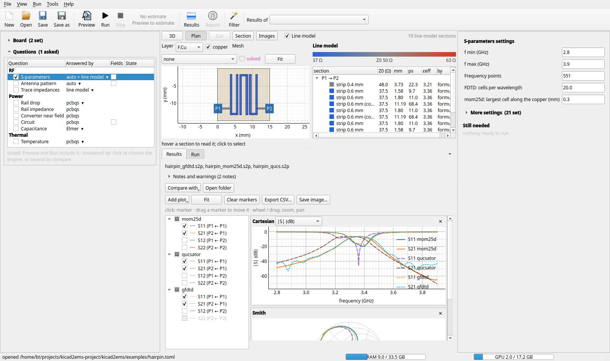
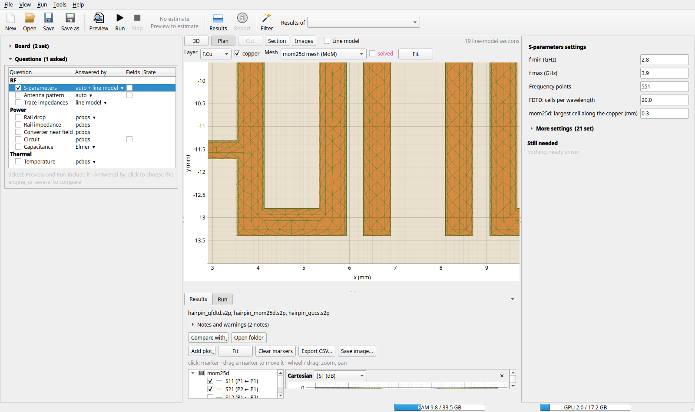
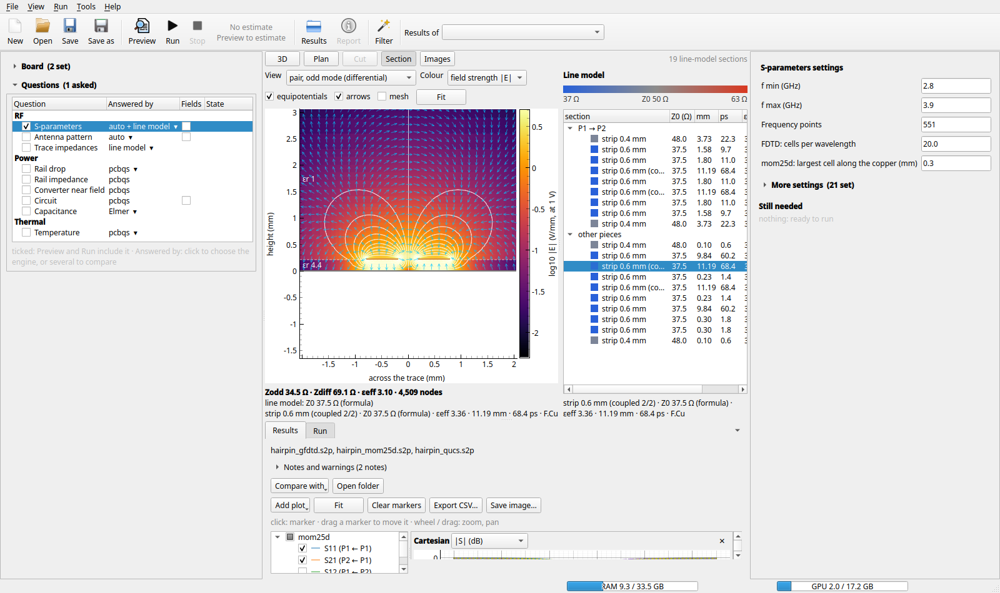
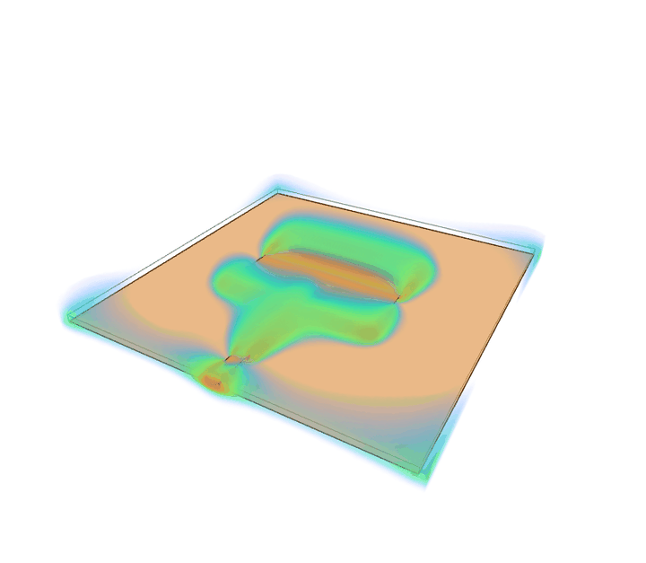
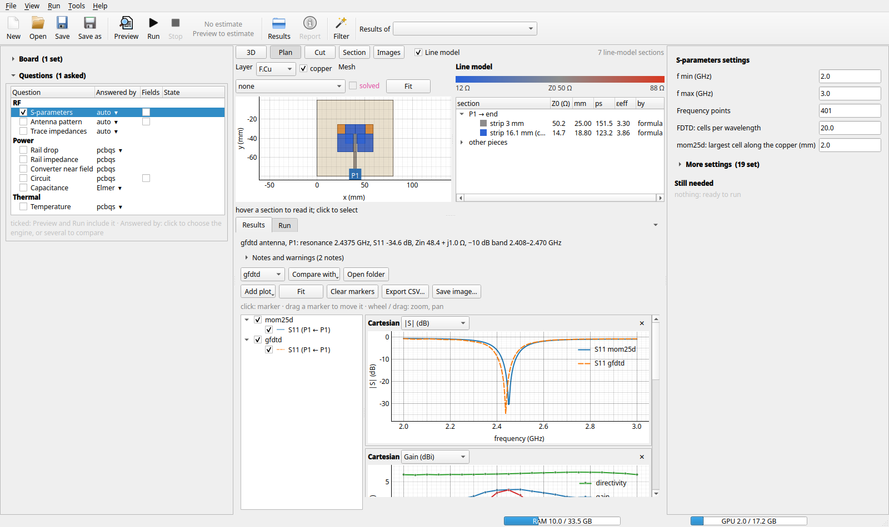
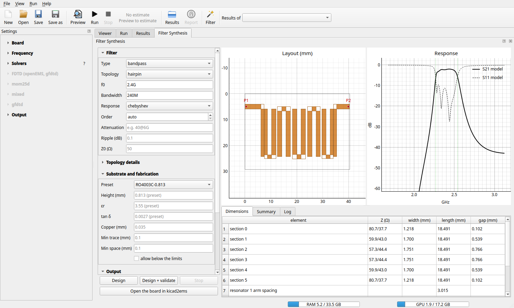
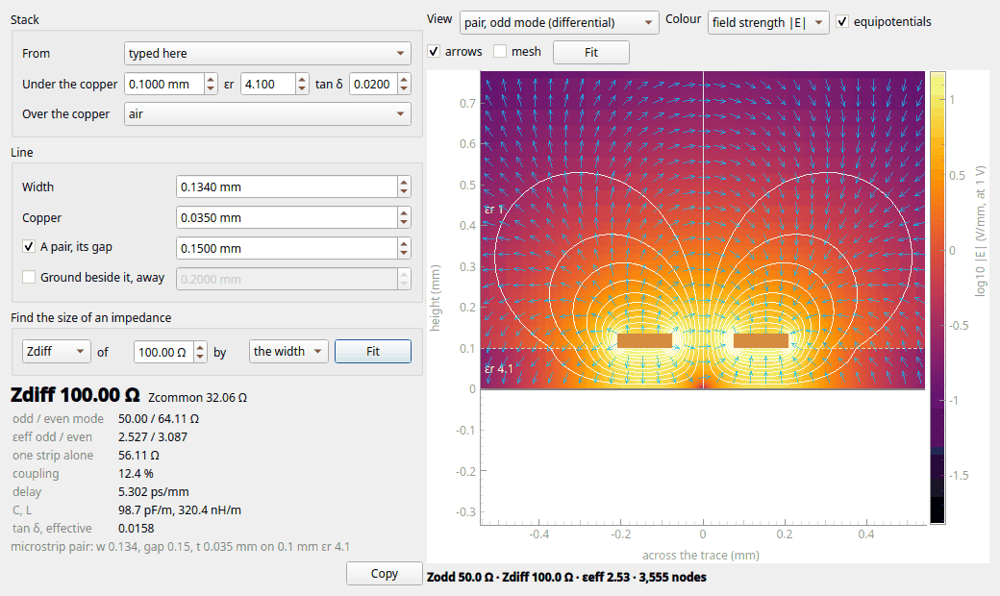

# GUI

[← Usage](usage.md) · [Index](index.md) · [Next: Examples →](examples.md)

```bash
pip install '.[gui]'          # kicad2ems-gui, its own package: PySide6, pyqtgraph, h5py, PyOpenGL
kicad2ems-gui [config.toml]   # or: python -m kicad2ems_gui
```

The GUI edits a run's settings and starts the command-line tool as a separate process: closing the window never
loses a run, and the GUI itself doesn't need openEMS.



## The window

One layout, in three columns: what is asked on the left, the board in the middle with the results that are not
maps in a drawer under it, the settings of the question selected on the right.

- **Toolbar**: New, Open, Save, Save as, Preview, Run, Stop, the run's estimate, the results folder, the report,
  *Filter* (the wand: [Filter Synthesis](#filter), a window of its own), and *Results of*: this board's preview
  or one of its runs ([below](#run-folders)). The estimate (after a preview) is the time and memory of the
  full-wave solvers ticked, or of the one *auto* would pick (`~4 min · 1.3 GB`); grey once the settings change,
  red when it won't fit in the memory available. It opens the Solvers window. **Run says what it will do**
  (*Run 2*: its tooltip names them in order) or, while something is missing, what that is (*Choose the board*):
  clicking it then goes to where it is set ([Still needed](#needed)).
- **Status bar**: the memory in use, the GPU's (through `nvidia-smi` or `rocm-smi`), and a running run's own;
  amber above 80 %, red above 95 %.
- **Left: the board and the questions.** The *Board* (its file and extra ports; the rest under *More about the
  board*), then the **Questions** asked of it ([below](#study)).
- **Middle: the board**, in the [Viewer](#viewer), always there. While *Circuit* is asked its schematic is a tab
  beside it. Under it the **drawer**: the [Results](#plots) page and the [Run](#the-run-page) page as tabs. It
  folds to its tab bar (the arrow at its right, or *View*), and a page comes to the front when it has something
  new: Run when a run starts, Results when one ends.
- **Right: the settings of the question selected.** For S-parameters, the few a run is set up with: the frequency
  range and points, and the main cell size of each solver chosen. The rest are under **More settings**: the
  sections *Frequency*, *Solvers* (the driven ports), one per solver (*FDTD (openEMS, gfdtd)*: the mesh, run and
  field-dump settings both share; *gfdtd*; *mom25d*; ...) and *Output*, each counting its settings that are set,
  a solver's greyed while it isn't chosen. *Find a setting* at its top shows only those whose name, key or
  section holds what you type. Empty fields use the default, shown as a hint.
- <a id="needed"></a>**Still needed**, under the settings: what a run of the selected question lacks, a line each
  (*the board has no port*, *name the rail*, *Q1 has no pad on ground: name the part its current returns
  through*); a click goes to where it is set. Kicad2ems checks its own run (the board, its ports, the band); an
  analysis says its own. *Run > Run the selected question alone* runs one whatever the others still need.

The columns and the drawer fold from *View* (Ctrl+1, 2, 3) and stay as they were left; *View > Reset layout*
shows them all. Nothing floats or docks. The window remembers its size, what is folded, its splitters and the
Results page's plots between sessions.

<a id="run-folders"></a>
**Where results go.** Each run gets a folder of its own under the output folder, named after the board and when it
started (`<out>/<board>_20261013_104514/`); a preview goes to `<out>/<board>_preview/`, which each preview
refreshes. Opening a config shows its newest run on the Results page and starts a preview, so the Viewer shows the
board as it is now; *Results of* picks an earlier run.

<a id="solvers"></a>
## Solvers

The solvers are chosen on the **S-parameters** row of the Questions list: click its *Answered by* cell for a
menu with a tick per solver, plus *auto*; plugin solvers appear too, with their own settings. After a preview,
each full-wave solver's entry shows its estimate (`mom25d (MoM) · ~4 min, 1.3 GB`), and its tooltip says why
one can't run here.

**?** beside *Solvers* (or *Help > Solvers and hardware*) opens the Solvers window: every solver with ✔ or ✖ and
what it found, the CPU, the memory and the GPU, and the last preview's estimates. Its *Programs* box sets where
qucsator is and the **openEMS environment**: a venv with openEMS, when it isn't in kicad2ems's own Python (of the
same Python version). These are the machine's settings, not a board's: they go into
`~/.config/kicad2ems/site.toml`.

**Stop** asks the run to stop: openEMS and gfdtd end at once and keep what they computed, mom25d ends after the
frequency it is solving, and solvers that haven't started are skipped. Press Stop again to end the process at once.

<a id="configs"></a>
## Configs

The *File* menu has New, Open, recent files, the examples, Save and Save as; the title shows `*` while there are
unsaved changes. Saving over an existing config **keeps the file as it was**: comments, key order, tables and keys
the GUI doesn't know all stay, and only the changed values are rewritten. Each run writes `gui_run.toml` into its
folder, so `kicad2ems <folder>/gui_run.toml` repeats it from a terminal.

*File → Examples* lists the examples in their groups: Antennas, RF structures and Lumped-element demos, each with
its subgroups, and after them those the installed analyses ship (pcbqs's Circuits). An entry's tooltip says what
it is.

<a id="study"></a>
<a id="analyses"></a>
## The questions, and who answers them

The Study's **Questions** list has a row for everything that can be asked of the board, by group: *RF* (the
ports' S-parameters, an antenna's pattern, the traces' impedances), *Power* (a rail's drop, its impedance, a
converter's near field, a circuit on the copper, capacitance) and *Thermal* (the temperature). A row has:

| Column | |
|---|---|
| Question | a tick: **Preview** and **Run** include it |
| Answered by | the engine that answers it. Click the cell for a menu: *auto* (the first that can run here), then a tick per engine. Several ticked all run, and their answers are compared |
| Fields | a tick where an engine can write field dumps. Ticked with none set, a default goes into the settings (an FDTD solver: E on the first port's layer at the band's centre; mom25d: its currents there; a circuit: its field maps), where you can change it. Unticked, the settings stay and the run leaves the dumps out |
| State | queued, running, done, or why it did not start; per engine where there are several |

The three RF questions are answered by the solvers, in one kicad2ems run: their menus tick the same solvers
(*Antenna pattern* lists those that model one, and its tick is the run's antenna mode; *Trace impedances* the
line model's). Every other engine is an analysis plugin (`kicad2ems[qs]`: pcbqs's power integrity, near field,
circuit and thermal; `kicad2ems[fem]`: Elmer for a rail's drop and the temperature, Elmer and Palace for
capacitance), found through kicad2ems's [registry](api.md#study); the window knows none by name. A question
nobody installed answers is greyed, and its tooltip says how to install an engine.

Selecting a row shows its engines' settings in the right column, each a panel made from the plugin's options (two
engines: each under its name). **Run** makes the runs the questions take, in order: the solvers', then each
analysis (the temperature after the circuit whose losses it takes); an engine that answers two questions
answers them in one run. What a run leaves is shown where every result is: its maps in the Viewer (a rail's
drop and current per layer, a board's temperature), its curves, its report and its tables on the Results page.

**Two engines compared.** When another engine has answered the same question on this board, the report on the
Results page gains a section *Engines compared*: the figures the engines name alike (a rail's own copper drop
per load; the hottest point and each part's temperature) against the engines, with the difference. It is one of
the report's tables, so it sorts, copies and exports as they do. A figure only one engine has is its own (pcbqs's
drop with the ground return), and stays beside it.

A config keeps the study as its `[study]` tables ([usage](usage.md#study)), which `kicad2ems study` runs from
the command line too, and each analysis's settings under `[analysis.<name>]`:

```toml
[study]
run = ["circuit", "thermal"]        # the questions
[study.thermal]
engine = ["thermal", "elmer_thermal"]   # who answers: both, compared
[analysis.circuit]
model = "buck.json"                 # each analysis's settings, by its options' names
```

<a id="viewer"></a>
## The Viewer

The board and its fields, in five views (a view the folder has nothing for is greyed out):

| View | Shows |
|---|---|
| 3D | the board with its copper as shaded slabs, a solver's mesh, the line model, dumps in place, the far field |
| Plan | one layer's copper from above (the others faint), a solver's mesh on it, the ports, the line model |
| Cut | a cut through a field dump, with its values ([below](#cut-view)) |
| Section | the field across the line-model section picked ([below](#section)) |
| Images | the plots a run wrote: openEMS's mesh with its side views, the model, the line model |



*The Plan view with mom25d's mesh: rings of thin cells along each copper edge, where the current crowds. A run of
mom25d also writes the mesh it solved on; **solved** draws it in pink over the preview's, its quad cells
(`--mom-quads`) without their diagonal.*

<a id="line-model"></a>
**The line model over the board.** With *Line model* ticked, the 3D and Plan views draw the
[line model](transmission-lines.md)'s sections on their copper, coloured by Z0: grey at the ports' impedance, blue
below, red above. In 3D each section also stands as tall as its Z0 (*Z0 relief*), so every step in impedance shows
as a step in height. The list beside the view has every section by path (`P1 → P2`, …) with its Z0, length,
delay, εeff and where its Z0 came from (*by*: the formula or the field solver); pick one there or on the plan.

<a id="section"></a>
### Section: the field across a trace

Pick a section and open **Section**: the [field solver](transmission-lines.md#field-solver) solves that one
cross-section (about 0.1 s, 2 s at worst on a real board) and draws it. A preview's line model is enough.



| Setting | What it does |
|---|---|
| View | what is solved: the board's copper across the trace (up to the plane that closes it), a grounded CPW as it was classified, or on a coupled section the pair in its odd or even mode, or this line alone |
| Colour | the field's strength (log scale, at 1 V) or the potential |
| equipotentials, arrows, mesh | lines of equal potential, the field's direction, the solver's cells |

Under the plot: the impedance of what is shown, the line model's own Z0, and where that came from. The two can
differ, and that is the point: a trace the formula takes as stripline can show ground beside it, or a plane with a
hole under it. It is the quasi-static field: no dispersion, no current crowding.

<a id="fields3d"></a>
### 3D

Drag to orbit, scroll to zoom, Ctrl+drag to pan (PyOpenGL, in the `gui` extra). The controls fold beside the view,
those the folder has nothing for hidden:

- **Parts:** the lumped R / C / L parts as chips at true size, from the footprint's name (0201, 0402, …):
  resistors green, capacitors cyan, inductors pink; one on the bottom layer hangs below the board.
- **Mesh:** the FDTD grid lines (openEMS's, which gfdtd shares) or mom25d's triangles, written by a preview.
- **A dump:** a volume dump (`--dump E@volume+5@2.4`: the board plus 5 mm of air) as a translucent cloud; a plane
  dump (an FDTD cut, mom25d's surface currents) as a coloured sheet in place.
- **Far field:** in antenna mode, the gain pattern at a recorded frequency over the board's centre.

| Control | |
|---|---|
| Show, Colours | \|F\| or one component; the colour map |
| envelope | the peak over a cycle instead of an animation |
| one colour range for every frame | the range over the whole dump, so a pulse is seen passing and dying away |
| log scale, Decades, Range top | the colour range; *Range top* ignores the strongest few voxels, such as a port gap |
| Opacity, Fade | how solid the strongest field looks, and how fast the weak field fades out |
| Height scale, Resolution | stretches z (boards are thin); voxels along the longest side |
| copper, line model, Z0 relief, parts at true size | what is drawn with the field, and how thick or tall |
| Mesh, solved mesh | a solver's mesh, and the one a run solved on over it |
| Far field: Pattern, Size, Height | the pattern at a frequency, its size against the board, its height above it |
| fps, Every n-th frame, Save GIF / MP4 | the animation's speed and frames, saved from the current camera |



<a id="cut-view"></a>
### Cut: field dumps in 2D

Add dumps under *Field dumps* in the settings (*Add a dump* builds the spec: [syntax](postprocessing.md#field-dumps)).
A dump without frequencies is recorded over time, and the Cut view can follow it live while the run goes; one with
frequencies is written at the end.

| Control | |
|---|---|
| Component, Cut normal to | \|F\| or the x, y or z component; for a volume, the plane to show |
| log scale, auto range | the colour scale |
| Frame, Play | step through time frames or frequencies |
| instantaneous, phase | for a frequency dump: the field at a phase of the cycle; *Play* turns it |
| Live | follow a running simulation |
| Save PNG / GIF / MP4 | the view or an animation (MP4 needs ffmpeg) |

## The Run page

Progress per driven port, the FDTD runs' energy decay, mom25d's adaptive sweep (its model change and prediction
error per solve, in dB, against its tolerance), the log, and *Stop*.

<a id="plots"></a>
## The Results page

S-parameters and antenna results as a grid of plots (the picture at the top). *Add plot* adds one, ✕ removes it.

| Plot | Shows |
|---|---|
| Cartesian | over frequency: \|S\| in dB or linear, phase, group delay or VSWR; the difference between solvers; with antenna results directivity, gain, realized gain or efficiency |
| Smith | the reflections (S11, S22, …) with an impedance readout |
| Polar | S in polar form, or the far-field cuts (xz, yz, xy) at a recorded frequency |

The traces are listed on the left by solver; tick the ones to show (those not computed are grey). Each source (a
solver, the compare file, an added folder) has its own line style; right-click a trace or a source to change its
colour, style or width. Differential pairs are named by mode and pair: Sdd21, Scd21, Scc11, and *s* for a
single-ended port among them (Sds31).

- **Difference plots**: with two solvers or more, a Cartesian plot shows **Δ|S| (dB)** or **|ΔS| (dB)** (the
  complex difference, phase included) of each trace against a reference solver.
- **Notes and warnings**: a fold at the top lists the run's warnings (open when there is one) and its notes.
- **Cursor, markers, zoom**: hover to read every trace; click to add a marker (drag to move, Delete to remove),
  listed in a table; wheel and drag to zoom, *Fit* for everything.
- **Add results folder…** overlays another run; **Export CSV…** and **Save image…**.



<a id="antenna"></a>
In antenna mode the line above the plots gives the resonance, the input impedance and the −10 dB band, with a
selector between the solvers that ran; the 3D pattern is in the Viewer.

<a id="beam-steering"></a>
**Beam steering.** For an antenna driven at several ports (mom25d, or the FDTD solvers with `drive`:
[Phased arrays](mom.md#phased-drive)), a *Beam steering* bar recombines the ports' far fields for any drive,
without solving again:

- **Drive**: `PORT[=amplitude][@phase]` per driven port; ports not named are terminated.
- **Grid**: where each port sits in a 2D array (`4x4`: the ports in order, row by row; or `P1:0,0 P2:1,0 ...`).
- **Phase step** (no grid), or **X step** and **Y step** (with a grid: an element at column *c*, row *r* gets
  *c*·X + *r*·Y more phase); a **phase map** shows each element's phase, amplitude and active reflection.
- **Taper**: **Taylor**, **Chebyshev** or **cosine** amplitudes, for lower sidelobes at the cost of a wider beam.
- **Aim at** θ, φ: each port's phase from its place, as `--aim` gives it; any layout of feeds.
- **Animate** sweeps the phase step, X, Y, a **Circle**, or the aim's θ or φ; **Reset** goes back to the run's.

The line below gives the beam's direction, its gain and realized gain, and each driven port's active reflection.
The gain plots, the far-field cuts and the Viewer's 3D pattern follow the steering, and the Viewer's *Far field*
section has the same controls.

<a id="filter"></a>
## The Filter Synthesis page

Designs a microstrip filter with [dfsynth](https://github.com/lowprocess/dfsynth) and writes its board and kicad2ems
config (*Filter* in the toolbar, or *File > New filter*: a window of its own, not about the open board). dfsynth is its own package (the `filter` extra, or the
installer); the page builds its form from `dfsynth --describe --json` and runs dfsynth as a process, so a dfsynth
option it has no field for appears under *More options*.



- **Settings** (left): *Filter* (type, topology, f0, bandwidth, response, order or an attenuation spec such as
  `40@6G`, ripple, Z0), *Topology details*, *Substrate and fabrication* (a preset, overrides, the copper, the
  minimum trace and space: a design below them is refused unless *allow below the limits* is ticked), *Output*
  and *Validation* (the kicad2ems solvers, the tuning rounds, extra kicad2ems arguments).
- **Design** synthesises the filter, calibrates it on dfsynth's line model and writes the board. **Design +
  validate** then solves the board with the solvers chosen and tunes it for the rounds asked (gfdtd suits
  interdigital filters, mom25d the other planar ones); the *Log* follows the run, **Stop** ends it.
- **Log** (warnings ⚠ and errors ✖ in bold red, counted on its tab), **Layout** (the copper, ground vias and
  ports), **Response** (S21 solid and S11 dashed of the line model and each solver of the last validation, the
  band edges dotted), **Dimensions** and **Summary** (the spec and each round's figures).
- **Open the board in kicad2ems** loads the config dfsynth wrote into the settings and previews it: from there any
  solver, mesh or field dump runs as for any other board.

<a id="impedance"></a>
## Tools > Impedance calculator

A line's impedance in a stack-up, without a board: kicad2ems's 2D field solver
([`kicad2ems-z0`](transmission-lines.md#calculator)) in a window of its own.



- **Stack**: the dielectric under the copper and what is over it (air, a solder mask, a dielectric closed by a plane:
  a stripline, or left open), typed; or, with a board open, *From* one of its copper layers: its own stack-up, the
  copper layers next to that one taken as planes.
- **Line**: the width and the copper's thickness; *A pair* adds the gap and gives Zdiff and Zcommon; *Ground beside
  it* a grounded coplanar line.
- Every change is solved as it is typed (about 0.1 s). The numbers are on the left, with the closed form where
  one applies; the field is on the right, as the Viewer's [Section](#section) draws a board's.
- **Fit** changes the width, the gap or the ground's distance until the impedance chosen is the target, to 0.1 %.
  A target no size reaches says what the range is. **Copy** takes the line and its numbers as text.

---
[← Usage](usage.md) · [Index](index.md) · [Next: Examples →](examples.md)
