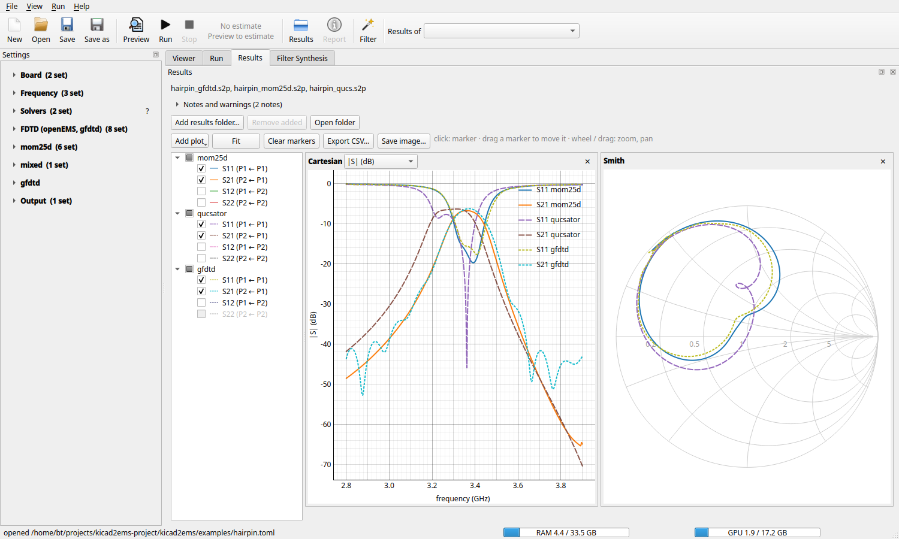
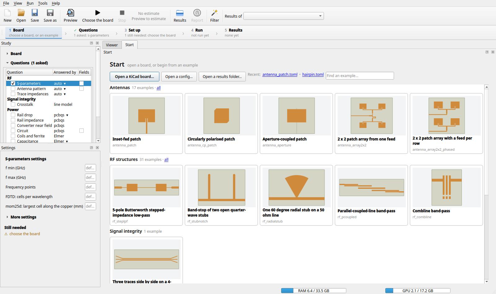
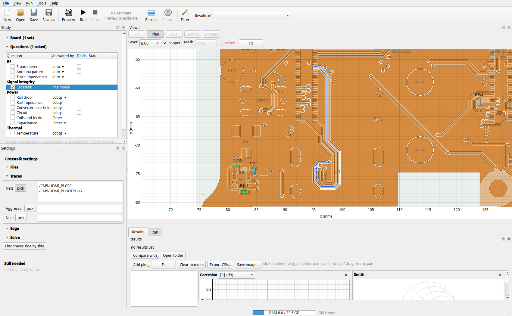
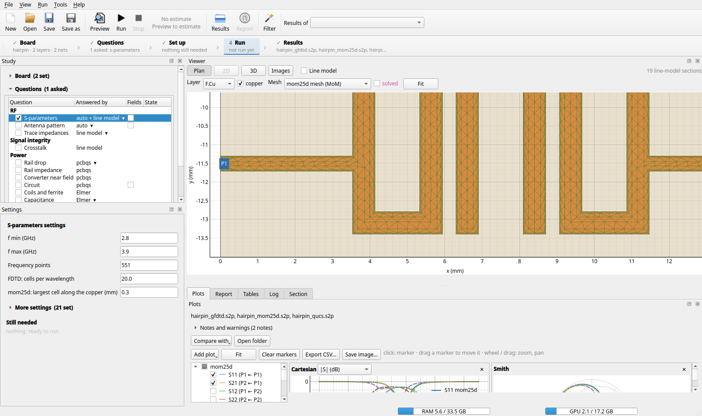
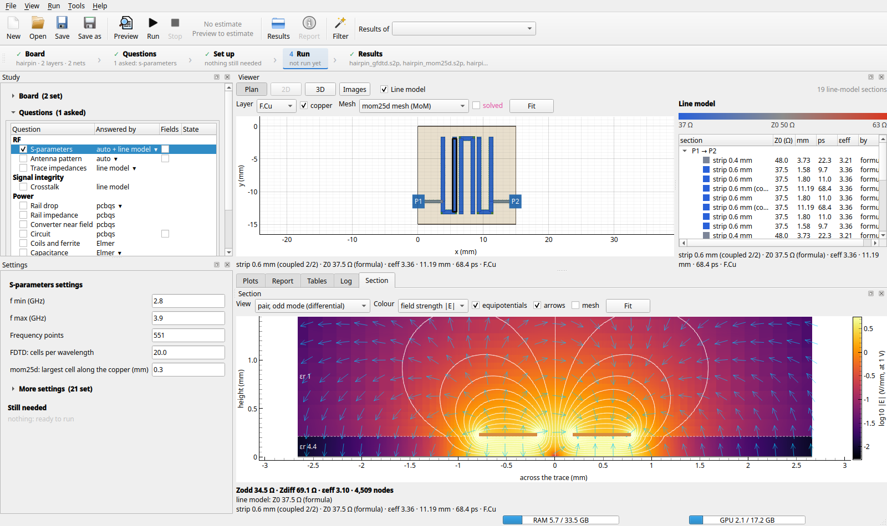
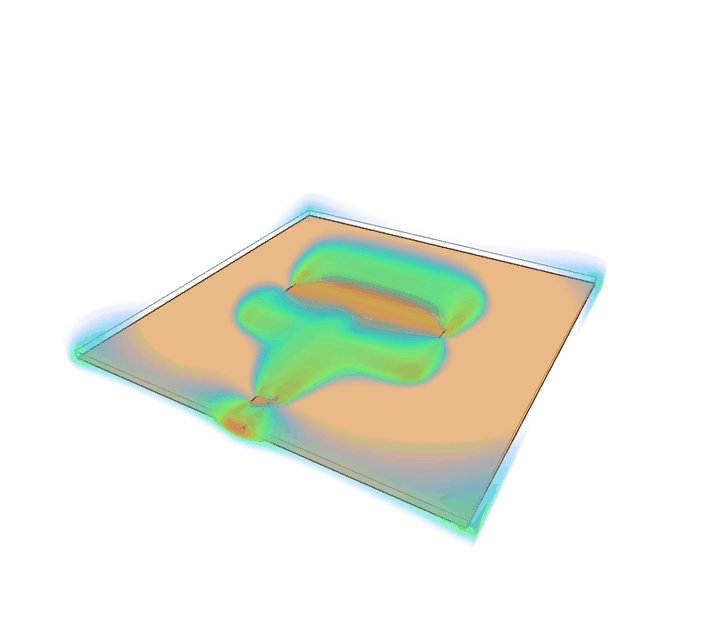
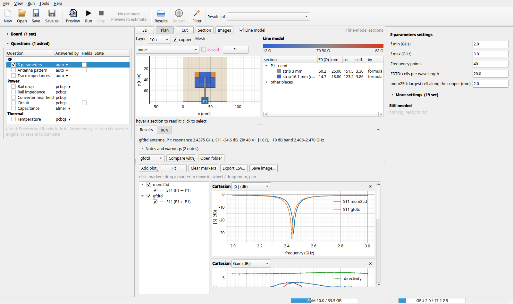
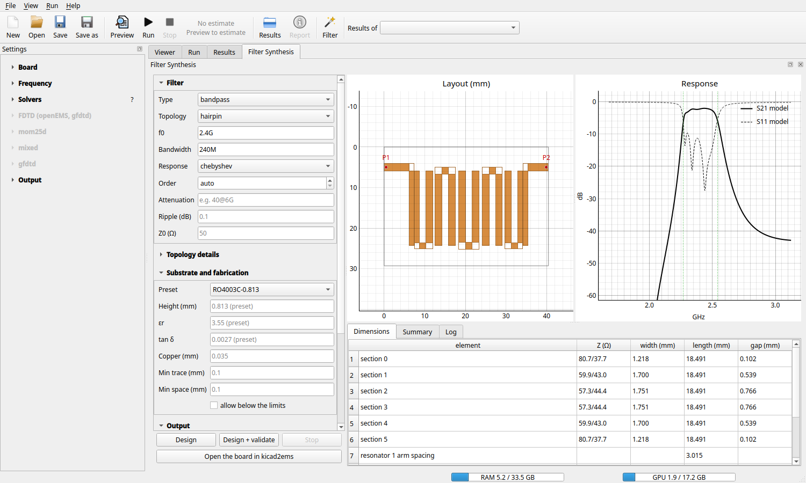
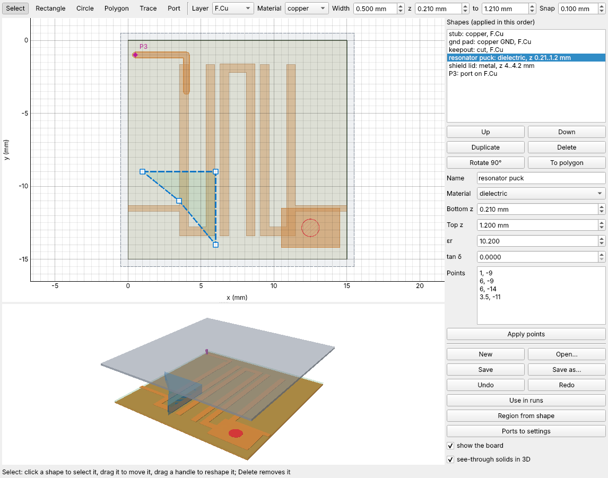
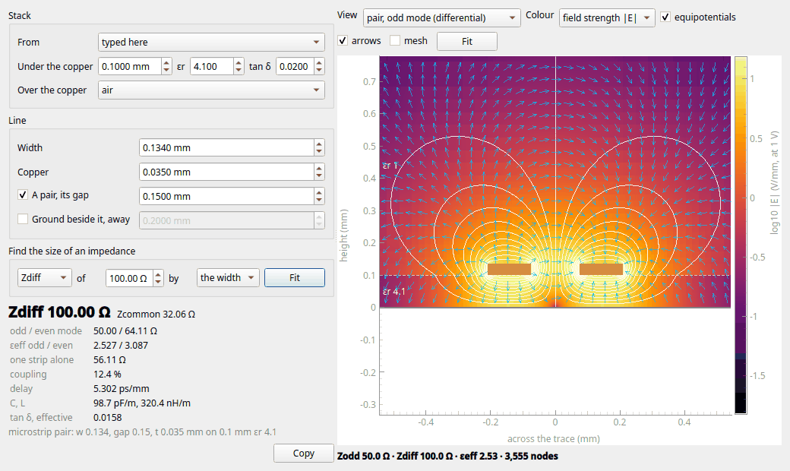

# GUI

[← Usage](usage.md) · [Index](index.md) · [Next: Examples →](examples.md)

```bash
pip install '.[gui]'          # kicad2ems-gui, its own package: PySide6, pyqtgraph, h5py, PyOpenGL
kicad2ems-gui [config.toml]   # or: python -m kicad2ems.gui
```

The GUI edits a run's settings and starts the command-line tool as a separate process: a solver's crash never takes
the window with it, and the GUI itself doesn't need openEMS. Closing the window stops a run that is going (it asks
first); Stop asks a run to end and lets each tool stop what it started (ngspice, Elmer, Palace).



## The window

Docks: what is asked and the settings of the question selected on the left, one over the other; the board with
the result's pages (its plots, its report, its tables, the log) beside and under it in the rest of the window.
Each dock can be dragged elsewhere, tabbed with another, floated or closed.

<a id="start"></a>
**A window with no board begins on the Start page**: *Open a KiCad board…*, *Open a config…*, *Open a results
folder…*, the configs opened lately, and the examples as tiles by group, each with its board drawn from above
(a group shows its first five; *all* the rest; *Find an example* keeps those with every word typed in their
name, title or group). A click on a tile opens the example as a study of its own. The page has the workspace to
itself until a board is chosen or a result opened; *View > Start* brings it back.



- **Toolbar**: New, Open, Save, Save as, Preview, Run, Stop, the run's estimate, the results folder, the report,
  *Filter* (the wand: [Filter Synthesis](#filter), a window of its own), *Draw* (the [Draw](#draw) page: shapes
  over the board), and *Showing*: the run the pages show
  (`Showing: 14:02 · S-parameters · line model (qucsator)`, `Showing: preview`, or *Nothing run yet*); a click
  brings the [Runs](#run-folders) page forward to pick another. The estimate (after a preview) is the time and memory of the
  full-wave solvers ticked, or of the one *auto* would pick, and how many solvers a Run uses, named under it
  (`~13 s · 0.5 GB · 2 solvers` over `gfdtd (auto) + Circuit`; before a preview `No estimate · 2 solvers`);
  grey once the settings change, red when it won't fit in the memory available. It opens the Solvers window.
  **Run** reads Run, always: its tooltip names what it will run, in order, or, while something is missing,
  what that is (*Choose the board*), and clicking it then goes to where it is set ([Still needed](#needed)).
- <a id="steps"></a>**Steps**, a bar under the toolbar: *Board*, *Questions*, *Set up*, *Run*, *Results*, each
  with where it stands in a line (the board's layers and nets; what is asked; what is still needed; the
  estimate, or the run's state; the run shown, or *none yet* while this config has none). Those done have a tick, the first that is not is marked;
  a click goes to where a step is done. It says where the study is, and the toolbar stays what acts. Drag it by
  its handle to the bottom of the window (or back), and *View > Steps* hides it.
- **Status bar**: the memory in use, the GPU's (through `nvidia-smi` or `rocm-smi`), and a running run's own;
  amber above 80 %, red above 95 %.
- **Left: the board and the questions.** The *Board* (its file and extra ports; the rest under *More about the
  board*), then the **Questions** asked of it ([below](#the-study)).
- **The workspace: the board**, in the [Viewer](#the-viewer). While *Circuit* is asked its schematic is a tab beside
  it, as Filter Synthesis is when opened; while it is not, the page is not there at all (*View* has it greyed). A result has a page for each thing it is: its [Plots](#plots), beside
  the board where the window has the width (1,400 px of workspace; else the first tab under it), and under the
  board, tabbed, its [Report, its Tables](#report-page), the [Log](#the-log-page), the [Runs](#run-folders) and,
  with a line model, the [Section](#section) picked. A page comes to the front when it has something new: the Log when a run starts,
  the Report (or, for S-parameters, the Plots) when one ends.
- **Left, under the questions: the settings of the question selected** (highlighted in the list, always: a
  page brought to the front leaves them as they are; a double-click on a question shows its page). For S-parameters, the few a run is set up with: the frequency
  range and points, and the main cell size of each solver chosen. The rest are under **More settings**: the
  sections *Frequency*, *Solvers* (the driven ports), one per solver (*FDTD (openEMS, gfdtd)*: the mesh, run and
  field-dump settings both share; *gfdtd*; *mom25d*; ...) and *Output*, each counting its settings that are set,
  a solver's shown only while it is chosen (and counted only then). *Find a setting* at its top shows only those whose name, key or
  section holds what you type. Empty fields use the default, shown as a hint.
- <a id="needed"></a>**Still needed**, under the settings: what a run of the selected question lacks, a line each
  (*the board has no port*, *name the rail*, *Q1 has no pad on ground, and the board has no one part of its
  kind to return through*); a click goes to where it is set. Kicad2ems checks its own run (the board, its
  ports, the band); an analysis says its own. *Run > Run the selected question alone* runs one whatever the
  others still need.
- <a id="several"></a>**Several rails**: *Rail drop*'s settings start with a table of the board's rails, a row
  each (rail, volts, source, ground source, loads, load spectra), *Add a rail* and *Remove the rail* under it,
  and the settings they share below. Run makes each row's run in turn, a folder each (*Runs* lists them),
  and the study's state is the last one's; a config's `[[analysis.pdn]]` tables
  ([usage](usage.md#several)) are the rows.
- <a id="proposals"></a>**What a result proposes**, as buttons under a finished question's settings: a
  converter's near field offers *Copy the input rail to Power integrity* and *Open U702 as a circuit* (the
  converter with its capacitors and inductor from the board, in the Circuit editor); a circuit's result offers
  *Copy the rail +5V and what is drawn from it to Power integrity* (the rail, its loads' average currents and
  their spectra, for the ripple they make) and *Copy U702's input current to Near field* (in place of the
  assumed pulse). A click fills the other question's settings, ticks it so that Run includes it and shows it;
  what the proposal could not say (a rail's source) is listed under Still needed
  ([the steps on a board](pcbqs/power-workflow.md#4-from-one-tool-to-the-next)).

*View* shows and closes each dock (the study and the settings: Ctrl+1, 2) and the steps bar, and *View > Reset
layout* puts them all back where a new window has them. The window remembers its size, where its docks and the
steps bar are, its splitters and the Plots page's plots between sessions; the first time it opens over the
whole screen.

<a id="run-folders"></a>
**Where results go: the Runs page.** Each run gets a folder of its own under the output folder, named after the
board and when it started (`<out>/<board>_20261013_104514/`, an analysis's `<out>/<board>_pdn_3V3_…/`); a preview
goes to `<out>/<board>_preview/`, which each preview refreshes. The **Runs** page lists them, a row each: when it
started, what it answered (the questions, and the rail or converter), the engines, how it ended (*done*,
*running*, *stopped*, *failed, code 1*, *no result*), how long it took and its size on disk. **≠ settings** marks
a run made with other settings than the form has now; its tooltip lists them (`fmax: 4.5 -> 3.9`; where it went
and the order of the solvers do not count). The preview is the last row, *current* while its settings are the
form's, else *stale*.

- **Scope**: *This config* (the default) lists the runs started from the config open: each run's folder names
  the config file it came from (its mark, `kicad2ems-study.json`, which `kicad2ems study` writes too, and
  which says how the run ended; its whole output is beside it, `stdout.log`). With
  a form never saved, the runs that name none, which older runs (from before the mark kept it) are too: *This
  board* lists those, and every other config's run of the board; *All*, everything under the output folder,
  with each run's board. The line above the table says how many more the board has.
- **A click shows a run** in the Viewer, Plots, Report and Tables (one that left no results: its log). **Ctrl
  or Shift and a click** on more lays them over it: their S-parameters, or the same kind of curves, in Plots,
  and the last one in a **second Viewer** (a window of its own) when it has fields or maps; *Compare* does
  both whatever they hold. *View > A second Viewer* opens it with the run before the one shown.
- **Open folder**, and **Delete…** the rows selected: asked once, with their sizes; a run going is kept.

Opening a config shows its newest run that finished (else nothing, and the preview once it is done) and starts
a preview, so the Viewer shows the board as it is now; a run that finishes is the one shown. In the Questions
list a question nothing has run of yet says when this config's runs last answered it (*last 14:02*); a click on
that cell shows the run.

<a id="solvers"></a>
## Solvers

The solvers are chosen on the **S-parameters** row of the Questions list: click
its *Answered by* cell for a menu with a tick per solver, plus *auto*. After a
preview, each full-wave solver's entry shows its estimate (`mom25d (MoM) · ~4
min, 1.3 GB`), and its tooltip says why one can't run here.

**?** beside *Solvers* (or *Help > Solvers and hardware*) opens the Solvers window: every solver with ✔ or ✖ and
what it found, the CPU, the memory and the GPU, and the last preview's estimates. Its *Programs* box sets where
qucsator is and the **openEMS environment**: a venv with openEMS, when it isn't in kicad2ems's own Python (of the
same Python version). These are the machine's settings, not a board's: they go into
`~/.config/kicad2ems/site.toml`.

**Stop** asks the run to stop: openEMS and gfdtd end at once and keep what they computed, mom25d ends after the
frequency it is solving, and solvers that haven't started are skipped. An analysis's tool is asked to end
(SIGTERM: it stops its ngspice, Elmer or Palace runs) and ended five seconds later if it has not, and a table's
next rows are not run. Press Stop again to end the process at once.

<a id="configs"></a>
## Configs

The *File* menu has New, Open, recent files, the examples, Save and Save as; the title shows `*` while there are
unsaved changes. Saving over an existing config **keeps the file as it was**: comments, key order, tables and keys
the GUI doesn't know all stay, and only the changed values are rewritten (one writer, `runs.update_toml`, edits
keys in place and replaces the `[study]` and `[analysis]` tables). Of the [older forms](usage.md#older-forms),
`[analysis] run` is saved as `[study]`; `no_mask` and an `[openems]` table's keys are edited where they are.
Each run writes `gui_run.toml` into its folder, so `kicad2ems <folder>/gui_run.toml` repeats it from a terminal.

*Edit → Undo* and *Redo* step back and forth through the changes to the settings: a tick or a choice is one step,
a field's typing one step once it pauses. The menu names what the step changes (*Undo fmax*). In a field being
typed in, Ctrl+Z is that field's own undo. Opening a config starts afresh.

*File → Examples* lists the examples in their groups: Antennas, RF structures and Lumped-element demos, each with
its subgroups, and after them those the installed analyses ship (pcbqs's Circuits). An entry's tooltip says what
it is.

<a id="the-study"></a>
<a id="analyses"></a>
## The questions, and who answers them

The Study's **Questions** list has a row for everything that can be asked of the board, by group: *RF* (the
ports' S-parameters, an antenna's pattern, the traces' impedances), *Power* (a rail's drop, its impedance, a
converter's near field, a circuit on the copper, capacitance) and *Thermal* (the temperature). A row has:

| Column | |
|---|---|
| Question | a tick: **Preview** and **Run** include it |
| Answered by | the engine that answers it. Click the cell for a menu: *auto* (the first that can run here), then a tick per engine. Several ticked all run, and their answers are compared |
| Fields | a tick where an engine can write field dumps. Ticked with none set, a default goes into the settings (an FDTD solver: E on the first port's layer at the band's centre; mom25d: its currents there; a circuit: its field maps), where you can change it. Unticked, the settings stay and the run leaves the dumps out |
| State | queued, running, done, or why it did not start; per engine where there are several |

The three RF questions are answered by the solvers, in one kicad2ems run: their
menus tick the same solvers (*Antenna pattern* lists those that model one, and
its tick is the run's antenna mode; *Trace impedances* the line model's). Every
other engine is an analysis (pcbqs's power integrity, near field, circuit and
thermal; Elmer for a rail's drop and the temperature, Elmer and Palace for
capacitance: those need the `fem` extra's gmsh), found through kicad2ems's
[registry](api.md#study-api); the window knows none by name. A question no
engine answers is greyed. An analysis may be several engines of one run
(`variants`): *Crosstalk* is answered by the line model, or by it with gfdtd,
openEMS or mom25d beside it, one at a time; the choice sets its full-wave check,
which its settings no longer show.

Selecting a row shows its engines' settings in the Settings dock, each a panel
made from the analysis's options (two engines: each under its name). **Run**
makes the runs the questions take, in order: the solvers', then each analysis
(the temperature after the circuit whose losses it takes); an engine that
answers two questions answers them in one run. What a run leaves is shown where
every result is: its maps in the Viewer (a rail's drop and current per layer, a
board's temperature), its curves on the Plots page, its report and its tables on
theirs.

<a id="pick"></a>
**A setting picked on the board.** A setting that names a net or a part has a **Pick** button beside it. With
it down, the Viewer's plan is in front and a click there puts what is under the cursor into the setting: a
trace's or a pour's net, or the part whose pads are there (the line under the plan says which, as the cursor
moves). A setting that takes several adds each one clicked, and takes it out when it is clicked again; what
the setting holds is drawn in blue. The button again ends it, as does another setting's. Where the settings
are a table (a board's rails), one button picks the selected cell: a net in the *Rail* column, a part in
*Source*. The plan shows the board as drawn for this (all its nets, and the parts' outlines), which is also
what it shows from the moment a board is chosen, before any preview or run; a run's result that was there is
back when the pick ends. An engine says which of its settings can be picked ([an option's
`pick`](api.md#analyses)), so the window knows none by name.



*CM5's HDMI control traces picked for the crosstalk question: **Pick** beside *Nets*, then a click on each.*

**Two engines compared.** When another engine has answered the same question on this board, the Report
page gains a section *Engines compared*: the figures the engines name alike (a rail's own copper drop
per load; the hottest point and each part's temperature) against the engines, with the difference. It is one of
the report's tables, so it sorts, copies and exports as they do. A figure only one engine has is its own (pcbqs's
drop with the ground return), and stays beside it.

A config keeps the study as its `[study]` tables ([usage](usage.md#study)), which `kicad2ems study` runs from
the command line too, and each analysis's settings under `[analysis.<name>]`:

```toml
[study]
run = ["circuit", "thermal"]        # the questions
[study.thermal]
engine = ["thermal", "elmer_thermal"]   # who answers: both, compared
[analysis.circuit]
model = "buck.json"                 # each analysis's settings, by its options' names
```

<a id="viewer"></a>
## The Viewer

The board and its fields, in four views (a view the folder has nothing for is greyed out):

| View | Shows |
|---|---|
| Plan | one layer's copper from above (the others faint), a solver's mesh on it, the ports, the line model |
| 2D | a field dump in a cut, with its values ([below](#cut-view)) |
| 3D | the board with its copper as shaded slabs, a solver's mesh, the line model, dumps in place, the far field |
| Images | the pictures a preview or a run wrote as files: openEMS's mesh with its side views, the model, the line model |

The field across one trace is a page of its own, [Section](#section), under the board.



*The Plan view with mom25d's mesh: rings of thin cells along each copper edge, where the current crowds. A run of
mom25d also writes the mesh it solved on; **solved** draws it in pink over the preview's, its quad cells
(`--mom-quads`) without their diagonal.*

<a id="line-model"></a>
**The line model over the board.** With *Line model* ticked, the 3D and Plan views draw the
[line model](transmission-lines.md)'s sections on their copper, coloured by Z0: grey at the ports' impedance, blue
below, red above. In 3D each section also stands as tall as its Z0 (*Z0 relief*), so every step in impedance shows
as a step in height. The list beside the view has every section by path (`P1 → P2`, …) with its Z0, length,
delay, εeff and where its Z0 came from (*by*: the formula or the field solver); pick one there or on the plan.

<a id="section"></a>
### The Section page: the field across a trace

Pick a section (in the list, or on the plan) and bring the **Section** page to the front: the
[field solver](transmission-lines.md#field-solver) solves that one cross-section (about 0.1 s, 2 s at worst on a
real board) and draws it. A preview's line model is enough. The page is under the board, so the plan stays in
view: pick another section there and its field follows. It is there while the folder shown has a line model,
and a section is solved only while the page is in view.



| Setting | What it does |
|---|---|
| View | what is solved: the board's copper across the trace (up to the plane that closes it), a grounded CPW as it was classified, or on a coupled section the pair in its odd or even mode, or this line alone |
| Colour | the field's strength (log scale, at 1 V) or the potential |
| equipotentials, arrows, mesh | lines of equal potential, the field's direction, the solver's cells |

Under the plot: the impedance of what is shown, the line model's own Z0, and where that came from. The two can
differ, and that is the point: a trace the formula takes as stripline can show ground beside it, or a plane with a
hole under it. It is the quasi-static field: no dispersion, no current crowding.

<a id="fields3d"></a>
### 3D

Drag to orbit, scroll to zoom, Ctrl+drag to pan (PyOpenGL, in the `gui` extra). The controls fold beside the view,
those the folder has nothing for hidden:

- **Parts:** the lumped R / C / L parts as chips at true size, from the footprint's name (0201, 0402, …):
  resistors green, capacitors cyan, inductors pink; one on the bottom layer hangs below the board.
- **Mesh:** the FDTD grid lines (openEMS's, which gfdtd shares) or mom25d's triangles, written by a preview.
- **A dump:** a volume dump (`--dump E@volume+5@2.4`: the board plus 5 mm of air) as a translucent cloud; a plane
  dump (an FDTD cut, mom25d's surface currents) as a coloured sheet in place.
- **Far field:** in antenna mode, the gain pattern at a recorded frequency over the board's centre.

| Control | |
|---|---|
| Show, Colours | \|F\| or one component; the colour map |
| envelope | the peak over a cycle instead of an animation |
| one colour range for every frame | the range over the whole dump, so a pulse is seen passing and dying away |
| log scale, Decades, Range top | the colour range; *Range top* ignores the strongest few voxels, such as a port gap |
| Opacity, Fade | how solid the strongest field looks, and how fast the weak field fades out |
| Height scale, Resolution | stretches z (boards are thin); voxels along the longest side |
| copper, line model, Z0 relief, parts at true size | what is drawn with the field, and how thick or tall |
| Mesh, solved mesh | a solver's mesh, and the one a run solved on over it |
| Far field: Pattern, Size, Height | the pattern at a frequency, its size against the board, its height above it |
| fps, Every n-th frame, Save GIF / MP4 | the animation's speed and frames, saved from the current camera |



<a id="cut-view"></a>
### 2D: field dumps in a cut

Add dumps under *Field dumps* in the settings (*Add a dump* builds the spec: [syntax](postprocessing.md#field-dumps)).
A dump without frequencies is recorded over time, and the 2D view can follow it live while the run goes; one with
frequencies is written at the end.

| Control | |
|---|---|
| Component, Cut normal to | \|F\| or the x, y or z component; for a volume, the plane to show |
| log scale, auto range | the colour scale |
| Frame, Play | step through time frames or frequencies |
| instantaneous, phase | for a frequency dump: the field at a phase of the cycle; *Play* turns it |
| Live | follow a running simulation |
| Save PNG / GIF / MP4 | the view or an animation (MP4 needs ffmpeg) |

<a id="the-run-page"></a>
## The Log page

Progress per driven port, the FDTD runs' energy decay, mom25d's adaptive sweep (its model change and prediction
error per solve, in dB, against its tolerance), the log, and *Stop*. It shows what has run for the study open
and nothing else: each plot once its run sends data (a run of neither has none), *Log of* the runs started
(once there are two); before anything runs it says *nothing run yet*, and opening another config, or New,
clears it (unless a run of the last one is still going).

<a id="report-page"></a>
## The Report and Tables pages

What an analysis found, as it wrote it: the **Report** is the page to read (the figures that matter first, then
what was assumed and what was left out), **Tables** its tables alone, each to sort, copy and export as CSV.
*Save…* writes the report as HTML (its pictures inside the file, so it opens anywhere) or PDF, and *Print…* sends it
to a printer. An S-parameter run's report is an HTML file: *Report* in the toolbar opens it.

<a id="plots"></a>
## The Plots page

S-parameters and antenna results as a grid of plots (the picture at the top), and an analysis's curves (a
rail's impedance, a near field's spectrum, a circuit's waveforms). *Add plot* adds one, ✕ removes it.

| Plot | Shows |
|---|---|
| Cartesian | over frequency: \|S\| in dB or linear, phase, group delay or VSWR; the difference between solvers; with antenna results directivity, gain, realized gain or efficiency |
| Smith | the reflections (S11, S22, …) with an impedance readout |
| Polar | S in polar form, or the far-field cuts (xz, yz, xy) at a recorded frequency |

*Export Touchstone* saves one of the run's S-parameter files (each solver's, a de-embedded one, the part ports')
where you choose. *View → Plot colours* makes the plots light or dark, or follows the desktop (the default).

The traces are listed on the left by solver; tick the ones to show (those not computed are grey). Each source (a
solver, the compare file, an added folder) has its own line style; right-click a trace or a source to change its
colour, style or width. Differential pairs are named by mode and pair: Sdd21, Scd21, Scc11, and *s* for a
single-ended port among them (Sds31).

- **Difference plots**: with two solvers or more, a Cartesian plot shows **Δ|S| (dB)** or **|ΔS| (dB)** (the
  complex difference, phase included) of each trace against a reference solver.
- **Notes and warnings**: a fold at the top lists the run's warnings (open when there is one) and its notes.
- **Cursor, markers, zoom**: hover to read every trace; click to add a marker (drag to move, Delete to remove),
  listed in a table; wheel and drag to zoom, *Fit* for everything.
- **Other runs over these**: Ctrl and a click on the [Runs](#run-folders) page; **Compare with** has the run's
  own variations and *Another folder…*; **Export CSV…** and **Save image…**.



<a id="antenna"></a>
In antenna mode the line above the plots gives the resonance, the input impedance and the −10 dB band, with a
selector between the solvers that ran; the 3D pattern is in the Viewer.

<a id="beam-steering"></a>
**Beam steering.** For an antenna driven at several ports (mom25d, or the FDTD solvers with `drive`:
[Phased arrays](mom.md#phased-drive)), a *Beam steering* bar recombines the ports' far fields for any drive,
without solving again:

- **Drive**: `PORT[=amplitude][@phase]` per driven port; ports not named are terminated.
- **Grid**: where each port sits in a 2D array (`4x4`: the ports in order, row by row; or `P1:0,0 P2:1,0 ...`).
- **Phase step** (no grid), or **X step** and **Y step** (with a grid: an element at column *c*, row *r* gets
  *c*·X + *r*·Y more phase); a **phase map** shows each element's phase, amplitude and active reflection.
- **Taper**: **Taylor**, **Chebyshev** or **cosine** amplitudes, for lower sidelobes at the cost of a wider beam.
- **Aim at** θ, φ: each port's phase from its place, as `--aim` gives it; any layout of feeds.
- **Animate** sweeps the phase step, X, Y, a **Circle**, or the aim's θ or φ; **Reset** goes back to the run's.

The line below gives the beam's direction, its gain and realized gain, and each driven port's active reflection.
The gain plots, the far-field cuts and the Viewer's 3D pattern follow the steering, and the Viewer's *Far field*
section has the same controls.

<a id="filter"></a>
## The Filter Synthesis page

Designs a microstrip filter with [dfsynth](dfsynth/README.md) and writes its board and kicad2ems
config (*Filter* in the toolbar, or *File > New filter*: a window of its own, not about the open board). dfsynth is its own package (the `filter` extra, or the
installer); the page builds its form from `dfsynth --describe --json` and runs dfsynth as a process, so a dfsynth
option it has no field for appears under *More options*.



- **Settings** (left): *Filter* (type, topology, f0, bandwidth, response, order or an attenuation spec such as
  `40@6G`, ripple, Z0), *Topology details*, *Substrate and fabrication* (a preset, overrides, the copper, the
  minimum trace and space: a design below them is refused unless *allow below the limits* is ticked), *Output*
  and *Validation* (the kicad2ems solvers, the tuning rounds, extra kicad2ems arguments).
- **Design** synthesises the filter, calibrates it on dfsynth's line model and writes the board. **Design +
  validate** then solves the board with the solvers chosen and tunes it for the rounds asked (gfdtd suits
  interdigital filters, mom25d the other planar ones); the *Log* follows the run, **Stop** ends it.
- **Log** (warnings ⚠ and errors ✖ in bold red, counted on its tab), **Layout** (the copper, ground vias and
  ports), **Response** (S21 solid and S11 dashed of the line model and each solver of the last validation, the
  band edges dotted), **Dimensions** and **Summary** (the spec and each round's figures).
- **Open the board in kicad2ems** loads the config dfsynth wrote into the settings and previews it: from there any
  solver, mesh or field dump runs as for any other board.

<a id="impedance"></a>
<a id="draw"></a>
## The Draw page (prototype)

Arbitrary shapes drawn over the board, in plan and in 3D, for a run to add to it (*Draw* in the toolbar, or
*File > Draw shapes*). The board under them is the one chosen in the settings, as drawn; with none, a two-layer
1.6 mm stack to draw on.



- **Tools**: *Select*, *Rectangle* and *Circle* (two clicks), *Polygon* and *Trace* (a click per point; double-click,
  right-click or Enter ends it, Esc drops it), *Port* (a click), *Measure* (two clicks give the distance, dx, dy and
  the angle; a third the angle between the two legs; Esc clears). A letter picks a tool (S, R, C, P, T, O, M).
- **Snapping**: a point snaps to the board's pads, vias, track ends and edges and to the shapes' corners, midpoints
  and centres within 8 pixels (*objects*; a ring, square, triangle or cross marks what it found, and the status bar
  names it: "snap: pad J1.1 (GND)"), else to the grid (*Snap*). The status bar has the cursor in model and KiCad mm
  and the size being drawn (a rectangle's width and height, a circle's radius, a trace's leg and length).
- **Materials**: *copper* joins its layer's copper (of the net given, else of the copper it overlaps most; a
  different net's copper under it is reported as a short), *cut* takes copper out of its layer, and *metal*,
  *dielectric* and *air* are solids between two heights. Shapes apply in the list's order: a cut takes out what
  is drawn before it.

**Selecting.** A click picks a shape; Shift or Ctrl + click adds one or takes it off. A drag on nothing draws a box:
left to right selects what is wholly inside it, right to left what it touches (Shift: added to the selection). A
drag from a selected shape moves the whole selection, snapped (X or Y while dragging: along that axis only, again:
free; Esc puts it back); a drag of the handles reshapes the one selected. Ctrl + drag, or the middle button, pans;
the wheel and the right button zoom. Ctrl+A selects all.

- **The list** has each shape's *Shown* and *Locked* ticks: a hidden shape is not drawn or picked (a run still
  applies it), a locked one is not moved, turned or deleted (aligned to, it stays as an anchor). *Lock* and *Hide*
  set them for the whole selection. Both are saved with the drawing.
- *Duplicate* (Ctrl+D), *Delete*, *Copy* (Ctrl+C), *Cut* (Ctrl+X) and *Paste* (Ctrl+V) work on the whole selection,
  each one undo step. Copy puts the shapes on the clipboard as `kicad2ems-shapes` text, so they paste into another
  drawing or another session (or a text editor); pasted onto the same spot they come one grid step along.
- **Shape** (the form) shows the last shape picked; with several selected, a change to its material, layer, net,
  width, radius, heights, εr or tan δ applies to them all.
- **Arrange**: *Move by* dx, dy (and dz: solids lifted); *Rotate* by any angle about the selection's centre, each
  shape's own, or a point (typed, or *Pick*ed with a click; a rectangle turned off a right angle becomes a polygon);
  *Mirror* x or y about the selection's centre; *Align* left, centre, right, top, middle or bottom; *Distribute*
  the centres evenly along x or y.
- **Array**: copies of the selection in a *row* (count, step), a *grid* (count, rows, steps) or round a *circle*
  (count, centre typed or picked, angle from the first to the last: 360 spaces them all the way round; each copy
  turned or only carried round): a via fence, stitching, a ring of vias. Named shapes' copies are numbered (via_2,
  via_3...).

**The 3D view** shows the shapes extruded over the board's substrate and copper, and edits them too:

- a click selects a shape (Shift or Ctrl + click adds or takes off; a click on nothing selects none), and the
  selection is outlined;
- a drag moves the selection on its level; X, Y or Z while dragging holds it to that axis (Z lifts solids); the
  gizmo's arrows (red x, green y, blue z) at the selection drag it along one axis; Shift + drag on a solid stretches
  it by its top or bottom face, or lifts it whole by a side; Esc puts it back;
- a drag on nothing orbits the view, Ctrl + drag or the middle button pans it, the wheel zooms;
- *Top*, *Front*, *Side*, *Iso* (keys 7, 1, 3, 5) set the camera, fitted to the board and the drawing; *Fit* (F)
  fills the view with the selection (and the plan too);
- *Clip* cuts the view with a plane across x, y or z at a height (*flip*: keep the other side): solids are cut and
  capped, and what is cut off is not picked;
- *Show* turns the board's substrate, each copper layer, each drawn material and the ports on or off, the grid at
  the working level (the layer drawn on, or a new solid's bottom; the snap grid, coarser where it would be dense),
  and see-through metal (to look under a lid).

Only drawn shapes are picked, not the board.

- *Use in runs* saves the drawing (`kicad2ems-shapes` JSON, model mm, y up) and names it in the settings
  (`shapes = "drawing.json"` in a config); *Region from shape* and *Ports to settings* write those settings in
  KiCad's coordinates. Ctrl+Z / Ctrl+Y undo and redo the drawing while the page has the focus.

Every solver reads the board's copper, so drawn copper and cuts reach them all; the line model builds its sections
from the board's own tracks and does not see them. Solids are kept on the board (`solids` in `board.json`) and
drawn, but no solver meshes them yet: the run's notes say so.

## Tools > Impedance calculator

A line's impedance in a stack-up, without a board: kicad2ems's 2D field solver
([`kicad2ems-z0`](transmission-lines.md#calculator)) in a window of its own.



- **Stack**: the dielectric under the copper and what is over it (air, a solder mask, a dielectric closed by a plane:
  a stripline, or left open), typed; or, with a board open, *From* one of its copper layers: its own stack-up, the
  copper layers next to that one taken as planes.
- **Line**: the width and the copper's thickness; *A pair* adds the gap and gives Zdiff and Zcommon; *Ground beside
  it* a grounded coplanar line.
- Every change is solved as it is typed (about 0.1 s). The numbers are on the left, with the closed form where
  one applies; the field is on the right, as the [Section](#section) page draws a board's.
- **Fit** changes the width, the gap or the ground's distance until the impedance chosen is the target, to 0.1 %.
  A target no size reaches says what the range is. **Copy** takes the line and its numbers as text.

---
[← Usage](usage.md) · [Index](index.md) · [Next: Examples →](examples.md)
