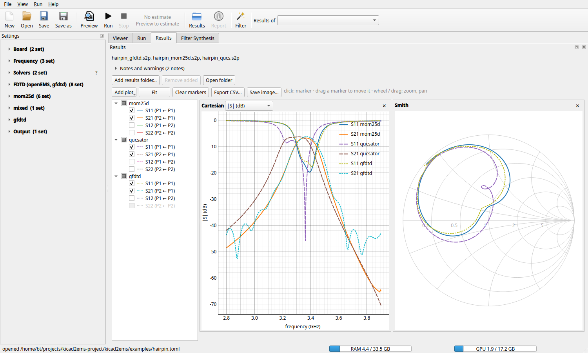

# kicad2ems-gui

> Part of kicad2ems since 0.4: the package `kicad2ems.gui`, installed with kicad2ems (`pip install .` in this
> repository; the [README](../../README.md#install) has the installer). Its history up to then is in this
> repository's, and in its own repository. Install lines below that name `.` mean this repository.

The window of [kicad2ems](https://github.com/lowprocess/kicad2ems): a run's
settings, the run itself and its results. S-parameter plots and the report, the
board in plan and 3D with the line model over it, field maps and animations,
antenna patterns and beam steering, dfsynth's filter synthesis (the Filter
page), and whatever analyses beside S-parameters (pcbqs's power integrity, near
field, circuit and thermal; Elmer's and Palace's).

The settings form is made from kicad2ems's option tables and its solver
registry, so every solver (openEMS, mom25d, gfdtd or any other the registry
lists) gets its tick box and its settings with no change here. The analyses come
the same way, from kicad2ems's analysis registry
(`kicad2ems.core.analyses.registry`): the window knows none of them by name,
but for the Circuit page's model editor, which imports pcbqs's model and
schematic code. Each run is a process of its own (`kicad2ems.core.runs`, or the
analysis's command), so the window needs nothing of a solver's and a solver's
crash never takes the window with it. Closing the window stops a run that is
going (it asks first); what the run had written stays in its folder. kicad2ems's
[GUI page](../gui.md) covers using it.

## The window

Docks, as a studio application's: on the left the **Study** (the board and the
**Questions** asked of it) over the **Settings** of the question selected; in
the workspace the board, in the Viewer, with the Results and Run pages under it.
Each dock moves, tabs with others, floats and closes (View brings it back;
*View > Reset layout* puts all of them where a new window has them), and the
window opens as it was left, the first time over the whole screen. The settings:
the few a run is set up with in view and the rest under a searchable **More
settings** (an option's `level`, a solver's `basic`); under them **Still
needed**, what a run of that question lacks (`rf_needs`, an analysis's
`missing`), each line leading to where it is set. The Run button says what it
will run, or the first thing missing.

## The study

The left column is the study: the board (one for every question) and the
**Questions** asked of it; the settings of the question selected there are the
Settings dock. The list is kicad2ems's
(`kicad2ems.core.study.study_tree`): the questions by group (RF, Power,
Thermal), each with the engines that answer it. A row's *Answered by* cell is a
menu: *auto*, or a tick per engine, and several ticked all run and are compared;
*Fields* asks for its field dumps where an engine can write them. The three RF
questions are kicad2ems's own run, with the solvers ticked on those rows. The
others' engines are the analyses (`kicad2ems --check` lists them): each one's
settings are a panel made from the options its Analysis declares, with what else
it offers: Near field's *Find converters*, which lists the board's converters to
pick from, and, after a run, what its result proposes for another question. A
near field's: *Copy the input rail to Power integrity* and *Open U702 as a
circuit* (the converter in the Circuit editor, its capacitors and inductor from
the board); a circuit's: *Copy the rail +5V and what is drawn from it to Power
integrity* (its loads' currents and their spectra, for the ripple on the rail)
and *Copy U702's input current to Near field*. A click fills that question's
settings, ticks it so that Run includes it, and shows it. A question no engine
answers is greyed.

**Several rails.** An analysis a study may hold several of (its `several`: pcbqs's rail tool) shows what differs
between them as a table at the top of its settings (`several_keys`: the rail, its volts, source, ground source,
loads and load spectra), a row a rail, with *Add a rail* and *Remove the rail*; the rest of its settings are
below, shared by every row. Run makes each row's run in turn, each into a folder of its own, as one job of the
study, and "Still needed" says which row lacks what. A config's several tables (`[[analysis.pdn]]`, as
`kicad2ems study` runs them) open as the rows, and the rows are saved as them. An analysis that says nothing
of the kind keeps one form, and a config's further tables of it are kept as they were.

**Preview** and **Run** make the runs the questions asked take, one after the other: the solvers', then each
analysis in the registry's order; the Log page lists them with each one's state, time and log. Run > *Run the
selected question alone* (or the list's context menu) runs one whatever is ticked. An analysis may start from
another's result: Thermal takes its losses from the latest circuit run when none are typed, so with both asked
it runs after Circuit and on that run's board. When two engines have answered one question, the Report page
has their named figures side by side (*Engines compared*).

**What a run leaves is shown where every result is**, not on a page of its own:

- its **maps** in the Viewer, Plan, 2D and 3D (an analysis writes them as field dumps: a rail's drop and current
  per layer, a near field's H, a board's temperature per layer, in °C on a scale from its coolest point);
- its **curves** on the Plots page (a rail's impedance, a near field's spectrum, a circuit's waveforms);
- its **report** on the Report page: what it found, to read; and its tables on the Tables page, to sort by a
  column, copy into a spreadsheet or export as CSV.

Plots, Report, Tables, the Log and Runs are docks of their own (Plots beside the board on a wide window, the others
tabbed under it), as is Section, the field across the line-model section picked on the plan. A window with no
board begins on the **Start** page (open a board, a config or a results folder; the examples as tiles with
their boards drawn), which has the workspace until a board is chosen. The **steps** bar under the toolbar
(Board, Questions, Set up, Run, Results) says where the study stands; it drags to the bottom of the window and
hides (View > Steps).

The **Runs** page lists the board's runs, each in a folder of its own under the output folder: by default those
of the config open (*This board*, *All*: the rest), with what each answered, the engines, how it ended, how long
it took, its size, and *≠ settings* where it ran with other settings than the form's; the preview last,
*current* or *stale*. A click fills the pages; Ctrl and a click lays more over it (Plots, and a **second
Viewer** for their maps); Delete and Open folder act on the rows selected. The toolbar's *Showing* says which
run the pages show and brings the page forward.

A config holds the study: beside kicad2ems's settings, the analyses it runs and their settings under
`[analysis]` (`run = ["circuit", "thermal"]`, `[analysis.circuit] model = "buck.json"`), read when it is opened
and written back when it is saved. A config that names no analyses is an S-parameter study.

**File > Examples** lists the examples in their groups (Antennas, RF structures, Lumped-element demos, and those
the installed analyses ship: Circuits). A circuit to start from is an example like any other: it opens as a study
with its board, its model on the Circuit page and the circuit ticked.

Filter Synthesis opens from the toolbar's Filter, in a window of its own. The
**Circuit** page, the one analysis with an editor of its own, is a tab beside
the board while Circuit is asked, and not there at all while it is not (View
has it greyed). It is the model's editor only (its schematic, its JSON): the
model is a file the config names, saved back beside the config with the study.
A new study, or a config that names no model, starts it blank (no parts; it
says so, and a Run says what it lacks): add parts, load a model or start from
an example. A blank page writes no model. The circuit's settings are a panel in the Settings dock like any
analysis's, made from the analysis's options (`kicad2ems.pcbqs.circuit
--describe`), with a *Model* section for the model's parameters and sweep. Its
results are on the Plots, Report and Tables pages and its log on the Log page,
as every analysis's.

## Install

    python -m pip install 'kicad2ems[gui]'              # kicad2ems with its window (the Filter page: dfsynth, in it)

    kicad2ems-gui [config.toml]                         # or: python -m kicad2ems.gui

It needs PySide6, pyqtgraph and PyOpenGL (installed with it).

## Inside

| Module | Contents |
|---|---|
| `app.py` | `MainWindow`, made of the parts below, and `main`: the window's pages, widgets and docks built, its closing |
| `windocks.py` | the window's shape: the pages as docks of the workspace, which are there, the toolbar and menus, the layout remembered |
| `winconfigs.py` | configs and examples: open, recent, a config's study and analyses read and written, a file dropped on the window |
| `winstudy.py` | the study in the list, what a run still needs, a result's proposal for another analysis, a setting picked on the board |
| `winrun.py` | the runs as they go: the study's queue (the Steps of kicad2ems's plan), each step's commands given to the launcher, kicad2ems's own run's events, Stop, the estimate |
| `runprocess.py` | the one launcher: `Command`, `RunProcess` (a QProcess wrapper: commands one after the other, the events tail, the output into `stdout.log`, the outcome into the folder's mark, Stop) |
| `winresults.py` | this board's runs and the one shown in the pages, those laid over it, the toolbar's Showing, runs deleted |
| `runspanel.py` | the Runs page: a row per run (scope, ≠ settings, the preview current or stale), picking, comparing, deleting |
| `winparts.py` | the Solvers window, the second Viewer (the run picked second on Runs), a page's dock, the example and layout threads |
| `setuptab.py`, `runtab.py`, `resultstab.py` | the study and the settings of what is selected in it; the Log page (the runs and their logs); the Plots page (S-parameter, antenna and curve plots) |
| `study.py` | the study with no window (no Qt): `StudyModel`, what is asked, who answers each question, the Fields ticks, what cannot run here, each run's state, and the Steps a Run takes (kicad2ems's `plan`) |
| `studytree.py` | the list in the Study dock, the model's view: a row per question, who answers it, its Fields tick and its state |
| `analysispanel.py` | an analysis's settings, for any analysis: the form from its options, its commands for the launcher (a row of its table each), their log and status line |
| `curves.py`, `curveplot.py` | an analysis's curves on the Plots page (a rail's impedance, a spectrum, waveforms), other runs over them |
| `reportview.py` | an analysis's report: the Report page to read, the Tables page's tables to sort, copy and export |
| `startpage.py` | the Start page: open a board, a config or a results folder; the examples as tiles, their boards drawn in a thread and kept in the cache folder |
| `steps.py` | the steps bar: `steps_of(win)`, where the study stands as plain data, and the toolbar that shows it |
| `document.py` | the config with no window (no Qt): `StudyDocument`, the RF settings, each analysis's tables (a run each when given several), the study, and what this machine cannot show (an analysis not installed, a question no engine here answers), read and written back; the form and the analyses' panels are its views |
| `runqueue.py` | a Run's runs in progress with no window (no Qt): `RunQueue`, the queue, the run going, a run passed over when what it needs did not finish, Stop, each run's state |
| `runner.py` | the settings form without Qt: its options (`FORM`, the solver tick boxes as Options too), sections, configs read and written back |
| `optionrow.py` | one option's field, from its `Option`: the settings form's and an analysis's (`field`, `value`, `set_value`) |
| `runfolders.py` | the Runs page's words for kicad2ems's index of runs (`kicad2ems.core.runs.index`, `RunInfo`, read from each folder's mark): scopes, settings compared, sizes and times |
| `planview.py`, `meshpick.py` | the board seen from above, with the line model and the meshes (the KiCad plugin's map too) |
| `viewer.py`, `volumetab.py`, `volume3d.py` | the Viewer's Plan, 2D and 3D views; `volume3d` holds their arrays, without Qt |
| `sectionview.py` | the field across a line-model section: the Section page (the KiCad plugin's too) |
| `splot.py`, `traces.py` | S-parameter plots, Smith charts, traces and their export |
| `markers.py` | what both plots share: their buttons, their markers' table (`MarkerTable`) |
| `fieldtab.py`, `antennatab.py`, `steering.py` | field maps, antenna results, beam steering |
| `filtertab.py` | the Filter page (dfsynth) |
| `impedance.py` | Tools > Impedance calculator: a stack-up's Z0 and the width of a target (kicad2ems's `lines.calc`) |
| `powercircuittab.py`, `schematicview.py` | the Circuit page: the circuit analysis's model as a schematic to edit; its settings panel (the analysis's options, and the model's own values) |
| `toolprocess.py` | a short tool as a child process (an analysis's Find, dfsynth), a tool's `--describe` |
| `systempanel.py`, `statusbar.py`, `meters.py` | what this machine can run, memory, estimates |
| `panels.py` | a collapsible section, the Still-needed list, an image panel, a row of controls that wraps |
| `api.py` | what the other parts may use (the KiCad plugin): `PlanView`, `SectionView` |

## The analyses' pages

The near field's preview (the toolbar's **Preview**) meshes without filling or solving; the Viewer shows its copper
and components by layer, and its field overlays with opacity controls, in 3D too. Cyan marks simulated copper, grey
the layout context and gold selected components. Its result offers **Copy the input rail to Power integrity**: the
board and the net, the DC source, voltage and loads left for review.

The **Circuit** analysis runs circuits through `python -m kicad2ems.pcbqs.circuit`: any
circuit of parts, nodes and drives, by ngspice, with the board's copper between the parts' pads when asked and the
periodic copper fields inferred from it, which open in the Viewer from a point's
folder. Among its examples is the wpthb full bridge with a coupled receiver
(pcbqs's `data/wpthb_bridge.json`). See pcbqs `docs/circuit.md` for scope and
validation. ngspice must be installed separately for its engine.

**Parallel circuit cases** runs independent operating points concurrently
(default four, capped by available CPUs). Extraction/field transfers are prepared
once and shared; Stop asks the tool to end (SIGTERM), which stops its ngspice children with it. Each
case records runtime and per-trial solver statistics for profiling.

The Circuit page now includes a **Schematic** editor beside **Model JSON**.
Select symbols to edit component models/parasitics/connections, add/remove
passives, undo/redo and save diagram positions. Search references or highlight
nets; the sweep controls are with the circuit's settings in the Study dock. The optional pcbqs
backend owns KiCad import: `.kicad_sch` uses `kicad-cli`, or import a KiCad XML
netlist directly. Review existing/source values and selected parts before
applying changes (KiCad itself shows the sheets). DNP markers, hierarchy,
fields and pin/net information show in that review; unknown IC behavior is not automatically modeled. All edits affect the saved
simulation JSON, not the KiCad source file.

## Tests

    python -m pytest

They use kicad2ems's fixtures, example boards and stand-in solvers from a
kicad2ems checkout (`KICAD2EMS_SRC`, default `../kicad2ems`), and run the window
offscreen. The analyses are stand-ins too (`tests/fake_analyses.py`: the same
names as pcbqs's, each a few lines with a tool that writes a small result), so
the window is tested as the host of any analysis; `tests/test_real_analyses.py`
runs pcbqs's own through it. kicad2ems's `tools/test_all.sh` runs them with the
rest. `python tools/gui/readme_media.py` makes kicad2ems's README and GUI-page
pictures from its examples.

## Licence

GPL-3.0-or-later, as kicad2ems.
