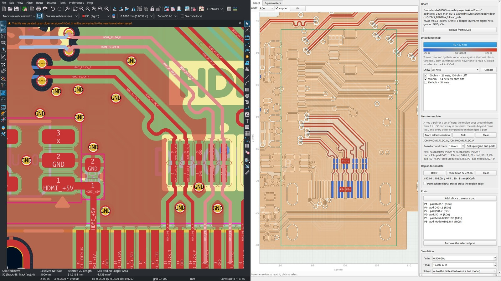

# KiCad plugin

[← Index](index.md)

kicad2ems's plugin for KiCad's PCB editor lives in its own repository,
[kicad2ems-ipc](https://github.com/lowprocess/kicad2ems-ipc). It talks to KiCad through KiCad's IPC API (KiCad 9
and later) and reads the board as it is open in KiCad, unsaved edits included. A toolbar button opens a window
with the impedance map of the board (every trace coloured by how far its [line model](transmission-lines.md) Z0
is from its net class's target), the nets, region and ports to simulate, and a kicad2ems run on them, or the same
set-up opened in [kicad2ems's own window](gui.md).

It installs from KiCad's Plugin and Content Manager, or from its repository; KiCad then builds the plugin a Python
environment of its own with kicad2ems in it. Its README says how, and how to use a kicad2ems you have installed
already.

## What the plugin uses

It uses kicad2ems as a library, through `kicad2ems.api.frontend` (the board, `build_lines` and `RefCopper` for the
map, `overlay`, `kind_value` and `extra_port_fps` for the region's parts and ports, `Run`, `EventTail`, `stop_runs`
and the readers for the runs), and the GUI's plan and section views through `kicad2ems_gui.api`
([APIs](api.md)). A change to those is a change to the plugin's interface.

A coupled section's pairs (`LineModel.groups[...]['pairs']`) give their even- and odd-mode impedances with the
copper's thickness (`ze`, `zo`) and as sheets (`ze_sheet`, `zo_sheet`), from the
[field solver](transmission-lines.md#coupled-sections), as do grounded CPW sections. Each distinct one takes about
20 ms, once per process (the CM5 Minima's 94 nets: 13 s, against 6.4 s with the formulas): for a first look from the
formulas, set `lines.topology.FIELD_GROUPS = False` and `lines.reference.FIELD_CPW = False`. `build_lines(...,
field=True)` takes every section from the board's cut across it, as the map's *Every section by the field solver*
does. Each drawing element says where its Z0 came from (`source`, `z0_formula`) and carries its cross-sections
(`section`), which `sections.solve` and kicad2ems-gui's `SectionView` draw.
