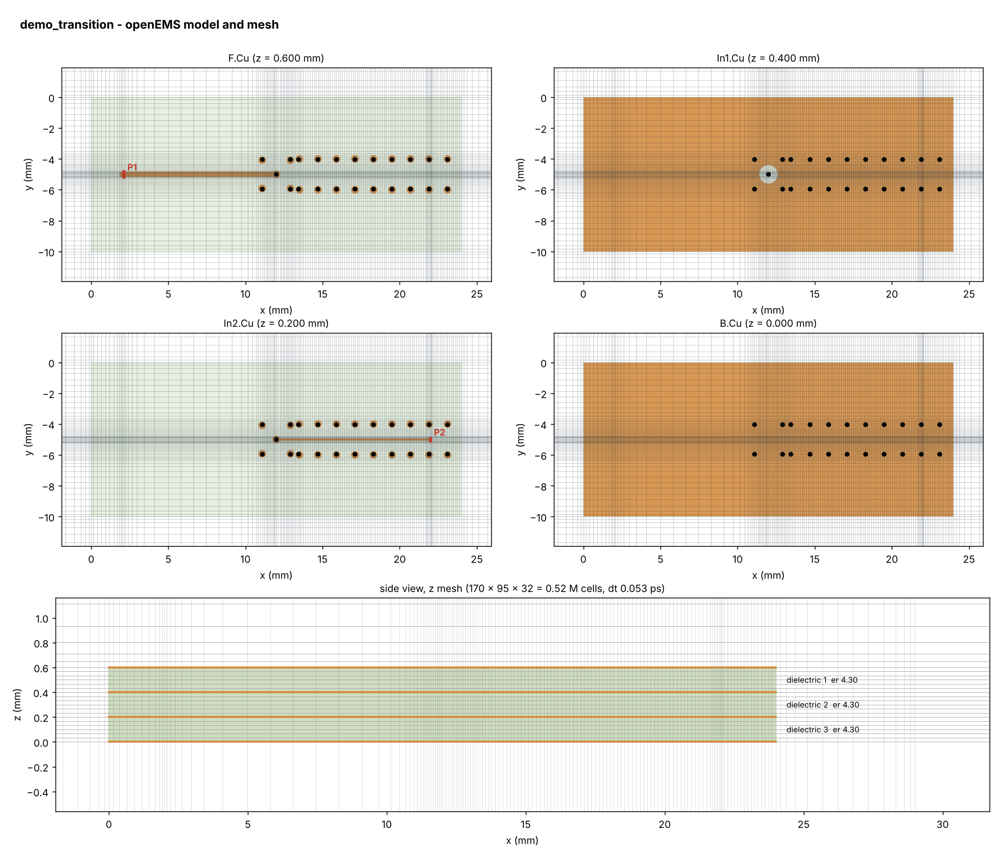

# openEMS: meshing

[← Results](postprocessing.md) · [Index](index.md) · [Next: openEMS simulation →](simulation.md)

openEMS and gfdtd need a rectilinear mesh: lists of x, y and z lines, which kicad2ems-fdtd's `mesh.auto_mesh`
builds. Accuracy depends on resolving the copper edges and the wavelength; the time step depends on the smallest
cell, so every extra line costs run time.

*The demo transition's preview (`--preview`): the lines crowd at the trace's edges and the vias, grow away from
them, and grade in z away from each copper layer.*

## Cell sizes

- **Largest cell**: a wavelength at `fmax` divided by `--res` (20), in the dielectric and in air separately.
- **Fine cell** at copper edges, `--fine`. By default it is a quarter of the smallest of: the narrowest port
  trace, twice the thinnest dielectric, and the narrowest gap next to the port copper (coupled lines, a
  coplanar slot). Narrow gaps can still need finer meshes: check with `--converge`.
- **Growth**: neighbouring cells differ by at most `--ratio` (1.4), across the kept lines too: each kept
  line's cell size is carried along the axis, growing `--ratio - 1` times the distance, so a gap split into
  small cells sets its neighbours' neighbours as well (before 2026-11-25 each gap was graded from the widths
  of the gaps beside it alone: on 32 of the 52 examples' meshes a cell beside one 2-8.9× its size). The cell
  round a copper edge (its thirds-rule pair) is never split, so where kept lines are closer than the ratio
  allows among themselves, or a pair sits beside cells a smaller largest cell holds down, the jump stays: 3 of
  the 52 meshes, rf_ratrace's 2.3× the largest.

## x and y lines

- **Straight copper edges** get the "thirds rule": a pair of lines across the edge, one third inside the
  metal and two thirds outside. This places the edge correctly for the field singularity there. An edge
  counts as straight if it stays within `fine/10` of an axis.
- **Curves** (arcs, round ends, oblique edges) get lines at their ends and their x/y extremes, plus one
  wherever the curve has run on by the copper's own width (`--curves extremes`, the default), or a line at
  every vertex (`vertices`). The width rule keeps a thin curved track, such as a rat-race ring, connected.
- **Over curved copper** (arcs, rings and fans longer than twice the copper's width, not round track ends)
  the largest cell is the dielectric's divided by `--curve-res` (6): a radial stub's notch otherwise moves from
  2.13 to 2.03 GHz.
- **Vias** on the port nets get lines at their centre and edges. Other vias, such as stitching and
  fences, move onto the nearest existing line within `--via-snap` (0.2 mm). Every move is logged.
- The board outline, the port planes and the ends of each lumped part are kept exactly.
- Lines closer than `fine/2` are merged, keeping the most important one.
- The gaps are then filled with graded lines up to the largest cell.

### The signal zone

Every mesh line runs across the whole model, so on a real board the ground planes' pours, antipads and
pads would set the mesh everywhere, not just near the signal. `--mesh-zone on` (the default) gives ground
copper's edges lines only within a zone around the signal copper (every net but the ground nets, on any
layer, and the signal vias). The zone reaches 1 mm or 3 times the thickest dielectric, whichever is more;
`--mesh-zone 2.5` sets the reach in mm and `--mesh-zone off` meshes every copper edge. Outside the zone
the planes are left to the graded mesh. A small ground ring (a pad, an antipad or a via, up to 2 mm across)
that touches the zone keeps all its lines: the return vias next to a signal via matter, and on
`rf_diffvia` cutting half of their lines moved the common mode by 0.14. Antenna mode never uses the zone,
since there the ground copper is often the radiator.

| Board | Cells, zone off → on | Largest change in S |
|---|---|---|
| KiCad's CM5 demo, HDMI D0 pair, default fine cell | 75 M → 17 M | not runnable before |
| the same, `--fine 0.1` | 9.5 M → 3.6 M (142 s → 47 s) | 0.024 |
| `sma_launch` | 1.14 M → 0.82 M | 0.0001 |
| `filter` | 0.40 M → 0.34 M | 0.0033 |
| `demo_transition` | 0.53 M → 0.51 M | 0.0003 |

The other examples lie within their zones, and mesh the same either way.

## Copper thickness

`--thickness on` gives each copper layer its stackup thickness in openEMS's and gfdtd's model. The stack above a
layer moves up by it, so every dielectric keeps its own thickness between the copper, as the line model's
cross-sections do. The bottom copper grows down; every other layer grows up (an inner layer into the dielectric
above it, which fills between its copper). The copper is solid metal; with `--sigma` its two faces are conducting
sheets, each one side of a conductor half as thick (σ / 4 and twice the thickness in openEMS's sheet model; gfdtd
1.3 knows them as faces, so `--rough` takes the copper's skin depth). The slab's sides are PEC: their loss, about a
quarter of a microstrip's (more with a [finish](simulation.md#finish)), is left out. Vias and
edge walls cover the copper they end on, a port runs from the reference copper's face to the trace's, and parts and
gap ports span the copper. The mesh has a line at both faces and one cell through the copper.

On rf_coupler (1.28 mm lines, 0.14 mm gap, 35 µm copper) S31 at 2.4 GHz rose 0.50 dB on both engines (−10.35 to
−9.85 dB; openEMS and gfdtd within 0.007 in |S|), against 0.65 dB from the line model's field solver, for 1.15× the
cells and 1.45× the run time. Thickness matters most where copper edges face each other across narrow gaps: tightly
coupled pairs and couplers.

## z lines

There's a line at every interface (dielectric boundaries and copper heights), at least `--nz` (4) cells
through each dielectric, and graded air above and below.

Next to a copper layer with signal edges (a port's layer, or any layer that isn't a plane), the first cell
on either side is `--z-sheet` (1) × the fine cell, growing by `--ratio` into the dielectric and the air.
The field at a strip's edge needs resolving vertically as much as sideways. On 0.8 mm FR-4, uniform cells
gave a 10 dB coupler's coupling and a grounded CPW's match far off, and refining the edge cells in x and y
didn't help:

| Mesh | Coupler S31 at 2.4 GHz | Grounded CPW S11 at 5 GHz |
|---|---|---|
| uniform, `--nz 4` | −8.6 dB, 0.32 M cells | −19.3 dB, 0.09 M cells |
| uniform, fine cell ÷ 3 (÷ 2 for the CPW) | −8.4 dB, 0.75 M cells | −18.1 dB, 0.18 M cells |
| uniform, `--nz 36` (32 for the CPW) | −10.5 dB, 1.21 M cells | −33.1 dB, 0.34 M cells |
| graded from the fine cell (the default) | −10.4 dB, 0.57 M cells | −31.5 dB, 0.14 M cells |

The graded mesh took 1.3× the uniform one's run time. `--z-sheet 0.5` gets closer (−10.5 dB, −32.6 dB)
for about twice the time, and `--z-sheet 0` turns grading off. Grading only starts where the fine cell
is smaller than the uniform cell, so wide lines on thin dielectrics are unchanged.

## Boundaries and air

The default boundary (`--bc auto`) puts a perfect conductor (PEC) directly on the bottom copper when it
covers at least 85 % of the board, and absorbing MUR boundaries elsewhere. You can instead give one value
for all sides or six values (`xmin,xmax,ymin,ymax,zmin,zmax`), each `PEC`, `PMC`, `MUR` or `PML_n`.

PEC side walls form a closed box. kicad2ems warns when that box resonates below `fmax`, since that adds
false resonances. Use them only when the real board sits in a shield can of that size.

There's `--air` (5 mm) of air on every side. Antenna mode uses at least a quarter wavelength, with `PML_8`. Six
values set each side on its own, in the order of `--bc` (xmin,xmax,ymin,ymax,zmin,zmax; ymax is the board's top
edge in KiCad): `--air 11.5,11.5,11.5,140,11.5,11.5` puts 140 mm in front of an antenna that fires off its top
edge. The NF2FF box follows the mesh, so it grows with the margin.

## Edge walls

`--edge-walls SIDES` (`xmin,xmax,ymin,ymax` or `all`) puts metal walls where the ground planes end at the
board edge. They stand in for edge plating or a row of stitching vias. Without them, plane pairs are open
at the edge and can resonate.

On the SMA launch example, the planes beyond the last via row rang as a quarter-wave resonator at
4.7 GHz, notching S21 to −5.5 dB. With `--edge-walls all` the notch disappeared and the run needed 14k
timesteps instead of 96k.

A wall spans the layers that have ground copper at the edge. It stops `--edge-keepout` (0.5 mm) short of
signal copper, so a launch pad or a trace running off the edge stays open. The preview draws the walls
in green.

## Drawn solids

The Draw page's solids ([the window](gui.md#the-draw-page-prototype), `shapes`) are resolved into disjoint pieces
(`core.solids`: a later solid over an earlier one, over the board's dielectric unless it encloses the whole board),
each an extruded polygon in the CSX model: metal a perfect conductor (with `--sigma` its faces lossy,
[below](#drawn-metal-loss)), a dielectric its εr and tan δ (as a stackup layer's, `--diel` included), air εr 1. They
sit over the board's dielectric and its cut-outs and under its copper, vias, walls, parts and ports; where a metal
piece meets another piece the metal wins, so its face is its surface on openEMS and gfdtd alike.

The mesh:
- x and y lines at each piece's Manhattan edges, and at a curved one's ends and extremes. A metal face wins a merge
  against the copper's thirds-rule lines (a wall thinner than the cell keeps a line on it); a dielectric's or air's
  gives way to them.
- z lines at each piece's heights. Inside a dielectric layer the line shares the layer's cells between its two sides:
  a pocket 0.1 mm deep in rf_shielded's 0.508 mm takes 13 + 4 cells, where a layer of its own would take `--nz` (16)
  and cut the time step to a quarter. Outside the stack a height has its line unless within fine / 2 of another.
- Over a dielectric piece, its own largest cell (λ / √εr / `res`); the air margin (`--air`) past the solids as well
  as past the board.
- Metal with no line across it would be left out: the log says so. A metal piece of no height, or with no z line
  through it, is a sheet on its nearest line.
- A metal piece no wider than 1 mm in plan is a post: with `--vias auto` (the default) or `snap` it is meshed as a
  ground via, with no x or y lines of its own (its heights keep theirs), its centre moved onto the nearest line
  crossing within `--via-snap`; where none is that near, a line every 2 × `--via-snap` along a row of them, not one
  a post. `--vias exact` gives it its faces' lines.

Two rules keep a drawn can from costing more than the PEC boundary it stands for (`rf_shielded_can.toml` against
`rf_shielded.toml`, gfdtd on an RX 7800 XT, 2026-11-27):
- When the drawn metal closes round the board (no way from its ports to the domain's faces but through metal:
  `core.solids.enclosure`), the mesh ends at the metal's outer faces: outside a closed shell there is no field, so the
  air margin is left out. 0.83 M cells to 0.58 M, 68 s to 43 s.
- Where metal fills the whole domain across an axis (the can's floor, lid and walls, once the mesh ends at them),
  there are no lines inside it and no grading beside it. 0.58 M cells to 0.45 M, 43 s to 35 s; the PEC boundary
  takes 0.41 M and 33 s.

A **ferrite** is meshed as a dielectric of its εr (its μ is near 1, or below it, above its resonance, where a
circulator works). A **magnet** is metal to the RF (rare-earth magnets conduct). Under a drawn magnet the ferrite
is gfdtd's `FerriteMaterial`, its bias (`core.magnets`: the magnets' field and its own demagnetising field, from
the charge on their faces, exact for prisms magnetised along z) computed at the mesh's own cell centres over it,
in the mesh's heights, NaN where it is not saturated (those cells unbiased, the log counts them). With no magnet
drawn it is a dielectric to every solver; under one, openEMS and Palace refuse it (no gyrotropic medium), as
mom25d refuses any solid. Left out: the bias's x and y components, magnetic materials other than the magnets and
the ferrite (no steel pole pieces or return path), a magnet's recoil permeability, temperature, and a partly
magnetised ferrite (its low-field loss).

S21's peak is 4.6255 GHz in each of them, as with the PEC boundary, on gfdtd and on openEMS (EMerge's converged
3D FEM: 4.621 GHz). A dielectric cover over the board, 0.2 mm of εr 2.2, gives 4.4774 GHz drawn as a solid and as a
stackup layer alike. With `--thickness on` (the solids' heights mapped as the stack's, a face on a copper level at
that copper's lower face) the drawn can gives 4.65026 GHz and the PEC boundary 4.65023 GHz.

**Posts.** A fence of 300 posts 0.25 mm across, 0.36 mm apart in four rows through rf_shielded_can's board
(`tools/gui/draw_bench.py`'s), had lines at every post's extremes: 484 × 132 lines in plan and 1.98 M cells, the
time step 0.069 ps. Snapped, the board keeps its own mesh: 129 × 112 and 0.45 M cells, 0.083 ps; gfdtd's run 36 s
to 14 s, its peak memory 1.93 to 0.56 GB. What it costs (gfdtd, 2026-11-27):

| Posts | Lines in plan, cells | Result, snapped against their faces' lines |
|---|---|---|
| rf_siw's 60 via rows (0.6 mm at 1 mm) drawn as posts | 243 × 90, 0.35 M → 164 × 106, 0.28 M | TE10 cut-off 6.195 → 6.204 GHz; 7–12 GHz: \|S21\| within 0.03 dB, 0.8° |
| 300 posts 0.2 mm across, 0.24 mm apart along rf_shielded_can's long edges | 792 × 116, 2.85 M (0.064 ps) → 133 × 112, 0.46 M (0.083 ps); 345 → 95 s, 2.66 → 0.56 GB | S21's peak 4.62554 GHz, the posts 0.05 MHz over the can's 4.62549; with their faces' lines 4.66252, and 4.66251 with them made air: those 37 MHz are the lines' (x lines 0.03–0.2 mm apart across the board), not the posts' |

A post snapped is a wire on its line crossing where the cells are larger than it (as a via is); among finer cells
it keeps its shape, moved. rf_siw's own KiCad vias (on the RF net: exact lines) cut off at 6.363 GHz, and at 6.292
snapped (`--vias snap`): their pads' lines make a finer mesh at the rows than the posts have.

**Conductor loss.** With `--sigma` the drawn metal's faces the field reaches are conducting sheets on openEMS and
gfdtd (`fdtd/faces.py`), as thick copper's are ([Copper thickness](#thickness)): each one side of a conductor, σ / 4
and twice its thickness in openEMS's sheet model, its impedance the surface's, (1 + j) / (σ δ). The conductor is 30
skin depths at the sheets' fit frequency: the fit's resistance within 0.5 % of the surface's from a tenth of it up
(2–3 % at 100 skin depths, its range growing as (t / δ)²). The faces: at each height the metal below not under more
metal, and above not over more; in each slab between heights the straight sides of the metal's union in plan (an
edge along x or y, `fine` long or more); none against more metal, none on an enclosure's outer faces (the mesh
ends there). Each lies on the mesh line of the body's outermost tangential edges; a wall or plate one cell thick or
less, field on both sides, is one sheet of its own thickness and σ. A magnet's faces take its own conductivity
(sintered NdFeB, 6.7 × 10⁵ S/m). Left out: curved and oblique sides (a post's, a round can's wall), whose staircase
stays PEC, as vias do; a sheet of no height stays PEC; a foil with no z line through it is a sheet of its own
thickness and σ.

- The faces lie over the board's copper (their priority 11 against its 9 and 10): copper on a metal face is that
  metal's surface, the field on one side of it, where a copper sheet is openEMS's two-sided one and half the loss
  (a board's ground on a can's floor had read the cavity's Q 14 % high).
- When the metal closes round the board the domain's sides are PEC, not Mur: openEMS and gfdtd keep conducting
  sheets in a Mur boundary's cell PEC, and the walls' inner faces and the board's ground on the can's floor are in
  it (one cell inside the mesh's end).

Checked against a rectangular cavity's TE101 mode (Pozar, eq. 6.46): a copper can drawn round a bare board of air,
32 × 27 mm inside and 10 mm tall, two 1 mm probes weakly coupled to it (`tools/fdtd/can_q.py`); Q0 from S21's
resonance, QL / (1 − |S21|) at its peak:

| | f0 | Q0 | Cells, time |
|---|---|---|---|
| Pozar | 7.2639 GHz | 7,619 | |
| gfdtd | 7.2596 GHz | 7,624 (+0.1 %) | 0.02 M, 4.6 M time steps, 166 s (RX 7800 XT) |
| openEMS | 7.2596 GHz | 7,628 (+0.1 %) | the same, 1,246 s (6 threads) |
| Palace, its eigenmode run (`loss`, the probes' Q_ext taken out) | 7.2617 GHz | 7,580 (−0.5 %; 7,573 from S21) | 14,266 tetrahedra, 317 s with the driven run (4 ranks) |

The probes load it to QL 5,046 (|S21| −9.4 dB at the peak); 2 mm probes a quarter of the way in had loaded it to 500
(−0.55 dB), where 1 / (1 − |S21|) multiplies S21's error sixteen times.

On rf_shielded_can (`--sigma 5.8e7`) S21's peak falls from −6.02 to −6.59 dB, almost all of it the board's ground on
the can's floor (PEC before: a sheet in the Mur boundary's cell); the can's walls and lid alone take 0.002 dB, 4 mm
from the board. It has 85,013 sheet edges (3,779 before, the traces'): the ground's 27,700, the lid's and walls'
53,600. Finding the faces takes 2 ms, 0.14 s with 300 posts in the can. On the RX 7800 XT gfdtd's step ran at 7,900
M cells/s lossless, 6,000 with the floor's face alone and 5,800 with them all (the lid's and walls' 4 %), its peak
memory 548 → 564 MB; the run 39–42 s either way (lossy, it rings down in 524,000 steps, not 694,000).

With `--thickness on` and `--sigma` the drawn can gives S21's peak −6.315 dB at 4.64660 GHz, the PEC boundary
−6.312 dB at 4.64642 GHz (there the ground's upper face is a cell in from the boundary, lossy; its sheet on the PEC
bottom without `--thickness` is not). An air pocket the top 0.1 mm of the laminate under the resonator's middle
third moves the peak 35.0 MHz up without `--thickness`, 35.5 MHz with it.

**Antenna mode.** The NF2FF box follows the mesh, which runs past the solids' air margin, so it holds them. Two
antenna examples need solids (gfdtd and openEMS, 2026-11-27, [Examples](examples.md#verified-results)):
- `antenna_dra`, a cylindrical dielectric resonator (εr 10, 6 mm radius, 6 mm tall) fed through a slot (a cut) in
  the ground: its HEM11δ with a 3.5 mm slot, weakly coupled, at 6.63 GHz against Mongia and Bhartia's 6.61 GHz; the
  5.5 mm slot of the example pulls it to 6.30 GHz and matches at 6.51 GHz (S11 −24.7 dB on both engines, gain 6.0
  dBi, 5.3 dBi broadside, the two within 0.1 dB);
- `antenna_patch_radome`, the patch under a 2 mm plate of εr 3, 3 mm above it: 2.4275 GHz on both, the bare patch's
  2.4375; laid on the copper the plate gives 2.3600 GHz drawn or as a stackup layer alike (−3.2 %), and mom25d's
  laterally infinite layer −3.4 % (2.4500 to 2.3675 GHz).

A puck of εr 38 is the hardest case for the staircase: `rf_dr_bandpass`'s TE01δ peak is 9.228 GHz on gfdtd and
9.196 GHz on openEMS on the same default mesh, 9.2014 and 9.1987 GHz on one of 3.2 times the cells, and 9.210 GHz on
Palace ([examples](examples.md#dielectric-resonator)). Another drawn-solid example: a can's box resonance and an
absorber under its lid ([`rf_can_mode`](examples.md#shield-can-resonance)).

## Time step

The time step is limited by the smallest cell. kicad2ems estimates it from the mesh. openEMS's own value
is usually about 10 % smaller. Thin layers such as prepregs or solder mask are often what limits it.

## Warnings

- Fewer than two mesh lines across a port trace: use a smaller `--fine`.
- A lumped part's gap narrower than half a fine cell: openEMS would drop the part.

## Mesh convergence

`--converge 1,1.5,2` builds a mesh for each factor: the resolution × f, the fine cell ÷ f and the
dielectric cells × f. The finest level gives the result. The coarser ones run first and are compared with
it (the largest change in |S| in dB and in phase, where |S| is above −40 dB). The result counts as
converged when the second-finest level is within `--converge-tol` (0.1 dB, 2°).

`--preview --converge 1,1.5,2` shows the cells, time step and relative run time of each level without
running. Convergence checks aren't available in antenna mode.

A narrowband filter whose pass band shifts between levels shows large dB differences on its skirts. The
plot shows whether it's a shift (refine further) or a level change.

## Validation: the transition demo

Around the demo transition's via, the trace end, the via pad and the antipad sit within about 1.5 fine cells of each
other, which is why the thirds rule's pairs are 2/3 of a fine cell wide: the default mesh is then within 0.5 ps of
the converged delay.

| Mesh | Cells | Worst S11 | Delay |
|---|---|---|---|
| default | 0.40 M | −24.1 dB | 135.1 ps |
| `--nz 6` (the example's setting) | 0.52 M | −21.9 dB | 135.1 ps |
| 1.5× finer | 0.71 M | −22.5 dB | 134.6 ps |
| line model | – | −18.0 dB | 132.2 ps |

On gfdtd with the grading of 2026-11-25 (`nz = 6`): 0.59 M cells, −22.1 dB, 134.8 ps (the grading before it
0.51 M, −22.3 dB, 134.9 ps; converged, at `--res 60` and a third of the fine cell, 2.4 M cells, −21.7 dB, 134.4 ps).

Return loss wants more cells through the dielectric, which is why the example sets `nz = 6`. Run `--converge 1,1.5`
once on each new kind of structure, and treat return loss below about −20 dB from an unconverged mesh as uncertain.

---
[← Results](postprocessing.md) · [Index](index.md) · [Next: openEMS simulation →](simulation.md)
