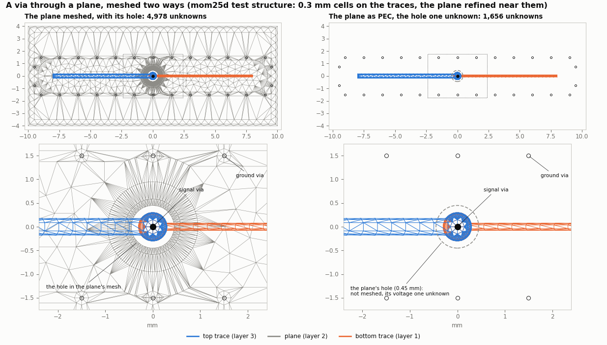
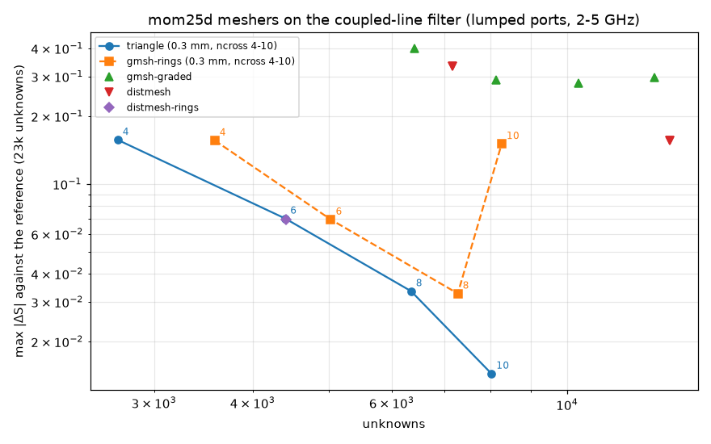
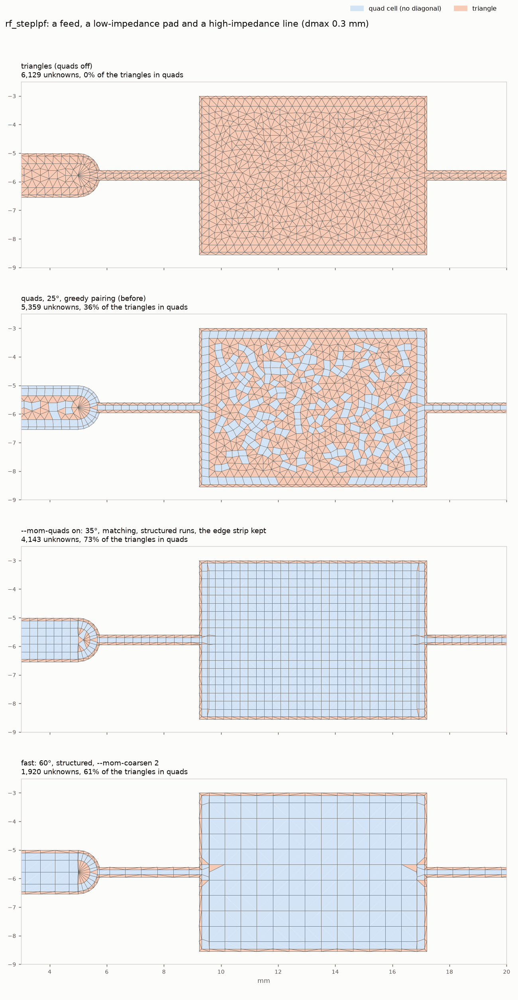
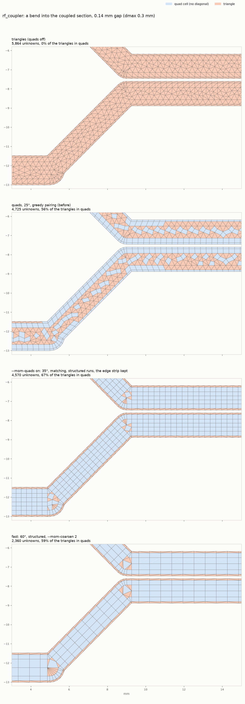
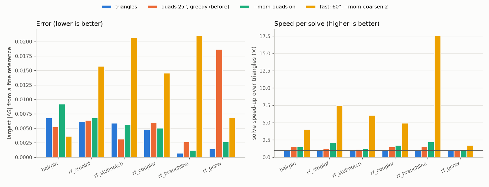
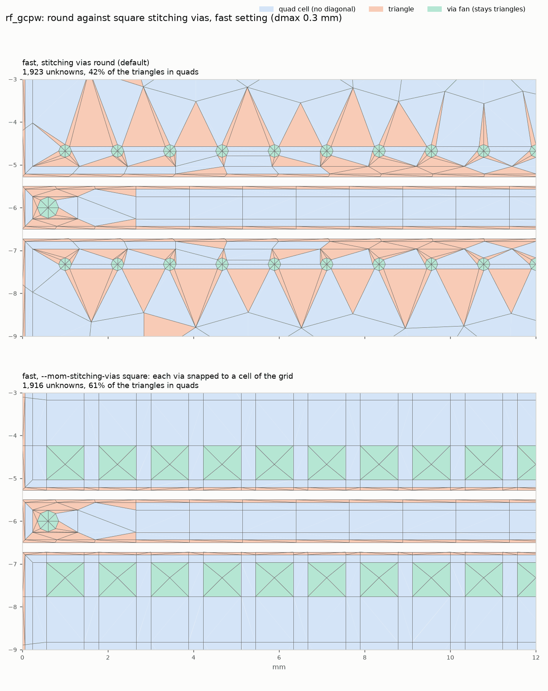

# mom25d

[← openEMS simulation](simulation.md) · [Index](index.md) · [Next: Transmission-line model →](transmission-lines.md)

mom25d is a 2.5D method-of-moments solver for circuit boards, its own package in
[its own repository](mom25d/README.md) (the `mom` extra, or the installer). It doesn't need
openEMS; without its compiled core, `--check` lists mom25d as not installed.

```bash
kicad2ems examples/rf_interdig.toml --solvers mom        # mom25d alone
kicad2ems examples/rf_interdig.toml --solvers mom,lines  # with the line model
kicad2ems examples/rf_interdig.toml --mom                # next to openEMS, as a reference
```

Its settings are the `--mom-*` options, or `dmax`, `port`, `solves`, `dump` and `near` under
`[solver.mom25d]` ([options](usage.md#options)). Its compiled core, `python -m kicad2ems.mom25d.core.build`, makes it about
five times faster.

## What mom25d models

- Copper is sheets on the layer interfaces with their edges stood up as plates the copper's thickness high
  ([thickness](#thickness); `--mom-thickness off`: sheets only, `grow`: an effective width).
- The dielectric layers extend sideways to infinity, over an **infinite ground plane**: the board's `ground`
  layer, or the lowest layer whose copper covers half the board. Copper below it is left out.
- Vias are vertical wires between the layers they connect; edge walls become rows of vias every 0.5 mm.
- A lumped part is one series R-L-C element across its gap.
- Radiation and surface waves are included. The board edge and an air box aren't: no box resonances, no edge
  effects.
- The dielectric is the stackup's εr and tan δ, constant over frequency. With `--diel wideband` (or
  `diel = "wideband"`), it follows the Djordjevic-Sarkar model, as on the FDTD solvers
  ([dielectrics](simulation.md#dielectrics)). mom25d evaluates that model exactly at each frequency it solves, where the FDTD
  solvers fit it with Debye poles, and it costs no extra run time. `--sigma` adds copper loss.

Other copper layers, inner planes and pours included, are meshed, except solid planes and lone stitching-via pads
(below). Large meshed planes add many unknowns and slow mom25d down ([speed](#runtime)).

<a id="thickness"></a>
### Copper thickness

mom25d's copper is a zero-thickness sheet. Real copper (35 µm) shifts S by a median RMS of about 0.04 on 17
of the matrix's boards, and by up to 0.17 on narrow-gap filters (gfdtd with solid copper against its sheets,
both on a twice finer grid; 2026-11-17). `--mom-thickness grow` moves every copper edge out by 0.57 × the
copper's thickness: the effective width of thick copper (Hammerstad; Kirschning-Jansen for coupled lines),
strips wider and gaps narrower by the same, no extra unknowns. Against gfdtd with solid copper the median RMS
went from 0.065 to 0.052, better on 11 of the 17 boards (rf_stripline 0.058 → 0.030, demo_transition 0.049 →
0.023). It is worse on resonators coupled across narrow gaps (hairpin 0.21 → 0.23, rf_interdig 0.12 → 0.14):
there the coupling is the side walls facing each other across the gap, which a sheet cannot carry.

`--mom-thickness sides` (the default) stands every copper edge up as a plate the copper's thickness high (up
into the layer above; the board's lowest copper down, as gfdtd's thick copper grows), two triangles with RWG
functions in 3D: the fold from the sheet and the edge shared with the next plate. The diagonal between a plate's
two triangles follows from them: a plate is a cell of one charge density, as a [quad cell](#quads) of the sheet
(its diagonal's own freedom is the charge's slope up 35 µm of copper, which a plate one cell high does not
resolve). A side so
carries charge (in the medium beside the copper: the air over a microstrip) and current along the trace. Both
matter: thick copper lowers a microstrip's effective permittivity because its inductance falls more than its
capacitance rises (a 30 mm line, w 0.38 mm on 0.2 mm FR4: the plates took eeff 2.8 % and Z0 4.4 % down,
Hammerstad-Jensen 3.5 % and 4.4 %); the sides' charge without their current moves eeff up. Against gfdtd with
solid copper the median RMS of the 17 boards went from 0.065 to 0.037 (`grow` 0.052), better on 16: hairpin
0.21 → 0.037, rf_meander 0.13 → 0.050, sma_launch 0.090 → 0.032, rf_steplpf 0.083 → 0.041, rf_combline 0.26 →
0.20; worse on rf_ratrace (0.039 → 0.056, where gfdtd's two grids differ by 0.07). Plates only on the edges
facing copper across a narrow gap did little (median 0.049 within 0.4 or 0.8 mm, 0.065 within 0.2 mm): the
sides matter on every edge. Both together (`grow+sides`, removed 2026-11-18) gained nothing (median 0.040,
mean 0.050 against `sides`' 0.037 and 0.051). The
cost: two unknowns a plate (+20-30 % on these boards, +17 % on sma_launch; three with the diagonals, until
2026-11-18: without them the 17 boards' S moved by an RMS of 0.0002-0.006, the median against solid copper
0.0360 → 0.0359, the mean 0.0506 → 0.0506) and their blocks (in the compiled core: pairs of triangles more than
five sizes apart take one point each, as the strips' far field, not 3 × 3: S within 1e-4): 41 solves of
sma_launch 179 s against 217 s with the diagonals and 3 × 3 points everywhere, hairpin 10.1 s against 11.1,
rf_diffvia 31 s against 38. The blocks a frequency (2026-11-18): rf_bends 0.29 → 0.085 s, sma_launch 0.70 → 0.32
s, the same to 5e-16, with the observers in colours (no two of a colour on one row: each its sums in its
thread's buffer and at once into its rows; kept for a column-parallel scatter, 5 N complex an observer, their
traffic bound it) and the folds' far block a triangle at a time (`fold_far`: an observer triangle's kernels once,
not for each of its edges). A plate's
functions are charge-dominated (its triangles 35 µm high), so their loops were lost to the complex64 LU of mixed
precision (rf_meander at 0.5 GHz: cond 1.4e9 against the sheets' 3.5e7); in mixed precision the verticals are
taken as loops (each with its folds and the sheet's edges round its node: no charge
left; T^T Z T exactly, S to the GMRES tolerance; with [quad cells](#quads) too), and the GPU's complex64 factor
no longer fails: sma_launch's
41 solves 245-257 s against 319-341 s (222 GMRES iterations over the sweep against 698, GPU fallbacks to the CPU's
triangular solves 0 against 6), rf_diffvia 36 s against 43 (12 fallbacks to 0), demo_transition 22 against 25,
rf_interdig 17 against 21; with a double LU (below 3000 unknowns with a GPU, 3500 without: hairpin, rf_meander,
rf_coupler) nothing changes. A
side breaks where a lumped port's gap or a lumped element crosses the copper (their current is the sheet's
edges'). Not modelled: the copper's top face,
the vias' vertical current with the plates' (only through their charge and the smooth potential), the plates
with holes and openings of PEC planes, and around a via through a meshed plane's antipad (rf_msvia's whole
stack: S11 −15 dB at 5 GHz, sheets −34, gfdtd with solid copper −23). With `--mom-planes mesh` or
`--mom-stack whole` the copper takes `edge` instead (rf_msvia: S11 −22.8 dB at 8 GHz, gfdtd's −22.8, sheets
−31.8), with `holes` or `slots` it stays sheets, and the log says so; `edge` with wave ports stays sheets
(a wave port's S moved 3-7 times what gfdtd's solid copper moves it: rf_diffvia's pairs 0.32, gfdtd 0.043,
lumped ports 0.065), so `--mom-port lumped` for it; at low frequency the loop/tree basis is not used with
them. With wave ports the sides stay (`mom25d.thickness.WAVE_SIDES`, on since 2026-11-18): the plates run on
through a feed's sample cuts and its gap (the gap's voltage across them too), a cut's current adds the plates'
crossing it (a third of it on a 0.38 mm microstrip), and the line characterisation has the sides (the thru
line's Zc 51.4 → 48.6 Ω). A cut's ends are moved onto the copper's edge within 2 % of the port's width: a
board's feed 0.2 µm wider than its port had left a sliver between the cut's end and the edge, its current not
counted (rf_interdig's wave-fit residual 1.7e-2 → 5e-4 as sheets). A fold's half on the sheet is an RWG half
on the sheet's triangle, so with the sheet's triangles, the vias and the holes it is the strips' operator's
(centroids far, the strips' near pairs; `Sides.strip_part`): in the plates' own rules (3 × 3 points) a loop of
a vertical, its folds and the sheet's edges round its node, no charge on any triangle, kept 3.5e-3 of a
vertical's charge in Z, at 1 GHz 4 times (up to 80) its inductive part, and the charge between a wave port's
cuts along demo_transition's feed at 1 GHz ranged over 6.4 times cut to cut (now 1.16, as sheets 1.15), which
the wave fit amplified (|S11| up to 1.8 below 2.7 GHz). Now the wave ports' thickness shift follows the lumped ports'
on the 7 wave-port boards: RMS 0.006-0.022 apart over the band (the lumped shift 0.03-0.12; demo_transition
0.22 → 0.008, below 2 GHz 0.57 → 0.007; rf_diffvia 0.069 → 0.019; sma_launch 0.018 → 0.006, its sweep
920 → 290 s, 1426 → 548 GMRES iterations). The matrix is better conditioned too
(demo_transition at 0.5 GHz cond 2.4e10 → 1.9e8, sheets 1.6e8; at 1 GHz the complex64 LU's GMRES 15 → 6
iterations, as sheets), and the lumped table moved little (median 0.037 → 0.036, mean 0.051 → 0.051;
demo_transition 0.026 → 0.023). One function decides the mode a run gets (`mom25d.thickness.resolve`: the request, the
board's planes and stack, its ports), and its reason is the log's note. `--mom-thickness off` gives the sheets: the
openEMS references of the Solver Matrix are zero-thickness sheets, so compare with `off` there.

`--mom-thickness edge` adds no unknowns: a triangle on a copper edge has its charge and current
spread up a wall, so its static 1/R with each near triangle is averaged over the height between them (two edge
triangles: the difference of two uniform heights; an edge and an interior triangle: one), the analytic
integrals at four offsets (mom25d.edge). The vector and the scalar potential take their own heights, fitted once
to 2D Laplace solves of solid against sheet copper: 2.35 × t for the current, and for the charge 1.08 × t ×
(2 εw / (εw + εo))^0.79, εw the permittivity the side stands in (0.50 × t in air over FR4; in a homogeneous
stripline L and C change alike and eeff stays). Against the 2D solves (w 0.2-1.0 mm, t 35-70 µm, single lines
and pairs 0.1-1 mm apart, even and odd) its Z0 and eeff changes are off by an RMS of 1.08 % points (`sides`
1.03, `grow` 4.0). Against gfdtd with solid copper (17 boards): median RMS 0.048, mean 0.058 (`grow` 0.052 /
0.078, `sides` 0.037 / 0.051), better than `off` on 14: hairpin 0.21 → 0.052, rf_meander 0.13 → 0.054,
rf_steplpf 0.083 → 0.045, sma_launch 0.090 → 0.039; worse on rf_pcoupled (0.065 → 0.074), rf_ratrace (0.039 →
0.068) and demo_transition (0.049 → 0.051). Its cost: 0.5-2 s once and a few ms a frequency (a sparse addition
to Z). Limits: the heights are fitted on the default mesh, and the correction grows on cells coarser across a
strip (a microstrip's eeff -4.2 % at 3 cells across, -3.2 % at 6, -2.4 % at 10); boards differ in which height
suits them (hairpin 2.35, rf_meander 2.9, demo_transition 1.8), which a per-board choice would not fix; the
copper's top face is not modelled (a stripline's Z0 falls 10.5 %, solid copper's 17 %); the loop/tree basis is
not used with it.
Re-measured on 2026-11-18 (the cells grown, e0ed75d): median 0.0474, mean 0.0576 against `sides`' 0.0359 and
0.0506, worse than `sides` on 15 of the 17 (demo_transition 0.024 → 0.047, hairpin 0.036 → 0.052), as good on
rf_branchline and rf_gcpw; S 0.012 (median) from `sides`', so it does not replace them.

`--mom-thickness mixed` stands plates only where copper faces copper within 0.5 mm or is narrower than 1 mm
inward from its edge (`board.MIXED_GAP`, `MIXED_WIDE`), and gives the other edges `edge`'s correction (the edge
triangles under a plate left out of it). The edges it leaves are those of wide copper facing nothing: rf_bends'
lines 676 plates → 1, sma_launch's pour 1113 → 195, the arrays' patches and feeds all. Against gfdtd with solid
copper (17 boards): median 0.0379, mean 0.0515 against `sides`' 0.0359 and 0.0506, S 0.0044 (median) from
`sides`' (rf_steplpf 0.013, rf_combline and rf_pcoupled 0.011: their wide sections); against openEMS (44 boards,
lumped ports) within 0.005 of `sides` on 36, further on 6: antenna_patch +0.057 (a resonant patch's edges, the
edge correction on its 2 mm cells), rf_shielded +0.024, antenna_cp_patch +0.014, the 16-port array +0.013,
rf_pcoupled +0.009, rf_combline +0.006; unknowns 177.5k → 160.7k, the suite 14.6 → 11.5 min on a loaded machine
(`sides` with the faster blocks in the same rounds 16.8: the times there not comparable). With wave ports it is
`sides` (`edge`'s part not checked with them). Not the default: the 17 boards' median 0.002 worse and the
openEMS gate failed on six. (Plates dropped on such edges with no correction instead moved S as far as
sheets do: antenna_array2x2 0.096 → 0.141 against openEMS, `off` 0.141.)

<a id="planes"></a>
### Solid planes and stitching pads

Two rules, both on by default, take out of the mesh the copper that carries next to no current of its own:

- **Solid planes as PEC** (`--mom-planes pec`): a plane in one piece over the board, without holes, on a ground net,
  is a perfect conductor of the stack itself. The highest one under every other copper layer becomes the ground
  and the lowest one over them a PEC cover (the copper beyond each is left out): a stripline's two planes are the
  typical case. A plane with antipads (a signal via through it) stays meshed.
- **Lone stitching-via pads dropped** (`--mom-stitching-pads drop`): the pad of a ground via with nothing else on
  its layer is left out, the via staying as its barrel. A pad that a part or a port lands on is kept.

A board imported with a few nets selected has no solid plane: its pours keep the clearances of the nets left out.
[`--fill-voids far`](model.md#fill-voids) fills those away from the signal copper, after which these rules apply.

`--mom-planes mesh --mom-stitching-pads keep` meshes everything. Of the 52 examples 7 change: rf_stripline from
15,563 unknowns to 1,337 (100 s to 3 s), demo_transition from 13,670 to 4,043 (107 s to 14 s), within 0.01 in |S|
of the fully meshed model (rf_marchand 0.085), with the same agreement with openEMS (`tools/mom_planes_study.py`).

<a id="plane-holes"></a>
**A plane a via runs through** (`--mom-planes holes`, experimental). A plane between the copper layers whose only
holes are those of vias through it (round or nearly, one via each, the via near the middle) is a perfect conductor
of the stack too: what is above it sees it as its ground, what is below as its cover, and neither sees the other.
The via's current runs on through the hole, and the hole's field is a few unknowns (`mom25d/frill.py`): two
shapes of the voltage across it, which is the hole's capacitance into both sides, charged by what the pads near
it induce; and two shapes that go as cos φ and sin φ about the via, the field a trace puts there when it crosses
the hole's rim (its return current has to go round the hole, and its charge finds no plane under it). A via that
lands on the plane ends there; a plane with a slot, a cut-out or a hole two vias share stays meshed.



Against the same plane meshed, with cells fine enough on the plane for its answer to have settled (0.3 mm; at
0.6 mm the meshed plane itself is 0.012 from that on one transition and 0.06 on a pair):

| | Unknowns: meshed finely, as a hole | max \|ΔS\| to the meshed plane (axisymmetric shapes alone) |
|---|---|---|
| a microstrip to a stripline through a 0.45 mm hole, 1 to 10 GHz | 11,256 → 1,661 | 0.004 (0.057) |
| two such transitions 1.2 mm apart, the holes 0.3 mm from each other | 11,972 → 2,938 | 0.005 (0.062) |
| demo_transition (a 0.6 mm hole), 1 to 8 GHz | 14,220 → 1,508 | 0.005 (0.077) |

Two pads joined by a via through a 0.45 mm hole have 202.0 fF with the plane meshed and 203.2 fF this way
(280.6 fF with the hole closed). The single transition takes 0.3 s a frequency in place of 16 s.
demo_transition with its plane meshed as kicad2ems does by default (cells of 0.9 mm on a plane: 3,910 unknowns)
is 0.013 from the hole model and 0.01 from the fine mesh; its S11 agrees with openEMS to −31.3 dB with the hole
model and −31.1 dB with that mesh (−25.9 dB before the hole had its first azimuthal order). Holes of one plane see each other (the admittance between their unknowns),
which matters only when they nearly touch: two 0.55 mm holes with 0.1 mm of plane between them are 0.012 off at
10 GHz, where the next azimuthal order would be wanted. What keeps this from being the default: the low end
(the loop/tree basis does not take the holes yet, so such a board's lowest frequencies are solved in the RWG
basis), holes that are not round or that two vias share (a differential pair's antipad stays meshed), and
the hole's own field, which is not in the current dumps, the near field or the far field.

<a id="sweep"></a>
**The adaptive sweep.** mom25d solves only some frequencies. It fits one rational model through all of S (AAA)
and adds a solve where two successive models disagree most, until the model changes by less than the tolerance
(5e-3 in |S|) and predicted the newest solve as closely, and then once more with a solve in the middle of the
widest gap between its samples; or after `--mom-solves` (60). (Until 2026-11-18 it took two such agreements
before the gap's solve: on the twelve boards' dense solves 218 solves against 206, each final model within 1.3e-3
of the solves against 3.6e-3: a solve more a board for a model already confirmed.) The GUI's Run
page plots the model change and the prediction error per solve; the run summary keeps them (`solved.mom25d.afs`).
The model is fitted to 3e-4 of each entry's scale, not to rounding: a mixed-precision solve's S carries noise
of 1e-5 to 1e-4, and a model fitted through it took a support at every sample and put poles between them. With
many ports it had no rows left to fit at all (16 entries: until 36 solves; 36 entries: until its 60), so a board's
solves went by its port count, not its response: against 201 solves across each band (2026-11-18) the sweeps
of twelve boards took 221 solves where they had taken 351, the model within 1.3e-3 of the solves between its
samples on every one (rf_bends, 6 ports: 34 solves, within 3e-4, where 60 had left it 0.056 off; the 16-port
array: 12, within 3e-4, where 60 had left it 0.87 off, its S not causal; rf_crosstalk_guard 37 → 14, rf_diffvia
37 → 22; hairpin, rf_branchline, rf_coupler, rf_combline, double precision: 45 → 46).

<a id="the-board"></a>
mom25d reads the board file every solver gets, `<name>_board.json`, and runs on its own too:

```python
import numpy as np
from mom25d.api import solve_board
res = solve_board('examples/out/rf_interdig_board.json', np.linspace(1e9, 8e9, 401), dmax=0.3e-3)
res.S, res.names, res.zref, res.notes
```

## Ports

| `--mom-port` | Port |
|---|---|
| `auto` (default) | a de-embedded wave port where the straight feed line is long enough, otherwise lumped |
| `wave` | always a wave port (an error if the feed is too short) |
| `lumped` | a small via from the reference copper to the trace |

A wave port fits the incoming and outgoing waves along its feed line, with the propagation constant from a separate
characterisation of the line's cross-section, so the feed only has to be long enough for the two amplitudes (about
0.1 rad at the lowest frequency). Lumped ports are closest to the FDTD solvers' ports, both including the port's
own parasitics; wave ports are closest to the line model's ideal reference plane. A differential pair is one
mixed-mode port (`P1d`, `P1c`), each mode with the propagation constant of the pair's characterisation; with
`auto`, a pair whose coupled feed is too short is solved as single-ended legs and the modes taken from them, as
for openEMS.

A wave port's two waves both carry the error of its characterised impedance (1–2 %), which makes transmission into
it a little large and out of it as much too small. Reflections and the product of the two transmissions do not
depend on it, so the ports' scales are fitted from the two directions and taken out (`sim.balance`): S between
wave ports is reciprocal, and a run says when the scales were more than 2 % apart. Lumped ports need none.

<a id="real-boards"></a>
### On real boards

mom25d suits planar circuits over one ground plane. KiCad's CM5 demo (the HDMI D0 pair, 6 layers) shows its
limits on a multilayer board:

- **The ground plane** is the lowest layer covering half the board (B.Cu there), and every plane above it is
  meshed: 128,000 unknowns. With `ground = "In1.Cu"`, 22,700, but the copper below it is left out.
- **Ports below the ground**: the module's pads sit on B.Cu, under that ground, so they can't be ports.
- **Results**: with the ports moved to F.Cu, the sweep did not converge in 15 solves, and a lumped port in the
  middle of a trace reflected almost everything (|S| 0.99, gfdtd 0.29).

For such boards use gfdtd or openEMS, or the [whole stack](#whole-stack) where the board is small enough.

<a id="whole-stack"></a>
### The whole stack

The ground stack fills in any hole in the ground layer, so a slot, a defected ground structure or a ground that
stops short of the trace isn't modelled. `mom_stack = "auto"` (the default) looks for them: where the ground's copper
is missing within three substrate heights of the signal copper, leaving out via antipads, a pour's pullback within
1 mm of the board edge, and pieces under 0.25 mm², it chooses the whole stack and logs why. It does the same when a
port is below the ground, which the ground stack can't model. Otherwise it keeps the ground stack. Of the examples,
it chooses the whole stack for rf_dgs, rf_slotline, rf_msvia (its P2 is on B.Cu, under the In2.Cu ground) and five
antennas (the slot, aperture, inverted-F, monopole and Vivaldi). With `--mom-stack ground` on such a board, the log warns and lists the
apertures as deviations.

| Board, against gfdtd (rms \|ΔS\|) | Ground stack | Whole stack |
|---|---|---|
| rf_dgs | 0.74 | 0.12 |
| rf_slotline | 0.93 | 0.14 |
| antenna_slot | 0.95 | 0.06 |

`mom_stack = "whole"` (`--mom-stack whole`) models every copper layer instead of an infinite ground: the lowest
copper layer is the bottom of the stack, with air below as well as above, and the planes are meshed like any other
copper. Copper below the old ground is in the model, ports can sit on any layer, and each is a lumped port to the
nearest plane under or over it (or its `ref_layer`).

On `rf_msvia` (F.Cu microstrip through a via to B.Cu, two inner planes), which the ground stack can't solve, the
whole stack has 5,219 unknowns at `--mom-dmax 0.6` and takes 25 s:

| `rf_msvia` | S21 1 GHz | 3 GHz | 5 GHz | 7 GHz | 10 GHz | worst S11 |
|---|---|---|---|---|---|---|
| mom25d, whole stack | −0.09 dB | −0.27 | −0.38 | −0.60 | −0.77 | −18.3 dB |
| gfdtd | −0.07 dB | −0.24 | −0.38 | −0.55 | −1.02 | −12.9 dB |

They agree to 0.05 dB up to 7 GHz; above it the planes' 1.8 mm cells are about eight per wavelength, and the
dielectric is still laterally infinite. The cost is the planes: the CM5 region is about 125,000 unknowns at 0.3 mm.

<a id="slot-planes"></a>
### Slot planes (experimental)

`--mom-planes slots` keeps every copper layer as the whole stack has them, but the ground stays a perfect conductor,
infinite, and only its openings are meshed (`mom25d/slots.py`): the field in each opening is its unknowns (RWG
functions of the magnetic current E × z), coupled to the traces and vias on either side through the stack's TM
and TE networks, so the plane costs its openings' area, not its own. Its kernels are the frill holes' (above)
generalised; the tests check them against the frill's, superposed from point elements, the openings' own matrix
against Babinet's principle (in a homogeneous medium it is 4/η² times the impedance matrix of a strip of the same
shape, to 1e-5), and the coupling's assembly against brute force. An opening is meshed as a plane is (cells of
3 × dmax, 2 × dmax near the copper of the other layers) with edge rings at its rim. The ground must be one piece
over 90 % of the board with no other net's copper and no via in an opening (the run says why not); its edge is not
modelled, the plane running on past the board.

On a microstrip over a narrow slot in a 24 mm ground the slot plane and the ground meshed at 0.3 mm agree within
0.03 in S from 2 to 10 GHz (1,743 + 491 unknowns against 30,435). On the examples (rms |ΔS| from openEMS, with
`--mom-port lumped` as on the Solver Matrix):

| Board | Whole stack: unknowns, time, \|ΔS\| | Slot planes |
|---|---|---|
| antenna_aperture (1 mm cells) | 8,384, 19 s, 0.192 | 5,580, 15 s, **0.057** |
| rf_dgs | 7,879, 18 s, 0.088 | 3,668, 12 s, 0.110 |
| rf_dgs, its ground grown to 50 × 50 mm (against gfdtd) | 0.066 | 0.084 |
| rf_slotline | 14,022, 55 s, 0.156 | 6,766, 73 s, 0.182 |
| antenna_slot | 28,571, 149 s, 0.058 | 9,115, 35 s, 0.257 |

On antenna_aperture the infinite plane under the laterally infinite dielectric is one consistent layered model
where the whole stack's finite meshed ground under it is not, and that was its 0.19 at any cell size. Where the
board's own ground edge is part of the answer, as in a slot antenna on a ground half a wavelength across
(antenna_slot), the infinite plane is another antenna: the whole stack stays what `--mom-stack auto` chooses. The
openings' coupling to the traces is the compiled core's (`slot_coupling`); their own matrix is NumPy's (about a
third of a solve on rf_slotline's long slot). Not taken yet: the loop/tree basis, frill holes in the same stack, a via through an opening, and the
openings' field in the current dumps and the near field (it is in the far field).

<a id="antenna-mode"></a>
## Antenna mode

With `mode = "antenna"`, mom25d computes the far field of the currents and writes the same results as the FDTD
solvers: match, directivity, efficiency, gain and patterns (`<name>_mom25d_antenna.json`, `_antenna.png`,
`_pattern.png`). On the ground stack nothing radiates below the board and there's no board edge: that suits patches
and arrays on a ground larger than themselves. On the [whole stack](#whole-stack) the board's ground is meshed and
the pattern covers the full sphere. The dielectric is laterally infinite either way, so an antenna that radiates
from the board's edge (an inverted-F, a monopole at the edge) is the FDTD solvers'.

| Patch (`antenna_patch.toml`) | Resonance | S11 | Efficiency | Directivity | Gain | Time |
|---|---|---|---|---|---|---|
| mom25d | 2.450 GHz | −31.4 dB | 36 % | 6.4 dBi | 2.0 dBi | 20 s |
| mom25d, whole stack (its 80 mm ground meshed) | 2.470 GHz | | 36 % | 7.3 dBi | 2.9 dBi | 47 s |
| openEMS | 2.438 GHz | −32.3 dB | 38 % | 7.0 dBi | 2.9 dBi | 81 s |

<a id="phased-drive"></a>
### Phased arrays

`drive` drives several ports at once, each as `PORT[=amplitude][@phase]` (the incident waves, phases in degrees);
ports not named are terminated in their reference impedance.

```bash
kicad2ems examples/antenna_array2x2_phased.toml                     # drive = ["P1@0", "P2@60"]
kicad2ems examples/antenna_array2x2_phased.toml --drive P1@0,P2=0.5@-90
kicad2ems examples/antenna_array4x4_phased.toml --steer 30,-45      # grid = "4x4": 30 deg per column, -45 per row
kicad2ems board.toml --grid "P1:0,0 P2:1,0 P3:0,1 P4:1,1" --steer 0,60
kicad2ems examples/antenna_array2x2_phased.toml --drive P1,P2 --aim 20,90 --taper taylor:25
```

mom25d solves each port driven alone and adds their far fields for the drive: exact at every frequency, the
coupling between the elements included. The gain uses the power all the driven ports accept; the log and the JSON
give the beam's direction and each port's *active reflection* (with its neighbours driven too). The far field's 11
frequencies across the band are solved as part of the adaptive sweep, not again after it (only the pattern
frequency, the resonance, may need a solve of its own), and every port's far field comes from one set of phases:
antenna_vivaldi 257 s to 140 s, antenna_array2x2_phased 28 s to 18 s.

- `grid` places the ports in a 2D array: `COLSxROWS` (the ports in order, row by row from the top) or
  `PORT:COL,ROW` each; `steer X,Y` adds X per column and Y per row (without a grid, X from port to port).
- `aim THETA,PHI` gives each port −k₀(x sin θ cos φ + y sin θ sin φ) more phase from its place, at the pattern
  frequency: any layout of feeds, phase shifters set at one frequency (the beam squints off it). The peak lands
  where the array factor times the element's pattern is largest, short of the target on a few elements: the 2×2
  example aimed at θ 20° peaks at 15°.
- `taper` multiplies in `taylor`, `chebyshev` or `cosine` amplitudes (`:SLL` dB, default 25): on the 4×4 example,
  sidelobes −14 / −13 dB uniform, −28 / −25 dB with `taylor:25`, −30 / −27 dB with `chebyshev:25`, for about 1 dB of
  gain.

Each port's far field is kept in `<name>_mom25d_array.npz`, which the GUI's Plots page steers without solving
again ([Beam steering](gui.md#beam-steering)). openEMS and gfdtd take `drive` too: a run per driven port, each run's
far field per unit incident wave summed for the drive, steered in the GUI likewise. On the 2×2 example gfdtd puts
the beam at θ 10° (mom25d 15°: its infinite ground has no board edge).

<a id="current-dumps"></a>
## Current dumps

`--mom-dump 2.4,5` saves the surface current on each layer at those frequencies, driven from `--dump-port` (default:
the first). The adaptive sweep solves them among its first samples, so a dump inside the band costs no solve of its
own. The dumps are drawn as |J| maps, animated with `--dump-animate`, and shown in the GUI's Viewer.
`--mom-near 0.5,2` adds the E field on planes 0.5 and 2 mm above the board (at least one cell, `--mom-dmax`, up).

```bash
kicad2ems examples/rf_stubnotch.toml --solvers mom --mom-dump 2.4,1.2 --dump-animate gif
```

<a id="meshers"></a>
## The mesh

mom25d meshes each copper layer into triangles (mesh2d, in the compiled core). The current peaks sharply at conductor edges, so the
mesher adds thin rings of cells inside each edge. A study on a coupled-line filter (`tools/mesher_study.py` in
mom25d) found that edge resolution sets the accuracy, not the cell size along the copper: thin edge cells gave 2–4
times smaller errors than evenly shaped cells, with a third of the unknowns. gmsh and DistMesh did worse:



The rings follow the narrowest trace on the layer, so on a coupler they are coarse beside its gap: the first sits
0.067 widths in, 86 µm on rf_coupler's 1.28 mm lines against its 0.14 mm gap, and the charge facing the gap crowds
well inside that. Where copper faces other copper across a gap of under about a quarter of a width, the mesher adds
rings at a quarter, an eighth and a sixteenth of that gap, along those edges only (a ray out of each edge finds the
gap; a wedge where a round track end meets a pad is not one). rf_coupler's lossless S31 at 2.4 GHz went from
−10.64 to −10.35 dB (refined FDTD: −10.24 to −10.29) for 22 % more unknowns; 16 cells across every strip did no
better at twice the unknowns. Of 17 example boards three have such gaps: rf_coupler, rf_gcpw (+20 % unknowns) and
rf_pcoupled (+12 %, its passband unchanged against refined FDTD); the rest mesh as before.

The options below are experimental: each saves unknowns at some cost in accuracy, measured against a fine reference
mesh (`tools/zone_study.py`, `tools/quad_configs_study.py` in mom25d).

<a id="zone"></a>
- **Signal zone** (`--mom-zone on`): the mesh detail only within a zone around the signal copper (0.5 mm or 1.5
  thicknesses of the thickest dielectric, and 1 mm around each signal via). Outside it copper edges get no rings,
  cells grow to 5 × `--mom-dmax`, vias keep only their attachment point and small pads become squares. Most of what
  this removes is stitching-via pads (about 130 unknowns each, 4 now): the demo transition goes from 8,334 to 2,781
  unknowns at about the same error (0.015–0.018 at 2–8 GHz). At 8 GHz the differential via loses about 0.02, where its transition excites
  the space between the ground planes.
<a id="edges"></a>
- **Coarse edges** (`--mom-edges coarse`): neither the edge rings nor the rings at narrow gaps, as Momentum
  without its edge mesh: a narrow trace is a cell or two across, the cells along it at the run's spacing. On
  narrow traces most unknowns are the rings: a CM5 carrier's F.Cu piece (18 nets, 447 mm of 0.13-0.14 mm trace
  over its plane) has 80 % of its triangles within 20 µm of an edge, and goes from 28,964 unknowns to 3,941 (49
  min and 19.6 GB to 36 s and 1.4 GB). Against the fine mesh there: each of its 20 through paths within 0.07 dB at
  the median of their worst over 1-10 GHz (a stub's −33 dB notch moves: 10 dB at its bottom), the coupling and
  reflection terms |ΔS| 0.006 at the median, 0.029 at the 95th percentile. On the 10 dB coupler (0.14 mm gap,
  1.28 mm lines), against gfdtd, S31 within 0.46 dB over 1-4 GHz (the fine mesh 0.64) at 1,258 unknowns against
  2,740; its isolation S41 3.4 dB off at −25 dB (the fine mesh 1.8 dB). For crosstalk on long buses; the fine
  mesh for a coupler's directivity or a filter's passband.
<a id="vias"></a>
- **Via meshing** (`--mom-stitching-vias`: `auto`, `round`, `square` or N sides). Square stitching vias are close
  (the GCPW's fence: 0.006 at 8 GHz instead of 0.002); `auto` ones are square outside `--mom-zone`, else round.
  Signal vias are round: square ones cost 0.03–0.05 at 5–8 GHz where the via is the structure (the pad and antipad
  set its capacitance), and eight sides or more saved next to nothing (`--mom-signal-vias`, removed 2026-11-18).

<a id="quads"></a>
### Quad cells (experimental)

`--mom-quads on` merges pairs of triangles that make a near-rectangle (corners within `--mom-quad-tol`, 35°, of a
right angle) into one quad cell, which has rooftop cells' unknowns, one per side; the matrix is filled on the
triangles and reduced to the quads before the factorisation. Straight traces and rectangular pads are meshed as a
grid of rectangles (*structured runs*), every cell a quad, and no quad touches the copper outline, where the current
crowds (`--mom-quads all` merges those too; `centre` only the signal copper).







*Against a fine triangle reference, dmax 0.3 mm, lumped ports: the largest |ΔS| at three frequencies, and a solve
in double precision on the CPU (8 cores).*

- **`--mom-quads on` is as accurate as the triangles** (within 0.003) with 13–32 % fewer unknowns, and solves 1.1–2.2×
  faster.
- **The fast setting** (`on`, `--mom-quad-tol 60 --mom-coarsen 2`) solves 4–17× faster with 2.4–3.8× fewer unknowns,
  at up to 0.021 from the reference: less than mom25d and the FDTD solvers already differ by on these boards.

The preview's mesh has the structured runs but no quads: they are paired when the run starts, and the run writes
the mesh it solved on. Quads work with the direct solver on the CPU and the GPU; the compressed solvers ignore them.

These figures are of 0.3 mm cells everywhere (before `--mom-cells`), and the fast setting was then the fastest
full-wave run of the Solver Matrix: its 44 boards in 9.3 min against 30.7 (2026-11-15). On today's mesh the two
halves of it part ways (2026-11-18, the 45 boards with thick copper's sides):

- its coarsening is the default ([above](#coarsen)): what it gained at 8–13 GHz, where a wavelength / 30 left the
  cells at 0.3 mm;
- its quad cells no longer pay. The cells already grow away from the features, and the structured runs' grid has
  more triangles than the equilateral cells it replaces (hairpin 1,298 against 1,114; over the 45 boards 5 % more
  unknowns to fill, 15 % fewer to factor). The LU is a quarter to a third of a solve (on the GPU above 3,000
  unknowns); the fill, the near field and the sides' blocks go by the triangles. `--mom-quads on --mom-quad-tol 60`
  on 14 of the larger boards: 6.2 min against 6.1 without, and six of them further from openEMS (rf_msvia 0.051 →
  0.114, sma_launch 0.049 → 0.065, demo_transition 0.052 → 0.064, antenna_array2x2 0.096 → 0.103). The plates of
  thick copper's sides stand on the mesh's boundary edges whatever the cells inside are: no quad touches the
  outline (`on`), so quads take nothing off the sides' unknowns; a plate is a cell of its own
  ([thickness](#thickness)).

<a id="cells"></a>
### The mesh's cells: the features, the wavelength, twice `--mom-dmax`

The mesher keeps `--mom-dmax` (0.3 mm) at the features (the outline's corners and bends, line ends, vias, ports) and
the edge rings as they are, and lets the cells grow away from the features, by half the distance to the nearest
one, along the outline, the edge rings and inside them (the spacing across an edge is kept), to the larger of two
sizes:

- **a wavelength / `--mom-cells`** (30) in the densest dielectric at `fmax`, on each layer at most 4 × its
  narrowest trace: as planar MoM tools size their cells (30 per wavelength: the current along a line within
  about 1 %). On 16 of the Solver Matrix's boards against openEMS (2026-11-15): 38 % of the unknowns of 0.3 mm
  cells everywhere and a quarter of the time, the median RMS 0.059 against 0.057; three boards moved by more than
  0.005 (antenna_cp_patch 0.098 → 0.115, 208 s → 3 s). The same size everywhere, not graded from the features,
  lost 0.04 on resonators and via boards; fewer edge rings lost as much on resonant filters.
- <a id="coarsen"></a>**`--mom-coarsen` × `--mom-dmax`** (2), where that is no more than a wavelength / 15. At
  8–13 GHz a wavelength / 30 is 0.4–0.6 mm, so the first size leaves the default 0.3 mm cells nearly as they are
  and those boards were the slow ones (rf_bends 11.8k unknowns, rf_siw 17.0k, rf_ebg 17.3k); with cells of 0.6 mm
  away from the features they are 7.1k, 11.3k and 14.7k. This is the coarsening of the old *fast* setting (below),
  now the default: 2 and 3 gave nearly the same error, the error coming from larger cells inside wide copper, not
  along the outline. On the 45 Solver Matrix boards against openEMS (2026-11-18): 10.6 min against 15.2, 44 boards
  within 0.005 of their RMS without it (median 0.0632 both, mean 0.0989 against 0.0987). The bound at a wavelength
  / 15 is for boards whose own `--mom-dmax` is already the wavelength's size: patch arrays at 2–3 mm moved by
  0.002–0.005 with cells of a wavelength / 12 to / 9, and at 30 GHz twice 0.3 mm would be a wavelength / 8.

Inside the copper the cells are equilateral (a hexagonal seed, smoothed; the triangulation is mesh2d's, in the
compiled core). A meshed plane (a layer whose copper covers more than half the board) has cells of 3 ×
`--mom-dmax` at its features and grows from there: to 3 × a wavelength / `--mom-cells` (a tenth of a wavelength),
or `--mom-coarsen` × its cells where that is no more than a wavelength / 8, whatever the traces of the other
layers are (rf_ebg's patch plane had been held at the 0.38 mm of the line above it). Under the copper of the layers
near it, where the return current runs, its cells keep their size (coarsened there, rf_msvia's S at 10 GHz is
0.05–0.10 further from openEMS). Coarser planes are not safe: with a wavelength / 20 on every layer (planes: /
6.7) the 45 boards took 12.5 min, 44 within 0.005, but antenna_slot, whose slot runs along the plane's cells,
moved from 0.048 to 0.072.

`--mom-cells 0`: not by the wavelength; `--mom-coarsen 0` (or 1): only by the wavelength, as before 2026-11-18;
both: `--mom-dmax` everywhere.

<a id="stitching"></a>
With `--mom-stitching-vias square` each fence via snaps to a whole cell of the structured grid, its four triangles
the via's fan, in place of the long spiky triangles round vias leave between via and pour:



On rf_gcpw it merges more (61 % of the triangles instead of 42 % with the fast setting), at a larger error at 9 GHz
(0.0096 instead of 0.0027 with `on`): keep `auto` unless the unknowns matter more.

<a id="gpu"></a>
## GPU

mom25d can factor its matrix on a GPU in single precision and refine the answer to full precision on the CPU.
slangpy (`pip install slangpy`, the `gpu-vulkan` extra) runs it on any GPU with a Vulkan driver (AMD, Intel,
NVIDIA; Windows and Linux): run on an AMD RX 7800 XT and an NVIDIA GTX 980 Ti, and on Mesa's llvmpipe in CI
(`tools/mom25d/gpu_selfcheck.py` checks another). `MOM25D_GPU=vulkan` or `off` chooses (`auto`: Vulkan where there
is one). Vulkan has no LAPACK, so its LU is mom25d's own (`gpu_vk.py`): the CPU factors each 256-column panel with
LAPACK while the GPU updates the rest, the two overlapping. On an RX 7800 XT it factors 16,384 unknowns in 1.64 s,
against 2.11 s for CuPy's rocSOLVER on the same card (the CuPy backend, retired on 2026-11-18), with LAPACK's pivots
and accuracy. `kicad2ems --check` and the GUI's Solvers window show the GPU mom25d will use.

<a id="gpu-ldl"></a>
**The symmetric factor.** MoM's matrix is complex symmetric, so by default the GPU factors only its lower half, as
L D Lᵀ without pivoting (`gpu_ldl.py`; the half by block columns of 256, `half.py`): the CPU factors each 256 × 256
diagonal block, the GPU the rest. It is half an LU's work and GPU memory: on an RX 7800 XT 14,000 unknowns in
0.49 s against the LU's 0.88, 20,000 in 1.2 s against 2.3, and its solves with many right-hand sides about twice
as fast. Where it has no factor without pivoting, or does not precondition the refinement, the LU factors that
frequency and those up to 1.25 × it (the log says so). `MOM25D_LDL=off` takes the LU always.

<a id="half"></a>
**The matrix by its lower half.** With the symmetric factor, the double-precision matrix itself is filled and kept
by its lower half where nothing needs its whole rows (the RWG basis without the copper sides' loops or quad cells;
`MOM25D_HALF=off` keeps it whole): half its memory on the host and on the GPU, the factor's single-precision copy
made from it. With many ports the refinement's products are bound by double-precision arithmetic, which an RX
7800 XT has about as much of as 8 CPU cores: from 16 columns they are split between the two. On the Thor carrier's
In7 group (24,872 unknowns, 106 ports) a frequency takes 8–13 s in 7.7 GB, where the LU took 15–22 s in 16 GB.

mom25d chooses how to solve from the memory available, and the log says which (`memory: direct solver needs ...`):

| Path | When | Memory for N unknowns |
|---|---|---|
| double precision on the CPU | up to 3,500 unknowns, and it fits in half the free RAM | 18 N² bytes |
| mixed precision on the CPU | above 3,500 unknowns, no GPU: single-precision factor refined to double (about 1.3× faster); factors kept across the sweep where they fit | by its half 12 N² bytes, plus 4 N² for each factor kept; whole 24 N², plus 8 N² for each LU kept; 10 N² where that doesn't fit |
| GPU factor, hybrid | up to 25,000 unknowns: the single-precision factor fits on the GPU, and the double-precision matrix in RAM (the refinement's); that matrix on the GPU too, the refinement's products there, where two factors still fit beside it | by its half: 12 N² bytes RAM, 4 N² GPU, with the products there 12 N² GPU; whole (the sides' loops, quad cells) 20 N² RAM, 4 N² GPU (the LU: 24 N², 8 N²), with the products there 20 N² GPU |
| GPU factor | above 25,000 unknowns, or where the hybrid's RAM doesn't fit: the refinement is matrix-free | 10 N² bytes RAM, 4 N² bytes GPU (the LU: 8 N²) |
| block low-rank (BLR), compiled | from 20,000 unknowns where the hybrid does not hold the matrix (any GPU path past it, or no GPU), and wherever nothing else fits | about 3 N² bytes at most: a fifth of a single-precision matrix |

Past 25,000 unknowns the hybrid's double-precision matrix costs more in memory traffic than its cheaper refinement
saves (`MOM25D_HYBRID_MAX_N` moves the limit): rf_siw (28.7k unknowns) takes 296 s on the GPU LU against 456 s
hybrid, antenna_vivaldi (21.9k) 148 s hybrid against 171 s. The GPU takes an LU up to its own estimate of the memory it needs (the matrix and its work arrays) with 0.5 GB or 3 %
to spare: on a 16 GB card about 41,000 unknowns. antenna_cp_patch's 40,827 factor there in 19 s; the compiled
[block low-rank solver](#blr) takes 22.5 s a solve, in 2.4 GB. The free memory is a cgroup's
where one limits the process (a container, or `systemd-run --scope -p MemoryMax=`).

<a id="gpu-products"></a>
**The refinement on the GPU.** A GMRES iteration of the hybrid is a product with the double-precision matrix, which
on the CPU is bound by memory: 3.4 GB read at 14.7k unknowns, 0.12–0.19 s. Where the GPU has room for that matrix
and two LUs besides, mom25d fills the matrix in the GPU's mapped host memory, copies it across the bus (0.14 s at
14.7k: no staging copy), makes the single-precision LU's matrix from it there (no complex64 copy on the host, none
uploaded) and runs the products on the GPU in double precision: 15 ms for two ports at 14.7k, 57 ms for sixteen,
to 3e-15 of NumPy's. The fresh solve's refinement costs less, and a kept LU serves frequencies further away, a
solve with it costing a fraction of a new LU: rf_ebg's sweep (14.7k unknowns) made 25 LUs where it had made 29,
82 s against 104; rf_siw 5 where 13, 20 s against 28; antenna_vivaldi 9 where 16. `MOM25D_GPU_DENSE=off` keeps the products on the host; a GPU without
double precision (shaderFloat64) does so by itself.

Retired on 2026-11-15 (R-F3): the **tiled** GPU solver (half the symmetric matrix on a CuPy GPU; the block
low-rank solver took its boards, rf_siw's sweep 272 s against its 520 s), the **HODLR** solver (never chosen
automatically) and the Python block low-rank factor. On 2026-11-18: the NumPy dense solver, the compressed
ACA / H-matrix solver (more than 30 minutes a frequency where block low-rank takes 22.5 s) and `--mom-core`:
the compiled core is required.

<a id="reuse"></a>
**Across a sweep** the matrix changes smoothly with frequency, so one frequency's LU preconditions the next ones:
GMRES on the new matrix with the old LU converges in 8–30 iterations across a 1–10 GHz band. mom25d keeps up to
four single-precision LUs (as memory allows, on the CPU or the GPU), solves each new frequency with the nearest, and
factors anew only where that would cost more than a fresh LU; the answer is refined to the same tolerance (S within
about 1e-6). On demo_transition (13.5k unknowns, 17 solves) three LUs served the whole sweep on the CPU: 84 s
against 176 s. The log says which solves reused one; in mom25d's Python API, `sim.reuse = 'off'` turns it off.

<a id="blocks"></a>
**The via and side blocks between the frequencies filled.** The rows and columns of the vias and of thick copper's
sides (the edges against them, and they against each other) cost as much to fill as the strips' own matrix, or more
(on the SMA launch, 15.1k unknowns of which 2.8k are theirs, 1.9 s of the 5 s a frequency took before the sides'
blocks were made faster), and every entry of them is smooth in the frequency once its 1/(jω) and the dielectric's
permittivity are taken out: the layered kernels' integrals of the charge and of the current, which turn with the phase
across the board. So mom25d keeps the blocks a sweep fills (the first in double precision, the others as their single-
precision difference from it; 16 at most, in no more than a double matrix's bytes, and only while the memory the
solver's own plan asks for stays free), and a frequency between them takes the polynomial in f through the 7 nearest,
where that one and the one through 6 agree to 1e-6 (the refinement's tolerance) on a sample of rows; else its blocks
are filled and kept as well. Such a frequency's Green tables are the same polynomial through the kept frequencies'
tables, so the strips' own block, which is filled at every frequency, and the via blocks are one kernel's (a loop of
current sees no charge only then), and its tables need no Sommerfeld integrals. The sides' part and the via chains'
part are judged apart: the chains' kernels are rougher over frequency (their own tables: antenna_array4x4_phased's 16
chains 3e-5 off between seven frequencies of a 20 % band where its sides are 5e-9 off), so where the chains' part
cannot be had it is filled at that frequency and the sides' part still taken. The elements in vias and the barrels'
loss, which need not be smooth, are added at each frequency.

A sweep's first seven frequencies fill theirs (the band's two ends, the adaptive sweep's three between and the first
two it picks, at the response's sharpest features: through five frequencies from 1 to 8 GHz, blocks within 1e-8 of the
filled ones still moved rf_interdig's 3.2 GHz resonance by 3 ppm, S by 3e-4 on its flank); of the rest most
interpolate: rf_ebg's 39 solves fill 15 and take 24, rf_interdig's 19 fill 7, an antenna run's 15 fill 8, a filter's
10 fill 7. S moves by 1e-5 or less on most boards and 8e-5 at most (rf_siw at the top of its band, rf_diffvia at one
frequency; ten boards, the SMA launch and rf_ebg among them) against every block filled at the same frequencies. A
linear sweep (`linear=` in the Python API) solves seven frequencies across its band first, for the same reason. Below
(k h)² = 1e-5, where a loop's inductance is that small beside its charge terms, every frequency is filled.
`MOM25D_INTERP=off` (in the API, `sim.interp = 'off'`) fills every frequency; the run's log says how many were filled.

Where the GPU's single-precision triangular solves stall at the bottom of a band (the matrix worst conditioned),
mom25d solves with the GPU's factor on the CPU instead; only where the factor itself is too weak is a frequency
solved in double precision on the CPU. Below a few hundred MHz the [loop/tree basis](#loop-tree) keeps that from
happening.

<a id="solve-policy"></a>
**How a frequency is solved** is one function, `mom25d.policy.choose`. From the unknowns, the free memory, the
GPU's, the LUs kept and what failed before, it returns a `SolvePlan`: the basis (RWG or loop/tree), the
factorisation, whether the double-precision matrix is kept for the refinement (dense) or the refinement is
matrix-free, and how many LUs to keep. The factorisations are a ladder: a single-precision LU on the GPU
(`vulkan-c64`), one on the CPU (`cpu-c64`, or the GPU's downloaded), a double-precision LU (`cpu-c128`), and the
block low-rank factor (`blr`). Where a rung fails at a frequency, the next one down solves it, and every frequency
up to 1.25× it skips the failed rung (`policy.RETRY`): a single-precision LU that does not precondition, a GPU
whose solves stall. `policy.memory_plan` applies the same rules to a whole run, for the log's `memory:` line and
the GUI's estimate.

<a id="blr"></a>
**The block low-rank solver** (`fast.FastOperator._solve_blr`, the compiled core's `BLRFactor`) never holds the matrix. The
unknowns are cut into tiles of about 500 by a geometric cluster tree. A pair of tiles whose clusters are further
apart than a third of the larger one's size is compressed to a low-rank product (adaptive cross approximation,
then QR and SVD); the rest are dense. The tiles are factored in single precision, the low-rank updates
recompressed as they go, on every core (BLAS and LAPACK are SciPy's). The factor preconditions GMRES on the exact
operator, so S is the direct solver's to about 1e-6, and across a sweep one frequency's factor serves the next as
the LU's does. From 20,000 unknowns mom25d takes it wherever the GPU's hybrid does not hold the matrix:

| Board, unknowns | BLR | the path it replaces |
|---|---|---|
| rf_siw, 28.7k: the sweep (28 solves) | 272 s, 1.2 GB | 520 s, tiled on the GPU |
| antenna_cp_patch, 40.8k: a solve | 22.5 s, 2.4 GB | 30.3 s, GPU LU (13 GB on the host and the GPU) |
| antenna_vivaldi, 21.9k, no GPU: the sweep (25 solves) | 202 s, 1.2 GB | 243 s, the CPU's single-precision LU (11.5 GB) |
| antenna_vivaldi with the GPU: the sweep | 202 s | 169 s, hybrid (kept: it holds the matrix) |

The compression's tolerance is 1e-5 of the equilibrated matrix. At 1e-3 a fine mesh's matrix was not
preconditioned at all (antenna_cp_patch: GMRES still at a residual of 0.6 after 500 iterations); where a factor
stalls GMRES, mom25d factors again at a hundredth of the tolerance and keeps that for the rest of the sweep.
`MOM25D_BLR_MIN_N` moves the threshold; in the Python API, `sim.solver = 'blr'`, `sim.blr_tol`, `sim.blr_tile`
and `sim.blr_eta` (the admissibility: 0.3) choose.

<a id="loop-tree"></a>
## Low frequency: the loop/tree basis

mom25d's matrix has two parts: the currents' magnetic coupling, which goes as jω, and their charges', which goes
as 1/(jω). On a loop of current the charge part is zero, but in the usual basis (RWG: a current across each mesh
edge) that zero is two large numbers cancelling. Once the current part is smaller than their rounding, the loops'
currents are lost: about (k h)² of the charge part, h a cell's size. On demo_transition that was below ~100 MHz
for the single-precision LU (each solve fell back to double) and ~10 kHz in double (S11 3 % off at 10 kHz, its
sign wrong at 1 kHz).

Below (k h)² = 10⁻⁵ (240 MHz on demo_transition) mom25d solves in a loop/tree basis instead, pcbqs's. The mesh is
a graph: a node per triangle and one for the ground, a branch per edge and per via. A tree spanning it carries the
charge, and every other branch with the tree's path back is a loop, which carries none. The two parts are filled
apart (the current's into the matrix, the charge's as potentials between triangles, added on the tree alone), so
nothing cancels, and the single-precision LU preconditions it as well at 10 Hz as at 1 GHz:

| demo_transition, 3.9k unknowns | RWG basis | loop/tree basis |
|---|---|---|
| 100 kHz–100 MHz, 13 points (kicad2ems, GPU) | 37 s: 6 of 7 solves in double | 7 s |
| copper loss, S11 at 10 Hz (the copper's DC resistance: 4.807e-4; pcbqs: 4.9e-4) | 5.34e-4 (double) | 4.806e-4 (double and mixed) |
| lossless, \|S - S(RWG, double)\| at 1 GHz / 6 GHz | | 6e-13 / 1e-13 (double) |

It costs a transform and a table of the triangles' potentials, 0.12 s against the LU's 0.28 s at 3.9k unknowns,
and the hybrid's memory (24 N² bytes). Each basis keeps its own LUs across a sweep. A large board on the block
low-rank solver is handed to it too for these frequencies, where its dense matrix fits (antenna_vivaldi, 21.9k
unknowns, at 50 MHz: 29 s; the single-precision low-rank factor gave S11 = 1.000 there, where it is
0.978 − 0.193j). Where it doesn't fit, the low-rank factor is made in double precision, compressed to a
hundredth of (k h)²: right (the same S11, 50 s), but nearly dense at these frequencies, so it wants 16 N² bytes
at worst. A block low-rank solve that does not converge is an error, not an answer. Quad
cells and `--mom-planes holes` solve in the RWG basis at every frequency. In mom25d's Python API `sim.loop_tree` (`auto`, `on`, `off`; or
`MOM25D_LOOP_TREE`) chooses. Below about 10 Hz the S-parameters' own extraction (from currents a million times
the ports') sets the floor: about 1e-6 in |S|.

<a id="runtime"></a>
## Speed against openEMS

Measured on every example, CPU and GPU: [benchmarks](benchmarks.md). A few of them:

| Board | openEMS | mom25d GPU | mom25d CPU |
|---|---|---|---|
| hairpin (single-layer microstrip) | 46 s | 6 s | 7 s |
| rf_coupler (0.14 mm gap) | 27 s | 10 s | 14 s |
| rf_stripline (two solid planes: PEC) | 14 s | 3 s | 3 s |
| demo_transition (an inner plane with a signal via through it, meshed) | 43 s | 12 s | 12 s |

- **mom25d is faster on single-layer microstrip** (filters, couplers, matching networks), with no time step or
  ring-down to wait for on high-Q circuits.
- **openEMS can be faster once planes must be meshed**: mom25d's cost grows with the meshed copper area, openEMS's
  with the volume.
- **Agreement**: where both resolve the structure, |S| agrees to about 0.05, transmission to 0.2 dB and 1–3 ps;
  larger dB differences appear only deep in stop bands and on steep filter skirts.

<a id="core"></a>
## The compiled core

The core (`core/mom25d_core.cpp` in mom25d, pybind11 and OpenMP) meshes the copper, fills the matrix and its
near-pair corrections, finds the near pairs, sums the Green's function tables' Sommerfeld integrals, builds the via
fans' columns, factors the block low-rank LU and prepares the GPU's complex64 matrix. mom25d needs it (`python -m
kicad2ems.mom25d.core.build`); its tests check the kernels against NumPy references
(`tests/mom25d/dense_reference.py`: the dense solver it had before, every pair integrated in NumPy). Against that
dense solver the core's direct solver ran small boards three to seven times faster (antenna_patch 5.3 s against
17.9 s, demo_lowpass 2.7 s against 19.0 s), with |S| within about 0.005 (the two split near and far interactions
differently) and the same resonances.

## Inside mom25d

The formulation is a mixed-potential integral equation with RWG basis functions; the layered-media kernels come from
a spectral transmission-line network, and the singular terms are integrated analytically: over the larger triangle
of a pair, with a 6-point rule over the smaller, whichever of the two is the observation, so the matrix is symmetric
and S with lumped ports reciprocal (the rule over a 0.9 mm plane cell above a 0.3 mm trace cell was 1.3 % off). The
near field is corrected out to 5 cells: against 12, |S| moves by 0.0025 at most on the examples' sharpest features
(3 cells: 0.013). The modules are listed in
[mom25d's README](mom25d/README.md#inside-mom25d). Its tests check it against exact solutions
and textbook formulas: layered Green's functions to about 1e-5, stripline impedance to 0.6 % (Cohn's), coupled
striplines' even and odd modes to 2.5 %, a plane cavity's resonance to 0.7 % of the cavity model, and the rf_coupler
example to 0.1 dB of openEMS's stored answer.

**Limits**: copper is zero-thickness (`--rough` scales its loss: [roughness](simulation.md#roughness)), and wave ports need a straight
feed line.

---
[← openEMS simulation](simulation.md) · [Index](index.md) · [Next: Transmission-line model →](transmission-lines.md)
