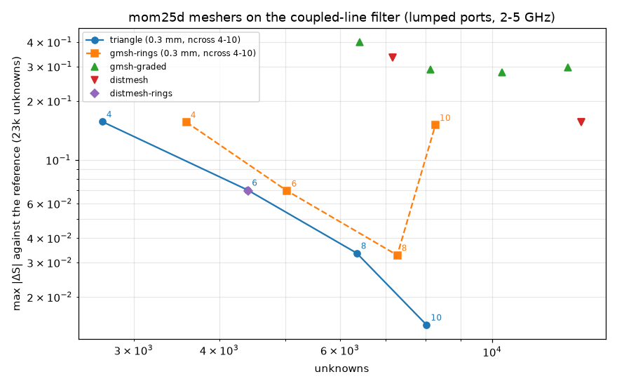

# mom25d

[← openEMS simulation](simulation.md) · [Index](index.md) · [Next: Transmission-line model →](transmission-lines.md)

mom25d is a 2.5D method-of-moments solver for circuit boards. It lives in this repository as the package
`mom25d/` and doesn't need openEMS.

```bash
kicad2ems examples/filter.toml --solvers mom        # mom25d alone
kicad2ems examples/filter.toml --solvers mom,lines  # with the line model
kicad2ems examples/filter.toml --mom                # next to openEMS, as a reference
```

Its settings are the `--mom-*` options, or `dmax`, `port`, `mesher`, `solves`, `tiled`, `dump` and `near`
under `[solver.mom25d]` ([options](usage.md#options)). Build the compiled core for about a fivefold
speed-up: `python -m mom25d.core.build` (needs g++ with OpenMP and pybind11).


## What mom25d models

- Copper is zero-thickness sheets on the layer interfaces.
- The dielectric layers extend sideways to infinity, over an **infinite ground plane**. That plane is
  the board's `ground` layer, or the lowest layer whose copper covers half the board. Copper below it is
  left out.
- Vias are vertical wires between the layers they connect.
- Edge walls become rows of vias every 0.5 mm.
- A lumped part is one series R-L-C element across its gap.
- Radiation and surface waves are included. The board edge and openEMS's air box aren't, so there are
  no box resonances and no edge effects.
- Loss uses the stackup's tan δ, constant over frequency. `--sigma` adds copper loss.

Other copper layers, including inner planes and pours, are meshed. Large planes add many unknowns and
slow mom25d down (see [speed](#runtime)).

<a id="sweep"></a>
**The adaptive sweep.** mom25d solves only some frequencies. It fits one rational model through all of
S (AAA) and adds a solve where two successive models disagree most. It stops when the model changes by
less than the tolerance (5e-3 in |S|) and had predicted the newest solve as closely, twice in a row, or
after `--mom-solves` (60) solves. The GUI's Run panel plots the model change and the prediction error after
each solve, in dB of |S|, against the tolerance (−46 dB) as the sweep runs. A sweep that ends at the cap
without settling shows there. The run summary keeps the history (`solved.mom25d.afs`).

<a id="the-board"></a>
mom25d reads the board file every solver gets, `<name>_board.json`. It can also run on its own:

```python
import numpy as np
from mom25d.api import solve_board
res = solve_board('out/filter_board.json', np.linspace(1e9, 8e9, 401), dmax=0.3e-3)
res.S, res.names, res.zref, res.notes
```

## Ports

| `--mom-port` | Port |
|---|---|
| `auto` (default) | a de-embedded wave port where the straight feed line is long enough, otherwise lumped |
| `wave` | always a wave port (an error if the feed is too short) |
| `lumped` | a small via from the reference copper to the trace |

A wave port fits the incoming and outgoing waves along its feed line. The propagation constant comes from
a separate characterisation of the line (a long test line of the same cross-section), so the feed only
has to be long enough for the two amplitudes, about 0.1 rad at the lowest frequency. Fitting the
propagation constant from the feed too failed on short feeds with a strong reflection: on the radial
stub it came out 2–10× low and gave |S11| = 1.19. Switching between the two at a feed length made S jump,
which cost the via transition 42 solves instead of 21.

Lumped ports are closest to openEMS's ports, since both include the port's own parasitics. Wave ports
are closest to the line model, which has an ideal reference plane. Differential pairs are one mixed-mode
port (`P1d`, `P1c`).

<a id="antenna-mode"></a>
## Antenna mode

With `mode = "antenna"`, mom25d computes the far field of the currents and writes the same results as
openEMS: match, directivity, efficiency, gain and patterns (`<name>_mom25d_antenna.json`, `_antenna.png`,
`_pattern.png`). The GUI's Results page plots them, and its Viewer draws the pattern in 3D.

The ground is infinite, so nothing radiates below the board and there's no board edge. That suits
patches and arrays on a ground larger than themselves. It doesn't suit antennas whose radiation comes
from a finite ground, such as an inverted-F or a monopole at the board edge; use openEMS for those.

| Patch (`antenna_patch.toml`) | Resonance | S11 | Efficiency | Directivity | Gain | Time |
|---|---|---|---|---|---|---|
| mom25d | 2.450 GHz | −31.4 dB | 36 % | 6.4 dBi | 2.0 dBi | 20 s |
| openEMS | 2.438 GHz | −32.3 dB | 38 % | 7.0 dBi | 2.9 dBi | 81 s |

<a id="phased-drive"></a>
### Phased arrays

`drive` drives several ports at once, each as `PORT[=amplitude][@phase]` (the incident waves, phases in
degrees). Ports not named are terminated in their reference impedance.

```bash
kicad2ems examples/antenna_array2x2_phased.toml                     # drive = ["P1@0", "P2@60"]
kicad2ems examples/antenna_array2x2_phased.toml --drive P1@0,P2=0.5@-90
```

mom25d solves each port driven alone, then adds their far fields for the drive. The solve is linear, so
this is exact at every frequency and includes the coupling between the elements. The gain uses the power
accepted by all the driven ports. The log and the JSON give the beam's direction and each driven port's
*active reflection*: what it sees with its neighbours driven too, which changes as the beam is steered.

Each port's far field is kept in `<name>_mom25d_array.npz`. The GUI's Results page uses it to steer the
beam without solving again ([Beam steering](gui.md#beam-steering)).

The example is a 2×2 patch array, 70 mm (0.57 λ) apart, with a feed per row. With P2 60° behind P1 the
beam tilts to θ 15° in the yz plane, with both ports matched (active S11 −29 and −23 dB); 45 s. openEMS
has no phased drive yet: with `drive` it drives the first port alone.

<a id="current-dumps"></a>
## Current dumps

`--mom-dump 2.4,5` saves the surface current on each layer at those frequencies, driven from the port
named by `--dump-port` (default: the first). Each frequency costs one extra solve. The dumps are drawn as
|J| maps, animated with `--dump-animate`, and shown in the GUI's Viewer.

```bash
kicad2ems examples/rf_stubnotch.toml --solvers mom --mom-dump 2.4,1.2 --dump-animate gif
```

`--mom-near 0.5,2` also computes the E field on planes 0.5 and 2 mm above the board. Keep them at least
one mesh cell (`--mom-dmax`) above the copper.

<a id="meshers"></a>
## Meshers

mom25d meshes each copper layer into triangles. The current peaks sharply at conductor edges, so what
matters most is thin cells along the edges. The default mesher (Triangle) adds offset rings inside each
edge. `--mom-mesher gmsh` uses gmsh instead (`pip install gmsh`).

A study on a coupled-line filter found that edge resolution sets the accuracy, not the cell size along
the copper. Thin edge cells gave 2–4 times smaller errors than evenly shaped cells, with a third of the
unknowns. gmsh made nicer triangles but wasn't more accurate. The study is in
`tools/mom25d/mesher_study.py`.



<a id="quads"></a>
### Quad cells (experimental)

`--mom-quads on` merges pairs of triangles that together make a near-rectangle (the strips along straight
traces) into one quad cell. The current on a quad is kept at the same charge density on both triangles, so
the shared diagonal stops being an unknown. Quads have the unknowns of rooftop cells, one per side. The
matrix is still filled on the triangles and then reduced before the factorisation.

| Board | Unknowns | Change in S from quads |
|---|---|---|
| Stepped microstrip, tensor mesh | 795 → 511 | 0.014 from a fine reference, triangles 0.015 |
| Hairpin filter | 4,763 → 3,974 | 0.006; S21 within 0.1 dB through the passband |
| Demo transition (cropped, via ports) | 8,334 → 6,509 | 0.017 from a fine reference, triangles 0.015 |

On the demo transition the factorisation went from 8.3 s to 4.1 s a frequency, plus 1.4 s to reduce the
matrix (2 cores). On the fine reference mesh itself, quads stay within 0.006 of the triangles. Quads work
with the direct solver on the CPU (double and mixed precision); the GPU and compressed solvers ignore them. Studies: `tools/mom25d/quad_study.py`.

<a id="gpu"></a>
## GPU

mom25d can factor its matrix on a GPU, in single precision, and then refine the answer to full precision on
the CPU. Install the CuPy package for your GPU stack:

| GPU | Package |
|---|---|
| AMD, ROCm 7 | `pip install cupy-rocm-7-0` |
| NVIDIA, CUDA 12 / 13 | `pip install cupy-cuda12x` / `cupy-cuda13x` |

PyTorch also works as a backend. `kicad2ems --check` shows the GPU mom25d will use, and so does the GUI's
Solvers window (Help > Solvers and hardware). `MOM25D_GPU=off` turns it off. Consumer AMD cards outside ROCm's support list may need
`HSA_OVERRIDE_GFX_VERSION=11.0.0` (RDNA3) or `10.3.0` (RDNA2).

mom25d chooses how to solve from the memory available. The log says which it chose (`memory: direct
solver needs ...`):

| Path | When | Memory for N unknowns |
|---|---|---|
| double precision on the CPU | up to 3,500 unknowns (or no compiled core), and it fits in half the free RAM | 18 N² bytes |
| mixed precision on the CPU | above 3,500 unknowns, no GPU: single-precision LU refined to double (about 1.3× faster) | 10 N² bytes |
| GPU LU | the single-precision matrix fits on the GPU | 24 N² bytes RAM, 8 N² bytes GPU |
| tiled | the GPU LU doesn't fit (`--mom-tiled`) | little RAM, 4 N² bytes GPU, the rest streamed from RAM |
| compressed (BLR / ACA) | nothing else fits | much less, but slower |

The **tiled** solver keeps only half the matrix on the GPU (it is symmetric) and builds it one block at
a time. It solves the matrix's symmetric part, which changes S by at most about 1e-3. Where the GPU LU
fits, that is faster, so `--mom-tiled auto` uses tiling only for larger boards. With it, the coupler at
0.1 mm cells (45,850 unknowns) solves in 62 s on a 16 GB card, where the CPU took over an hour.

<a id="runtime"></a>
## Speed against openEMS

Measured on every example, CPU and GPU: [benchmarks](benchmarks.md). A few of them:

| Board | openEMS | mom25d GPU | mom25d CPU |
|---|---|---|---|
| filter (single-layer microstrip) | 119 s | 18 s | 22 s |
| hairpin (single-layer microstrip) | 50 s | 9 s | 10 s |
| rf_coupler (0.14 mm gap) | 92 s | 16 s | 20 s |
| demo_transition (2 inner planes) | 55 s | 188 s | 436 s |
| sma_launch (3 planes, 185 vias) | 33 s | 171 s | 417 s |

- **mom25d is faster on single-layer microstrip**: filters, couplers and matching networks. It has no
  time-step or ring-down problem with high-Q circuits.
- **openEMS is faster once planes must be meshed.** mom25d's cost grows with the copper area, openEMS's
  with the volume.
- **Agreement**: where both resolve the structure, |S| agrees to about 0.05, and transmission to 0.2 dB
  and 1–3 ps. Larger dB differences appear only deep in stop bands and on steep filter skirts.
- **On the GPU**, mixed precision can fail to converge at the bottom of a band, where the matrix is worst
  conditioned. That frequency, and those up to 1.25 times it, are then solved in double precision on the
  CPU, and the GPU is tried again above that. On the SMA launch, whether that happens at a given frequency
  depends on rounding in the last digit of the matrix: relative noise of 1e-15 moved the fallbacks from
  run to run, and with them the run time, between about 195 and 410 s.

<a id="core"></a>
## The compiled core

The core (`mom25d/core/mom25d_core.cpp`, pybind11 and OpenMP) fills the matrix, evaluates the near-pair
corrections, finds the near pairs, sums the Green's function tables' Sommerfeld integrals, builds the via
fans' columns and prepares the GPU's complex64 copy of the matrix. NumPy versions of all of them remain as
the fallback. `mom_core` chooses:

| `mom_core` | Kernels |
|---|---|
| `auto` (default) | the core where it's built; boards up to 3,500 unknowns use NumPy's dense solver |
| `compiled` | the core for every board, small ones through its direct solver; stops if the core isn't built |
| `python` | NumPy only: slower, for checking the core |

Measured on the RX 7800 XT machine (whole runs, mom25d only):

| Board | Unknowns | NumPy paths before | Core with the new kernels | `compiled` |
|---|---|---|---|---|
| antenna_patch | 1,391 | 19.6 s | 17.9 s | 5.3 s |
| demo_lowpass | 1,875 | 21.5 s | 19.0 s | 2.7 s |
| rf_wilkinson | 4,657 | 7.2 s | 5.4 s | – |
| rf_stubnotch | 5,090 | 10.3 s | 8.8 s | – |
| rf_stripline | 15,563 | 135 s | 101 s | – |

On small boards, `compiled` gives |S| within about 0.005 of the dense solver's (the two split near and far
interactions differently), with the same resonances. A profile of the larger boards shows what a complete
C++ port could still gain: about 60 % of their time is already compiled (the core, the GPU's LU, BLAS in the
refinement), and most of the rest is NumPy on large arrays rather than interpreted Python.

## Inside mom25d

| Module | Contents |
|---|---|
| `api.py` | `solve_board`: a board file in, S-parameters out |
| `board.py` | the board file as a planar model |
| `model.py` | stack, metal, vias, ports, port characterisation |
| `sim.py` | `Simulation`: mesh, ports, parts, solver choice (`memory_plan`) |
| `multilayer.py` | layered-media Green's functions |
| `via.py` | via kernels |
| `geo.py`, `mesh_gmsh.py` | the meshers |
| `fast.py` | the matrix fill and the solvers |
| `gpu.py`, `ldlt.py` | the GPU backends and the tiled solver |
| `blr.py` | the block low-rank solver |
| `afs.py`, `run.py` | the adaptive frequency sweep |
| `farfield.py` | far and near fields from the currents |
| `core/` | the compiled C++ kernels |

The formulation is a mixed-potential integral equation with RWG basis functions. Layered-media kernels
come from a spectral transmission-line network. The singular terms are integrated analytically.

The tests (`tests/test_mom25d_*.py`) check it against exact solutions and textbook formulas: layered
Green's functions to about 1e-5, stripline impedance to 0.6 %, coupled-line couplers to 0.1 dB, plane
cavity resonances to 0.7 %.

**Limits**: copper is zero-thickness, there is no surface-roughness model, and wave ports need a straight
feed line.

---
[← openEMS simulation](simulation.md) · [Index](index.md) · [Next: Transmission-line model →](transmission-lines.md)
