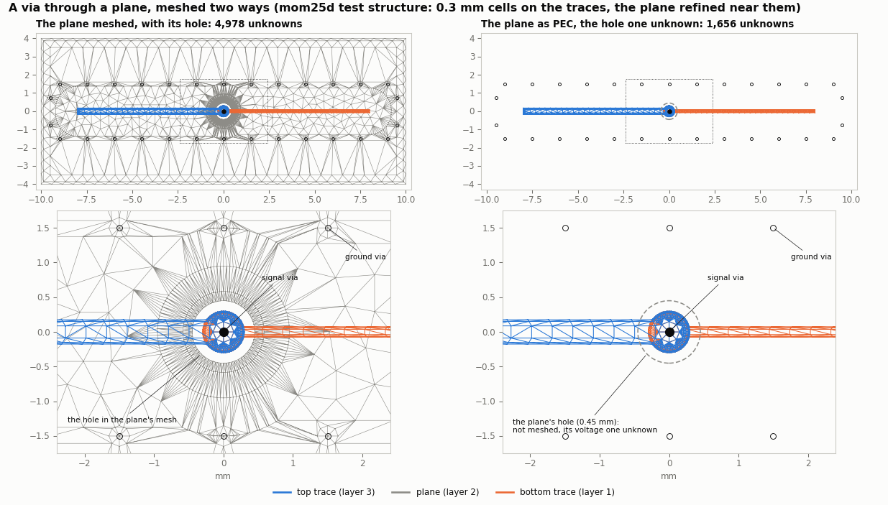
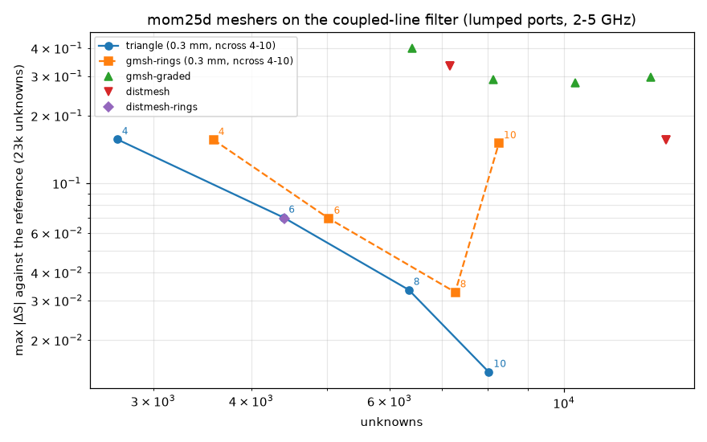
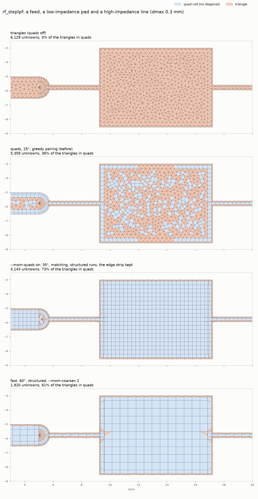
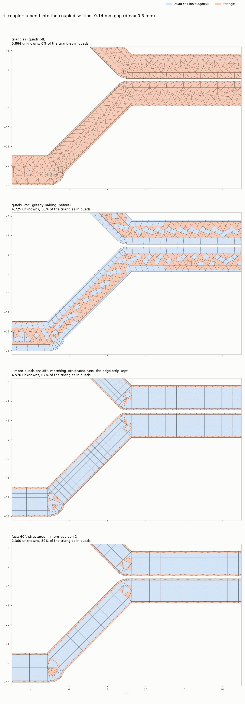
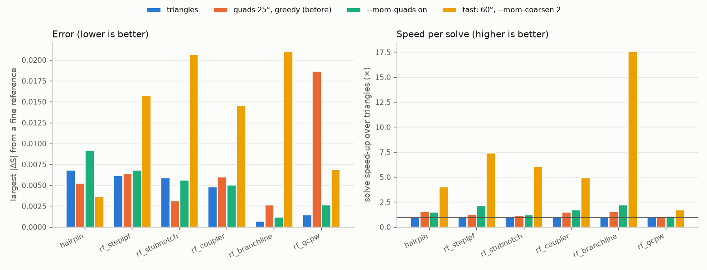
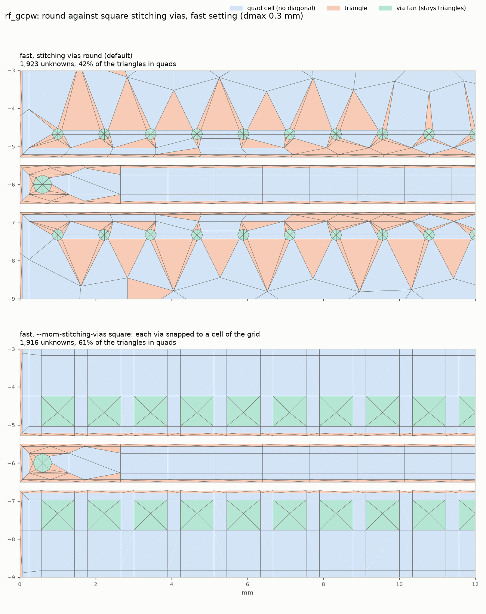

# mom25d

[← openEMS simulation](simulation.md) · [Index](index.md) · [Next: Transmission-line model →](transmission-lines.md)

mom25d is a 2.5D method-of-moments solver for circuit boards, its own package in
[its own repository](https://github.com/lowprocess/mom25d) (the `mom` extra, or the installer). It doesn't need
openEMS; without it, `--check` lists mom25d and the mixed solver built on it as not installed.

```bash
kicad2ems examples/rf_interdig.toml --solvers mom        # mom25d alone
kicad2ems examples/rf_interdig.toml --solvers mom,lines  # with the line model
kicad2ems examples/rf_interdig.toml --mom                # next to openEMS, as a reference
```

Its settings are the `--mom-*` options, or `dmax`, `port`, `solves`, `tiled`, `dump` and `near` under
`[solver.mom25d]` ([options](usage.md#options)). Its compiled core, `python -m mom25d.core.build`, makes it about
five times faster.

## What mom25d models

- Copper is zero-thickness sheets on the layer interfaces.
- The dielectric layers extend sideways to infinity, over an **infinite ground plane**: the board's `ground`
  layer, or the lowest layer whose copper covers half the board. Copper below it is left out.
- Vias are vertical wires between the layers they connect; edge walls become rows of vias every 0.5 mm.
- A lumped part is one series R-L-C element across its gap.
- Radiation and surface waves are included. The board edge and an air box aren't: no box resonances, no edge
  effects.
- The dielectric is the stackup's εr and tan δ, constant over frequency. With `--diel wideband` (or
  `diel = "wideband"`), it follows the Djordjevic-Sarkar model, as on the FDTD solvers
  ([dielectrics](simulation.md#dielectrics)). mom25d evaluates that model exactly at each frequency it solves, where the FDTD
  solvers fit it with Debye poles, and it costs no extra run time. `--sigma` adds copper loss.

Other copper layers, inner planes and pours included, are meshed, except solid planes and lone stitching-via pads
(below). Large meshed planes add many unknowns and slow mom25d down ([speed](#runtime)).

<a id="planes"></a>
### Solid planes and stitching pads

Two rules, both on by default, take out of the mesh the copper that carries next to no current of its own:

- **Solid planes as PEC** (`--mom-planes pec`): a plane in one piece over the board, without holes, on a ground net,
  is a perfect conductor of the stack itself. The highest one under every other copper layer becomes the ground
  and the lowest one over them a PEC cover (the copper beyond each is left out): a stripline's two planes are the
  typical case. A plane with antipads (a signal via through it) stays meshed.
- **Lone stitching-via pads dropped** (`--mom-stitching-pads drop`): the pad of a ground via with nothing else on
  its layer is left out, the via staying as its barrel. A pad that a part or a port lands on is kept.

A board imported with a few nets selected has no solid plane: its pours keep the clearances of the nets left out.
[`--fill-voids far`](model.md#fill-voids) fills those away from the signal copper, after which these rules apply.

`--mom-planes mesh --mom-stitching-pads keep` meshes everything. Of the 52 examples 7 change: rf_stripline from
15,563 unknowns to 1,337 (100 s to 3 s), demo_transition from 13,670 to 4,043 (107 s to 14 s), within 0.01 in |S|
of the fully meshed model (rf_marchand 0.085), with the same agreement with openEMS (`tools/mom_planes_study.py`).

<a id="plane-holes"></a>
**A plane a via runs through** (`--mom-planes holes`, experimental). A plane between the copper layers whose only
holes are those of vias through it (round or nearly, one via each, the via near the middle) is a perfect conductor
of the stack too: what is above it sees it as its ground, what is below as its cover, and neither sees the other.
The via's current runs on through the hole, and the hole carries the voltage across it as an unknown (two field
shapes by default, `mom25d/frill.py`): the hole's capacitance into both sides, charged by what the pads and traces
near it induce. A via that lands on the plane ends there; a plane with a slot, a cut-out or a hole two vias share
stays meshed.



The hole's field is taken as axisymmetric. That is exact for what the pads do: two pads joined by a via through a
0.45 mm hole have 202.0 fF with the plane meshed and 203.2 fF this way (280.6 fF with the hole closed). It leaves
out what a trace crossing the hole's rim adds, which sees the plane closed under it. On the structure above
(0.3 mm pads, 0.45 mm hole) |S| is within 0.03 of the meshed plane's to 5 GHz and 0.065 at 10 GHz, 0.02 with a
hole no wider than the pads; on demo_transition (a 0.6 mm hole) within 0.08, |S21| within 0.02 dB, for 1,504
unknowns in place of 3,910, and the agreement of S11 with openEMS goes from −32.3 to −27.7 dB. The hole's own
field is not in the current dumps, the near field or the far field.

<a id="sweep"></a>
**The adaptive sweep.** mom25d solves only some frequencies. It fits one rational model through all of S (AAA)
and adds a solve where two successive models disagree most, until the model changes by less than the tolerance
(5e-3 in |S|) and predicted the newest solve as closely, twice in a row, or after `--mom-solves` (60). The GUI's Run
page plots the model change and the prediction error per solve; the run summary keeps them (`solved.mom25d.afs`).

<a id="the-board"></a>
mom25d reads the board file every solver gets, `<name>_board.json`, and runs on its own too:

```python
import numpy as np
from mom25d.api import solve_board
res = solve_board('out/filter_board.json', np.linspace(1e9, 8e9, 401), dmax=0.3e-3)
res.S, res.names, res.zref, res.notes
```

## Ports

| `--mom-port` | Port |
|---|---|
| `auto` (default) | a de-embedded wave port where the straight feed line is long enough, otherwise lumped |
| `wave` | always a wave port (an error if the feed is too short) |
| `lumped` | a small via from the reference copper to the trace |

A wave port fits the incoming and outgoing waves along its feed line, with the propagation constant from a separate
characterisation of the line's cross-section, so the feed only has to be long enough for the two amplitudes (about
0.1 rad at the lowest frequency). Lumped ports are closest to the FDTD solvers' ports, both including the port's
own parasitics; wave ports are closest to the line model's ideal reference plane. A differential pair is one
mixed-mode port (`P1d`, `P1c`), each mode with the propagation constant of the pair's characterisation; with
`auto`, a pair whose coupled feed is too short is solved as single-ended legs and the modes taken from them, as
for openEMS.

A wave port's two waves both carry the error of its characterised impedance (1–2 %), which makes transmission into
it a little large and out of it as much too small. Reflections and the product of the two transmissions do not
depend on it, so the ports' scales are fitted from the two directions and taken out (`sim.balance`): S between
wave ports is reciprocal, and a run says when the scales were more than 2 % apart. Lumped ports need none.

<a id="real-boards"></a>
### On real boards

mom25d suits planar circuits over one ground plane. KiCad's CM5 demo (the HDMI D0 pair, 6 layers) shows its
limits on a multilayer board:

- **The ground plane** is the lowest layer covering half the board (B.Cu there), and every plane above it is
  meshed: 128,000 unknowns. With `ground = "In1.Cu"`, 22,700, but the copper below it is left out.
- **Ports below the ground**: the module's pads sit on B.Cu, under that ground, so they can't be ports.
- **Results**: with the ports moved to F.Cu, the sweep did not converge in 15 solves, and a lumped port in the
  middle of a trace reflected almost everything (|S| 0.99, gfdtd 0.29).

For such boards use gfdtd or openEMS, or the [whole stack](#whole-stack) where the board is small enough.

<a id="whole-stack"></a>
### The whole stack

The ground stack fills in any hole in the ground layer, so a slot, a defected ground structure or a ground that
stops short of the trace isn't modelled. `mom_stack = "auto"` (the default) looks for them: where the ground's copper
is missing within three substrate heights of the signal copper, leaving out via antipads, a pour's pullback within
1 mm of the board edge, and pieces under 0.25 mm², it chooses the whole stack and logs why. It does the same when a
port is below the ground, which the ground stack can't model. Otherwise it keeps the ground stack. Of the examples,
it chooses the whole stack for rf_dgs, rf_slotline, rf_msvia (its P2 is on B.Cu, under the In2.Cu ground) and five
antennas (the slot, aperture, inverted-F, monopole and Vivaldi). With `--mom-stack ground` on such a board, the log warns and lists the
apertures as deviations. `mixed` cuts its lines over the infinite ground, so it declines these boards under `auto`.

| Board, against gfdtd (rms \|ΔS\|) | Ground stack | Whole stack |
|---|---|---|
| rf_dgs | 0.74 | 0.12 |
| rf_slotline | 0.93 | 0.14 |
| antenna_slot | 0.95 | 0.06 |

`mom_stack = "whole"` (`--mom-stack whole`) models every copper layer instead of an infinite ground: the lowest
copper layer is the bottom of the stack, with air below as well as above, and the planes are meshed like any other
copper. Copper below the old ground is in the model, ports can sit on any layer, and each is a lumped port to the
nearest plane under or over it (or its `ref_layer`). `mixed` stays on the ground stack.

On `rf_msvia` (F.Cu microstrip through a via to B.Cu, two inner planes), which the ground stack can't solve, the
whole stack has 5,219 unknowns at `--mom-dmax 0.6` and takes 25 s:

| `rf_msvia` | S21 1 GHz | 3 GHz | 5 GHz | 7 GHz | 10 GHz | worst S11 |
|---|---|---|---|---|---|---|
| mom25d, whole stack | −0.09 dB | −0.27 | −0.38 | −0.60 | −0.77 | −18.3 dB |
| gfdtd | −0.07 dB | −0.24 | −0.38 | −0.55 | −1.02 | −12.9 dB |

They agree to 0.05 dB up to 7 GHz; above it the planes' 1.8 mm cells are about eight per wavelength, and the
dielectric is still laterally infinite. The cost is the planes: the CM5 region is about 125,000 unknowns at 0.3 mm.

<a id="antenna-mode"></a>
## Antenna mode

With `mode = "antenna"`, mom25d computes the far field of the currents and writes the same results as the FDTD
solvers: match, directivity, efficiency, gain and patterns (`<name>_mom25d_antenna.json`, `_antenna.png`,
`_pattern.png`). On the ground stack nothing radiates below the board and there's no board edge: that suits patches
and arrays on a ground larger than themselves. On the [whole stack](#whole-stack) the board's ground is meshed and
the pattern covers the full sphere. The dielectric is laterally infinite either way, so an antenna that radiates
from the board's edge (an inverted-F, a monopole at the edge) is the FDTD solvers'.

| Patch (`antenna_patch.toml`) | Resonance | S11 | Efficiency | Directivity | Gain | Time |
|---|---|---|---|---|---|---|
| mom25d | 2.450 GHz | −31.4 dB | 36 % | 6.4 dBi | 2.0 dBi | 20 s |
| mom25d, whole stack (its 80 mm ground meshed) | 2.470 GHz | | 36 % | 7.3 dBi | 2.9 dBi | 47 s |
| openEMS | 2.438 GHz | −32.3 dB | 38 % | 7.0 dBi | 2.9 dBi | 81 s |

<a id="phased-drive"></a>
### Phased arrays

`drive` drives several ports at once, each as `PORT[=amplitude][@phase]` (the incident waves, phases in degrees);
ports not named are terminated in their reference impedance.

```bash
kicad2ems examples/antenna_array2x2_phased.toml                     # drive = ["P1@0", "P2@60"]
kicad2ems examples/antenna_array2x2_phased.toml --drive P1@0,P2=0.5@-90
kicad2ems examples/antenna_array4x4_phased.toml --steer 30,-45      # grid = "4x4": 30 deg per column, -45 per row
kicad2ems board.toml --grid "P1:0,0 P2:1,0 P3:0,1 P4:1,1" --steer 0,60
kicad2ems examples/antenna_array2x2_phased.toml --drive P1,P2 --aim 20,90 --taper taylor:25
```

mom25d solves each port driven alone and adds their far fields for the drive: exact at every frequency, the
coupling between the elements included. The gain uses the power all the driven ports accept; the log and the JSON
give the beam's direction and each port's *active reflection* (with its neighbours driven too). The far field's 11
frequencies across the band are solved as part of the adaptive sweep, not again after it (only the pattern
frequency, the resonance, may need a solve of its own), and every port's far field comes from one set of phases:
antenna_vivaldi 257 s to 140 s, antenna_array2x2_phased 28 s to 18 s.

- `grid` places the ports in a 2D array: `COLSxROWS` (the ports in order, row by row from the top) or
  `PORT:COL,ROW` each; `steer X,Y` adds X per column and Y per row (without a grid, X from port to port).
- `aim THETA,PHI` gives each port −k₀(x sin θ cos φ + y sin θ sin φ) more phase from its place, at the pattern
  frequency: any layout of feeds, phase shifters set at one frequency (the beam squints off it). The peak lands
  where the array factor times the element's pattern is largest, short of the target on a few elements: the 2×2
  example aimed at θ 20° peaks at 15°.
- `taper` multiplies in `taylor`, `chebyshev` or `cosine` amplitudes (`:SLL` dB, default 25): on the 4×4 example,
  sidelobes −14 / −13 dB uniform, −28 / −25 dB with `taylor:25`, −30 / −27 dB with `chebyshev:25`, for about 1 dB of
  gain.

Each port's far field is kept in `<name>_mom25d_array.npz`, which the GUI's Results page steers without solving
again ([Beam steering](gui.md#beam-steering)). openEMS and gfdtd take `drive` too: a run per driven port, each run's
far field per unit incident wave summed for the drive, steered in the GUI likewise. On the 2×2 example gfdtd puts
the beam at θ 10° (mom25d 15°: its infinite ground has no board edge).

<a id="current-dumps"></a>
## Current dumps

`--mom-dump 2.4,5` saves the surface current on each layer at those frequencies, driven from `--dump-port` (default:
the first). The adaptive sweep solves them among its first samples, so a dump inside the band costs no solve of its
own. The dumps are drawn as |J| maps, animated with `--dump-animate`, and shown in the GUI's Viewer.
`--mom-near 0.5,2` adds the E field on planes 0.5 and 2 mm above the board (at least one cell, `--mom-dmax`, up).

```bash
kicad2ems examples/rf_stubnotch.toml --solvers mom --mom-dump 2.4,1.2 --dump-animate gif
```

<a id="meshers"></a>
## The mesh

mom25d meshes each copper layer into triangles (Triangle). The current peaks sharply at conductor edges, so the
mesher adds thin rings of cells inside each edge. A study on a coupled-line filter (`tools/mesher_study.py` in
mom25d) found that edge resolution sets the accuracy, not the cell size along the copper: thin edge cells gave 2–4
times smaller errors than evenly shaped cells, with a third of the unknowns. gmsh and DistMesh did worse:



The rings follow the narrowest trace on the layer, so on a coupler they are coarse beside its gap: the first sits
0.067 widths in, 86 µm on rf_coupler's 1.28 mm lines against its 0.14 mm gap, and the charge facing the gap crowds
well inside that. Where copper faces other copper across a gap of under about a quarter of a width, the mesher adds
rings at a quarter, an eighth and a sixteenth of that gap, along those edges only (a ray out of each edge finds the
gap; a wedge where a round track end meets a pad is not one). rf_coupler's lossless S31 at 2.4 GHz went from
−10.64 to −10.35 dB (refined FDTD: −10.24 to −10.29) for 22 % more unknowns; 16 cells across every strip did no
better at twice the unknowns. Of 17 example boards three have such gaps: rf_coupler, rf_gcpw (+20 % unknowns) and
rf_pcoupled (+12 %, its passband unchanged against refined FDTD); the rest mesh as before.

The options below are experimental: each saves unknowns at some cost in accuracy, measured against a fine reference
mesh (`tools/zone_study.py`, `tools/quad_configs_study.py` in mom25d).

<a id="zone"></a>
- **Signal zone** (`--mom-zone on`): the mesh detail only within a zone around the signal copper (0.5 mm or 1.5
  thicknesses of the thickest dielectric, and 1 mm around each signal via). Outside it copper edges get no rings,
  cells grow to 5 × `--mom-dmax`, vias keep only their attachment point and small pads become squares. Most of what
  this removes is stitching-via pads (about 130 unknowns each, 4 now): the demo transition goes from 8,334 to 2,781
  unknowns at about the same error (0.015–0.018 at 2–8 GHz). At 8 GHz the differential via loses about 0.02, where its transition excites
  the space between the ground planes.
<a id="vias"></a>
- **Via meshing** (`--mom-signal-vias`, `--mom-stitching-vias`: `round`, `square` or N sides). Eight sides or more
  match round vias within the mesh's own scatter (0.01), and save next to nothing: keep `round`. Square signal vias
  cost 0.03–0.05 at 5–8 GHz where the via is the structure (the pad and antipad set its capacitance); square
  stitching vias are close (the GCPW's fence: 0.006 at 8 GHz instead of 0.002). `auto` stitching vias are square
  outside `--mom-zone`, else round.
<a id="lines"></a>
- **Line functions** (`--mom-lines on`): inside each straight run of signal trace, a few functions per column along
  it replace the triangles' unknowns, 10 to 20 to one: the current along the line, peaked at both edges, plus an odd
  shape for coupled lines (`even`: the symmetric one only; `full`: a flat one too). rf_coupler: 5,864 unknowns to
  4,027, 0.018 from the reference at 8 GHz instead of 0.015.

<a id="mixed"></a>
## The mixed solver: long lines as transmission lines

`--solvers mixed` (`mom25d/kicad2ems/mixed.py` in mom25d) is mom25d with the middle of each long, lone, straight run
of signal trace cut out of the board and put back as a transmission line. mom25d solves the rest with a
de-embedded wave port on each face of each cut; each cut becomes a line of its own cross-section's γ and Zc, joined
into mom25d's network. A stretch is cut only where no other signal copper comes within 3 widths or 4 heights of it,
not through vias, parts or ports, keeping the straight feed each wave port needs down to `fmin`; a cut is at least
`--mixed-cut` mm long (3). It uses mom25d's mesh options.

On rf_stripline (with `--mom-zone on`) one 12.5 mm stretch is cut, 5,069 unknowns to 4,335, and S21 matches
mom25d's within 0.5° to 10 GHz. **Current dumps** work: on the cut stretch the trace current comes from the line's
waves (within 5 % of mom25d's on rf_stripline at 5 GHz), and the planes carry the line's image as return current.

<a id="quads"></a>
### Quad cells (experimental)

`--mom-quads on` merges pairs of triangles that make a near-rectangle (corners within `--mom-quad-tol`, 35°, of a
right angle) into one quad cell, which has rooftop cells' unknowns, one per side; the matrix is filled on the
triangles and reduced to the quads before the factorisation. Straight traces and rectangular pads are meshed as a
grid of rectangles (*structured runs*), every cell a quad, and no quad touches the copper outline, where the current
crowds (`--mom-quads all` merges those too; `centre` only the signal copper).







*Against a fine triangle reference, dmax 0.3 mm, lumped ports: the largest |ΔS| at three frequencies, and a solve
in double precision on the CPU (8 cores).*

- **`--mom-quads on` is as accurate as the triangles** (within 0.003) with 13–32 % fewer unknowns, and solves 1.1–2.2×
  faster.
- **The fast setting** (`on`, `--mom-quad-tol 60 --mom-coarsen 2`) solves 4–17× faster with 2.4–3.8× fewer unknowns,
  at up to 0.021 from the reference: less than mom25d and the FDTD solvers already differ by on these boards.

The preview's mesh has the structured runs but no quads: they are paired when the run starts, and the run writes
the mesh it solved on. Quads work with the direct solver on the CPU and the GPU; the tiled GPU solver and the
compressed solvers ignore them.

<a id="coarsen"></a>
### Coarsening (experimental)

`--mom-coarsen X` lets the cells grow away from the features (the outline's corners and bends, vias, port and cut
lines): from dmax at a feature by half the distance to the nearest one, up to X × dmax, along the outline, the edge
rings and inside them; the spacing across an edge is kept. The error comes from larger cells inside wide copper,
not along the outline, and X = 2 and 3 give nearly the same error: 2 is the useful setting.

<a id="stitching"></a>
With `--mom-stitching-vias square` each fence via snaps to a whole cell of the structured grid, its four triangles
the via's fan, in place of the long spiky triangles round vias leave between via and pour:



On rf_gcpw it merges more (61 % of the triangles instead of 42 % with the fast setting), at a larger error at 9 GHz
(0.0096 instead of 0.0027 with `on`): keep `auto` unless the unknowns matter more.

<a id="gpu"></a>
## GPU

mom25d can factor its matrix on a GPU in single precision and refine the answer to full precision on the CPU.
slangpy runs it on any GPU with a Vulkan driver; a CuPy package is optional:

| GPU | Package |
|---|---|
| any, through Vulkan (AMD, Intel, NVIDIA; Windows and Linux) | `pip install slangpy` (the `gpu-vulkan` extra) |
| NVIDIA, CUDA 12 / 13 (optional) | `pip install cupy-cuda12x` / `cupy-cuda13x` |
| AMD, ROCm 7, Linux (optional) | `pip install cupy-rocm-7-0` |

`auto` tries Vulkan first, and CuPy first only on CUDA; `MOM25D_GPU=cupy`, `vulkan` or `off` chooses. Vulkan has no
LAPACK, so its LU is mom25d's own (`gpu_vk.py`): the CPU factors each 256-column panel with LAPACK while the GPU
updates the rest, the two overlapping. On an RX 7800 XT it factors 16,384 unknowns in 1.64 s, against 2.11 s for
CuPy's rocSOLVER on the same card, with LAPACK's pivots and accuracy. `kicad2ems --check` and the GUI's Solvers
window show the GPU mom25d will use. Consumer AMD cards outside ROCm's list may need `HSA_OVERRIDE_GFX_VERSION=11.0.0`
(RDNA3) or `10.3.0` (RDNA2) for CuPy.

mom25d chooses how to solve from the memory available, and the log says which (`memory: direct solver needs ...`):

| Path | When | Memory for N unknowns |
|---|---|---|
| double precision on the CPU | up to 3,500 unknowns (or no compiled core), and it fits in half the free RAM | 18 N² bytes |
| mixed precision on the CPU | above 3,500 unknowns, no GPU: single-precision LU refined to double (about 1.3× faster); LUs kept across the sweep where they fit | 24 N² bytes, plus 8 N² for each LU kept; 10 N² where that doesn't fit |
| GPU LU, hybrid | up to 25,000 unknowns: the single-precision matrix fits on the GPU, and its double-precision copy in RAM (the refinement's) | 24 N² bytes RAM, 8 N² bytes GPU |
| GPU LU | above 25,000 unknowns, or where the hybrid's RAM doesn't fit: the refinement is matrix-free | 10 N² bytes RAM, 8 N² bytes GPU |
| GPU LU, streamed | Vulkan, and RAM short even of that: the matrix is filled straight into the GPU a block of rows at a time | about 1 GB RAM, 8 N² bytes GPU |
| tiled | CuPy, the GPU LU doesn't fit (`--mom-tiled`) | little RAM, 4 N² bytes GPU, the rest streamed from RAM |
| block low-rank (BLR), compiled | from 20,000 unknowns where the hybrid does not hold the matrix (any GPU path past it, or no GPU), and wherever nothing else fits | about 3 N² bytes at most: a fifth of a single-precision matrix |
| compressed (ACA, HODLR) | without the compiled core, nothing else fits | much less, but far slower on large boards |

Past 25,000 unknowns the hybrid's double-precision matrix costs more in memory traffic than its cheaper refinement
saves (`MOM25D_HYBRID_MAX_N` moves the limit): rf_siw (28.7k unknowns) takes 296 s on the GPU LU against 456 s
hybrid, antenna_vivaldi (21.9k) 148 s hybrid against 171 s. The GPU takes an LU up to its own estimate of the memory it needs (the matrix and its work arrays) with 0.5 GB or 3 %
to spare: on a 16 GB card about 41,000 unknowns. antenna_cp_patch's 40,827 factor there in 19 s. The streamed path
is about 1.3× slower a solve than the GPU LU (its fill can't use the matrix's symmetry), but it solves that board
in 5.8 GB of RAM, where the compressed solvers took more than 30 minutes a frequency (the compiled
[block low-rank solver](#blr) now takes 22.5 s, in 2.4 GB). The free memory is a cgroup's
where one limits the process (a container, or `systemd-run --scope -p MemoryMax=`).

The **tiled** solver keeps half the (symmetric) matrix on the GPU and builds it a block at a time; it solves the
matrix's symmetric part, which changes S by at most about 1e-3. The coupler at 0.1 mm cells (45,850 unknowns)
solves in 62 s on a 16 GB card, where the CPU took over an hour.

<a id="reuse"></a>
**Across a sweep** the matrix changes smoothly with frequency, so one frequency's LU preconditions the next ones:
GMRES on the new matrix with the old LU converges in 8–30 iterations across a 1–10 GHz band. mom25d keeps up to
four single-precision LUs (as memory allows, on the CPU or the GPU), solves each new frequency with the nearest, and
factors anew only where that would cost more than a fresh LU; the answer is refined to the same tolerance (S within
about 1e-6). On demo_transition (13.5k unknowns, 17 solves) three LUs served the whole sweep on the CPU: 84 s
against 176 s. The log says which solves reused one; in mom25d's Python API, `sim.reuse = 'off'` turns it off.

Where the GPU's single-precision triangular solves stall at the bottom of a band (the matrix worst conditioned),
mom25d solves with the GPU's factor on the CPU instead; only where the factor itself is too weak is a frequency
solved in double precision on the CPU. Below a few hundred MHz the [loop/tree basis](#loop-tree) keeps that from
happening.

<a id="blr"></a>
**The block low-rank solver** (`fast.solve_blr`, the compiled core's `BLRFactor`) never holds the matrix. The
unknowns are cut into tiles of about 500 by a geometric cluster tree. A pair of tiles whose clusters are further
apart than a third of the larger one's size is compressed to a low-rank product (adaptive cross approximation,
then QR and SVD); the rest are dense. The tiles are factored in single precision, the low-rank updates
recompressed as they go, on every core (BLAS and LAPACK are SciPy's). The factor preconditions GMRES on the exact
operator, so S is the direct solver's to about 1e-6, and across a sweep one frequency's factor serves the next as
the LU's does. From 20,000 unknowns mom25d takes it wherever the GPU's hybrid does not hold the matrix:

| Board, unknowns | BLR | the path it replaces |
|---|---|---|
| rf_siw, 28.7k: the sweep (28 solves) | 272 s, 1.2 GB | 520 s, tiled on the GPU |
| antenna_cp_patch, 40.8k: a solve | 22.5 s, 2.4 GB | 30.3 s, GPU LU (13 GB on the host and the GPU) |
| antenna_vivaldi, 21.9k, no GPU: the sweep (25 solves) | 202 s, 1.2 GB | 243 s, the CPU's single-precision LU (11.5 GB) |
| antenna_vivaldi with the GPU: the sweep | 202 s | 169 s, hybrid (kept: it holds the matrix) |

The compression's tolerance is 1e-5 of the equilibrated matrix. At 1e-3 a fine mesh's matrix was not
preconditioned at all (antenna_cp_patch: GMRES still at a residual of 0.6 after 500 iterations); where a factor
stalls GMRES, mom25d factors again at a hundredth of the tolerance and keeps that for the rest of the sweep.
`MOM25D_BLR_MIN_N` moves the threshold; in the Python API, `sim.solver = 'blr'`, `sim.blr_tol`, `sim.blr_tile`
and `sim.blr_eta` (the admissibility: 0.3) choose.

<a id="loop-tree"></a>
## Low frequency: the loop/tree basis

mom25d's matrix has two parts: the currents' magnetic coupling, which goes as jω, and their charges', which goes
as 1/(jω). On a loop of current the charge part is zero, but in the usual basis (RWG: a current across each mesh
edge) that zero is two large numbers cancelling. Once the current part is smaller than their rounding, the loops'
currents are lost: about (k h)² of the charge part, h a cell's size. On demo_transition that was below ~100 MHz
for the single-precision LU (each solve fell back to double) and ~10 kHz in double (S11 3 % off at 10 kHz, its
sign wrong at 1 kHz).

Below (k h)² = 10⁻⁵ (240 MHz on demo_transition) mom25d solves in a loop/tree basis instead, pcbqs's. The mesh is
a graph: a node per triangle and one for the ground, a branch per edge and per via. A tree spanning it carries the
charge, and every other branch with the tree's path back is a loop, which carries none. The two parts are filled
apart (the current's into the matrix, the charge's as potentials between triangles, added on the tree alone), so
nothing cancels, and the single-precision LU preconditions it as well at 10 Hz as at 1 GHz:

| demo_transition, 3.9k unknowns | RWG basis | loop/tree basis |
|---|---|---|
| 100 kHz–100 MHz, 13 points (kicad2ems, GPU) | 37 s: 6 of 7 solves in double | 7 s |
| copper loss, S11 at 10 Hz (the copper's DC resistance: 4.807e-4; pcbqs: 4.9e-4) | 5.34e-4 (double) | 4.806e-4 (double and mixed) |
| lossless, \|S - S(RWG, double)\| at 1 GHz / 6 GHz | | 6e-13 / 1e-13 (double) |

It costs a transform and a table of the triangles' potentials, 0.12 s against the LU's 0.28 s at 3.9k unknowns,
and the hybrid's memory (24 N² bytes). Each basis keeps its own LUs across a sweep. The compressed and tiled
solvers, quad cells and line functions, and `--mom-planes holes` solve in the RWG basis at every frequency; so
does mom25d without its compiled core. In mom25d's Python API `sim.loop_tree` (`auto`, `on`, `off`; or
`MOM25D_LOOP_TREE`) chooses. Below about 10 Hz the S-parameters' own extraction (from currents a million times
the ports') sets the floor: about 1e-6 in |S|.

<a id="runtime"></a>
## Speed against openEMS

Measured on every example, CPU and GPU: [benchmarks](benchmarks.md). A few of them:

| Board | openEMS | mom25d GPU | mom25d CPU |
|---|---|---|---|
| hairpin (single-layer microstrip) | 46 s | 6 s | 7 s |
| rf_coupler (0.14 mm gap) | 27 s | 10 s | 14 s |
| rf_stripline (two solid planes: PEC) | 14 s | 3 s | 3 s |
| demo_transition (an inner plane with a signal via through it, meshed) | 43 s | 12 s | 12 s |

- **mom25d is faster on single-layer microstrip** (filters, couplers, matching networks), with no time step or
  ring-down to wait for on high-Q circuits.
- **openEMS can be faster once planes must be meshed**: mom25d's cost grows with the meshed copper area, openEMS's
  with the volume.
- **Agreement**: where both resolve the structure, |S| agrees to about 0.05, transmission to 0.2 dB and 1–3 ps;
  larger dB differences appear only deep in stop bands and on steep filter skirts.

<a id="core"></a>
## The compiled core

The core (`core/mom25d_core.cpp` in mom25d, pybind11 and OpenMP) fills the matrix and its near-pair corrections,
finds the near pairs, sums the Green's function tables' Sommerfeld integrals, builds the via fans' columns and
prepares the GPU's complex64 matrix; NumPy versions of all of them remain as the fallback.

| `mom_core` | Kernels |
|---|---|
| `auto` (default) | the core where it's built, for every board (NumPy's dense solver without it) |
| `compiled` | the core for every board, small ones through its direct solver; stops if the core isn't built |
| `python` | NumPy only: slower, for checking the core |

`compiled` runs small boards three to seven times faster than `auto` (antenna_patch 5.3 s against 17.9 s,
demo_lowpass 2.7 s against 19.0 s), with |S| within about 0.005 (the two split near and far interactions
differently) and the same resonances.

## Inside mom25d

The formulation is a mixed-potential integral equation with RWG basis functions; the layered-media kernels come from
a spectral transmission-line network, and the singular terms are integrated analytically: over the larger triangle
of a pair, with a 6-point rule over the smaller, whichever of the two is the observation, so the matrix is symmetric
and S with lumped ports reciprocal (the rule over a 0.9 mm plane cell above a 0.3 mm trace cell was 1.3 % off). The
near field is corrected out to 5 cells: against 12, |S| moves by 0.0025 at most on the examples' sharpest features
(3 cells: 0.013). The modules are listed in
[mom25d's README](https://github.com/lowprocess/mom25d#inside-mom25d). Its tests check it against exact solutions
and textbook formulas: layered Green's functions to about 1e-5, stripline impedance to 0.6 %, coupled-line couplers
to 0.1 dB, plane cavity resonances to 0.7 %.

**Limits**: copper is zero-thickness (`--rough` scales its loss: [roughness](simulation.md#roughness)), and wave ports need a straight
feed line.

---
[← openEMS simulation](simulation.md) · [Index](index.md) · [Next: Transmission-line model →](transmission-lines.md)
