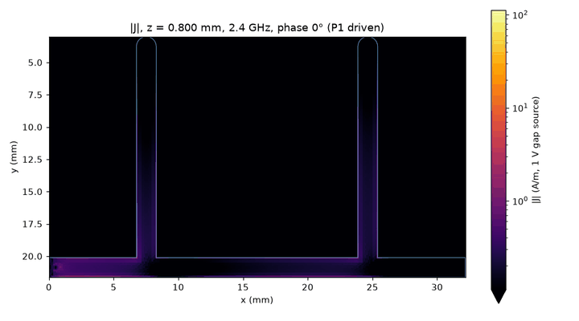

# mom25d

> Part of kicad2ems since 0.4: the package `kicad2ems.mom25d`, installed with kicad2ems (`pip install .` in this
> repository; the [README](../../README.md#install) has the installer). Its history up to then is in this
> repository's, and in its own repository. Install lines below that name `.` mean this repository.

A 2.5D method-of-moments solver for circuit boards: copper as zero-thickness sheets on the interfaces of a
layered dielectric over an infinite ground plane, vias as vertical wires, lumped parts as series elements.
It takes a board file and gives its S-parameters, on the CPU (a compiled C++ / OpenMP core) with an
optional GPU LU (Vulkan through slangpy on any GPU with a Vulkan driver, run on AMD and NVIDIA cards and on
Mesa's llvmpipe in CI).

<p align="center">
  
</p>

*The surface current on a stub notch filter at its 2.4 GHz notch (kicad2ems `--mom-dump 2.4 --dump-animate gif`):
the quarter-wave stub holds the standing wave and nothing passes it.*

It is the planar solver of [kicad2ems](https://github.com/lowprocess/kicad2ems), which reads KiCad and Gerber
files and writes the board file (`<name>_board.json`) every solver gets. mom25d reads that file without kicad2ems;
kicad2ems's [mom25d page](../mom.md) covers what it models,
its ports, the mesh, antenna mode, the GPU paths and its speed against openEMS.

## Install

```bash
pip install .                       # numpy, scipy, shapely, emsdev (the GPU and memory probes)
pip install '.[core]'               # pybind11, then build the compiled core (g++ with OpenMP; Windows: MSVC or MinGW):
python -m kicad2ems.mom25d.core.build         # mom25d/_core*.so (.pyd on Windows): the mesher, and kernels ~5x faster
pip install '.[gpu-vulkan]'         # the GPU LU through Vulkan: slangpy (any GPU)
```

On Windows the core builds with Visual Studio 2022 or its Build Tools, or MinGW-w64's g++ (see
[emsdev](../emsdev/README.md)).

The compiled core is needed: the mesher's triangulation is in it (`src/kicad2ems/emsdev/native/mesh2d.hpp`). The
kernels are in it too (NumPy references for them in its tests).

`MOM25D_GPU=off` turns the GPU off (`auto`, the default: Vulkan where there is one); Vulkan needs only the
GPU's driver.

The compiled core's threads (the matrix fill, OpenMP) and the LU's BLAS run on the fastest physical cores only: a
hybrid CPU's E-cores and hyperthreads held them back (an i7-13700K's fill took 1.5-3.1 s a frequency on 24 threads,
0.87 s on 8). `MOM25D_OMP_THREADS` and `MOM25D_BLAS_THREADS` (or `OMP_NUM_THREADS`, `OPENBLAS_NUM_THREADS`) set
them instead.

A wave port's line, characterised as a short line of its own, is kept on disk by its cross-section and the code
that solved it (`linecache.py`), so a board run again does not solve it again (the launch board's set-up: 0.5 s for
14.5). `MOM25D_CACHE` names the folder (default `~/.cache/mom25d`); `MOM25D_CACHE=off` keeps nothing.

## Use

```python
import numpy as np
from mom25d.api import solve_board

res = solve_board('coupler_board.json', np.linspace(1e9, 6e9, 101), dmax=0.3e-3)
res.f, res.S, res.names, res.zref                  # Hz, (nf, n, n), port names, reference impedances
```

DC/PDN, quasistatic fields and operational circuits now live in
[pcbqs](../pcbqs/README.md), installed with kicad2ems. The former
`kicad2ems.mom25d.pdn`, `kicad2ems.mom25d.mqs` and circuit namespaces have been
removed; see [the migration guide](../pcbqs/migration.md). MoM's RF API, shared
numerical implementation and native core are unchanged.

`solve_board` builds the model, meshes it and runs an adaptive frequency sweep; its docstring lists the options
(cell size, port kind, mixed-mode pairs, conductor loss, the compiled core). The steps it
wraps are public too:

```python
from mom25d.board import BoardModel                # the board file as a planar model
from mom25d.run import solve_band                  # the adaptive sweep over a Simulation
m = BoardModel(board_dict)
sim = m.simulation(dmax=0.3e-3, fmin=1e9, fmax=6e9)
f, S, info = solve_band(sim, 1e9, 6e9, points=101, zref=m.port_z0)
```

## Inside mom25d

| Module | Contents |
|---|---|
| `api.py` | `solve_board`: a board file in, S-parameters out |
| `board.py` | the board file as a planar model |
| `model.py` | stack, metal, vias, ports, port characterisation |
| `sim.py` | `Simulation`: mesh, ports, parts |
| `multilayer.py` | layered-media Green's functions |
| `base.py` | the 1/R moment integrals, the port wave fits (RWG functions: `kicad2ems.emsdev.numerics.base`) |
| `via.py` | via kernels |
| `frill.py` | a via through a hole in a PEC plane inside the stack: the hole's field as a few unknowns, axisymmetric and of the first azimuthal order (`planes='holes'`) |
| `geo.py` | wave ports in any direction; the mesher on mom25d's core (`kicad2ems.emsdev.numerics`'s `geo` and `cdtmesh`: offset rings along the copper edges; a hexagonal seed inside, smoothed; mesh2d in the core triangulates) |
| `sing.py` | the off-plane 1/R integrals with the rule over the smaller triangle (emsdev.numerics.sing's) |
| `quads.py` | quad cells |
| `thickness.py` | the copper's thickness: the mode a run gets (`resolve`); `sides.py`, `edge.py` model it |
| `policy.py` | how each frequency is solved: `choose` (a `SolvePlan`: basis, factorisation, what is kept) and `memory_plan` (a run's solver, precision and memory) |
| `fast.py` | the matrix fill and the solve a `SolvePlan` asks for: the factorisations, the kept LUs, the retries (the block low-rank solver's tiling; its factor is compiled in `core/`) |
| `blocks.py` | the via and sides blocks kept over a sweep, and between the frequencies filled (`Anchors`) |
| `looptree.py` | the loop/tree basis the direct solver takes at low frequency (pcbqs's) |
| `gpu.py` | the GPU backends (Vulkan, and an emulated one for the tests) |
| `gpu_vk.py` | the Vulkan backend: a hybrid LU (panels on the CPU, updates on the GPU) and its GPU solves |
| `run.py` | the adaptive frequency sweep (emsdev's `kicad2ems.emsdev.afs`, which pcbqs shares) |
| `farfield.py` | far and near fields from the currents |
| `core/` | the compiled C++ kernels |
| `solvers/` | kicad2ems's solver `mom25d` (listed in `kicad2ems.core.solvers.SOLVERS`; only kicad2ems imports it) |

The formulation is a mixed-potential integral equation with RWG basis functions. Layered-media kernels
come from a spectral transmission-line network. The singular terms are integrated analytically.

The tests check it against exact solutions and textbook formulas: layered Green's functions to about 1e-5,
stripline impedance to 0.6 % (Cohn's), coupled striplines' even and odd modes to 2.5 %, a plane cavity's resonance
to 0.7 % of the cavity model (Hammerstad's fringing), and the 10 dB coupler to 0.1 dB of openEMS (S21, S31), with
stored S-parameters of two boards beside them (`tests/test_validation.py`). The board
files they read (`tests/boards`) are kicad2ems's example boards. `tools/` holds the GPU self-check and the studies
behind kicad2ems's mom25d page (mesher, zone, quad cells).

**Limits**: copper is zero-thickness (`Metal(rough=)` scales its loss by Hammerstad's roughness factor), and wave ports need a straight
feed line.

## Licence

GPL-3.0-or-later.

The mesher's triangulation is kicad2ems's own (`src/kicad2ems/emsdev/native/mesh2d.hpp`), GPL-3.0-or-later like
the rest.
