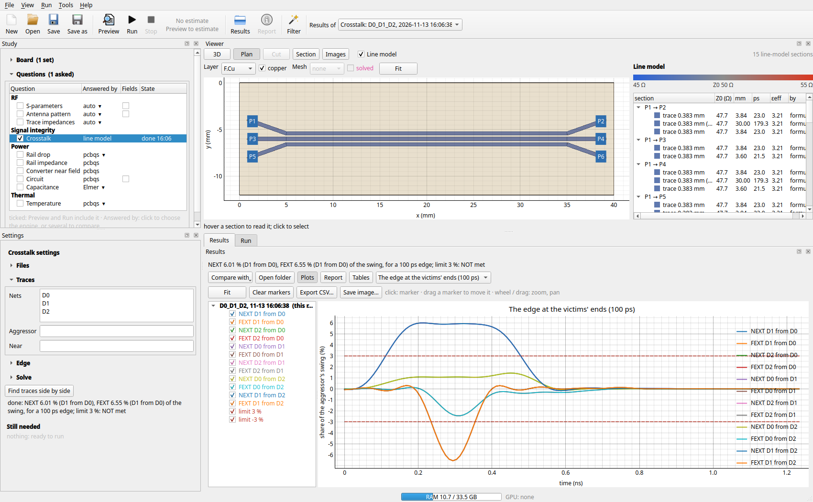

# Signal integrity: crosstalk

The crosstalk question tells you how much of one trace's edge arrives on its neighbours, at their near end (NEXT)
and at their far end (FEXT), and what in the layout makes it. You name the traces by their nets; the ports, the
solve and the reading of the result are done for you.

```sh
python -m kicad2ems.si board.kicad_pcb --nets D0,D1,D2 --rise 100 --limit 3 --out out/xt
kicad2ems study examples/si_bus.toml          # the same from a config: [analysis.crosstalk]
```

In the window it is **Crosstalk** under *Signal integrity* in the study's questions. *Find traces side by side*
lists the pairs of nets that run close together on the board, to pick from; **pick** beside *Nets* takes them
from clicks on the board ([picking](gui.md#pick)).



## What it does

1. **The traces' ends.** Each net's routed copper is followed to its two ends (the pair of free track ends
   furthest apart along the tracks). An end on a pad gets its port on the pad, a free end a port 0.3 mm in from it.
   The near end is the one at a part you name (`--near U1`); with none named, the ends nearest the first trace's
   first end. The log says which end is which.
2. **The solve.** The S-parameters between all the ends, by the [line model](transmission-lines.md): its coupled
   sections come from the 2D field solver on the board's own cross-section, and it takes a second or two. Name a
   full-wave solver beside it (`--solvers lines,mom25d`; *Check* in the window) and the same ports are solved by
   both, the report's figures then being the full-wave solver's.
3. **NEXT and FEXT.** With trace *a* driven at its near end, a victim's NEXT is S(victim near, *a* near) and its
   FEXT is S(victim far, *a* near): over frequency in dB, and in time for an edge of `--rise` ps (10 to 90 %),
   as the largest voltage at each end in percent of the aggressor's swing. Each trace is the aggressor in turn
   unless `--aggressor` names them. A victim with several aggressors also gets their sum: in time each one's
   largest added up (the worst case), over frequency their power sum.
4. **The layout.** Every stretch where two of the traces run side by side is listed with its length, gap and
   layer, and with the coupling its cross-section gives: Kc (capacitive) and Kl (inductive). From these follow
   the textbook estimates, which the report sets beside the solved figures to explain them:

   | | |
   |---|---|
   | NEXT, saturated | (Kc + Kl) / 4: an edge shorter than twice the stretch's delay; a longer run changes nothing |
   | NEXT, short stretch | that times 2 Td / ramp: grows with the length |
   | FEXT | (Kc − Kl) / 2 × Td / ramp: grows with the length and with a faster edge; near zero in stripline |

   The report says which case each stretch is in, the length below which NEXT would start to fall, and what a
   gap 1.5, 2 and 3 times as wide would give (the same cross-section solved again with the victim moved away).
   With a limit (`--limit`, percent of the swing; `--mode next`, `fext` or `both` says of what), it says whether
   the limit is met and the gap that would meet it.

## The example

`examples/si_bus.toml`: three 50 Ω traces on a 4-layer board, 0.2 mm apart for 30 mm. For a 100 ps edge:

| | line model | mom25d |
|---|---|---|
| NEXT, a neighbour | 6.0 % | 5.9 % |
| FEXT, a neighbour | −6.5 % | −7.1 % |
| NEXT, the next trace but one | 1.4 % | 1.4 % |
| the middle trace, both neighbours switching | 12.0 % and 13.1 % | |
| run time | 2 s | 30 s |

The stretch's own estimate is 7.1 % for both (Kc 0.090, Kl 0.193): the edge's ramp of 125 ps is shorter than
twice the stretch's delay of 176 ps, so NEXT is saturated and only a wider gap lowers it: 4.8 % at 0.3 mm,
3.5 % at 0.4 mm, 2.1 % at 0.6 mm.

## Options

| Option | Default | |
|---|---|---|
| `--nets` | | the traces, by net, comma-separated: two or more |
| `--aggressor` | each in turn | the driven traces |
| `--near` | nearest ends | the parts at the near (driven) ends: `U1,U2` |
| `--mode` | both | what the headline and the limit are about: `next`, `fext`, or the larger |
| `--rise` | 100 | the aggressor's edge, ps (10 to 90 %) |
| `--limit` | none | the most crosstalk allowed, percent of the swing |
| `--z0` | 50 | each trace's termination at both ends, Ω |
| `--solvers` | lines | `lines,mom25d` (or `gfdtd`, `openems`): a full-wave solver beside the line model |
| `--ground` | as drawn | the copper layer taken as a solid plane |
| `--fmax` | 1 / rise | the highest frequency solved, GHz |
| `--sigma` | lossless | copper conductivity, S/m |

The result is `crosstalk.json` in the output folder (the pairs' curves and waveforms, the victims' sums, the
stretches), beside the run's own files (`<name>_<solver>.sNp`, `<name>_lines.json`).

## What it leaves out

- **Differential pairs as pairs.** The two legs of a pair are two traces here; crosstalk between pairs in their
  differential and common modes is not worked out (the proposals leave a pair's own legs out).
- **Drivers and receivers.** Every end is terminated in `--z0`. A real driver's impedance and an unterminated
  receiver reflect, and NEXT that reflects at the near end arrives at the far end too.
- **Coupling that is not a parallel run.** The line model sees side-by-side stretches. Crossings on adjacent
  layers, a shared return via or a gap in the plane under the traces need the full-wave check.
