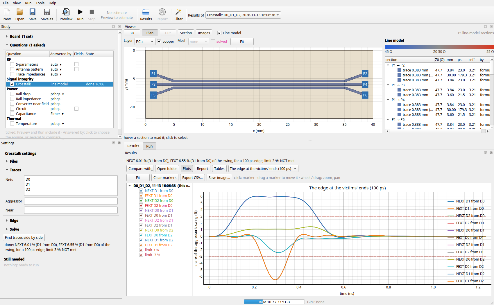

# Signal integrity: crosstalk and a board's coupling

The crosstalk question tells you how much of one trace's edge arrives on its neighbours, at their near end (NEXT)
and at their far end (FEXT), and what in the layout makes it. You name the traces by their nets; the ports, the
solve and the reading of the result are done for you.

```sh
python -m kicad2ems.core.si board.kicad_pcb --nets D0,D1,D2 --rise 100 --limit 3 --out out/xt
kicad2ems study examples/si_bus.toml          # the same from a config: [analysis.crosstalk]
```

In the window it is **Crosstalk** under *Signal integrity* in the study's questions. Its *Answered by* cell
offers the line model (the default) or a full-wave solver beside it: *line model + gfdtd*, *line model +
openEMS*, *line model + mom25d*; one not installed is greyed with the reason. A config says it the same way:

```toml
[study.crosstalk]
engine = "gfdtd"     # crosstalk_gfdtd, or "line model + gfdtd"; "line model" or none: the line model alone
```

(An `[analysis.crosstalk]` table's `check = "gfdtd"`, from before these were engines, is read as that engine
when `[study.crosstalk]` names none.) *Find traces side by side*
lists the pairs of nets that run close together on the board, to pick from; **Pick** beside *Nets* takes them
from clicks on the board ([picking](gui.md#pick)).



## What it does

1. **The traces' ends.** Each net's routed copper is followed to its two ends (the pair of free track ends
   furthest apart along the tracks). An end on a pad gets its port on the pad, a free end a port 0.3 mm in from it.
   The near end is the one at a part you name (`--near U1`); with none named, the ends nearest the first trace's
   first end. The log says which end is which.
2. **The solve.** The S-parameters between all the ends, by the [line model](transmission-lines.md): its coupled
   sections come from the 2D field solver on the board's own cross-section, and it takes a second or two. Name a
   full-wave solver beside it (`--solvers lines,gfdtd`; the engine in the window or `[study.crosstalk]`) and the
   same ports are solved by both: the headline, the tables and the curves are then the full-wave solver's (the
   headline ends "by gfdtd ..."), the line model's figures beside them (*Against line model*), and the layout's
   stretches still the line model's. mom25d runs with lumped ports here.
3. **NEXT and FEXT.** With trace *a* driven at its near end, a victim's NEXT is S(victim near, *a* near) and its
   FEXT is S(victim far, *a* near): over frequency in dB, and in time for an edge of `--rise` ps (10 to 90 %),
   as the largest voltage at each end in percent of the aggressor's swing. Each trace is the aggressor in turn
   unless `--aggressor` names them. A victim with several aggressors also gets their sum: in time each one's
   largest added up (the worst case), over frequency their power sum.
4. **The layout.** Every stretch where two of the traces run side by side is listed with its length, gap and
   layer, and with the coupling its cross-section gives: Kc (capacitive) and Kl (inductive). From these follow
   the textbook estimates, which the report sets beside the solved figures to explain them:

   | | |
   |---|---|
   | NEXT, saturated | (Kc + Kl) / 4: an edge shorter than twice the stretch's delay; a longer run changes nothing |
   | NEXT, short stretch | that times 2 Td / ramp: grows with the length |
   | FEXT | (Kc − Kl) / 2 × Td / ramp: grows with the length and with a faster edge; near zero in stripline |

   The report says which case each stretch is in, the length below which NEXT would start to fall, and what a
   gap 1.5, 2 and 3 times as wide would give (the same cross-section solved again with the victim moved away).
   With a limit (`--limit`, percent of the swing; `--mode next`, `fext` or `both` says of what), it says whether
   the limit is met and the gap that would meet it. A pair the line model puts in no coupled section (traces on
   two layers, or further apart than it couples) has no path between its ends there: its crosstalk was not
   computed, and the limit is not judged ("not modelled": a full-wave solver beside it answers).

## The example

`examples/si_bus.toml`: three 50 Ω traces on a 4-layer board, 0.2 mm apart for 30 mm. For a 100 ps edge:

| | line model | gfdtd | mom25d |
|---|---|---|---|
| NEXT, a neighbour | 6.0 % | 6.0 % | 6.5 % |
| FEXT, a neighbour | −6.5 % | −7.4 % | −8.0 % |
| NEXT, the next trace but one | 1.4 % | 1.5 % | |
| FEXT, the next trace but one | −2.5 % | −2.5 % | |
| the middle trace, both neighbours switching | 12.0 % and 13.1 % | | |
| run time | 2 s | 11 s (GPU; 71 s on the CPU core) | 76 s |

mom25d's sweep stopped unconverged at its 60 solves here; gfdtd is the full-wave check to use on this board
(`tests/core/test_si.py` runs it: NEXT within 0.5 and FEXT within 1.5 percentage points of the line model's).

The stretch's own estimate is 7.1 % for both (Kc 0.090, Kl 0.193): the edge's ramp of 125 ps is shorter than
twice the stretch's delay of 176 ps, so NEXT is saturated and only a wider gap lowers it: 4.8 % at 0.3 mm,
3.5 % at 0.4 mm, 2.1 % at 0.6 mm.

## Options

| Option | Default | |
|---|---|---|
| `--nets` | | the traces, by net, comma-separated: two or more |
| `--aggressor` | each in turn | the driven traces |
| `--near` | nearest ends | the parts at the near (driven) ends: `U1,U2` |
| `--legs` | off | a differential pair's legs as two traces (default: the pair one trace, in its differential mode) |
| `--mode` | both | what the headline and the limit are about: `next`, `fext`, or the larger |
| `--rise` | 100 | the aggressor's edge, ps (10 to 90 %) |
| `--limit` | none | the most crosstalk allowed, percent of the swing |
| `--z0` | 50 | each trace's termination at both ends, Ω |
| `--solvers` | lines | `lines,gfdtd` (or `openems`, `mom25d`): a full-wave solver beside the line model; in a study, the engine |
| `--ground` | as drawn | the copper layer taken as a solid plane |
| `--fmax` | 1 / rise | the highest frequency solved, GHz |
| `--sigma` | lossless | copper conductivity, S/m |

The result is `crosstalk.json` in the output folder (the pairs' curves and waveforms, the victims' sums, the
stretches), beside the run's own files (`<name>_<solver>.sNp`, `<name>_lines.json`).

## What it leaves out

- **A pair's common mode.** A differential pair is one trace in its differential mode (as it drives and as its
  receiver sees it; `--legs` takes its legs as two traces). What its neighbours put into its common mode, and its
  skew, are not reported yet.
- **Drivers and receivers.** Every end is terminated in `--z0`. A real driver's impedance and an unterminated
  receiver reflect, and NEXT that reflects at the near end arrives at the far end too.
- **Coupling that is not a parallel run.** The line model sees side-by-side stretches. Crossings on adjacent
  layers, a shared return via or a gap in the plane under the traces need the full-wave check.

<a id="coupling"></a>
## A board's coupling, a layer at a time

The crosstalk question is for a few named traces. **Board coupling** (`kicad2ems.core.coupling`) is for a bus: many
nets named by patterns, each signal layer solved with its reference planes alone, and for each victim its worst
aggressors.

```sh
python -m kicad2ems.core.coupling board.kicad_pcb --nets 'DQ*,DQS*' --rise 100 --limit 15 --out out/cpl
kicad2ems study examples/si_ddr.toml          # the same from a config: [analysis.coupling]
```

In the window it is **Board coupling** under *Signal integrity*, answered by mom25d (the default) or the line
model (`coupling_lines`: seconds, a first look). A config says it as `[study.coupling] engine = "coupling_lines"`.

What it does:

1. **The nets.** Those whose names match a pattern (`DQ*`, `DQS?_[PN]`: fnmatch; a name alone is a pattern too).
   Nets with zones (planes, pours) are never traces.
2. **The layers.** On each copper layer where the nets run (`--layers` to choose), each net's stretch there: its
   tracks on that layer, ended where it leaves the layer (at a via or a pad), a port at each end. A stretch shorter
   than `--min-length` (5 mm) is a breakout: left out, and listed. The nets of a layer are ordered across the
   way they run, so the matrices' neighbours sit beside their diagonal.
3. **The solve.** The board is imported once with every layer's ports. Each layer is then solved on a board of
   its own: that layer's stretches and the ground copper of every layer (the reference planes: mom25d takes solid
   planes as PEC), the selected nets' vias, their copper on other layers and the parts left out. A port at its
   net's own via (a stretch that leaves the layer there) gets the plane's copper under it, the via's antipad
   closed. mom25d solves the layer over its own reference plane (the plane its ports reference, the copper beyond
   it left out; `--mom-stack ground`), the board turned over for a layer under its plane (B.Cu under In4.Cu):
   its automatic stack had meshed every plane of a real board, whose planes have apertures under the traces.
   **Groups:** a layer's nets whose tracks come no nearer than `--apart` mm to any others of them (default 20
   heights over the layer's plane: microstrip crosstalk falls as 1 / (1 + (s/h)^2), ~0.25 % of its close range
   there) are solved as separate groups, the coupling between groups taken as none; each group's run in
   `<layer>/group<k>`. `--apart 0`: the whole layer at once.
4. **The coupling.** Each net's near end driven in turn, every end terminated in `--z0`: each victim's NEXT and
   FEXT from each aggressor, as the largest share of the swing for an edge of `--rise` ps (as the crosstalk
   question's). Each layer gets the matrices (victim by aggressor), each victim its `--top` worst aggressors and
   their sum (every aggressor's peak at once: the worst case), and the worst pairs. A differential pair (its legs
   by name: `D0_P` / `D0_N`, `TX+` / `TX-`) is one channel: it drives, and its receiver sees, in its differential
   mode, and crosstalk between modes is the voltage share (S scaled by the modes' reference impedances: 2 z0
   differential, z0 single). Each pair also gets its own conversion to common mode (driven differentially, seen in
   common mode at either end: what an asymmetric neighbour or a longer leg makes). `--legs` takes the legs as two
   nets instead. `--limit` judges the worst victim's sum (`--mode`: of NEXT, FEXT or the larger).

The result is `coupling.json`, a figure per layer (`coupling_<layer>.png`: the NEXT and FEXT matrices, and the
layer's stretches coloured by each victim's sum) and each layer's run in its own folder.

`examples/si_ddr.toml` (`make_rf_examples.py ddr`): two byte lanes, each four DQ lines and a DQS pair, lane 0
microstrip on F.Cu, lane 1 stripline on In2.Cu through vias. For a 100 ps edge, the worst victim's sum (the
DQS pair on both layers, in its differential mode, from the lines on either side of it):

| | mom25d | line model |
|---|---|---|
| F.Cu (microstrip): NEXT, FEXT | 12.1 %, 14.0 % | 11.4 %, 10.9 % |
| In2.Cu (stripline): NEXT, FEXT | 8.3 %, 1.5 % | 7.2 %, 0.5 % |
| the pair's conversion to common mode | 0.02-0.06 % | 0 |
| run time, both layers | 8.6 min (GPU) | 18 s |

The pairs sit mirror-symmetric between two lines, so they convert next to nothing; with the legs as two nets
(`--legs`) the worst victim is DQ1, beside DQS0_P: 14.7 % NEXT and 20.4 % FEXT by mom25d.

In stripline (one dielectric around the traces) FEXT nearly cancels, in microstrip it is larger than NEXT. mom25d
finds more FEXT than the line model: it sees the fan-outs and the whole layer's field, the line model its coupled
sections alone.

What it leaves out: what crosses between layers (a via's field, a reference plane's gaps, broadside traces on
adjacent layers), since each layer is solved on its own; drivers and receivers, as the crosstalk question; and a
stretch's own branches (a net that forks on a layer is its longest path there). The line model couples only the lines it
groups into coupled sections: lines further apart than that (a few heights) read 0 % where mom25d finds a little.
It takes ground copper between two lines (a guard trace, a pour) into the lines' cross-section as ideal ground
along its length, however it is stitched: a guard tied down at its ends alone reads as one stitched every 3 mm
(mom25d: 2.46 % FEXT against 2.25 %).

## A board in pieces: vias as ports (`kicad2ems.core.segment`, in progress)

For boards too large to solve whole (the user's plan, 2026-11-20): each signal layer's traces over ideal planes
(mom25d's Green's function carries them: the planes are not meshed), each signal via, or a group of them whose
circles touch (a pair's), a small model of its own, and the pieces joined as one network.

```sh
python -m kicad2ems.core.segment examples/rf_msvia.toml --out out/seg
python -m kicad2ems.core.segment board.kicad_pcb --nets 'PCIE*,HDMI*' --out out/seg   # ports at the nets' ends on pads
```

- **The cuts:** a circle round each signal via, its radius 0.25 mm beyond the via's pad and the largest antipad round
  it in the planes; every trace that crosses it is cut there, a port on each side. A via where its net ends at a
  port (a through-hole pad's barrel) is not cut.
- **A layer's piece:** its signal copper outside every circle, the planes of the other layers (ideal), no vias, its
  external ports and a port at each cut.
- **A via's piece:** its group's copper inside the circle on every layer, the planes clipped to a box 1.5 mm beyond
  the circle (with their antipads), the vias in the box (its own and the ground vias round it), a port at each
  cut; mom25d meshes its whole stack.
- **The join:** S_e = S_ee + S_ei G (I - S_ii G)^-1 S_ie over the pieces' S side by side (G pairs the two sides of
  each cut); the external ports' Touchstone and `segment.json` (the pieces, their ports and times).
- **External ports:** the board's own, or (`--ends`, and wherever the board has none) one on each pad where a
  selected net's tracks end.
- **Groups:** a layer's nets further apart than `--apart` heights over its plane (20 by default, as Board
  coupling's) are pieces of their own, their coupling taken as none; `--apart 0`: one piece a layer.
- **Each piece in a process of its own**, so the memory one took is free for the next. mom25d stops a piece that
  will not fit, saying so (`--thickness grow` has no copper-side unknowns: a large piece).

Measured against the whole board on mom25d (S21, 1-10 GHz): `rf_msvia` 0.18 dB at worst, 0.04 dB rms (gfdtd whole
is 0.10 / 0.02 dB from mom25d whole); `rf_diffvia` Sdd21 0.16 dB rms (gfdtd 0.18). Its reflection near 10 GHz is
2-3 dB higher than the whole board's: neither a via model's box as large as the board, nor the cut further out,
nor `--calibrate` (each cut corrected for its two lumped ports back to back, from a calibration line of its cross
section: 0.042 to 0.069 dB rms on rf_msvia, 0.160 to 0.142 on rf_diffvia) changes it much; to find in the via
model. What the pieces leave out: a plane's apertures under a trace, a plane pair's cavity beyond a via model's
box, broadside coupling between layers, the vias of nets not selected.
