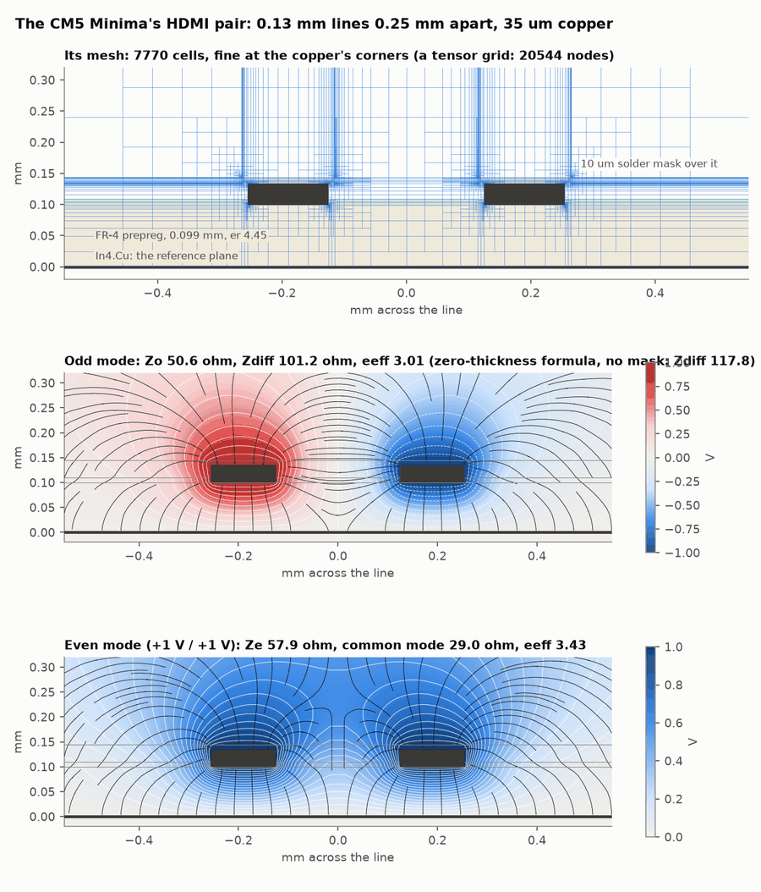
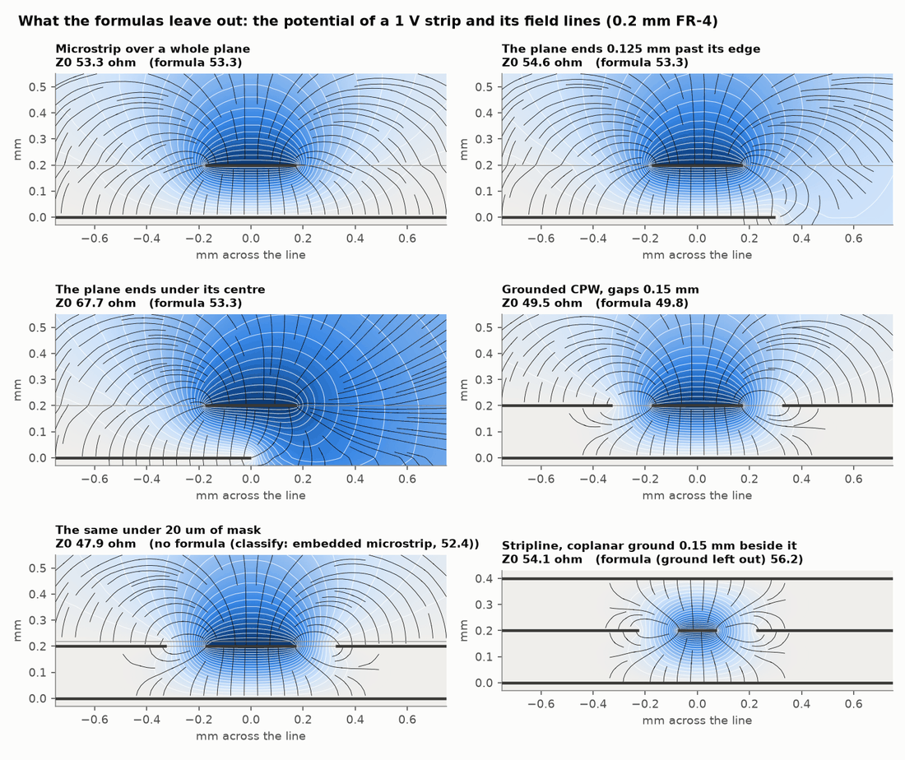
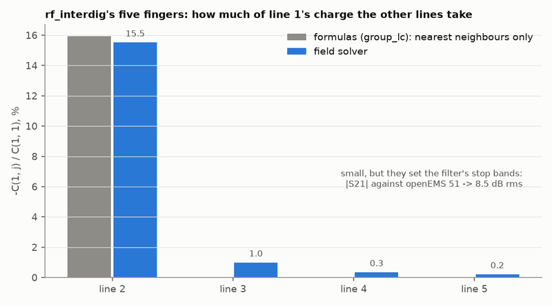
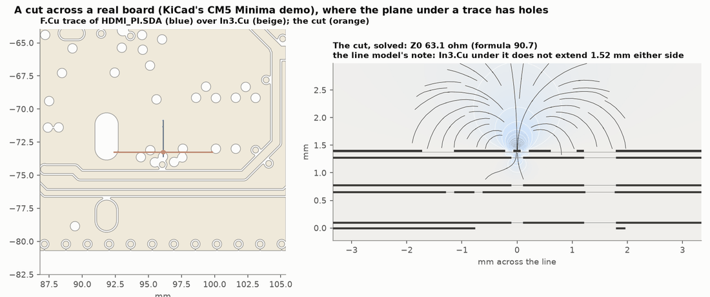

# Transmission-line model

[← mom25d](mom.md) · [Index](index.md) · [Next: Architecture →](architecture.md)

Every run, including previews, breaks the port nets into uniform line sections, each with an impedance from
closed-form formulas or a 2D field solve. On the examples this takes about a second and needs no full-wave
solver: a quick estimate that shows where a routed line departs from the port impedance. The sections can also be solved as a circuit
([below](#fast)).

## Sections

The model starts from the port nets and follows series parts into the next net, but never into a ground net.

| Section | What it is |
|---|---|
| trace | tracks of one width on one layer. A trace is split at junctions, and where its surroundings change: the reference planes, the gap to coplanar ground, or extra copper widening it (a taper or teardrop) |
| pad | a component pad. A trace ending in a pad is shortened by the part inside it |
| strip | copper drawn as a shape: rectangular shapes (resonators, hairpins, tapped feeds, stubs drawn as rectangles), and other shapes that sit across a track as a stub (a radial stub). A strip is sliced into sections that follow its width, so a fan becomes a stub that widens step by step; with qucsator, a fan that is a circular sector is one radial stub (MRSTUB) instead |
| via | a via barrel: a coaxial line through the planes it passes, or an inductance where there's no plane |
| part | a lumped R/L/C part, in series or to ground ([details](model.md#lumped-parts)) |

<a id="coupled-sections"></a>
**Coupled sections.** Straight, parallel sections of one cross-section on one layer within 5 substrate heights of
each other become a coupled section: hairpin and interdigital filter fingers, differential pairs. The
[field solver](#field-solver) gives each its capacitance matrix, every line coupled to every other, and each
neighbouring pair its even- and odd-mode impedances with the copper's thickness (`ze`, `zo`; as sheets, `ze_sheet`,
`zo_sheet`). `topology.FIELD_GROUPS = False` uses the formulas instead (Kirschning & Jansen for microstrip, Cohn for
stripline: zero thickness, nearest neighbours only). With qucsator, a coupled microstrip pair is still qucsator's
own MCOUPLED.

Copper thickness matters most here: the CM5 Minima demo board's HDMI pairs (0.13 mm lines 0.25 mm apart, 0.099 mm
over In4.Cu, 35 µm copper, in a 100 Ω class) are 117.8 Ω differential by the zero-thickness formula, 104.8 Ω with
the copper's thickness, and 101.2 Ω with the board's 10 µm solder mask too.

**Discontinuities** are listed where sections meet: open ends, corners, bends, steps, tees, crosses and end gaps.

## Impedances

Each section is classified by the copper around it. Only copper of other nets counts as a reference.

| Cross-section | When | Formula |
|---|---|---|
| microstrip | one plane below, nothing above | Hammerstad & Jensen |
| embedded microstrip | dielectric over the strip | microstrip with a cover correction |
| grounded CPW | ground copper beside the strip on both sides | conformal mapping (Ghione & Naldi) |
| stripline | planes on both sides | Wheeler; offset stripline for unequal heights |
| coax | a via inside antipads | the coaxial formula |
| lumped | a via without a plane, or a part | an inductance or the part's value |

A trace is split where its reference planes change: a plane's edge, a split, a slot it crosses. Where a trace ends
at a via, the last stretch over that via's own antipad (up to 3 reference heights) keeps the line's cross-section:
it is part of the via transition, not a line over the next plane down (which on `rf_diffvia` put the worst Sdd11 at
−9.4 dB against openEMS's −15.4; the rule gives −11.9).

Each section gets two impedances: **Z0** with the stackup's copper thickness (the design value), and **Z0 sheet**
with zero thickness, as the field solvers model copper (the demo transition's 0.35 mm microstrip: 50.7 Ω and
53.3 Ω). The formulas match scikit-rf's reference values within 0.3 %, and the stripline matches Cohn's exact result
within 0.2 %.

<a id="field-solver"></a>
## Field solver

`kicad2ems.lines.xsection` solves a cross-section numerically: the per-unit-length capacitance matrix of N
conductors over planes, in any stack of dielectrics, and from it L, Z0, εeff, the even and odd modes of a pair and
the dielectric loss. It covers what the formulas can't: coplanar ground under solder mask or between two planes,
mask that follows the copper, coupled lines with copper thickness, coupling beyond the nearest neighbour, layers of
different εr. The line model uses it [by default](#lines-field) for coupled sections and grounded CPW, and with
`--lines-field` for every section.



```python
from kicad2ems.lines import xsection as X
X.microstrip(0.35, 0.2, 4.3, t=0.035, mask=0.02, er_mask=3.8).solve().single()   # (Z0, eeff)
X.coupled_microstrip(0.15, 0.15, 0.2, 4.4).solve().pair()                         # (Ze, Zo, eeff_e, eeff_o)
X.stripline(0.15, 0.2, 0.2, 4.3, s=0.15).solve().single()                         # coplanar ground beside it
r = X.coupled_stripline(0.1, 0.1, 0.2, 0.2, 4.3).solve(); r.C, r.Ca               # F/m: coupled.mtl_s takes them
```

It solves Laplace's equation with bilinear finite elements on a mesh of rectangles, inside a grounded box 24
structure heights beyond the copper, with mom25d's methods ([coarsening](mom.md#coarsen)):

- **Cells grow from the corners**: halved in x or z only where larger than 0.4 × their distance from the nearest
  corner of copper (`xsection.MESH_GROW`), so a corner's fine cells stay around it.
- **Each corner's own scale**: 1/128 of the feature there (`MESH_FINE`), and at least 1 % of its distance from the
  signal copper (`MESH_FAR`).
- **Hanging nodes tied** to the ends of the side they lie on, the matrix reduced to the nodes left (T^T K T, as mom25d
  reduces to quads). The sides are nested, so a linear potential solves exactly (the patch test,
  `tests/test_xsection.py`).

Each cross-section is solved on this mesh and on one twice as coarse, and the two extrapolated (`MESH_MIX`);
`REFINE = False` skips the coarse solve (30 % faster, Z0 up to 0.7 % low). `MESH = False` uses the tensor grid the
solver began on, kept as the independent check.

| Against | Case | Mesh | Tensor grid | Nodes, mesh / grid |
|---|---|---|---|---|
| Exact (Cohn, with η0 / 4) | stripline, w 0.15, b 0.4 mm | −0.10 % | +0.37 % | 885 / 6,105 |
| Hammerstad & Jensen | microstrip 0.35 / 0.2 mm, 3.0 / 1.6 mm | −0.02 % | +0.23 % | 921 / 14,181 |
| Hammerstad & Jensen | microstrip 0.4 / 0.21 mm with 35 µm | +0.12 % | +0.21 % | 2,140 / 28,427 |
| Wheeler | stripline with 35 µm copper | +0.02 % | +0.24 % | 2,058 / 15,631 |
| Ghione & Naldi | grounded CPW 0.5 / 0.5 / 1.6 mm | −0.18 % | +0.39 % | 1,833 / 19,109 |
| Ghione & Naldi | grounded CPW 0.3 / 0.15 / 0.2 mm | −0.58 % | −0.23 % | 1,848 / 19,065 |
| Kirschning & Jansen | coupled microstrip 0.15 / 0.15 / 0.2 mm: Ze, Zo | −0.15 %, +0.14 % | +0.11 %, +0.65 % | 1,796 / 18,655 |
| Cohn | coupled stripline, w 0.1, s 0.1, b 0.4 mm: Ze, Zo | −0.15 %, −0.31 % | +0.19 %, +0.38 % | 1,341 / 9,405 |

Closed forms are not exact either: on the second CPW the mesh is within 0.02 % of a converged solve and the formula
0.56 % above it. On a real board, the 2,200 cross-sections of the CM5 Minima's 94 nets (up to 75 conductors), the
mesh's worst error against the same one converged is 0.31 % (median 0.04 %, at most 30,800 nodes); the tensor grid's
0.54 % (603,000 nodes). A cross-section takes about 20 ms (up to 0.2 s); it is quasi-static: no dispersion, no
conductor loss. `tools/xsection_study.py` makes these tables, `tools/xsection_figures.py` the figures here.

**Copper thickness on a pair, by full-wave simulation** (`tools/xsection_fullwave.py`, openEMS): on `rf_diffvia`'s
two pairs, thickness takes 7.1 % off the microstrip pair's Zdiff and 14.2 % off the stripline pair's; the field
solver gives 8.4 % and 15.7 %, and with the copper FDTD's Zdiff is 91.9 and 83.4 Ω against the solver's 91.6 and
84.2 Ω.



The formulas also miss what lies beside a stripline: on the CM5 Minima, `PCIE_PI.nRST` runs on In2.Cu with ground
0.2 mm beside it, 71.9 Ω by the offset-stripline formula and 58.8 Ω by its cut; cropped and solved by openEMS, its
total C is 1.07 pF, against 1.05 pF for the cut and 0.89 pF for the formula (`tools/lines_crop_check.py`). In the GUI,
the [Section view](gui.md#section) draws any section's cut.

<a id="lines-field"></a>
### The line model on the field solver

Coupled sections and grounded CPW come from the field solver by default. `--lines-field` (`lines_field = true`)
takes every section's cross-section from the board: at the point where a section is classified, the reference
copper is cut across the strip, out to 5 reference heights either side, on every layer up to the nearest plane that
spans the cut; the pieces it crosses become the solver's conductors. A plane that ends beside the trace, ground on
one side or beside a stripline are solved as they are (the microstrip above: 53.3 Ω over a whole plane, 54.6 Ω where
the plane ends 0.125 mm past its edge, 67.7 Ω where it ends under its centre).

In the circuit solvers, a microstrip or grounded CPW section keeps scikit-rf's and qucsator's own models (with their
dispersion) unless the field solver's sheet Z0 is more than 2 % from the formula's (`reference.FIELD_DIFFERS`); then
it is a quasi-static line of the solver's Z0 and εeff (`Element.field`).

On the examples with openEMS references (scikit-rf; the rms of the complex difference of S11, and the rms difference
of |S21|, as in [Examples](examples.md)):

| Board | Formulas throughout | Coupled sections by the field solver (default) | and `--lines-field` |
|---|---|---|---|
| `rf_interdig`: five coupled fingers | −23.0 dB / 51.21 dB | −24.7 dB / 8.47 dB | −24.7 dB / 8.47 dB |
| `rf_stripline`, `rf_diffvia`, `rf_coupler`, `rf_wilkinson`, `demo_transition`, `rf_shielded`, `hairpin` | | within 0.1 dB / 0.06 dB of the formulas | within 0.3 dB / 0.1 dB |
| `rf_branchline`, `rf_steplpf`, `rf_stubnotch`, `rf_gcpw`, `rf_ratrace`, `rf_radialstub`, `sma_launch` | | the same | the same |

The interdigital filter's stop bands are set by the coupling between fingers that aren't neighbours, which the
formulas leave out (`tools/lines_vs_openems.py` makes this comparison; qucsator's gives the same picture):



On the other boards the sections are the idealised cross-sections the formulas were made for, and what remains
comes from what the line model leaves out: discontinuities (scikit-rf), vias, radiation, the can.

<a id="cpw-thickness"></a>
On the CM5 Minima's control lines (grounded CPW, pour 0.15 mm from the trace) the field solver differs from the
formulas in two ways:

| Where | Formula | Field solver, as a sheet | with 35 µm copper |
|---|---|---|---|
| 0.2 mm line, its plane 0.099 mm under it | 48.1 Ω | 47.3 Ω | 43.1 Ω |
| 0.13 mm line, plane 0.099 mm under it | 61.5 Ω | 60.3 Ω | 53.6 Ω |
| 0.2 mm line, the plane under it full of via clearances: classified over the next plane down, 0.73 mm | 79.4 Ω | 58.0 Ω | 52.1 Ω |
| 0.15 mm line, the same, 0.65 mm | 104.9 Ω | 60.5 Ω | 55.1 Ω |

- **Copper thickness in grounded CPW**: the formula has none; 35 µm of copper beside a 0.15 mm gap takes 10–12 % off
  (Gupta's correction finds a third to a half of it). So grounded CPW comes from the field solver by default, as
  classified (`reference.FIELD_CPW`).
- **A plane with holes**: where the plane under a trace doesn't cover the points `classify` tests, the formula takes
  the next plane down as the reference and comes out 30–75 % too high; the copper between the holes still carries
  most of the return, and the cut solves it as it is:



<a id="similar"></a>
**Similar cross-sections share a solve.** Each is cached, a cross-section and its mirror image are one, widths and
gaps are snapped to 1 % steps (`xsection.SIMILAR`), and the copper a cut finds to bins that widen away from the
strip (`reference._distance_bins`, at most a height wide: `reference.BIN_MAX`), where it matters less: snapping moves
Z0 by 0.1–0.2 %. On the CM5 Minima's HDMI nets that is 158 solves instead of 254, within 0.33 % (0.11 % rms) of
solving each. Its 94 signal nets take 13 s to build by default, 71 s with `--lines-field`, 6.4 s with the formulas
(`tools/cm5_line_model.py`, one core).

## Paths

For each pair of ports the model finds the shortest path through the sections. Branches off the path, such as
stubs and shunt parts, are listed with their position, length and what they end in.

<a id="outputs"></a>
## Outputs

| Where | Contents |
|---|---|
| the log | one line per path: sections, length, impedance range, branches |
| `<name>_tlines.png` | the sections coloured by impedance, and an impedance profile along each path |
| `<name>_lines.json` | every section's geometry, Z0, εeff, length and delay: the GUI's [line-model overlay](gui.md#line-model) |
| the report | a table per path: layer, cross-section, width, length, Z0, εeff, delay. Impedances more than 10 % or 25 % off the port impedance are shaded |
| `<name>_run.json` | the same tables, under `lines` |

<a id="fast"></a>
## Solving the line model

The sections become a circuit, solved in milliseconds by one of two programs:

| | `scikit` | `qucs` |
|---|---|---|
| needs | scikit-rf (`pip install scikit-rf`) | qucsator from Qucs-S, on PATH or `--qucsator PATH` |
| microstrip | `MLine` | `MLIN` |
| grounded CPW | `CPW` | `CLIN` |
| coupled lines | a multiconductor line block | `MCOUPLED` for a microstrip pair, otherwise the same block |
| discontinuities | not modelled | open ends, corners, steps, tees, crosses and gaps |

`--solvers lines` uses qucsator when it's installed, otherwise scikit-rf; `--fast` adds the line model next to the
other solvers as a reference. The copper is zero-thickness, as in the other solvers, and `--sigma` adds copper loss.
The result is `<name>_qucs.sNp` or `<name>_scikit.sNp`, compared in the plot and report with the first solver. Large
differences point to something one model leaves out (coupling, radiation, plane resonances, the lumped ports) or to
a mesh problem.

## Limits

- Impedances are quasi-static. qucsator's microstrip models add dispersion.
- Coupled sections must be straight, parallel microstrip or stripline. Coupling across layers isn't modelled.
- Shapes other than rectangles become strips only as stubs across a track; tapers and teardrops widen the track.
- **Radial stubs**: with qucsator, a fan that is a circular sector is qucsator's radial stub (MRSTUB), its radial line
  taken to start half the track's width beyond the track's edge (fitted against mom25d on 60°, 90° and 40° fans:
  the notches agree within 0 to −2.4 %). scikit-rf has no radial stub: the fan is sliced into widening sections,
  which ignores its radial field (notches 5–8 % high).
- qucsator has no stripline model, so single striplines are RLCG lines whose dielectric loss is set at the band
  centre. Coupled sections' loss grows with frequency, as it should.
- No radiation, no plane resonances, no return-path breaks.
- Via transitions: the barrel is a coaxial line and the pads aren't modelled. On `rf_diffvia` the worst Sdd11 is
  −11.9 dB against openEMS's −15.4 (5.2 dB rms).
- Solder mask counts only with `--mask`.

---
[← mom25d](mom.md) · [Index](index.md) · [Next: Architecture →](architecture.md)
