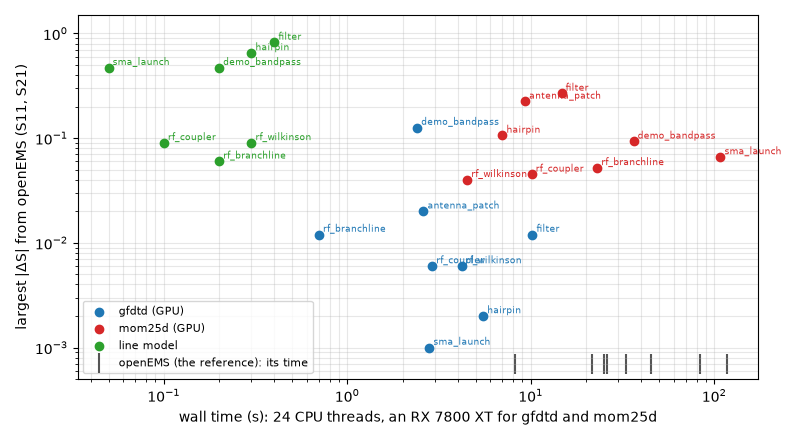

# Usage

[← Getting started](getting-started.md) · [Index](index.md) · [Next: GUI →](gui.md)

## Running kicad2ems

```bash
kicad2ems board.toml                         # everything from a config file
kicad2ems board.kicad_pcb --fmin 1 --fmax 6  # no config file
kicad2ems board.kicad_pcb --config run.toml  # the board on the command line, options from a file
kicad2ems board.toml --preview               # build the model and mesh, don't solve
kicad2ems --init board.kicad_pcb             # write a starter config with the ports found
kicad2ems --check                            # what this Python can run
kicad2ems study board.toml                   # every question the config's study asks, one run after the other
```

`python -m kicad2ems` does the same with a particular Python.

The exit code is 0 when the run finished, 1 when a solver you named gave no result, and 2 when a setting
is invalid or a named solver cannot run. Settings and solvers are checked before any work starts.

<a id="solvers"></a>
## Choosing solvers

`--solvers` (or `solvers = [...]` in a config) picks the solvers. Each writes `<name>_<solver>.sNp`.

| Name | Solver | Needs |
|---|---|---|
| `openems` (or `fdtd`) | openEMS, 3D FDTD | openEMS |
| `gfdtd` | gfdtd, 3D FDTD on the GPU or the CPU: openEMS's model, its own engine ([details](gfdtd.md)) | CuPy for the GPU, or its compiled core |
| `mom25d` (or `mom`) | mom25d, 2.5D method of moments ([details](mom.md)) | nothing extra |
| `mixed` | mom25d with long straight runs as transmission lines ([details](mom.md#mixed)) | nothing extra |
| `qucs` | the [line model](transmission-lines.md), solved by qucsator | qucsator on PATH |
| `scikit` | the line model, solved by scikit-rf | scikit-rf |
| `lines` | `qucs` if qucsator is installed, otherwise `scikit` | |
| `pcbqs` (or `qs`) | pcbqs, quasi-static: the low end of a band, from DC to about a tenth of a wavelength, with the return current where it flows ([details](https://github.com/lowprocess/pcbqs/blob/main/docs/sparams.md)) | the `qs` extra; run only when named |
| `auto` | the default: the full-wave solver expected to be fastest, plus the line model | |
| `all` | every solver | |

```bash
kicad2ems board.toml --solvers mom             # MoM only
kicad2ems board.toml --solvers openems,lines   # openEMS and the line model
kicad2ems board.toml --solvers all             # everything, compared in one plot
```

The first solver in the table order is the reference: its plot is `<name>_<solver>.png`, and the others
are drawn over it and compared with it in the report.

`--mom` and `--fast` add mom25d or the line model as an extra reference. If a reference can't run, you
get a warning and the run continues. If a solver named in `--solvers` can't run or can't model the
board, the run stops before starting.

Below a few hundred MHz on a board of a few centimetres the full-wave solvers are slow and lose accuracy (an FDTD
run of 100,000 steps or more; mom25d's mixed-precision solves falling back to double precision), and the line
model has no DC resistance and no return path. `--solvers pcbqs` solves the copper's currents there instead,
and its charge where the band asks for it: `--fmin 0.00001 --fmax 0.1 --sweep log` is 10 kHz to 100 MHz, evenly
spaced on a log scale. Its run says to
what frequency it holds on the board, and two ports whose return is not joined (a ground via missing between
two planes) are reported as such.

<a id="joined"></a>**One band from both.** With pcbqs and a full-wave solver in one run (`--solvers pcbqs,mom25d
--fmin 0.01 --fmax 6 --sweep log`), the run also writes `<name>_joined.sNp`: pcbqs's answer up to the frequency
it says it holds to, mom25d's (else the other full-wave solver's) above it, and across a fifth of a decade each
side of that crossover a raised-cosine blend in log f, so the joined curve has no step. The log says how far the
two disagree there, and warns above 0.1 in |S|. On `demo_transition` the crossover is 714 MHz and they differ by
up to 0.043: pcbqs's one-sheet copper reads the matched line's |S11| about 3.5 dB high, as its docs say, and the
joined band takes mom25d's from there up.

Antenna mode (`mode = "antenna"`) needs openEMS, gfdtd or mom25d. mom25d models antennas over an infinite
ground plane, so it suits patches and arrays but not antennas that use the board edge.

<a id="which"></a>
### Which solver

gfdtd and mom25d are the working solvers, and the line model is for tuning. openEMS is the slower reference,
for what the other two lack and for checking gfdtd's engine.



*The largest |ΔS| from openEMS over S11 and S21 against the wall time, on eight examples ([benchmarks](benchmarks.md):
24 CPU threads, an RX 7800 XT for gfdtd and mom25d); `python tools/doc_figures.py solvers` draws it.*

- **gfdtd** solves openEMS's model (the same mesh, ports, parts and end criteria) with its own engine: the fastest
  full-wave solver on every example, 3–35 times faster than openEMS on the GPU (its CPU core faster too), and
  within 0.02 of it on 7 of the 8. It handles what FDTD handles: board edges, enclosures, antennas with a finite
  ground, gap ports. Its copper takes `--sigma` as openEMS's does (gfdtd 261104 or later; lossless before) and
  `--rough` over the band (openEMS takes it at the band centre). It has no `--converge`, and its lumped parts are
  modelled differently (demo_bandpass's 0.126). Agreeing with openEMS checks its engine, not the model.
- **mom25d** is a different method, so it is the independent cross-check: no air box or enclosure resonances,
  radiation and surface waves in, conductor loss (`--sigma`, `--rough`) and de-embedded wave ports. It is quick on
  thin trace filters and slow on large planes with many vias (memory grows with the square of the unknowns, time
  with their cube: sma_launch 108 s against gfdtd's 2.8 s). Its dielectric extends sideways forever, so antennas
  that use the board edge come out wrong (antenna_ifa and antenna_slot: 1.4 from openEMS); it can't model gap
  ports, and its loss tangent doesn't vary with frequency. It lands 0.04–0.3 from openEMS on most boards.
- **openEMS** does the most (conductor loss, phased drive, `--converge`) on the CPU only, and was the slowest
  full-wave solver on all but the smallest boards.
- **mixed** is mom25d with the middle of each long, lone, straight run put back as a transmission line: fewer
  unknowns on boards of long traces, mom25d's limits. It isn't part of `all`.
- **The line model** is a circuit of line sections, solved in milliseconds: close on plain distributed circuits
  (0.06–0.09), 0.4–0.8 off on filters and transitions (no coupling, radiation or parasitics), no antennas.

<a id="auto"></a>
### `auto`

`auto` drops the solvers that can't run here or can't model the board, estimates how long each remaining
full-wave solver would take, runs the fastest and adds the line model. gfdtd's estimate is openEMS's mesh and
timesteps at gfdtd's measured speed (about 8 times openEMS's on the GPU, 2 times on its CPU core); with `--converge`
auto leaves gfdtd out, as it would ignore it (and with `--sigma` on a gfdtd older than 261104, whose copper is
lossless). mom25d's is the matrix work for its unknowns on the CPU or GPU; a solver that needs more than 80 % of
the RAM is dropped. The log says what it chose:

```
solvers auto: gfdtd + qucs (0.31 M cells, 1 run(s) of ~146,729 timesteps on the GPU, ~13 s); openems not chosen
(0.31 M cells, 1 run(s) of ~146,729 timesteps, ~89 s); mom25d not chosen (4,763 unknowns, ~16 EM solves, ~19 s);
force one with --solvers <name>
```

The estimates are rough: calibrated on the examples, they picked the faster solver on 10 of 13, and the others
were at most 1.6 times slower. With `--preview`, auto only reports what it would run.

## Config files

A config is a TOML file. Every option can be a top-level key, with dashes or underscores (`end-db` or
`end_db`). A solver's own options can also go in a `[solver.<name>]` table under their short names:

```toml
board   = "board.kicad_pcb"
nets    = ["RF", "GND"]
fmax    = 6.0
solvers = ["openems", "mom25d"]

[solver.openems]
excite  = "P1"
dump    = ["E@F.Cu-0.1@2,6"]

[solver.mom25d]
dmax    = 0.4
```

- Lists can be TOML arrays or comma-separated strings (`nets = "RF,GND"`).
- Paths in a config are relative to the config file, so you can run it from any directory.
- Unknown keys are reported, with the option they are probably a typo of.
- Settings are applied in this order: defaults, then the config file, then the command line.
- An invalid value stops the run with a one-line error. Set `KICAD2EMS_TRACEBACK=1` for the traceback.

<a id="study"></a>
## A study: several questions of one board

A run of kicad2ems answers one thing, the ports' S-parameters. A study asks more of the same board: the
[crosstalk between traces](si.md) (kicad2ems's own), a rail's drop, the temperature, a circuit on the copper,
each by an engine installed for it (`kicad2ems --check` lists the questions and who answers them). The config says which, and `kicad2ems study` runs them in order:

```toml
board = "board.kicad_pcb"

[study]
run = ["sparams", "dc", "thermal"]      # the questions

[study.sparams]
engine = ["mom25d", "pcbqs"]            # who answers: one engine, or several to compare; none: the default

[study.thermal]
engine = ["pcbqs", "Elmer"]             # by its name (elmer_thermal) or as a list shows it
fields = true                           # its field dumps too, where the engine can write them

[analysis.pdn]                          # an engine's own settings: an analysis's under [analysis.<name>],
rail = "+5V"                            # a solver's under [solver.<name>] or at the top level, as before
```

```bash
kicad2ems study board.toml                    # all of it
kicad2ems study board.toml --list             # the runs it takes, without making them
kicad2ems study board.toml --only thermal     # some of its questions (or engines)
kicad2ems study board.toml --preview          # the runs that have a preview, without solving
```

The solvers named for S-parameters, an antenna and the line model run first, together, as kicad2ems's own run
(without an `engine`, the solvers the settings name, `auto` by default); then each analysis in its order, so
that the temperature follows the circuit whose losses it takes. An engine that answers two questions answers
them in one run (a rail's drop and its impedance). Each run goes into a folder of its own under the output
folder, `<board>_<date>_<time>` for the solvers and `<board>_<engine>_<what>_<date>_<time>` for an analysis,
with a `kicad2ems-study.json` that says who made it and what was asked; the window lists them under Results of.
A run that fails or cannot start says why and the rest go on. The exit code is 0 when every run finished, 1 when
one did not, 2 when the study cannot be read.

<a id="several"></a>An analysis may be given several tables, as an array, and is then run once for each: a
board's rails, one after the other, each into its own folder (named by the rail) with its own result.

```toml
[study]
run = ["dc", "pdn"]

[[analysis.pdn]]
rail = "+5V"
volts = 5
source = "J101"
load = ["U702=1.4"]

[[analysis.pdn]]
rail = "+3V3"
volts = 3.3
load = ["U1=0.8", "U4=0.2"]
```

`kicad2ems study board.toml --list` then reads `Rail drop, Rail impedance: Power integrity (pcbqs.pdn), 2 runs:
+5V, +3V3`. An analysis that starts from another's result takes the last of them.

A config without `[study]` is read as before: `[analysis] run = [...]` names analyses (`"rf"`: S-parameters),
and with neither the study is S-parameters alone, which `kicad2ems board.toml` runs just the same.

<a id="options"></a>
## Options

### Board

| Option | Default | Meaning |
|---|---|---|
| `board` | | the `.kicad_pcb`, or a `.toml` that names it |
| `--pos` | | a pick-and-place file (ports can be listed there instead of a Fab text) |
| `--nets` | all copper | the nets to include, or `auto`: the port nets and the ground |
| `--region x0,y0,x1,y1\|LAYER` | | crop to a rectangle (KiCad mm) or to the shapes on a drawing layer ([details](model.md#region)) |
| `--cut-ports` | off | add a port where a signal track crosses the region edge |
| `--port SPEC` | | an extra port: `P3=J1.1` (a pad) or `P3@x,y[,layer[,rotation]]` ([details](model.md#extra-ports)) |
| `--ground LAYER` | | treat this copper layer as a solid plane |
| `--fill-voids off\|far\|all` | off | fill the ground copper's voids left by the nets not selected ([details](model.md#fill-voids)) |
| `--mask` | off | include the solder mask |
| `--parts auto\|none` | auto | lumped R/L/C parts from two-pad footprints ([details](model.md#lumped-parts)) |

### Frequency and mesh (openEMS)

| Option | Default | Meaning |
|---|---|---|
| `--fmin`, `--fmax` | 0.5, 10 | the band, GHz |
| `--points` | 401 | frequency points |
| `--sweep` | `linear` | their spacing: `linear`, or `log` (evenly on a log scale, for a band of several decades; `fmin` above 0). The result plot's axis is then logarithmic, in MHz or kHz below 1 GHz |
| `--res` | 20 | cells per wavelength at fmax |
| `--fine` | automatic | cell size at copper edges, mm ([details](meshing.md#cell-sizes)) |
| `--air` | 5 | air between the board and the boundary, mm (antenna mode: at least λ/4); or six values xmin,xmax,ymin,ymax,zmin,zmax, ymax being the board's top edge in KiCad |
| `--ratio` | 1.4 | largest size ratio of neighbouring cells |
| `--nz` | 4 | fewest cells through each dielectric layer |
| `--curves extremes\|vertices` | extremes | mesh lines for curved copper |
| `--z-sheet` | 1 | first z cell next to signal copper, × the fine cell, graded into the dielectric; 0: uniform ([details](meshing.md#z-lines)) |
| `--curve-res` | 6 | over arcs and fans the largest cell is the dielectric's ÷ this; 1: off |
| `--vias auto\|exact\|centre\|snap` | auto | mesh lines for vias |
| `--via-snap` | 0.2 | how far a snapped via may move, mm |
| `--thickness off\|on` | off | copper with its stackup thickness, the stack moved to make room ([details](meshing.md#thickness)) |
| `--edge-walls SIDES` | off | metal walls at the board edge, standing in for stitching vias (`xmin,xmax,ymin,ymax` or `all`; [details](meshing.md#edge-walls)) |
| `--edge-keepout` | 0.5 | gap between edge walls and signal copper, mm |
| `--converge F1,F2,...` | | also run coarser meshes and check the result has converged ([details](meshing.md#convergence-levels)) |
| `--converge-tol DB,DEG` | 0.1,2 | the convergence tolerance |

### openEMS run

| Option | Default | Meaning |
|---|---|---|
| `--bc` | auto | boundaries: `PEC`, `PMC`, `MUR` or `PML_8`, one value or six; auto puts PEC under a solid bottom plane and MUR elsewhere |
| `--end-db` | −40 | stop when the signals have decayed by this much ([details](simulation.md#ending-a-run)) |
| `--end-on ports\|energy` | ports | what the decay is measured on |
| `--max-steps` | 1 000 000 | the timestep limit per run |
| `--sigma` | perfect conductor | copper conductivity, S/m |
| `--rough` | smooth | copper roughness, µm RMS, with `--sigma` ([details](simulation.md#roughness)) |
| `--finish` | auto | surface finish of the outer copper, with `--sigma`: the stackup's, or none, osp, enig, enepig, hasl, hasl-snpb, imag, imsn ([details](simulation.md#finish)) |
| `--diel fixed\|wideband` | fixed | the dielectric loss model ([details](simulation.md#dielectrics)) |
| `--diel-fref` | 1 | the frequency at which the stackup's εr and tan δ apply, GHz |
| `--excite` | all ports | the ports to drive |
| `--threads` | 0 | openEMS threads per run (0: automatic) |
| `--jobs` | 1 | runs in parallel |

### Antenna mode

| Option | Default | Meaning |
|---|---|---|
| `--mode sparams\|antenna` | sparams | antenna: one driven port, absorbing boundaries, the far field ([details](postprocessing.md#antenna-mode)) |
| `--drive` | one port | drive several ports, `PORT[=amplitude][@phase]` each: a phased array (mom25d; [details](mom.md#phased-drive)) |
| `--grid` | a line | the ports' places in a 2D array: `COLSxROWS` (ports in order, row by row) or `PORT:COL,ROW ...` ([details](mom.md#phased-drive)) |
| `--steer` | none | phase steps added to `--drive`: `X[,Y]`, X per column and Y per row of `--grid` (no grid: X from port to port) |
| `--aim` | none | point the beam at `THETA,PHI` (deg): each driven port's phase from its place at the pattern frequency, on top of `--drive` and `--steer` |
| `--taper` | uniform | amplitude taper for lower sidelobes: `taylor`, `chebyshev` or `cosine`, `:SLL` in dB (e.g. `taylor:25`) |
| `--ff-freq` | the resonance | the frequencies of the radiation patterns, GHz |
| `--ff-step` | 2 | the angle step of the pattern cuts, degrees |

### Field dumps

| Option | Meaning |
|---|---|
| `--dump FIELD@REGION[@GHz,...]` | save E, H or J on a layer, a plane, the volume or a box; repeatable ([details](postprocessing.md#field-dumps)) |
| `--dump-port` | which driven port's run records the dumps (default: the first) |
| `--dump-animate gif\|mp4` | also animate each frequency-domain dump over one period (MP4 needs ffmpeg) |

### Solvers

| Option | Default | Meaning |
|---|---|---|
| `--solvers LIST` | `auto` | the solvers to run ([above](#solvers)) |
| `--fast auto\|skrf\|qucsator` | off | also solve the line model, as a reference |
| `--mom` | off | also run mom25d, as a reference |

### mom25d (`[solver.mom25d]`)

| Option (short name) | Default | Meaning |
|---|---|---|
| `--mom-dmax MM` (`dmax`) | 0.3 | largest mesh cell along the copper, mm (planes get 3× this) |
| `--mom-port auto\|wave\|lumped` (`port`) | auto | port type: de-embedded wave ports where the feed line is long enough, otherwise lumped |
| `--mom-solves N` (`solves`) | 60 | most frequencies the adaptive sweep may solve |
| `--mom-tiled auto\|on\|off` (`tiled`) | auto | the tiled GPU solver for boards too big for the dense one ([details](mom.md#gpu)) |
| `--mom-dump GHz,...` (`dump`) | | save the surface currents at these frequencies ([details](mom.md#current-dumps)) |
| `--mom-near MM,...` (`near`) | | with `--mom-dump`: also the E field this far above the board |

### Line model (`[solver.qucs]`)

| Option (short name) | Default | Meaning |
|---|---|---|
| `--qucsator PATH` (`path`) | found on PATH | the qucsator program |

### Output

| Option | Default | Meaning |
|---|---|---|
| `--out` | `out` next to the board | the output folder |
| `--compare FILE.sNp` | | draw another result on the S-parameter plot |
| `--preview` | off | build the model and mesh, don't solve |
| `--no-report` | off | skip the HTML report |
| `--openems-output` | off | show openEMS's own output instead of the progress line |
| `--events FILE` | | also write progress as JSON lines ([below](#events)) |

<a id="outputs"></a>
## Output files

| File | Contents |
|---|---|
| `<name>_<solver>.sNp` | each solver's S-parameters (terms that weren't computed are 0 and listed in the header) |
| `<name>_joined.sNp` | pcbqs below the frequency it holds to and a full-wave solver above, in one band ([details](#joined)) |
| `<name>_<solver>.png` | the S-parameter plot and Smith chart, the other solvers overlaid |
| `<name>_report.html` | everything on one page ([details](postprocessing.md#the-report)) |
| `<name>_run.json` | the run summary ([details](postprocessing.md#json-summary)) |
| `<name>_board.json` | the converted board every solver gets ([details](model.md)) |
| `<name>_mesh.png` / `_model.png` | the openEMS mesh, or the model alone without openEMS |
| `<name>_tlines.png` | the line sections ([details](transmission-lines.md#outputs)) |
| `<name>_lines.json` | the line sections' geometry and impedances, for the GUI's Viewer |
| `<name>.xml` | openEMS's geometry, for AppCSXCAD |
| `<name>_antenna.png`, `_pattern.png`, `_antenna.json` | antenna results |
| `<name>_converge.png` | the mesh convergence check |
| `<name>_mesh_<solver>.npz` | each solver's mesh for the GUI's 3D view: openEMS's grid lines, mom25d's surface triangles (written by a preview too) |
| `<name>_<port>_<dump>_<GHz>GHz.png` (`.gif`, `.mp4`) | field dump images and animations |
| `openems/exc_<port>/`, `gfdtd/exc_<port>/` | one FDTD run folder per driven port, with its log and dumps |
| `mom25d/exc_<port>/` | mom25d's current dumps |

## Progress

While openEMS runs, its output goes to `openems/exc_<port>/openems.log` and the terminal shows a progress
line:

```
P1 [##############------]  71%  step 23184  -28.4/-40 dB  305 MC/s  ETA 18s
```

The bar follows the signal decay towards `--end-db`, or the step count towards `--max-steps`, whichever
is further. `energy flat` means the field isn't decaying (see
[maintenance](maintenance.md#static-plateau)). With `--jobs` above 1, all runs share one line.

<a id="events"></a>
## Events for a GUI or script

`--events FILE` writes the run as JSON lines as it goes. `t` is seconds since the start.

```
{"t": 0.0, "kind": "format", "format": "kicad2ems-events", "format_version": 1}
{"t": 0.0, "kind": "stage", "name": "model"}
{"t": 0.4, "kind": "log", "text": "mesh: 188 x 115 x 25 = 0.54 M cells ..."}
{"t": 9.8, "kind": "status", "run": "P1", "step": 6118, "db": -3.2, "fraction": 0.08, "eta": 95.0}
{"t": 99.1, "kind": "file", "label": "S-parameters, openEMS (FDTD)", "path": "out/board_openems.s2p"}
{"t": 99.3, "kind": "done", "code": 0}
```

| kind | Fields |
|---|---|
| `stage` | `name`: model, mesh, lines, preview, solve, outputs |
| `log` | `text`: each message as printed |
| `status` | openEMS: `run` (the port), `step`, `db`, `speed`, `fraction`, `eta`; mom25d: `run` = `mom25d`, `solves`, `f_ghz`, `fraction` |
| `file` | `label` and `path` of each output file |
| `done` | `code`: the exit code |

---
[← Getting started](getting-started.md) · [Index](index.md) · [Next: GUI →](gui.md)
